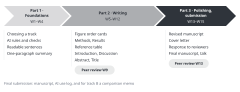
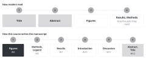
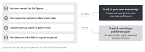

::: {.callout-note collapse="true"}
## This week's goals

By the end of this week, you will be able to do the following.

- Compare the order in which readers read a paper with the order in which you write a manuscript in this course, and explain the difference.
- Explain, with your own research as an example, why you write a manuscript starting from the figures.
- Write the story line of a paper in five sentences: question, why it matters, what was done, what was found, what it means.
- Say whether your manuscript is a hypothesis-testing, descriptive or methods paper.
- Choose between track A and track B by the criteria.
- Settle a list of 3–4 figures (track A) or the paper you will rewrite (track B).
:::

# 1. Principles {#principles}

{fig-alt="Three arrow-shaped blocks: Part 1 Foundations W1–W4, Part 2 Writing the manuscript W5–W12, Part 3 Polishing and submission W13–W15. Under each block are what that part produces and the peer review weeks."}

## Readers read the Title, then the Abstract, then the figures

- Most readers do not read a paper from beginning to end. They look at the Title to decide whether to read on, and they use the Abstract to guess what the paper is about. Then they skim the figures and look up only the parts they need in the Results or the Methods.
- So the Title, the Abstract and the figures alone should tell a reader the main claim of the paper.
- Two-minute activity in class: students write down the order in which they read a recent paper, and the instructor asks a few of them.

## In this course you write the figures first and the Title last

{fig-alt="A flowchart in two rows. The top row is the order in which readers read: Title, Abstract, figures, then the parts of the Results and Methods they need. The bottom row is the order in which you write in this course: figures (W5), Methods and Legend (W6), Results (W7), Introduction (W10), Discussion (W11), Abstract and Title (W12)."}

| Writing order | Part of the manuscript | Week | What it takes from earlier steps |
|---|---|---|---|
| 1 | Figures (figure storyboard) | [W5](w05_figure_storyboard.qmd) | Data, and a conclusion sentence for each figure |
| 2 | Methods, Figure legend | [W6](w06_methods_legends.qmd) | The experiments and analyses in the figures |
| 3 | Results | [W7](w07_results.qmd) | Figure order cards (paragraph order) |
| 4 | Introduction | [W10](w10_introduction.qmd) | The questions that the Results answered, the reference table from [W8](w08_literature.qmd) |
| 5 | Discussion | [W11](w11_discussion.qmd) | Results, the W8 reference table |
| 6 | Abstract, Title | [W12](w12_abstract_title.qmd) | The whole manuscript |

- The writing order is almost the reverse of the reading order. Each part you write later interprets or summarizes the parts before it. The Abstract and the Title summarize the whole manuscript, so you write them last.
- If you write the Introduction first, it is easy to raise a question that your results cannot answer. If you settle the figures first, the Introduction ends with the question that the Results actually answered.

## Each figure shows one conclusion

- You should be able to state the conclusion of each figure in one sentence, the conclusion sentence. If you cannot, the figure either shows two things or does not have a conclusion yet.
- A conclusion sentence states what you found, not what you did. [W5](w05_figure_storyboard.qmd) covers how to write one.
- The examples are fictional. They come from a study that gave a fictional drug, compound X, to mice with unilateral ureteral obstruction (UUO).
  - Before: Figure 2 shows Masson's trichrome staining and quantification of the fibrotic area.
  - After: Compound X reduced the fibrotic area in UUO kidneys.
- The dry-lab example is also fictional. It comes from a study that reanalyzed public single-cell RNA sequencing data from human kidney biopsies.
  - Before: Figure 3 presents the proportions of fibroblast subtypes across samples.
  - After: The MF2 myofibroblast subtype made up a larger share of fibroblasts in biopsies from patients with fibrosis.

## A paper answers one question

- A paper answers one question with data. Then it says what the answer means. Zeiger (2000) calls this flow the story line of a paper.
- Each section has a job in this story line. The Introduction states the question and why it matters. The Methods and the Results give what was done and what was found. The Discussion gives what the answer means and its limits. The Title and the Abstract condense the whole story line.
- So before you write the manuscript, write the story line in five sentences.
  1. Question: what did this study want to know?
  2. Why it matters: what can we not do without the answer?
  3. What was done: what did you do to answer the question?
  4. What was found: what did you learn? Collect the conclusion sentences of your figures.
  5. What it means: what can you say from this? Stay within what the data show.
- If you cannot write one of the five sentences, the study itself needs work before the manuscript does. Talk with your supervisor.
- Example (wet lab, fictional):
  1. Does compound X reduce kidney fibrosis after unilateral ureteral obstruction (UUO)?
  2. Few treatments directly reduce kidney fibrosis.
  3. We gave compound X to mice with UUO and measured the fibrotic area, fibrosis marker genes and Smad3 signaling.
  4. Compound X reduced the fibrotic area and lowered Smad3 phosphorylation.
  5. Compound X limits fibrosis in the UUO model and may act through TGF-β/Smad3 signaling.
- A claim about background, like sentence 2, needs references. You find them in [W8](w08_literature.qmd) and check them in [W10](w10_introduction.qmd).
- In [W4](w04_paragraphs.qmd) you rewrite these five sentences as one paragraph.

## The shape of the question depends on the type of paper

- Hypothesis-testing paper: the question can be answered yes or no, such as "Does X change Y?" The compound X study above is this type.
- Descriptive paper: the question asks to describe something, such as "What is Y made of?" or "How does Y differ?" Studies that build a cell atlas or find cell types in single-cell data belong here. Example (dry lab, fictional): Which fibroblast subtypes are more common in human kidneys with fibrosis?
- Methods paper: the question asks what a new method does better than existing methods. Studies that report a new analysis tool or a new lab technique belong here. What was found is a comparison with existing methods (for example accuracy, speed or reproducibility).
- The type of paper changes what goes into the last paragraph of the Introduction, the Abstract and the Title. Zeiger (2000) also treats the Introduction, Abstract and Title of the three types separately. Decide this week which type your manuscript is.
- Full references are in [Resources](../resources.qmd#books).

## Choose the track by your data and your supervisor's agreement

- The differences between the two tracks are set out in the [two-track table of the course overview](../index.qmd#tracks).

{fig-alt="Four conditions on the left: results for 3–4 figures, the supervisor's agreement, classmates may read it in peer review, and not ideas yet to be filed in a grant or patent. If all apply, an arrow leads to track A, your own manuscript. If any one does not, an arrow leads to track B, rewriting a published paper."}

- Choose track A if all of the following apply.
  - You already have results for 3–4 figures, or you can settle the order of the figures by W5.
  - Your supervisor agrees that you may use this manuscript in the course.
  - Classmates may read the manuscript in peer review (W9, W13).
  - The results are not ideas yet to be filed in a grant or patent application. Such content falls in the "Do not put in" row of the AI traffic light, so you could do almost none of the AI exercises with it.
- Choose track B if any of the following applies.
  - You do not have data yet, or you do not have enough for 3–4 figures.
  - It is hard to get your supervisor's agreement, or you cannot show your results to classmates.
- If you are unsure, ask your supervisor and the instructor this week.
- A classmate's manuscript belongs to someone else. Do not put a classmate's figure order cards, drafts or reference table into AI. They fall in the "Do not put in" row of the [AI use rules](../ai_rules.qmd#traffic-light). [W2](w02_ai_basics.qmd) covers this in more detail.

## Choose a track B paper by five criteria

- The paper is open access, so anyone can read the full text.
- Its review record (Peer Review File) is published. Then in [W14](w14_submission_response.qmd) you can write a response letter to the paper's real reviews. Example: Weinand et al. (2024) in [Resources](../resources.qmd#papers).
- It is an original research article in a high-impact journal. Do not choose a review article.
- It is close to your own field. Only then can you rewrite the Results from the Methods and the figures alone.
- You have not read it yet. If you have already read a paper, its Results and Discussion stay in your head, and rewriting it is no longer practice.
- You rewrite 3–4 main figures, not the whole paper. The instructor approves the paper and the figures before your choice is final.

::: {.callout-warning}
## Do not read the results in advance

- Do not expand the Abstract on a search results page. On the journal page, go straight to the figures and the Methods.
- Do not ask AI to summarize the paper you chose. Reading an AI summary is the same as reading the Abstract and the Results.
- After you choose the paper, do not put its Title or DOI into AI. AI may reveal the Results in its answer.
- Turn off the web search feature of your AI tool until you submit the W12 assignment. If an answer comes with links to web sources, do not use that answer ([AI use rules](../ai_rules.qmd#track-b)).
- Do not use the paper you chose as the starting point of your literature search ([W8](w08_literature.qmd)). Papers that cite it, or lists of related papers, may reveal its results.
- You cannot avoid the Title. In W12 you write three title options and then compare them with the real Title.
- Read the Figure legends of the original paper only after you submit your own legends in [W6](w06_methods_legends.qmd). The point is to write the legends yourself first.
- Look at the reference list of the original paper only after you submit your Discussion draft in [W11](w11_discussion.qmd).
- Read the whole original paper only after you submit the W12 assignment (Abstract and Title). The version you submit in W12 is the baseline for the comparison memo in W15.
:::

# 2. Try it with AI {#try-with-ai}

Exercise: ask AI about the structure of a paper, and compare (25 minutes)

Step 1, both tracks (8 minutes): Use the prompt below to ask about the reading order and the writing order. Compare the answer with the principles on this page. Pick one difference, and write 2–3 lines on which side's reasoning fits your own research.

```text
I am a graduate student in biomedical science. I am writing my first research article.
1. In what order do most readers read a research article (title, abstract, figures, introduction, results, methods, discussion)? Explain briefly.
2. In what order would you recommend writing the sections, and why?
Answer in plain English in under 200 words.
```

Step 2, track A (15 minutes): Practice with a fictional example, and do not put in your own results yet. You check your supervisor's agreement and your tool settings in W2. When AI returns an order and conclusion sentences, mark each place where a conclusion sentence claims more than the figure shows. Then write the list of your own figures yourself, without AI.

```text
Below are four figures from a hypothetical mouse study, in random order.
- Western blots of TGF-β/Smad3 signaling proteins
- Study design, body weight and serum creatinine
- qPCR of fibrosis marker genes (Col1a1, Acta2, Fn1)
- Masson's trichrome staining and quantification of the fibrotic area
The study tested whether compound X reduces kidney fibrosis after unilateral ureteral obstruction (UUO). There were 6 mice per group.
1. Put the figures in the order you would present them in a paper. Explain the order in one sentence per figure.
2. Write one conclusion sentence for each figure. Do not invent numbers.
```

Step 2, track B (15 minutes): Find candidate papers. When you get the list, open each DOI. Check that the paper exists, that it is open access and that it has a review record.

```text
List five original research articles in [my field, e.g. kidney fibrosis] that meet all of these conditions:
- open access
- published in a high-impact journal in 2020 or later
- the journal published the peer review file with the article
For each article, give only the title, authors, journal, year and DOI.
Do not summarize the articles or describe their results.
```

Step 3 (2 minutes): Add one line to your [AI use log](../ai_rules.qmd#ai-log).

AI traffic light: step 1, and step 2 for track A, are in the "Free to use" row (explanations of concepts, a fictional example). The list of papers that track B students receive is a list of references, so it is in the "Always verify" row.

::: {.callout-tip}
## Prompting tips

- Set the format and length you want (under 200 words, title and DOI only).
- State what AI must not do (Do not invent numbers, Do not summarize). In track B, this one line prevents you from reading the results in advance.
:::

::: {#ai-lab}
AI lab: press the "Put in the AI lab" button under a prompt block above, or write a prompt yourself and send it. Fill in the blanks in the prompt with your own text before you send it. The class code is announced separately. On one page the conversation continues. To start again, press "New conversation". Text that you put in this box goes to an outside AI service through the course API key. Input sent through the API is not used for training by default. Follow the AI traffic light notes above for what you may put in. The AI in this box does not search the web. So the list of papers for track B may include papers that do not exist. Open each DOI to check it. In your AI use log, write "AI lab" and the model name shown under each reply as the tool.
:::

# 3. Verify and revise {#verify-and-revise}

Where AI often goes wrong

- Writing order: AI often tells you to start with the Introduction, or to write in IMRaD order. This is not a factual error but a different choice. This course starts with the figures, and you compare the reasons given for each approach.
- Conclusion sentences: AI writes them more strongly than the figure supports. For example, if the drug was given before fibrosis developed, "reverses fibrosis" does not fit the design. Reverse means that fibrosis that had already formed was reduced. AI also widens mouse results with phrases such as "in patients".
- AI mixes numbers or background knowledge that you did not give into the conclusion sentences. This happens even when the prompt forbids it.
- Paper recommendations: the list mixes in papers that do not exist, DOIs that point to other papers, papers that are not open access and papers without a review record.

Checklist

- [ ] For each candidate track B paper, I opened the DOI myself and checked that the title, authors, journal and year are correct. (check the source)
- [ ] I found the open-access label and the Peer Review File link on the journal page myself. (check the source)
- [ ] I put each conclusion sentence that AI wrote next to the description of the figure, and checked that it does not claim more than the figure shows. (read side by side)
- [ ] I confirmed my choice of track with my supervisor and the instructor. (cross-check)
- [ ] Track B: I counted how many of the five papers from AI met all the conditions. This count is material for the verification exercise in W2.

# Assignment {#assignment}

A: list of figures / B: choose a paper; both tracks: five-sentence summary

- Both tracks
  - At the top, state the track you chose and your reasons in 2–3 lines.
  - Five-sentence summary: write the five sentences from the principles (question, why it matters, what was done, what was found, what it means) in English. Below them, state the type of paper (hypothesis-testing, descriptive or methods) in one line. Track A writes about their own study. Track B writes from the figures and Methods of the chosen paper only, and adds (guess) at the end of each sentence guessed from the figures.
  - Grading criteria for the summary: are all five sentences there? Are what was found and what it means no stronger than what the figures show?
  - Submit through the university LMS. Deadlines are announced separately.
  - If you used AI, submit your [AI use log](../ai_rules.qmd#ai-log) with the assignment.
- Track A: list of figures
  - Length: one A4 page at most.
  - Format: a table of 3–4 figures with the figure number, a one-line description and the data status (available / being analyzed / experiment planned). Write the one-line descriptions in English. If you already know the conclusion, you may write it as a conclusion sentence.
  - Example of a one-line description (fictional): Study design, body weight and serum creatinine after UUO.
  - Submit proof of your supervisor's agreement. Forward your supervisor's email of agreement, or submit the signed [supervisor consent form](../assets/forms/supervisor_consent.docx). If you use an email, it must state whether your supervisor agrees to each of the four items on the consent form.
  - Grading criteria: Does each figure show one thing? Do the 3–4 figures connect around one question? Does the data status fit the W5 schedule?
- Track B: choose a paper
  - Length: one A4 page at most.
  - Format: the bibliographic details (authors, title, journal, year, DOI link) of the chosen paper and of one backup paper, confirmation that the paper is open access, the Peer Review File link, the number of main figures and the 3–4 figures you will rewrite, 2–3 lines on why the paper is close to your field, and one line confirming that you have not read the Results, Introduction, Discussion or Abstract.
  - Grading criteria: Does the paper meet all five criteria? Are the bibliographic details correct, and does the DOI open? Is the reason for your choice tied specifically to your own research?

# Notes {#notes}

The order in which a paper is read, the order in which it is written, choosing a track, the five-sentence story line and the type of paper (Zeiger: story line)
