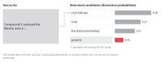
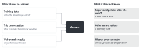
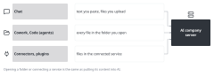
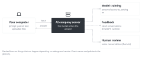
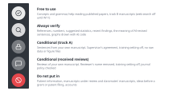

::: {.callout-note collapse="true"}
## This week's goals

By the end of this week, you will be able to do the following.

- Explain how AI produces its answers, and how what goes into AI differs between tools.
- Decide which row of the AI traffic light the content you want to put into AI belongs to.
- Pick out the claims in an AI answer that need checking, and check each one with the right method among the three checks.
- Find the AI policies of the university and of the journal you will submit to in their original text, and say where in the manuscript you must disclose AI use.
- Keep an AI use log, and use it to write the AI disclosure statement for a paper.
:::

# 1. Principles {#principles}

This week has two parts. The first part covers how AI tools work. The second part applies the AI rules of this course to cases. The terms are collected in the [Glossary](../glossary.qmd).

## AI picks a plausible next word

{fig-alt="After the text 'Compound X reduced the fibrotic area in', four candidates with probability bars: UUO kidneys, mice, the obstructed kidney, patients. Patients is marked as plausible but wrong for this study."}

- A large language model (LLM) learns from a large amount of text. It then continues a text with the words that are likely to come next. It does not look up facts when it answers.
- So wrong content also comes out in natural sentences. References that do not exist are the typical example ([W7](w07_literature.qmd)).
- The training material ends at a certain date, the knowledge cutoff. The model does not know papers or policies that came after that date.
- If you turn on web search, the model reads the search results before it answers. But it can summarize the results wrongly, so open the sources yourself.
- The model remembers earlier content only within one conversation. If a conversation gets too long, it loses track of the early parts. Start each new topic in a new conversation.
- Demonstration in class (5 minutes): the instructor asks the same question once with web search on and once with it off. The class compares the content and the sources of the two answers.

{fig-alt="On the left, training data, this conversation and web search results lead to the answer. On the right are three things it does not know."}

## What goes into AI differs by tool

{fig-alt="With Chat, pasted text and uploaded files go to the AI company server. With Cowork and Code, every file in the opened folder. With connectors and plugins, files in the connected service."}

| Mode | Examples | What goes into AI |
|---|---|---|
| Chat (conversation) | claude.ai, ChatGPT, Gemini | What you paste in or upload |
| Cowork, Code (agent) | Claude Cowork, Claude Code, Codex | The files in the folder you open for it, and the content of the apps you connect |
| Connectors, plugins | A connection to storage such as Google Drive | The files in the connected service |

- If you open a folder for an agent tool, AI reads the files in that folder directly. So do not open a folder that contains patient information, raw data or a classmate's manuscript.
- For the meaning of connector, skill, plugin, MCP and API, see the [Glossary](../glossary.qmd#extensions).

## Your input goes to the company's server

{fig-alt="From your computer on the left, input goes to the AI company server in the middle and the answer comes back. Dashed lines lead from the server to model training, feedback and human review."}

- An AI chat is a cloud service. What you type leaves your computer and is processed on the company's servers.
- On a personal account, your input may be used to train the model. Before anything else, apply the setting that keeps your input out of training ([where to find it in each service](../glossary.qmd#training-settings)).
- Even with this setting applied, a conversation in which you press a feedback button (thumbs up or down) may still be used for training, as ChatGPT and Gemini state. Some services have people review parts of conversations.
- Institutional accounts (contracts with a university or a company) have their own data policies. Check which kind of account you have.

## You learn the AI use rules by applying them to cases

The rules are on the [AI use rules](../ai_rules.qmd) page. Below, you apply those rules to cases. This page links to the rule tables instead of copying them.

### Decide the traffic light row before you put anything in

{fig-alt="A vertical traffic light. From the top, five rows: Free to use, Always verify, Conditional (track A), Conditional (received reviews) and Do not put in. Each row lists examples of what belongs there."}

- The row depends on what you want to put in and on who owns it. The criteria are in the [traffic light table](../ai_rules.qmd#traffic-light). If you are unsure, ask the instructor before you put it in.
- Practice in class (10 minutes): students sort the cases below into rows and explain why. The table also gives the answers for the instructor.

| Case | Row | Reason |
|---|---|---|
| Asking how the UUO model causes fibrosis | Free to use | A general, public topic |
| Putting in one Methods paragraph of the track B paper, without the Title and DOI, and asking about its grammatical structure | Free to use | A published paper |
| A track B student asks AI in W6 to polish a Results draft with web search on | Free to use, but turn web search off and ask again | Web search stays off until W11 |
| Five references on the UUO model recommended by AI | Always verify | References |
| A type of graph recommended by AI | Always verify | Treated like a suggested statistical method |
| A graph drawn with R code that AI wrote | Always verify | Check that the number of points and the means match the data |
| A grammar check of one paragraph of my Results. My supervisor agreed, and the tool is set so that my input is not used for training | Conditional (track A) | All conditions are met |
| Putting the same paragraph into an account whose settings I have not checked | Conditional (track A), but do not put it in | A condition is not met |
| Original image files of Western blots | Conditional (track A), but do not put them in | Raw data and figure files do not go in |
| Uploading a raw data file to get graph code | Conditional (track A), but do not put it in | Raw data do not go in. Give only the column names |
| Comments received in peer review. The reviewer's name is removed, and the tool is set so that the input is not used for training | Conditional (received reviews) | All conditions are met |
| A table of clinical information on patients' biopsies | Do not put in | Patient information |
| A classmate's figure order cards, draft or reference table | Do not put in | Someone else's manuscript |
| An unpublished hypothesis, or a grant idea that the lab is preparing | Do not put in | An idea not yet filed in a grant or patent |

- Treat a classmate's work like a manuscript under review at a journal. This covers figure order cards, drafts and reference tables. Do not put a manuscript you receive in peer review (W8, W12) into AI. Read it and write your review yourself.
- Review comments that you received on your own manuscript are different. You may put them into a tool that uses the setting that keeps your input out of training, after you remove the reviewer's name ([received reviews](../ai_rules.qmd#received-reviews)).
- The setting that keeps your input out of training has a different name and location in each tool. The [Glossary](../glossary.qmd#training-settings) lists them.

### Check an AI answer one claim at a time

- Do not trust an AI answer as a whole, and do not discard it as a whole. Take out the claims that need checking one by one. Check each claim with the method that fits its type ([the three checks](../ai_rules.qmd#three-checks)).

| Type of claim | Check | How |
|---|---|---|
| References | Check the source | Open the DOI and search for the title in PubMed. See whether the paper contains the content in question |
| Numbers (duration, dose, ratio, sample size) | Check the source | Find the figure, table or sentence of the original paper where the number appears |
| Explanations of concepts, suggested methods | Cross-check | Textbooks or review papers, peers, professors |
| Sentences that AI revised | Read side by side | Put the revised sentence next to the original, and check that the claims and numbers are the same |

- The hardest error to catch is a real paper that does not say what AI claims it says. A DOI that opens does not end the check.
- Example: the sentence below is made up to look like a typical AI answer.
  - AI answer: Fibrosis in the UUO model peaks at day 3 and resolves by day 14 (Smith et al., 2018).
  - The claims, split out: (1) peaks at day 3, a number. (2) resolves by day 14, a number. (3) Smith et al., 2018, a reference.
  - Check the reference first. If the source does not exist, or does not say this, then (1) and (2) also become unsupported claims.

### The AI policies of the university and the journal come before the rules of this course

- The points below were checked on each original page on 2026-11-10. Policies change often, so check them again when you submit ([W13](w13_submission.qmd)).
- [ICMJE Recommendations, II.A.4](https://www.icmje.org/recommendations/browse/roles-and-responsibilities/defining-the-role-of-authors-and-contributors.html)
  - Disclose AI use in the cover letter and in the manuscript. Writing assistance goes in the Acknowledgments. Data collection, analysis and figure generation go in the Methods.
  - AI cannot be an author. Do not cite content made by AI as a primary source ([V.A](https://www.icmje.org/recommendations/browse/artificial-intelligence/ai-use-by-authors.html)).
  - Reviewers must not upload a manuscript to AI that cannot guarantee confidentiality. The only exception is when the journal explicitly allows it ([V.B](https://www.icmje.org/recommendations/browse/artificial-intelligence/ai-use-by-reviewers.html)).
- [Springer Nature (Nature Portfolio)](https://www.nature.com/nature-portfolio/editorial-policies/ai)
  - The policy sorts AI use into green, amber and red by risk. Polishing grammar and readability is green, and the policy asks authors to disclose how they used AI even for green uses.
  - Three uses are red and not allowed: letting AI write the Results or Discussion on its own, listing AI as an author, and making figures without raw data that can be checked ([manuscript preparation section](https://www.springernature.com/gp/policies/editorial-policies/ai-manuscript-preparation)).
  - Disclose visual material made with AI in the AI Declaration of the manuscript and in the legend of that figure.
- [Science journals](https://www.science.org/content/page/science-journals-editorial-policies)
  - Disclose AI use in the cover letter, and in the Methods or the Acknowledgments depending on the purpose. AI cannot be an author.
  - Images made with AI cannot be used without explicit permission from the editors. Reviewers must not put any part of a manuscript into AI.
- [Elsevier](https://www.elsevier.com/about/policies-and-standards/generative-ai-policies-for-journals)
  - A separate section that discloses AI use goes right before the References. The heading and the recommended wording of this section are set by the policy.
  - Basic checks of grammar, spelling and punctuation need not be disclosed. If AI substantially changed the sentence structure or the organization, disclose it.
  - Primary images from experiments, such as microscopy, tissue and Western blot images, must not be made or altered with AI. Reviewers must not upload a manuscript to AI.
- Kyungpook National University: the [Generative AI research ethics guide for Kyungpook National University researchers](https://gsee.knu.ac.kr/content/notice.html?fidx=6113&gtid=grad_notice&pg=vv) (in Korean) from the Research Ethics Center (2026, a PDF attached to a department notice)
  - Do not put unpublished research data or personal information into AI. If you cannot avoid it, de-identify the data first. Never put in technology that is to be filed as a patent.
  - The rule is to disclose AI use in the methods (the checklist in the guide says the methods or the acknowledgments). Failing to disclose it can be judged as research misconduct.
  - The Center for Teaching and Learning also has an [AI guide for learners](https://knu.ac.kr/wbbs/wbbs/bbs/btin/viewBtin.action?bbs_cde=1&btin.appl_no=000000&btin.bbs_cde=1&btin.doc_no=1337233&menu_idx=67) (in Korean) (2026-04).
  - For practice, this course allows the ["Conditional (track A)" row](../ai_rules.qmd#traffic-light). In return, you must meet all of its conditions: your supervisor's agreement, the setting that keeps your input out of training, and no raw data or figure files.
- The same use can be treated differently by different journals. For example, Elsevier says that grammar correction need not be disclosed, while Springer Nature asks authors to disclose it. So read the policy of the journal you will submit to yourself. If the university's policy is stricter, follow the university's policy. The one exception is the "Conditional (track A)" row above.

### In the paper, state specifically what you used AI for

- An AI disclosure states the name and version of the tool, the task you gave it, and that the authors checked the output and take responsibility for it.
- You can write this statement accurately only if you keep an [AI use log](../ai_rules.qmd#ai-log).
- Before: AI was used in the preparation of this manuscript.
- After (Acknowledgments, writing help): During the preparation of this manuscript, the authors used [tool name and version] to check grammar and improve the readability of the text. The authors reviewed and edited all suggested changes and take full responsibility for the content of the article.
- After (Methods, help with analysis code, from the fictional single-cell RNA sequencing reanalysis): We used [tool name and version] to help write the Python code that plotted the UMAP embeddings. The authors reviewed and tested all code before use.
- These sentences are general examples. If the journal gives its own wording, use that wording.

# 2. Try it with AI {#try-with-ai}

Exercise: check one AI answer claim by claim (35 minutes)

1. Check your settings (5 minutes): On your own account, find the setting that keeps your input out of training and apply it. Open a new conversation, and see whether web search and memory are turned on. Track B students also find out how to turn web search off. Keep it off until you submit the W11 assignment.
2. Choose a question (3 minutes): Choose a question whose answer will include both references and numbers.
3. Ask AI (5 minutes): Adapt one of the examples below to your field.
4. Split the claims (5 minutes): Split the answer into claims and put them in a table. The columns are claim, type and check.
5. Check (12 minutes): Start with the references. Record each result as correct, partly wrong, wrong or could not check.
6. Record (5 minutes): Add one line to your AI use log. Then compare with the person next to you what was wrong.

Wet-lab example:

```text
In the mouse unilateral ureteral obstruction (UUO) model, at which time points after surgery is interstitial fibrosis usually measured, and with which methods?
Give three references that support your answer, with authors, year, journal and DOI.
```

Dry-lab example:

```text
Which public single-cell RNA sequencing datasets of human kidney biopsies include patients with kidney fibrosis?
For each dataset, give the accession number, the number of donors, and the original paper with its DOI.
```

- Track A: Write a general question about your field. Do not put in your own unpublished results or numbers.
- Track B: Ask about the field of the paper you chose in W1. Do not put in the Title or DOI of that paper, because AI may reveal its Results.
- AI traffic light: the question is in the "Free to use" row. The references and numbers in the answer are in the "Always verify" row.

::: {.callout-tip}
## Prompting tips

- If you ask for DOIs or accession numbers along with the answer, checking goes faster. But a DOI can also be made up.
- Asking AI again whether it is sure is not a check. It may give the same wrong answer again. Check against the original source.
:::

# 3. Verify and revise {#verify-and-revise}

This week you mainly check the source and cross-check. You practice reading side by side in [W3](w03_readable_sentences.qmd).

Where AI often goes wrong

- Papers that do not exist: real author names, plausible titles and real journal names are mixed together.
- The DOI points to a different paper, or the year or the order of authors is wrong.
- The paper exists, but it does not say what AI claims it says.
- Numbers: AI mixes in values from other models or other species, uses different units, or reduces a range to a single value.
- Datasets: the accession number points to different data, or the number of donors differs from the original paper.
- Recent content: the tool does not know papers that came out, or policies that changed, after its training. Read the AI policies of journals in the original text instead of asking AI about them.

Checklist

- [ ] I opened the DOI of each reference myself. (check the source)
- [ ] The title, authors and year of the paper that opened match the AI answer. (check the source)
- [ ] What AI claimed on the basis of that paper is actually in the paper. I noted the figure, table or sentence. (check the source)
- [ ] I found the numbers and accession numbers in the original paper or in a database (for example, GEO). (check the source)
- [ ] I compared explanations of concepts and suggested methods with a textbook or with one review paper. (cross-check)
- [ ] I mark claims that I could not check as could not check, and I do not use them in my manuscript.
- [ ] In my AI use log, I recorded the task I gave AI, what I accepted, and what I discarded and why.

# Assignment {#assignment}

Verify one AI answer and bring it to class

- Length: 1–2 A4 pages. Attach the full AI answer as an appendix. The appendix does not count toward the length.
- Format
  1. The tool name, the date and the full prompt.
  2. A verification table: claim, type, check (one of the three checks), result (correct / partly wrong / wrong / could not check), evidence (DOI, URL, figure or table number).
  3. 3–5 lines on how you would change the prompt if you asked the same question again.
  4. A link to the original AI policy of one journal you would like to submit to, and one line on where that journal asks you to disclose AI use.
  5. One or two English sentences on how you used AI in this assignment, written like an AI disclosure in a paper.
- Differences between tracks: Track A students ask a question about their own field. Track B students ask about the field of the chosen paper, but do not put in that paper's Title or DOI. Track B students may verify the list of papers they received in the W1 exercise. In that case, remove the chosen paper from the list.
- Grading criteria
  - Did you pick out every claim in the answer that needs checking?
  - Is the evidence specific (the DOI, and the location of the figure, table or sentence)?
  - Did you find the journal's policy on its original page?
- Submit through the university LMS. Deadlines are announced separately.
- Record your AI use in this assignment in your [AI use log](../ai_rules.qmd#ai-log) too, and submit the log with the assignment.

# Notes {#notes}

The AI traffic light, the three checks, AI policies of the university and journals, and how to disclose AI use
