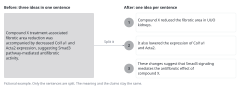

::: {.callout-note collapse="true"}
## This week's goals

By the end of this week, you will be able to do the following.

- Explain, with evidence, why English sentences written by AI are hard to read.
- Find the ten patterns of hard-to-read sentences in an English paragraph, and label each one by its number.
- Fix the sentences you found with minimal changes, without changing the meaning, the numbers or the terms.
- Recognize sentences that have been revised too much (overcorrection).
:::

# 1. Principles {#principles}

## Writing short means putting fewer ideas in each sentence

- Text written by AI takes more effort to read, even when its grammar is correct. This is because AI tends to pack a lot of information into each sentence.
  - Reinhart et al. (2025, [PNAS](https://doi.org/10.1073/pnas.2422455122)): instruction-tuned models, which are adjusted to follow instructions, used present participial clauses 2–5 times as often as human writers. They used nominalizations 1.5–2 times as often.
  - Clark, Martin & Mahowald (2026, [arXiv:2610.29162](https://arxiv.org/abs/2610.29162), a preprint not yet peer reviewed): all nine models they studied paired inanimate subjects with human action verbs more often than human writers did. All nine also used rare word combinations more often. Most of the models placed related words farther apart and stacked more nouns. The authors propose the hypothesis that this comes from training the models for tasks in which information density matters, such as math, code and reasoning.
  - Futrell, Mahowald & Gibson (2015, [PNAS](https://doi.org/10.1073/pnas.1502134112)): in all 37 languages they studied, related words were closer together than in a random baseline. People use language in a way that keeps related words close.
- Rule: do not drop articles, prepositions, relative pronouns or verbs to make a sentence short. Split the sentence instead. If you need to cut length, cut content, not grammar.
- The examples are fictional (the mouse UUO model and a fictional drug, compound X; the numbers are made up).
  - Before: Compound X treatment-associated fibrotic area reduction was accompanied by decreased Col1a1 and Acta2 expression, suggesting Smad3 pathway-mediated antifibrotic activity.
  - After: Compound X reduced the fibrotic area in UUO kidneys. It also lowered the expression of Col1a1 and Acta2. These changes suggest that Smad3 signaling mediates the antifibrotic effect of compound X.

{fig-alt="On the left is one English sentence that holds three ideas. On the right are three numbered English sentences that split the same content."}

## Use ten patterns to find hard-to-read sentences

The table below is the checklist for this week's exercise and for [W12 Polishing](w12_polishing.qmd). Do not change the numbers.

| # | Pattern | Clues | How to fix |
|---|---|---|---|
| 1 | Noun stack | Three or more nouns in a row | Rewrite it with a verb |
| 2 | Related words far apart | A long gap between subject and verb, a long modifier attached to a noun | Split the sentence |
| 3 | Inanimate subject with an action verb | The data tell, the filter swallows | Make the real actor the subject, and use a precise verb |
| 4 | Coined words and rare word combinations | Compounds you have never seen, several names for one thing | Use common words. Define a new term once and keep using it |
| 5 | Dropped function words | Note style without articles, that, prepositions or forms of be | Put the missing words back |
| 6 | Nominalization | the analysis of, resulted in a reduction of | Use the verb |
| 7 | Clauses chained with commas | ..., enabling X, revealing Y, highlighting Z | Split it into sentences, each with a subject and a verb |
| 8 | Nouns turned into verbs | pipelined, operationalized | Spell out what was done |
| 9 | English-style commas in Korean sentences | 또한, 본 연구는, ("In addition, this study,") | Remove the commas |
| 10 | Formulaic phrases and visual decoration | plays a crucial role, underscore, bold text, em dashes | State a specific claim once |

## Learn each pattern through examples

The dry-lab examples are also fictional (a study that reanalyzed public single-cell RNA sequencing data from human kidney biopsies).

1. Noun stack
   - Before: We performed myofibroblast subtype marker gene expression comparison.
   - After: We compared which marker genes each myofibroblast subtype expressed.
   - Keep established technical terms (single-cell RNA sequencing, differential expression analysis) as they are. Do not coin new stacks.
2. Related words far apart
   - Before: The myofibroblast subtype that we identified after integrating public datasets of kidney biopsies from patients with and without fibrosis and removing batch effects was expanded in fibrotic samples.
   - After: We integrated public datasets of kidney biopsies from patients with and without fibrosis and removed batch effects. In the integrated data, one myofibroblast subtype was expanded in fibrotic samples.
3. Inanimate subject with an action verb
   - Before: The QC filter quietly swallows low-quality cells. / Compound X fights fibrosis in the injured kidney.
   - After: The QC filter removes low-quality cells without a warning. / Compound X reduced fibrosis in UUO kidneys.
   - Conventional expressions such as Figure 2 shows and These results suggest are fine in moderation. The problem is metaphorical verbs (swallow, fight, tell a story).
4. Coined words and rare word combinations
   - Before: Compound X lowered the fibro-burden index. (In the same paragraph, MF2 cells, the profibrotic cluster and these activated stromal cells all refer to the same cells.)
   - After: Compound X reduced the fibrotic area. (The cells are called MF2 throughout.)
   - If you really need a new term, define it once and keep using it. Example: We defined the fibrotic area as the percentage of the tissue area stained blue with Masson's trichrome.
5. Dropped function words
   - Before: Kidneys harvested day 7 post-UUO, fixed, sectioned, stained with Masson's trichrome.
   - After: We harvested the kidneys 7 days after UUO. The kidneys were fixed, sectioned and stained with Masson's trichrome.
   - Before: the samples the lab sequenced / After: the samples that the lab sequenced
   - Fixed formats, such as the title of a Figure legend, are an exception ([W5](w05_methods_legends.qmd)).
6. Nominalization
   - Before: Administration of compound X resulted in a reduction of collagen deposition.
   - After: Compound X reduced collagen deposition.
   - Before: We performed an analysis of Smad3 phosphorylation. / After: We analyzed Smad3 phosphorylation.
7. Clauses chained with commas
   - Before: We integrated the datasets, enabling cell-type annotation across studies, revealing an expanded MF2 subtype, and highlighting its contribution to fibrosis.
   - After: We integrated the datasets. This allowed us to annotate cell types across studies. In patients with fibrosis, MF2 made up a larger share of fibroblasts. MF2 contributes to fibrosis.
   - When you split the sentence, you can see that the last sentence is a causal claim. A difference in proportions alone does not support it. An -ing tail is an easy place for an unsupported claim to hide.
8. Nouns turned into verbs
   - Before: We pipelined the QC and clustering steps.
   - After: We combined the QC and clustering steps into one pipeline.
9. English-style commas in Korean sentences
   - Before: 또한, 본 연구는, 기존 연구와 달리, 공개 데이터를 다시 분석하였다.
   - After: 또한 본 연구는 기존 연구와 달리 공개 데이터를 다시 분석하였다.
   - Both sentences mean "In addition, unlike earlier studies, this study reanalyzed public data." In English, a comma after However or Moreover is the rule. Comma habits do not carry over between the two languages.
   - In this course, you meet this pattern in drafts that you write in Korean first, in explanations that AI writes in Korean, and in notes made before translation. One study reports that Korean text written by LLMs uses commas differently from text written by people (Park et al. 2025, [arXiv:2503.00032](https://arxiv.org/abs/2503.00032)).
10. Formulaic phrases and visual decoration
    - Before: These findings underscore the crucial role of Smad3 signaling in renal fibrosis and pave the way for novel therapeutic strategies.
    - After: In UUO kidneys, compound X reduced the fibrotic area from 18.2% to 9.6%.
    - In place of a formulaic phrase, write the specific claim that the data show. In Table 1 of Reinhart et al. (2025), text written by GPT-4o used underscore 107 times as often as human text, and intricate 119 times as often.
    - Visual decoration means bold text on ordinary words, quotation marks for emphasis, em dashes, and bullet lists for content whose logic runs on from point to point.

## Do not revise too much

- Do not judge by a single measure, such as sentence length or a readability score. Wang, Bilal & Zaman (2026, [arXiv:2609.17301](https://arxiv.org/abs/2609.17301), a preprint not yet peer reviewed) analyzed more than 84,000 conversations with ChatGPT and Gemini. Taken one at a time, the length, readability and lexical diversity of the answers had no consistent relationship with how hard the answers were to understand. The difficulty depended on how these features combined.
- Do not cut every sentence to the same length. That reads awkwardly too.
- Keep numbers, gene names, citations and the strength of claims as they are. Do not add new hedges such as may or might.
- Keep the academic register. Easier sentences do not call for a casual tone.
- Do not revise sentences that already read well.

# 2. Try it with AI {#try-with-ai}

Exercise: find the patterns in a paragraph written by AI (30 minutes)

1. Have AI write (5 minutes): Use a prompt below to have AI write a Results paragraph. The data are a fictional example.
2. Find the patterns on your own (10 minutes): Number the sentences, and fill in a table (#, original phrase, pattern number, revised sentence). List only real problems, starting with those that cost the reader most.
3. Compare with a partner (5 minutes): If you gave the same sentence different numbers, explain why. Do not put your partner's table or paragraph into AI.
4. Have AI review it (5 minutes): Use the review prompt to have AI review the same paragraph. Compare the result with your table, and mark what AI missed and where it revised too much.
5. Read side by side (5 minutes): Put 2–3 revised sentences next to the original sentences, and check that the meaning and the numbers are the same.

Wet-lab data:

```text
Write one Results paragraph (about 150 words) for a research article in a high-impact journal.
Use only the data below. They are invented for a class exercise.
- Mice: male C57BL/6J, 8 weeks old. Kidneys were harvested 7 days after unilateral ureteral obstruction (UUO).
- Groups (n = 6 each): sham, UUO + vehicle, UUO + compound X (10 mg/kg)
- Fibrotic area (Masson's trichrome): UUO + vehicle 18.2%, UUO + compound X 9.6% (P = 0.0004)
- mRNA, UUO + compound X vs UUO + vehicle: Col1a1 −52%, Acta2 −38%, Fn1 −21% (Fn1 not significant)
- Body weight and serum creatinine did not differ.
```

Dry-lab data:

```text
Write one Results paragraph (about 150 words) for a research article in a high-impact journal.
Use only the data below. They are invented for a class exercise.
- Data: public single-cell RNA sequencing data of human kidney biopsies from 8 patients with fibrosis and 6 patients without fibrosis
- After integration, fibroblasts formed several subtypes. One myofibroblast subtype is called MF2.
- MF2 made up 24% of fibroblasts in patients with fibrosis and 7% in patients without fibrosis (P = 0.008).
```

Review prompt:

```text
Review the paragraph above for sentences that are hard to read.
Look for noun stacks, long distances between related words, nominalizations, chains of -ing clauses, coined terms, missing function words and formulaic phrases.
Return a table with the original phrase, the problem and a minimal fix.
Do not change any number, gene name, statistical result or claim.
```

- Track A: Use the fictional example data above. You may use the content of one of your own figures instead, but only if you meet all the conditions of the "Conditional (track A)" row (your supervisor's agreement, the setting that keeps your input out of training, no raw data or figure files).
- Track B: Have AI polish one Methods paragraph of the paper you chose, with the prompt below. When you compare the original, written by people, with the version that AI polished, the patterns that AI added are easy to see. Do not put in the Title, the DOI or the authors' names, and do not ask about the paper. Turn web search off.

```text
Rewrite the following Methods paragraph in a more polished academic style.
[one Methods paragraph from the paper you chose]
```

- AI traffic light: the fictional examples and the Methods of a published paper are in the "Free to use" row. Your own content in track A is in the "Conditional (track A)" row. Whether the meaning of a sentence that AI revised has changed is in the "Always verify" row.

::: {.callout-tip}
## Prompting tips

- In this exercise you ask for a high-impact journal style on purpose, so that the patterns show up. Do not ask for this when you polish a real manuscript.
- When you have AI revise your text, add a line such as Do not change any number. The numbers can still change, so check them by reading side by side.
:::

# 3. Verify and revise {#verify-and-revise}

This week you mainly read side by side. For the numbers, you check the source by comparing them with the data you gave in the prompt.

Where AI often goes wrong

- AI adds significantly to results that are not significant. In the data above, Fn1 is not significant, but AI easily lumps it in, as in "significantly reduced Col1a1, Acta2 and Fn1".
- AI adds conclusions you did not give. Body weight and serum creatinine did not differ, yet AI writes "improved renal function". There was only one dose, yet AI writes "dose-dependent". AI also adds "via Smad3" although you gave no Smad3 data.
- AI creates numbers you did not give. For example, it calculates "3.4-fold" from 24% and 7% and puts it in. Even if the calculation is correct, it is a new number, so you must check it.
- AI states causation too strongly. It turns associated with into drives, and suggests into demonstrates. It may also extend mouse results to the treatment of patients.
- AI changes gene notation. Mouse genes are written like Col1a1, and human genes like COL1A1.
- AI calls one thing by several names (MF2, the profibrotic cluster, these cells).
- When you ask AI to review a text, it may revise sentences that have no problem, wrongly flag established technical terms as noun stacks, or add hedges. While fixing one pattern, it may also create another, for example by coining a new term.

Checklist

- [ ] The numbers, units, n and P values match the data given in the prompt. (check the source)
- [ ] There are no numbers, conclusions or statistical expressions that were not given. (check the source)
- [ ] Each revised sentence makes its claim with the same strength (suggest, show, demonstrate) as the original. (read side by side)
- [ ] The notation of genes and proteins, and the species, are unchanged. (read side by side)
- [ ] The same thing is called by the same term throughout.
- [ ] No new hedges or new content have come in.
- [ ] The sentence lengths vary naturally.

# Assignment {#assignment}

Find the patterns in a paragraph written by AI

- Length: one English paragraph written by AI (120–200 words) and your analysis, on 1–2 A4 pages.
- Format
  1. The tool name, the date and the full prompt.
  2. The original AI paragraph, with each sentence numbered.
  3. A review table: #, original phrase, pattern number, revised sentence. List the problems that cost the reader most first.
  4. The revised paragraph. Revise only the sentences in the table.
  5. Notes from reading side by side, in 2–3 lines: whether any meaning or number changed in your revision, and where the AI review and your own review differed.
- Differences between tracks: Track A students use a paragraph that AI wrote on the fictional example or on a topic in their field. They put in their own results only if they meet the conditions of the "Conditional (track A)" row. Track B students use the text that AI produced when it polished one Methods paragraph of the chosen paper.
- Grading criteria
  - Are the pattern numbers correct? Accurate labels count for more than the number of patterns found.
  - Are the revisions minimal? Did you keep the meaning, the numbers and the terms?
  - Did you recognize places where a revision went too far, and avoid them?
- Submit through the university LMS. Deadlines are announced separately.
- You used AI, so submit your [AI use log](../ai_rules.qmd#ai-log) with the assignment.

# Notes {#notes}

Why AI-written text is hard to read, and 10 patterns (plain-prose)
