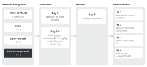
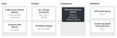
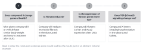
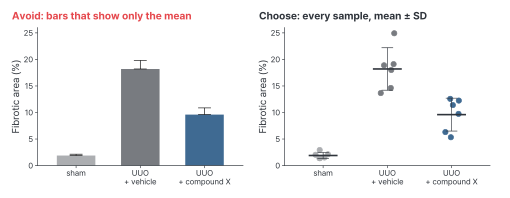
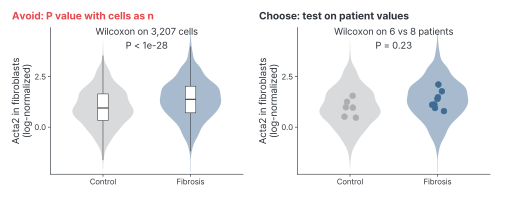
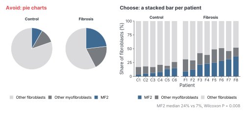

::: {.callout-note collapse="true"}
## This week's goals

- Write the conclusion of each figure as one sentence in English.
- Order the figures as the paper's argument runs, and explain why.
- Choose the graph type that fits the comparison the reader must see.
- Find the figure specifications and image rules of your target journal, and apply them to your figures.
:::

# 1. Principles {#principles}

- Part 2 starts from the figures. The legends in [W5](w05_methods_legends.qmd) and the Results in [W6](w06_results.qmd) follow the figure order you set this week.
- The examples come from the course's shared fictional example study. The numbers are made up.
  - Wet lab: mice with unilateral ureteral obstruction (UUO) were given compound X, a fictional drug. The study has four figures, with n = 6 per group.
  - Dry lab: public single-cell RNA sequencing data from human kidney biopsies were reanalyzed. The analysis found a myofibroblast subtype (fictional name MF2) that is more common in patients with fibrosis.

{fig-alt="From left: animals and groups (male C57BL/6J, 8 weeks old; sham, UUO + vehicle and UUO + compound X, n = 6 each), treatment (surgery on day 0; compound X 10 mg/kg or vehicle given orally on days 0–6), harvest (kidneys harvested on day 7) and measurements (Fig. 1 body weight and serum creatinine, Fig. 2 Masson's trichrome, Fig. 3 qPCR, Fig. 4 western blot)."}

{fig-alt="From left: data (public single-cell RNA sequencing of human kidney biopsies, 8 patients with fibrosis and 6 controls), analysis (QC, cell type annotation, fibroblast subtypes), comparison (MF2 proportion per patient, Wilcoxon) and validation (marker genes, spatial transcriptomics)."}

## Principle 1. Write one conclusion sentence for each figure

- A conclusion sentence states, in one sentence, the claim that one figure shows. Write the result, not the method or the name of the graph.
- Make the subject what you studied (a drug, a cell, a gene). Make the verb the result (reduces, lowers, is more abundant in).
- Claim only as much as the data show. Do not use causal verbs such as drives or mediates for observational data.
- If you cannot write a conclusion sentence for a figure, the figure does not make a claim yet. It is a candidate for removal from the main text or for the Supplementary Information.
- Examples:
  - Before: Masson's trichrome staining of kidney sections after UUO.
  - After: Compound X reduces interstitial fibrosis in the obstructed kidney.
  - Before: UMAP of fibroblasts from human kidney biopsies.
  - After: The myofibroblast subtype MF2 is more abundant in kidneys with fibrosis.
  - Before: Compound X prevents fibrosis by blocking TGF-β/Smad3 signaling.
  - After: Compound X lowers Smad3 phosphorylation in the obstructed kidney.

## Principle 2. The figure order is the order of the argument

- Readers go through the figures in order, and each figure answers one question. Place the figures so that each one answers the question the previous figure left open.
- Do not order the figures by when you did the experiments or by technique. Order them by the question each figure answers.
- Read in order, the conclusion sentences alone should read like the results part of an Abstract.
- The same holds for the panels within a figure. The reading order, left to right and top to bottom, is the order of the argument.

{fig-alt="Four cards, Figure 1 to 4, in numbered order. At the top of each card is the question it answers, and below it is the conclusion sentence in English."}

| Figure | Question it answers | Conclusion sentence (fictional example) |
|---|---|---|
| 1 | Does compound X change general health? | Mice given compound X or vehicle have similar body weight and serum creatinine after UUO. |
| 2 | Is fibrosis reduced? | Compound X reduces interstitial fibrosis in the obstructed kidney. |
| 3 | Is the expression of fibrosis genes lower too? | Compound X lowers Col1a1 and Acta2 expression after UUO. |
| 4 | Does TGF-β/Smad3 signaling change too? | Compound X lowers Smad3 phosphorylation in the obstructed kidney. |

## Principle 3. Choose the graph type by the comparison it must show

- First decide what the reader must compare with what. Choose the graph after that.

| What the reader must see | Graph to choose | What to avoid |
|---|---|---|
| A few groups with few samples (n = 6 per group) | A point for each sample, with the mean and error bars | Bar graphs that show only the mean. They hide n and the distribution |
| The distribution in each group | A box plot or violin plot with a point for each sample | P values calculated with each cell as an independent sample |
| Composition (proportions of cell types) | A stacked bar for each sample, or a proportion graph with a point for each sample | Pie charts |
| The same subjects before and after treatment | A graph that joins each pair with a line (paired plot) | A two-group comparison that ignores the pairs |
| Marker genes of many clusters | A dot plot | A heatmap with one column per cell |
| A single-cell map | UMAP only as a guide to location. Color it by one variable only | Interpreting the distances between points |

{fig-alt="On the left, a graph of three groups with only mean bars and error bars. On the right, the same data with a point for each mouse, plus the mean and standard deviation."}

{fig-alt="Both graphs show violins of the Acta2 distribution across cells in controls and patients with fibrosis. On the left, the test uses 3,207 cells and gives P < 1e-28. On the right, each patient's mean is a point, and the test of 6 versus 8 patients gives P = 0.23."}

{fig-alt="On the left, two pie charts show the fibroblast composition of controls and of patients with fibrosis. On the right, stacked bars show the composition of each of the 14 patients, and the median MF2 proportions are 7% and 24%."}

- Bar graphs and line graphs can make different distributions look the same. In studies with few samples, show the individual points as well (Weissgerber et al. 2015, [doi:10.1371/journal.pbio.1002128](https://doi.org/10.1371/journal.pbio.1002128)).
- Use the accent color for only the one thing your claim needs, and leave the rest gray.
- Give the same group or cell type the same color in every figure. Avoid red and green pairs. Check with a color vision deficiency simulation that the colors can still be told apart.
- Order categories by meaning, not alphabetically. Example: sham → UUO + vehicle → UUO + compound X.

## Principle 4. Match the journal's figure specifications from the start

- If you shrink a finished figure later, its text and lines become hard to read. Draw each figure at its final size from the start.
- The specifications of two journals serve as examples here (checked on each journal's pages on 2026-11-10).

| Item | Nature | PLOS ONE |
|---|---|---|
| Width | Single column 89 mm, double column 183 mm, 1.5 columns 120–136 mm if needed | 6.68–19.05 cm (789–2,250 px at 300 dpi) |
| Maximum height | Page depth 247 mm | 22.23 cm |
| Resolution | Photographic images 300–600 dpi | 300–600 dpi |
| File format | TIFF or PSD for photographs. Vector formats such as Adobe Illustrator (.ai), EPS or PDF for graphs and line art | TIFF or EPS |
| Text | Panel labels in 8 pt bold lowercase a, b, c. All other text 5–7 pt | Arial, Times or Symbol fonts, 8–12 pt |
| Color | RGB recommended | RGB or grayscale |

- Sources: [Nature, Final submission](https://www.nature.com/nature/for-authors/final-submission), [Nature guide to preparing figures](https://research-figure-guide.nature.com/figures/preparing-figures-our-specifications/), [PLOS ONE, Figures](https://journals.plos.org/plosone/s/figures).
- Specifications differ between journals and can change. Check them again on the journal's pages just before you submit ([W13](w13_submission.qmd)).

## Principle 5. Do not make or edit data figures with AI

- Do not use AI to make or edit data figures (blots, micrographs and so on) ([AI use rules](../ai_rules.qmd#in-the-paper)).
- Follow the journal's image rules as well. The main points of the [Nature Portfolio image integrity policy](https://www.nature.com/nature-portfolio/editorial-policies/image-integrity) are these:
  - Adjust brightness and contrast equally across the whole image, and apply the same adjustment to the controls.
  - Do not use cloning or healing tools.
  - If you combine images taken at different times or from different locations, mark the boundaries and state this in the legend.
  - For life science papers, submit the uncropped original gel and blot images together with the final version.
- PLOS ONE also asks authors to put a thin white or black line where gels are spliced and to state this in the legend. It also says not to crop too tightly around the bands ([PLOS ONE, Figures](https://journals.plos.org/plosone/s/figures)).
- Keep the original files from before any processing (raw microscope files, blot scans). State the equipment and processing software in the Methods ([W5](w05_methods_legends.qmd)).
- Journals differ on whether generative AI images may be used in schematic overviews of the study design. Check the rules of the journal you will submit to.
- AI may write the code (R, Python) that draws your graphs. Do not put data files into AI, and run the code on your own computer. You check yourself that the figure shows the data correctly. What to check, and an example entry for the AI use log, are in the [AI use rules](../ai_rules.qmd#plot-code).

# 2. Try it with AI {#try-with-ai}

Have AI check your conclusion sentences and figure order (25 min).

1. (10 min) Without AI, write for each figure one line with its conclusion sentence and one line with the question it answers. Track A works from the list of figures in the W1 assignment. Track B works from the figures of the paper you chose.
2. (10 min) Put the conclusion sentences and descriptions of the data into the prompt below, as text only.
3. (5 min) Compare the AI's answer with principles 1–3, and change only what you accept. Record what you accepted and what you discarded in your [AI use log](../ai_rules.qmd#ai-log).

```text
I am planning the figures for a short research paper. Below are my figures in order.
For each figure I give one conclusion sentence and a short description of the data
(groups, n per group, type of measurement). I have not attached any data or images.

Please do three things:
1. For each conclusion sentence, say whether it states a claim or only describes
   a method or a plot. If a sentence claims more than the described data can show
   (for example, a causal mechanism from a correlation), point this out.
2. Read the sentences in order. Say where the argument jumps, repeats or goes
   backward. Suggest a new order only if it makes the argument clearer, and say why.
3. For each figure, name the comparison the reader must see. Suggest one plot type
   for it and one alternative, with the trade-off. Do not invent results or statistics.

Figure 1: [conclusion sentence] | Data: [groups, n per group, measurement]
Figure 2: [conclusion sentence] | Data: [groups, n per group, measurement]
```

- Track A: this falls in the "Conditional (track A)" row of the [AI traffic light](../ai_rules.qmd#traffic-light). Get your supervisor's agreement, and use only tools set so that your input is not used for training. Do not put in figure files or raw data, only descriptions written as text. This exercise does not need exact numbers, so leave the numbers out as well.
- Track B: the paper is published, so it falls in the "Free to use" row. But do not put in the paper's title, authors or DOI, and turn web search off. If AI tells you the Results of that paper, the comparison you make in W15 loses its meaning.
- Treat the graph types that AI recommends like the statistical methods it suggests, in the "Always verify" row. Check them against the table in principle 3 and against the figures of recent papers in the same field.
- The prompt says that no data are attached and tells AI not to invent results. The reason is that AI often fills gaps with plausible numbers.
- Pair check (optional, 5 min): swap only the conclusion sentences with a partner. Read your partner's sentences in order, and say where the reading gets stuck. Your partner's cards are someone else's manuscript, so do not put them into AI.

# 3. Verify and revise {#verify-and-revise}

Where AI often goes wrong in this week's work:

- It makes conclusion sentences claim more than the data show. It changes reduces to prevents, and is associated with to drives.
- It recommends bar graphs of the mean by default. For single-cell data, it recommends graphs and tests that use the number of cells as n.
- It interprets the distances between clusters in a UMAP.
- It gives journal specifications that are out of date or that belong to another journal.
- It reorders the figures by technique (tissue, RNA, protein), regardless of the argument.

Checklist:

- [ ] In every conclusion sentence, the subject is what you studied and the verb is the result.
- [ ] The verb of each conclusion sentence fits the type of data. An intervention experiment can take reduces. Observational data take is higher in or is associated with.
- [ ] Reading only the conclusion sentences in order shows the claim of the paper.
- [ ] Every graph shows n, and n is the number of experimental units (animals, patients).
- [ ] The same group has the same color in every figure, and the colors can be told apart in a color vision deficiency simulation.
- [ ] The figure width, font size, resolution and file format match the target journal's pages.
- [ ] You keep the original files of the data figures and a record of the image processing.

The three checks this week:

- Check the source: check the journal's figure specifications and image rules directly on the journal's pages.
- Cross-check: compare the graph types and figure order with your supervisor's view or with the figures of recent papers in the same field.
- Read side by side: put each conclusion sentence that AI revised next to your original sentence, and check that the claim has not grown.

# Assignment {#assignment}

Figure order cards

- Length: one card for each figure. Track A writes 3–4 cards. Track B writes as many cards as there are figures in the main text of the paper. At the top, write the claim of the whole manuscript as one sentence in English.
- Format: fill in the items below on each card. Write the conclusion sentence in English. The other items may be in Korean. Submit one file (Word or PDF).

| Item | What to write | Example (fictional example, Figure 2) |
|---|---|---|
| Figure number | Its position in the manuscript | Figure 2 |
| Question it answers | The question that the previous figure left open | Does compound X reduce fibrosis? |
| Conclusion sentence | One sentence in English | Compound X reduces interstitial fibrosis in the obstructed kidney. |
| Panels | What each panel shows, and with which graph | a: representative Masson's trichrome images (one per group, same magnification, scale bar). b: fibrotic area (%), a point for each mouse with mean ± SD |
| Key statistics | The one comparison that supports the conclusion: the groups compared, n and its unit, and the test | UUO + vehicle versus UUO + compound X. n = 6 mice per group. One-way ANOVA followed by Tukey's multiple comparisons test |
| Results paragraph | Which paragraph of the W6 Results it becomes, and a candidate subheading | Second paragraph. Compound X reduces fibrosis after UUO |

- Track A: work from your own figures. For analyses that are not finished yet, write "planned" in the key statistics item. Do not make up numbers in advance.
- Track B: work only from the figures and Methods of the paper you chose. Do not read the Results. Find the names of the tests in the statistical analysis section of the Methods.
- Grading criteria:
  1. Each conclusion sentence is a claim and does not go beyond what the figure's data show.
  2. The figure order forms an argument, and the question items show why.
  3. The graph types and key statistics (n and its unit, the test) fit the comparison to be shown.
- These cards become the frame for the W5 legends and for the order of the W6 Results paragraphs. When your figures change, revise the cards and keep using them.
- Submission: through the university LMS. Deadlines are announced separately. If you used AI, submit your AI use log with the assignment.

# Notes {#notes}

One conclusion sentence per figure, and journal figure specifications (figure-chooser)
