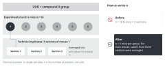
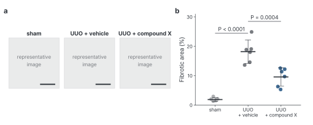

::: {.callout-note collapse="true"}
## This week's goals

- Write Methods in enough detail that another lab can repeat the experiment.
- Use tense and voice consistently in the Methods and figure legends.
- State what n counts, and report the test, the error bars and exact P values.
- Write a figure legend in this order: title sentence, panel descriptions, then n and statistics.
:::

# 1. Principles {#principles}

- The examples come from the same fictional example study as in [W4](w04_figure_storyboard.qmd). Mice with unilateral ureteral obstruction (UUO) were given compound X, a fictional drug, with n = 6 per group. The numbers and conditions are made up.
- Write the Methods and legends from your W4 figure order cards. The key statistics item of each card becomes the n and statistics sentence of the legend.

## Principle 1. Write enough for others to repeat the work (reproducibility)

- The test question: could a graduate student in another lab in the same field do the same experiment from this Methods section alone?
- What wet-lab Methods often leave out: the strain, sex, age and supplier of the animals. The manufacturer, catalog number and dose of each reagent, and the route and timing of administration. How quantification was done (which areas, how many images, whether it was blinded). Software names and versions.
- What dry-lab Methods often leave out: the data source and accession numbers, the criteria used to filter cells, package names and versions, the main parameters, and where the code is published.
- Cite standard methods, and describe only what you changed. Do not stop at "as described previously". Check that a cited methods paper really exists, using the steps in [W7](w07_literature.qmd).
- Each study design has its own reporting guideline.
  - Animal studies: [ARRIVE 2.0](https://arriveguidelines.org/arrive-guidelines). Its minimum set, the Essential 10, covers study design, sample size, inclusion and exclusion criteria, randomization, blinding, outcome measures, statistical methods, experimental animals, experimental procedures and results (Percie du Sert et al. 2020, [doi:10.1371/journal.pbio.3000410](https://doi.org/10.1371/journal.pbio.3000410)).
  - For other designs (observational studies, clinical trials, diagnostic studies and so on), find the matching guideline at the [EQUATOR Network](https://www.equator-network.org/).
- Examples:
  - Before: Mice underwent UUO and were treated with compound X. Kidneys were harvested and analyzed.
  - After: Male C57BL/6J mice (8 weeks old) underwent left UUO. Compound X (10 mg/kg) or vehicle was given by oral gavage once daily from day 0 to day 6. Kidneys were harvested on day 7.

## Principle 2. Keep tense and voice consistent

- Use the past tense for what you did in this study. Use the present tense for what a figure shows and for general facts ("Data are mean ± SD" in a legend).
- Use the passive voice when it does not matter who did the work. Decide whether to use the active "we" by looking at recent papers in your target journal. Within one section, keep to one choice.
- Do not turn verbs into nouns. Write one step per sentence.
- Examples:
  - Before: Quantification of the fibrotic area was performed using ImageJ.
  - After: Fibrotic area was quantified in ImageJ (version 1.54).
  - Before: Kidneys were fixed in 10% formalin, followed by paraffin embedding, and then 4-μm sections were cut and stained with Masson's trichrome.
  - After: Kidneys were fixed in 10% formalin and embedded in paraffin. Sections (4 μm) were stained with Masson's trichrome.

## Principle 3. State what n counts

{fig-alt="On the left are the six mice of one group and three sections from mouse 1. On the right are a Before that writes n = 18 and an After that writes n = 6 mice per group."}

- n is the number of experimental units. An experimental unit is a unit that received the treatment independently. One mouse, one patient or one separately prepared culture each counts as one unit (Lazic et al. 2018, [doi:10.1371/journal.pbio.2005282](https://doi.org/10.1371/journal.pbio.2005282)).
- Several images taken from the same mouse, or three qPCR wells from the same sample, are technical replicates. Average them and use the mean as one value for that mouse.
- In single-cell data, n is the number of patients (donors), not the number of cells.
- In the Methods, state the experimental unit, how technical replicates were combined, and which animals were excluded and why.
- Examples:
  - Before: n = 18 (6 mice × 3 sections).
  - After: n = 6 mice per group. For each mouse, values from three sections were averaged.

## Principle 4. Report the test, the error bars and exact P values

- State the name of the test, whether it was two-sided or one-sided, whether the comparison was paired, the correction for multiple comparisons, and the statistics software and its version.
- State in the legend whether the error bars show the SD, the SEM or a 95% confidence interval. The three give different information. The SD shows how widely the data are spread. The SEM and the confidence interval show how precisely the mean was estimated (Cumming et al. 2007, [doi:10.1083/jcb.200611141](https://doi.org/10.1083/jcb.200611141)).
- Give exact P values where possible (P = 0.012). Whether to write very small values as P < 0.0001 depends on the journal's rules.
- The statistics items of the [Nature Portfolio Reporting Summary](https://www.nature.com/documents/nr-reporting-summary-flat.pdf) make a good checklist. They ask for the exact n and its unit for each group, whether the measurements came from distinct samples or from the same sample measured repeatedly, the test and whether it was one-sided or two-sided, and exact P values where possible.
- Examples:
  - Before: Data are presented as mean ± SEM. *P < 0.05.
  - After: Data are mean ± SD; each dot is one mouse (n = 6 per group). P values are from one-way ANOVA with Tukey's multiple comparisons test.

## Principle 5. Write a figure legend as title, panel descriptions, then n and statistics

- Title sentence: write in one sentence what the whole figure shows. Start from your W4 conclusion sentence. Some journals put the conclusion in the title, and others describe only the content. Follow the papers of your target journal.
- Panel descriptions: for each panel, state what was measured, under which conditions and how. A reader should understand the figure without reading the main text. Do not repeat the procedures from the Methods.
- n and statistics: state what one dot is, n and its unit, the type of error bar and the test. For images, give the length of the scale bar.
- Do not interpret in the legend. Interpretation belongs in the Results and the Discussion.
- Below is the figure that the legend describes (fictional example). In a real manuscript, representative images go in the place of panel a.

{fig-alt="Panel a has three image placeholders, for sham, UUO + vehicle and UUO + compound X, each with a scale bar. Panel b shows the fibrotic area of the three groups as a point for each mouse with mean ± SD, and marks P < 0.0001 for sham versus vehicle and P = 0.0004 for vehicle versus compound X."}

- Before:

```text
Figure 2. Masson's trichrome staining. Compound X significantly decreased fibrosis,
suggesting that it may be a promising therapy. *P < 0.05.
```

- After:

```text
Figure 2. Compound X reduces interstitial fibrosis after UUO.
(a) Representative Masson's trichrome images of kidneys from sham, UUO + vehicle
and UUO + compound X mice on day 7. Scale bars, 100 μm.
(b) Fibrotic area as a percentage of cortical area. Each dot is one mouse (mean of
three sections). Bars show mean ± SD; n = 6 mice per group. P values are from
one-way ANOVA with Tukey's multiple comparisons test.
```

# 2. Try it with AI {#try-with-ai}

Give AI a Methods paragraph, and have it find what a reader could not reproduce (25 min).

1. (5 min) Work through the practice paragraph below (fictional example) together as a class first. This paragraph leaves out a lot of information on purpose.
2. (10 min) Run the same prompt on one Methods paragraph. Track A uses a paragraph from their own Methods. Track B uses a paragraph from the Methods of the paper they chose.
3. (10 min) Compare the AI's list with the ARRIVE Essential 10 or the matching reporting guideline. Fill in the missing information from your lab notebook, protocols and analysis records.

```text
Mice underwent UUO and were treated with compound X or vehicle. Kidneys were
harvested and fibrosis was assessed by Masson's trichrome staining. Fibrotic area
was quantified using ImageJ. Data were analyzed by t-test and P < 0.05 was
considered significant.
```

```text
Below is a Methods paragraph from a biomedical research paper. Read it as a
researcher in another lab who wants to repeat the experiment exactly.

1. List every piece of information that is missing or too vague to repeat the
   experiment. Group the items under: animals or samples, interventions,
   measurement and quantification, statistics, ethics.
2. For each item, say in one sentence why a reader needs it.
3. Do not rewrite the paragraph. Do not suggest values for the missing information.

Methods paragraph:
[paste here]
```

::: {.callout-note collapse="true"}
## What to find in the practice paragraph (for the instructor)
The strain, sex, age and supplier of the animals. Which ureter was ligated, and the sham group. The dose, route and duration of compound X, and what the vehicle contained. How mice were assigned to groups (randomization), and blinding. The day the tissue was collected. Section thickness and the number of sections per mouse. The area quantified, the number of images, the threshold criteria and the ImageJ version. n, the experimental unit and the exclusion criteria. The use of a t test. If the sham group is included, three groups are compared, which needs a method for multiple comparisons. Whether the test was two-sided. Ethics approval for the animal experiments.
:::

- Track A: this falls in the "Conditional (track A)" row of the [AI traffic light](../ai_rules.qmd#traffic-light). Get your supervisor's agreement, and use only tools set so that your input is not used for training. Do not put in raw data, figure files or photos of your lab notebook. Leave out methods that are not yet patented and conditions that you will not publish.
- Track B: the Methods of a published paper fall in the "Free to use" row. Turn web search off. Check whether the information that AI calls missing is in the Supplementary Information or in the cited methods paper.
- The practice paragraph is a fictional example, so it falls in the "Free to use" row.

::: {.callout-warning}
## Do not let AI fill in missing values
AI fills gaps with common values (8-week-old males, 7 days, 10 mg/kg) that look plausible. Take every value in your Methods from your lab notebook and analysis records only.
:::

# 3. Verify and revise {#verify-and-revise}

Where AI often goes wrong in this week's work:

- It fills missing values with common ones (strain, age, dose, dates, software versions).
- While it polishes sentences, it changes the name of the test or changes SD to SEM.
- It changes the unit of n. n = 6 mice becomes n = 6 independent experiments.
- It merges exact P values into P < 0.05, or it makes up P values that do not exist.
- It makes up catalog numbers, RRIDs and citations of methods papers.
- It puts interpretation or significantly into legends.

Checklist:

- [ ] Every value in the Methods appears in the lab notebook, protocols or analysis records.
- [ ] You covered all required items of the reporting guideline, or stated why an item does not apply.
- [ ] Every figure legend gives n and its unit, the type of error bar and the test, and these match the Methods.
- [ ] The n and test in each legend match the key statistics item of the W4 card.
- [ ] The Methods are in the past tense, and the data descriptions in the legends are in the present tense.
- [ ] In sentences that AI revised, no numbers, units or test names have changed.
- [ ] Every cited methods paper really exists (checked by DOI and in PubMed).
- [ ] You checked whether the target journal asks you to state AI use in the Methods ([AI use rules](../ai_rules.qmd#in-the-paper)).

The three checks this week:

- Check the source: check the values in the Methods against your lab notebook and analysis records, and check methods papers by DOI and in PubMed.
- Cross-check: compare the reproducibility list from AI with a reporting guideline such as ARRIVE, and ask the people who did the experiment with you.
- Read side by side: put the Methods and legends that AI revised next to your original sentences, and check that the numbers and tests are unchanged.

# Assignment {#assignment}

Draft Methods and legends

- Track A:
  - Methods: write all the subsections that your 3–4 figures need, including a statistical analysis subsection and a sentence on ethics approval. About 800–1,500 words.
  - Legends: write one for each figure.
- Track B:
  - Legends: write one for each figure, from the figures alone, before you read the legends of the original paper.
  - Methods: rewrite in your own words the subsections of the paper's Methods that cover two of its figures, and the statistical analysis section. Do not copy sentences. Submit with them the reproducibility list for the same part that you made in the AI exercise.
  - Read the legends of the original paper after you have submitted your own, and compare them.
- Format: an English manuscript, as one file (Word or PDF).
- Grading criteria:
  1. The text is detailed enough for another lab to repeat the work, and it includes the required items of the reporting guideline.
  2. n and its unit, the tests, the error bars and the P values are the same in the legends and the Methods, and they are correct.
  3. Tense and voice are consistent, and each sentence describes one step without noun stacks.
- Submission: through the university LMS. Deadlines are announced separately. If you used AI, submit your AI use log with the assignment.

# Notes {#notes}

Reproducibility, tense and voice, and how to report n and statistics
