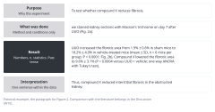

::: {.callout-note collapse="true"}
## This week's goals

- Write one paragraph for each figure, following your W4 figure order cards.
- Write each paragraph in this order: purpose, what was done, result, short interpretation.
- Put values, n and statistics into result sentences correctly, and keep results apart from interpretation.
- Find and fix the errors that AI often makes in Results (made-up numbers, significantly without a test, overstated causation).
:::

# 1. Principles {#principles}

- The examples come from the same fictional example study as in [W4](w04_figure_storyboard.qmd) and [W5](w05_methods_legends.qmd). The numbers are made up.
  - Wet lab: the mouse unilateral ureteral obstruction (UUO) model, compound X (a fictional drug), and n = 6 per group.
  - Dry lab: a reanalysis of single-cell RNA sequencing data from human kidney biopsies, and a myofibroblast subtype (fictional name MF2) that is more common in patients with fibrosis.

## Principle 1. Write one paragraph per figure, in the order of the cards

- The order of the W4 cards is the order of the Results paragraphs. The conclusion sentence on each card is a candidate for the paragraph's subheading. Decide whether to use subheadings by looking at papers in your target journal.
- Within a paragraph, follow the order of the panels, and give the panel in parentheses in each sentence (Fig. 2a).
- Do not mix two figures in one paragraph. If one figure is too large, split its paragraph in two.

## Principle 2. Write each paragraph as purpose, what was done, result, short interpretation

- Purpose (one sentence): say why you did this experiment. It is the question that the previous paragraph left open.
- What was done (one sentence): give only the name of the method and the conditions. The detailed procedure is in the Methods.
- Result (two or three sentences): give the values, n and statistics, in the past tense.
- Interpretation (one sentence): say what this result means, within the range of the data. Comparison with the literature belongs in the Discussion ([W10](w10_discussion.qmd)).
- Example paragraph (fictional example, Figure 2):

```text
To test whether compound X reduces fibrosis, we stained kidney sections with
Masson's trichrome on day 7 after UUO (Fig. 2a). UUO increased the fibrotic area
from 1.9% ± 0.6% in sham mice to 18.2% ± 4.0% in vehicle-treated mice (mean ± SD,
n = 6 mice per group; P < 0.0001; Fig. 2b). Compound X lowered the fibrotic area
to 9.6% ± 3.1% (P = 0.0004 versus UUO + vehicle; one-way ANOVA with Tukey's test).
Thus, compound X reduced interstitial fibrosis in the obstructed kidney.
```

{fig-alt="On the left are four boxes: purpose, what was done, result and interpretation. On the right, next to each box, are the English sentences of the example paragraph that belong to it."}

## Principle 3. Keep results and interpretation apart

- A result sentence states what you observed. An interpretation sentence states what it means, and shows that it is an interpretation with words such as These data indicate or suggest.
- Put the interpretation in one sentence at the end of the paragraph. Do not mix interpretation into the result sentences.
- Do not extend results from this model to human disease or to treatment effects.
- Examples:
  - Before: Compound X reduced fibrosis, indicating that it is a promising therapy for chronic kidney disease.
  - After: Compound X lowered the fibrotic area from 18.2% to 9.6% (n = 6 mice per group; P = 0.0004; Fig. 2b). These data indicate that compound X limits fibrosis in the UUO model.

## Principle 4. Give n and statistics with every value, and use significantly only for tested comparisons

- With each value, give the summary value (mean ± SD, or median and interquartile range), n and its unit, the test and the P value. When you report a change, state what it was compared with.
- Follow the journal's format on whether n and the test go in the text or in the legend. Either way, readers must be able to find n and the test for every value.
- Use significantly only for comparisons that you tested statistically. To describe the size of a difference, give the numbers instead of dramatically or markedly.
- If there is no difference, write did not differ rather than had no effect, and give the P value. Failing to find a difference is not evidence that there is no effect.
- Examples:
  - Before: Compound X significantly improved kidney function.
  - After: Body weight and serum creatinine did not differ between UUO + vehicle and UUO + compound X mice (P = 0.41 and P = 0.57; Fig. 1b, c).
  - Before: MF2 cells were significantly increased in fibrotic kidneys (P < 10^-50).
  - After: The proportion of MF2 cells among fibroblasts was higher in biopsies with fibrosis than in controls (median 24% versus 7%; n = 8 and 6 patients; P = 0.008, Wilcoxon rank-sum test).
- The Before of the last example treated tens of thousands of cells as independent samples. The unit of comparison is the patient ([W5](w05_methods_legends.qmd), principle 3).

## Principle 5. Do not claim more causation than you showed

- In an intervention experiment, where you gave a drug and measured the outcome, you can write reduced or lowered.
- Mechanism is different. If you showed only that a change in signaling occurred together with the effect, write was accompanied by. Without a blocking experiment (an inhibitor, a knockout), do not write through, by inhibiting or mediates.
- For observational data (comparisons between patients, proportions of single-cell subtypes), write was higher in or was associated with. Do not write drives or causes.
- Examples:
  - Before: Compound X attenuated fibrosis by inhibiting TGF-β/Smad3 signaling (Fig. 4).
  - After: Compound X also lowered the ratio of phosphorylated to total Smad3 (Fig. 4b). Whether this change is needed for the reduction in fibrosis remains to be tested.

# 2. Try it with AI {#try-with-ai}

Have AI polish a paragraph you wrote, then read the two versions side by side to find what changed (30 min).

1. (10 min) Without AI, write one paragraph from one W4 card and your W5 legend. Follow the order in principle 2.
2. (5 min) Put the card and the paragraph into the prompt below.
3. (10 min) Read your original paragraph and the AI version side by side. Compare the values, n, tests, significantly, causal verbs and any new interpretation, one item at a time.
4. (5 min) Record the changes you accepted and the ones you discarded in your [AI use log](../ai_rules.qmd#ai-log).

```text
Below is one paragraph from the Results section of my manuscript and the figure
card it is based on. Edit the paragraph for clarity and grammar only.

Rules:
- Do not change, round or add any number, n, unit, P value or test name.
- Do not add "significantly" or any other claim of statistical significance.
- Do not add interpretation, mechanism or causal language that is not already there.
- Keep one idea per sentence. Split long sentences instead of compressing them.
- After the edited paragraph, list every change you made and the reason for it.

Figure card:
[paste card]

Paragraph:
[paste paragraph]
```

- Track A: this falls in the "Conditional (track A)" row of the [AI traffic light](../ai_rules.qmd#traffic-light). Get your supervisor's agreement, and use only tools set so that your input is not used for training. Put in only the text of the paragraph and the card, not raw data or figure files.
- Track B: this falls in the "Free to use" row. Write only from the paper's figures, your legends and the paper's Methods. Do not read the Results of the original paper. Do not put the paper's title or DOI into AI, and turn web search off. Otherwise AI may bring in sentences from the original Results.
- On either track, sentences that AI revised fall in the "Always verify" row. Check yourself whether the meaning has changed.
- Pair reading (optional): in your partner's paragraph, mark which sentences are results and which are interpretation. Your partner's paragraph is someone else's manuscript, so do not put it into AI.

::: {.callout-warning}
## Why you should not let AI write the first draft
If you give AI only the card and ask it to write the paragraph, it often fills in values, tests and mechanisms that are not on the card. The practice paragraph below is an example. Write the paragraph yourself first, and use AI only to polish it.
:::

# 3. Verify and revise {#verify-and-revise}

Exercise: compare the card and the AI-written paragraph below (both fictional examples), and find every error.

```text
Figure 3 card (key statistics), UUO + compound X versus UUO + vehicle,
n = 6 mice per group, one-way ANOVA with Tukey's test:
  Col1a1 mRNA  -52%  P = 0.003
  Acta2 mRNA   -38%  P = 0.02
  Fn1 mRNA     -21%  P = 0.19

AI-written paragraph:
Compound X significantly reduced the expression of all three fibrosis markers
(Fig. 3). Col1a1 mRNA decreased by approximately 50%, Acta2 by 40% and Fn1 by 35%
(n = 8 per group, P < 0.05). These results demonstrate that compound X suppresses
fibroblast activation through TGF-β/Smad3 signaling.
```

::: {.callout-note collapse="true"}
## What to find (for the instructor)
The paragraph says that all three genes were significantly reduced, but Fn1 has P = 0.19. It rounds 52% and 38% to 50% and 40%. The 35% for Fn1 is not on the card. n has changed from 6 to 8. Three different P values are merged into one P < 0.05. The paragraph states a causal TGF-β/Smad3 mechanism that Figure 3 does not show, and demonstrate makes the interpretation stronger than the data.
:::

Where AI often goes wrong in this week's work:

- It rounds values, or makes up values that are not on the card.
- It adds significantly to comparisons that were not tested or that have P > 0.05.
- It changes or drops n and its unit.
- It writes correlations or changes that occur together as causation (through, mediates, drives). It upgrades show to demonstrate or prove.
- It slips interpretation and comparisons with the literature into result sentences.

Checklist:

- [ ] Every value in the paragraph matches the card and the analysis output files, without rounding.
- [ ] Every value has n and its unit, and n matches the W5 legend.
- [ ] Every comparison described with significantly has a test and a P value.
- [ ] No comparison with P > 0.05 is written as reduced or increased.
- [ ] Causal verbs appear only where there is a blocking or manipulation experiment.
- [ ] The interpretation is one sentence at the end of the paragraph, and comparisons with the literature are left for the Discussion.
- [ ] The paragraph order matches the order of the W4 cards.

The three checks this week:

- Check the source: compare every value, one by one, with the analysis output files (for track B, with the paper's figures and your legends).
- Read side by side: put the paragraph that AI revised next to your original paragraph, and check that the values, tests and strength of the claims are unchanged.
- Cross-check: ask a partner or your supervisor to read the paragraph and tell the result sentences apart from the interpretation sentences.

# Assignment {#assignment}

Draft Results

- Length: one paragraph for each W4 card (3–4 paragraphs), about 100–200 words each. You may add subheadings.
- Format: an English manuscript, as one file (Word or PDF). Put the number of the matching card before each paragraph.
- Track A: write from your own results. For analyses that are not finished, mark the place with [pending]. Do not make up numbers in advance.
- Track B: write only from the paper's figures, your W5 legends and the paper's Methods. Do not read the Results of the original paper. You submit the comparison with the real paper in W15.
- Grading criteria:
  1. The paragraphs follow the order of the cards, and each one runs purpose, what was done, result, interpretation.
  2. The values, n and statistics are correct and match the legends. The word significantly appears only with tested comparisons.
  3. Results and interpretation are kept apart, and no causal claim goes beyond what the data show.
- Submission: through the university LMS. Deadlines are announced separately. If you used AI, submit your AI use log with the assignment.

# Notes {#notes}

One paragraph per figure, and how to write values, n and statistics
