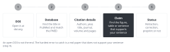

::: {.callout-note collapse="true"}
## This week's goals

- Find literature in this order: reviews, recent primary papers, then citation chasing. Keep a search log as you go.
- Check whether a reference that AI gives really exists, whether its citation details are correct, and whether the paper contains the claim it is cited for.
- Make a reference table that pairs each claim you will cite with a paper, and use it for the Introduction and Discussion.
:::

# 1. Principles {#principles}

- The table you make this week is the evidence for the Introduction in [W9](w09_introduction.qmd) and the Discussion in [W10](w10_discussion.qmd). So do not only collect papers. Next to each paper, write the claim it will support.
- Compound X in the examples is the fictional drug from the course's shared fictional example study. The reference numbers in the examples are placeholders.

## Principle 1. Map the field with reviews first

- Read two or three recent reviews first (from roughly the last five years). Learn the field's terms, its main approaches, its landmark papers and the questions still in dispute.
- From the reviews, collect candidate search terms and two or three anchor papers.
- A review does not replace primary papers. For a specific result, cite the primary paper that reported it.
- Examples:
  - Before: Many studies have reported that TGF-β is important in fibrosis [1–12].
  - After: TGF-β1 increased collagen production by kidney fibroblasts in culture [3] and in mice after UUO [4].

## Principle 2. Find recent primary papers, and mark preprints

- For primary papers, start with the last three years, newest first. Widen the period if that is not enough.
- Vary your search terms in at least three ways. Use synonyms, gene aliases and older terms.
  - Examples: kidney fibrosis / renal fibrosis / tubulointerstitial fibrosis. UUO / unilateral ureteral obstruction. Acta2 / α-SMA.
  - In PubMed, also search with MeSH terms. Example: "Ureteral Obstruction"[MeSH] AND "Fibrosis"[MeSH].
- Search for published papers in [PubMed](https://pubmed.ncbi.nlm.nih.gov/), and for preprints in [bioRxiv](https://www.biorxiv.org/) and medRxiv.
- A preprint has not been through peer review. Mark it as [preprint] in your table, and check whether a published version has come out. If it has, cite the published version.

## Principle 3. Follow citations backward and forward

- Go backward from your two or three anchor papers. Look at the papers they cite.
- Go forward as well. Look at the papers that cite them, especially those from the last 12 months. Use the Cited by list of the database.
- When to stop: stop when new searches return only papers that are already in your table.

## Principle 4. Read the results, not the abstract, and match each claim to a paper

- Find the figure, table or sentence of the paper that holds the claim you will cite, and note it in your table. Mark separately the papers for which you read only the abstract.
- Check that the conditions are the same. The species (human, mouse), the cells and tissue, the experimental approach (in vitro, in vivo) and the disease stage must match before you can cite a paper for the same claim.
- Do not cite papers you have not read. Do not copy entries from another paper's reference list.
- Example (fictional example; suppose that [7] is an experiment in cultured hepatic stellate cells):
  - Before: Compound X inhibits Smad3 phosphorylation in kidney fibroblasts [7].
  - After: Compound X lowered Smad3 phosphorylation in cultured hepatic stellate cells [7].

## Principle 5. Look for opposing results, and log your searches

- Check whether the evidence comes mostly from one lab, one cohort, one method or one species.
- Look on purpose for opposing and negative results. For example, add no association, did not reduce or failed to replicate to your search terms.
- Each time you search, record the date, database, search terms, filters, number of results and number of papers you chose. You will use this log again when you update your searches in W9 and W10, and when you answer reviewers' questions in [W14](w14_reviewer_response.qmd).

# 2. Try it with AI {#try-with-ai}

Ask AI for references, and verify them one at a time (30 min).

- Background: the references that AI gives include made-up ones and ones with wrong citation details.
  - Walters and Wilder (2023) checked 636 citations in short literature reviews written by ChatGPT. The share of fabricated citations was 55% for GPT-3.5 and 18% for GPT-4. Citations of papers that do exist also had errors, in 43% and 24% of cases respectively ([doi:10.1038/s41598-023-41032-5](https://doi.org/10.1038/s41598-023-41032-5)).
  - Bhattacharyya et al. (2023) checked 115 references in medical articles written by ChatGPT-3.5. Of these, 47% were fabricated, 46% were real but had wrong details, and 7% were accurate. The most common error was a wrong PMID ([doi:10.7759/cureus.39238](https://doi.org/10.7759/cureus.39238)).
  - Both studies tested models from 2023. Models and search features have changed since then, but the way to check is the same.
- The [AI policy](https://www.nature.com/nature-portfolio/editorial-policies/ai) of Nature Portfolio lists making up citations as a use that is not allowed.

Steps:

1. (5 min) Choose one claim. The shared topic is the background of the fictional example study (TGF-β/Smad3 signaling in the UUO model, or myofibroblast subtypes in human kidney fibrosis). Track A may use a published, general topic from their own field.
2. (5 min) Use the prompt below to get five references.
3. (15 min) Check them one at a time with the steps in section 3, and put each one into one of the five categories of the classification table.
4. (5 min) Add up the count for each category across the whole class.

```text
I am writing the Introduction of a biomedical paper.
Give me five peer-reviewed papers that support this statement:
"[one claim, e.g. TGF-β/Smad3 signaling promotes kidney fibrosis after
unilateral ureteral obstruction in mice]"

For each paper, give the first author, year, title, journal, DOI and PMID.
Then give the specific result (figure or experiment) in that paper that supports
the statement. If you are not sure that a paper exists, say so instead of guessing.
```

- Track A: a published, general topic falls in the "Free to use" row. Hypotheses, results and grant ideas that you have not yet published fall in the "Do not put in" row of the [AI traffic light](../ai_rules.qmd#traffic-light).
- Track B: you may use the topic of the paper you chose. But do not put in the paper's title or DOI, and turn web search off. Otherwise AI may tell you what the paper's Introduction and Discussion say.
- On either track, references from AI fall in the "Always verify" row.
- It helps to swap tables with a partner and check a few references again. Your partner's table contains claims that have not been published yet, so do not put it into AI.

::: {.callout-tip}
## The same applies to AI tools that search
Check papers from AI tools that search the web or paper databases with the same steps. Even if a paper exists, you still have to check separately whether it contains the claim you will cite.
:::

# 3. Verify and revise {#verify-and-revise}

Steps to check one reference:

{fig-alt="Five steps, numbered 1 to 5, in a row: DOI, database, citation details, claim and status."}

1. DOI: open `https://doi.org/` followed by the DOI. If it does not open, record this. If it opens but shows a different paper, record a mismatch.
2. Database: search for the title in [PubMed](https://pubmed.ncbi.nlm.nih.gov/) and compare the PMID. For papers in fields that PubMed does not cover, use [Crossref Search](https://search.crossref.org/).
3. Citation details: compare the authors (spelling of the first author), year, title, journal, volume and pages with the paper's page, one item at a time.
4. Claim: find the figure, table or sentence in the main text that supports the claim, and note where it is. Check that the species, cells and conditions are the same as in your sentence.
5. Status: check for retractions or corrections in the PubMed record, on the journal's page and in the [Retraction Watch Database](https://retractiondatabase.org/). For a preprint, check whether a published version has come out.

| Category | Meaning | What to do |
|---|---|---|
| Verified | The paper exists, and its citation details and the claim are correct | Add it to the reference table |
| Wrong citation details | The paper exists, but the year, journal, authors, PMID or other details are wrong | Correct them from the paper's page, and record the error |
| Claim mismatch | The paper exists, but it does not contain the claim, or its conditions differ | Revise your sentence to fit the paper, or find another paper |
| Not found | The DOI does not exist or leads to a different paper, and the paper is not in the databases | Discard it, and record it as a fabricated reference |
| Retracted | The paper is marked as retracted | Do not cite it. The only exception is when you discuss the retraction itself |

Where AI often goes wrong in this week's work:

- It makes up papers by putting the names of real researchers on plausible titles.
- It attaches a real DOI or PMID to a different paper.
- It gets the year, volume, pages or PMID wrong.
- It attributes results that are not in the real paper. It turns mouse results into human results, and results from cultured cells into animal results.
- It presents reviews as primary papers, and preprints as published papers.
- It offers retracted papers without saying that they were retracted.

The three checks this week:

- Check the source: this is the main check this week. Check each paper by DOI, in PubMed and in its full text.
- Cross-check: compare with what review papers say or with your supervisor's judgment.
- Read side by side: put AI's summary of a paper next to the matching sentences in the paper, and check that the claim has the same scope.

Build your reference list in a reference manager (for example, Zotero or EndNote) by importing each paper with its DOI or PMID. Do not paste in the citation details that AI gave you.

# Assignment {#assignment}

Reference table and verification log

- Length: about 15 references (including 2–3 reviews), a verification log for at least 5 references suggested by AI (including those from the class exercise), and a search log.
- Format: submit the three tables below as one file (Excel or Word).
- Table 1. Reference table

| Column | What to write |
|---|---|
| No. | 1, 2, 3 … |
| Claim to cite | Your sentence that this paper will support (one sentence in English) |
| Where it goes | One of: Introduction (which paragraph), Discussion comparison, Methods |
| Citation details | First author, year, and journal or [preprint] |
| DOI, PMID | The values you opened and checked yourself |
| Design and data | Species, n and techniques (for example, mouse UUO, n = 6 per group, qPCR) |
| Result that supports the claim | The result in one line, and where it is (for example, Fig. 3b) |
| How you found it | Review, database search, citation chasing (backward or forward), AI suggestion |
| Checks | DOI, PubMed, citation details, full text. Mark it if you read only the abstract |

- Table 2. Verification log of references suggested by AI: date, tool, the citation details AI gave, DOI result, PubMed result, citation details check, claim check, and category (one of the five in the table in section 3).
- Table 3. Search log: date, database, search terms, filters, number of results, and number of papers chosen.
- Track A: search for the claims you will use in the Introduction and Discussion of your manuscript.
- Track B: search on the topic of the paper you chose, but do not read its Introduction and Discussion. Do not use the paper you chose as the starting point (anchor paper) of your search.
- Track B students look at the reference list of the paper they chose only after they submit the W10 Discussion draft. Describe how much it overlaps with your table in the W15 comparison memo.
- Grading criteria:
  1. You checked for every reference that it exists and that its citation details and claim are correct, and you noted where the claim is supported.
  2. The table includes reviews, recent primary papers, papers found by citation chasing and opposing results, and preprints are marked.
  3. The search log is specific enough for someone else to repeat the searches.
- Submission: through the university LMS. Deadlines are announced separately. If you used AI, submit your AI use log with the assignment.

# Notes {#notes}

Search principles, and catching references that AI made up (literature-scout)
