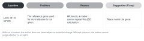

::: {.callout-note collapse="true"}
## This week's goals

- By the end of this week, you can read a classmate's Methods and Results with the review form and write comments that give a location and a reason.
- You can decide for each comment you receive whether to accept it. If you do not accept it, you can give the reason in one line.
- You can explain why a classmate's manuscript must not go into AI, and you can limit your AI use this week to checking your own manuscript.
- You can compare what an AI self-check and a human review each catch and miss.
:::

# 1. Principles {#principles}

This week is peer review week. You swap your Methods from W5 and your Results from W6 with a classmate and read each other's work. The examples come from a fictional example study. In this study, the fictional drug compound X was given to mice in the unilateral ureteral obstruction (UUO) model. The numbers are made up.

## Reviewers point out problems instead of rewriting

- If a reviewer rewrites a sentence, the author does not learn why it needed to change. The reviewer's sentence may also end up in the author's manuscript word for word.
- Give sentence-level suggestions only as examples, in one or two places. The author fixes the rest.

## Each comment gives a location, a problem and a reason

{fig-alt="Four boxes hold the location Lines 14–16, the problem, the reason and the suggestion, each as a fragment of an English sentence."}

- Add a suggestion if you have one. If a comment has no location, the author does not know where to make the change. If it has no reason, the author cannot judge whether to accept it.
- Before: *The Methods are unclear.*
- After: *Lines 14–16 (qPCR): The reference gene used for normalization is not given. Without it, a reader cannot repeat the ΔΔCt calculation. Please name the gene.*
- Before: *The Results need more data.*
- After: *Line 42: "Compound X markedly reduced fibrosis" gives no number. Please add the fibrotic area of each group (mean ± SD), n, and the statistical test, as in the Figure 2B legend.*

## Write the most important problems first

- Major problems: Methods that cannot be repeated, missing n or statistics, numbers that differ between the text and the figures, and interpretation that is stronger than the data.
- Minor problems: words, grammar and format.
- A review with 20 minor problems and no major ones does little for the author. Choose the three biggest problems first, and write the minor ones after them.

## In the Results, read results and interpretation separately

- A Results sentence states what was measured. Mechanisms and meaning belong in the Discussion.
- Before: *Compound X reduced Col1a1 mRNA by 52% (Figure 3A), indicating that it blocks TGF-β signaling.*
- Review comment: Figure 3 measured only mRNA. Signaling is covered in Figure 4. The comment says that the second half of the sentence is interpretation. It asks the author to move that part to the Discussion or to link it to the Figure 4 paragraph.
- After: *Compound X reduced Col1a1 mRNA by 52% compared with vehicle (Figure 3A).*

## A classmate's manuscript does not go into AI

- The "Do not put in" row of the [AI use rules](../ai_rules.qmd) includes "manuscripts under review (including other people's manuscripts you received as a reviewer)". A classmate's manuscript falls under this row. So do a classmate's figure order cards and reference table. Track A manuscripts contain unpublished data, and track B manuscripts are still text that a classmate wrote. So they stay out of AI whatever the track.
- This covers parts of sentences as well as the whole manuscript. You also may not ask AI to summarize it or to draft comments on it.
- If a conceptual question comes up during the review, ask it as a general question without any sentences from the manuscript. This is in the "Free to use" row. Example: *What should a Methods section report about qPCR normalization?*
- Use the manuscript file you received only for the review, and do not send it to anyone else. Delete it when the review is over.

## How the review runs

1. Before class: authors upload the latest version of their Methods, Results, figures and legends to the LMS, with line numbers. Deadlines are announced separately.
2. Pairs: you work in pairs and read each other's manuscripts. The instructor assigns pairs at random. If your partner is from another field, you practice writing so that a reader from a different field can follow. Scientific Reports also recommends showing a manuscript to colleagues from other fields before submission ([submission guidelines](https://www.nature.com/srep/author-instructions/submission-guidelines)).
3. Reading (40 min): on the first pass, only read to the end. Fill in the form below on the second pass.
4. Conversation (10 min): the reviewer explains the three major problems out loud. The author does not argue back and asks questions only to check that they understood the comments.
5. The reviewer gives the form to the author and also uploads it to the LMS.

When you review a track B manuscript, do not look up and read the Results of the original paper. If you have already read them, do not tell the author. The author has not read that part yet.

## Review form

Answer each item with yes, partly or no. Where there is a problem, write the line numbers and a comment. For animal studies, keep the [ARRIVE Essential 10](https://arriveguidelines.org/arrive-guidelines) open beside the form.

| # | Item | Question to check |
|---|---|---|
| M1 | Reproducibility | Could another lab do the same experiment or analysis from these Methods alone? Are the reagents and their sources, concentrations, times, equipment, software versions and parameters given? For dry lab work, are the data accession numbers and the location of the code given? |
| M2 | n | Is it clear what n counts (animals, patients, cells, fields of view)? Is n given for each group, and are excluded samples and the exclusion criteria given? |
| M3 | Statistics | Does the text state the name of the test, the groups compared, the correction for multiple comparisons, and whether the error bars are SD or SEM? |
| M4 | Approvals and sources | Are the approval numbers for animal or human studies given? Are the sources of public data given? |
| R1 | Paragraph structure | Is there one paragraph per figure? Is the first sentence of each paragraph the conclusion sentence for that figure? |
| R2 | Numbers, n, statistics | Does each comparison have numbers, n, the test and the P value, and do they match the figure? |
| R3 | Results and interpretation | Are there sentences that mix in interpretation or explanations of mechanism? Are there words that are stronger than the data (prove, demonstrate, markedly)? |
| R4 | Readability | Does each sentence hold one idea? Are there noun stacks, long modifiers or translationese? (the patterns in [W3](w03_readable_sentences.qmd)) |
| R5 | Consistency | Are the methods that appear in the Results described in the Methods? Do the n and statistics in the legends match the text? |

End the form with two things: the three major problems to fix first, and one specific thing that was done well.

# 2. Try it with AI {#try-with-ai}

In this week's practice, authors use AI only on their own manuscripts. Before the review, you check your own manuscript with AI. After you receive the review, you compare the AI output with your classmate's comments (25 min).

1. Before the review starts (10 min): have your own Methods and Results checked with the prompt below. Save the output, and do not revise the manuscript until the review is over.
2. Give and receive peer review in the order set out in section 1.
3. After the review (10 min): put the AI output and your classmate's comments side by side and sort them into four groups. The groups are points that both raised, points that only your classmate raised, points that only AI raised, and points where AI was wrong.
4. (5 min) Choose the comments you will accept. This leads into the revision table of the assignment.

```text
Below are the Methods and Results of a paper manuscript that I wrote. Do not rewrite anything. Only check them.
For each question below, list the places that have problems, with their line numbers.
1. Could another lab repeat the experiment or analysis exactly from these Methods alone? What information is missing?
2. Does each comparison have n, numbers and a statistical test? Is it clear what n counts?
3. Which sentences in the Results are interpretation rather than results?
4. Which sentences hold two or more ideas, or string together three or more nouns?
Do not guess to fill in information that is not in the manuscript. If you are not sure, write "needs checking".

[Methods]
(paste here)

[Results]
(paste here)
```

If you use AI when you revise your sentences after the review, ask as shown below. You may put in the comments you received as they are, if you meet the conditions for [received reviews](../ai_rules.qmd#received-reviews). Even so, we recommend restating each comment in one line in your own words. When you restate a comment in your own words, you find out whether you understood it.

```text
I received the comment below in a peer review. The comment is my own summary.
Comment: The Methods do not give the reference gene used for qPCR normalization.
Tell me what information I need to add to my paragraph below to answer this comment, and where to add it.
Do not write new sentences. Tell me only the kind of information to add and where to put it. I will check the information itself in my lab records.

[My paragraph]
(paste here)
```

- Track A: your own manuscript is in the "Conditional (track A)" row. Get your supervisor's agreement, and use only tools set so that your input is not used for training. Do not put in raw data or figure files. If you cannot meet these conditions, use the four questions of the first prompt as a checklist and check the manuscript yourself.
- Track B: your manuscript is your own rewrite, so it is in the "Free to use" row. But do not put in the title, authors or DOI of the paper you chose, and turn web search off. Otherwise AI may tell you the Results of the real paper.
- Information that AI says is missing is in the "Always verify" row. Look in your manuscript yourself to see whether it is really missing.
- A classmate's manuscript is in the "Do not put in" row at every step.

# 3. Verify and revise {#verify-and-revise}

These are the places where an AI self-check often goes wrong, and how to check them.

- It says that information is missing when it is already in the manuscript. This happens most often when the information is in a legend or in another paragraph. Check the source: look for it in your own manuscript.
- It fills in missing information with guesses. Common examples are reagent suppliers, catalog numbers, software versions and the names of reference genes. Check the source: confirm them yourself in your lab notebook or analysis records.
- It states the conventions of a field as if they were rules. Example: "Journals always require SEM." Check the original text of your target journal's guidelines, and cross-check with your supervisor.
- It recommends changing the statistical test. The point may be right, but it belongs in the "Always verify" row. Do not change the test on AI's word alone. Cross-check with your supervisor or a statistics textbook.
- It changes the meaning while it polishes a sentence. Example: it changes "reduced" to "significantly attenuated". Read side by side to catch this.
- Some things AI cannot catch at all. You did not give it the figures, so it cannot find numbers that differ between the text and the figures. It also does not know where readers in your field get confused. These are the job of peer review.

Checklist for revising:

- [ ] For each comment, I chose one of accepted, partly accepted or not accepted.
- [ ] For each comment I did not accept, I wrote the reason in one line. Where I judged that the reviewer was wrong, I wrote down my evidence.
- [ ] The numbers, n and statistics in the places I changed match the figures and legends.
- [ ] I checked any information that AI suggested myself, in my lab notebook or raw data.
- [ ] I read each revised sentence side by side with the original and checked that the claim did not become stronger or weaker.

# Assignment {#assignment}

Version revised after peer review

- What to submit (LMS):
  1. Revised version: your revised Methods and Results, with line numbers. Mark the changes with tracked changes or color.
  2. Revision table: one row for each comment you received.
  3. The review form that you wrote for your classmate. This review is graded as part of the peer review grade.
  4. Your AI use log, if you used AI. Add the four-group comparison from section 2 in 3–5 lines.
- Format of the revision table:

| # | Summary of the comment (in my own words) | Action | Where I changed it, or why I did not accept it |
|---|---|---|---|
| 1 (example) | The Methods do not give the qPCR reference gene | Accepted | Added the name of the reference gene at line 15 of the Methods |
| | | | |

- Track A: add only experimental details that you have checked in your lab notebook.
- Track B: check details for the Methods in the Methods of the original paper. You still do not read the Results, Introduction, Discussion or Abstract.
- Grading criteria:
  - Review: each comment has a location and a reason, and major and minor problems are separated.
  - Revision: each comment has an action and a reason. Comments that you did not accept also have evidence.
  - Revised version: the numbers, n and statistics match the figures and legends.
- Grading: the review form is graded as peer review (peer review is 20% of the course grade, of which W8 is 10%). The revision table and the revised version are graded as a weekly assignment. The instructor does the grading. The review in [W12](w12_polishing.qmd) is graded by the same criteria.
- Submit through the university LMS. Deadlines are announced separately.

# Notes {#notes}

Peer review of Methods and Results
