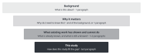

::: {.callout-note collapse="true"}
## This week's goals

- By the end of this week, you can design an Introduction in four steps: background, why it matters, what existing work cannot do, and this study.
- You can state the claim of each paragraph in one sentence and attach its evidence from your W7 reference table.
- You can describe the gap in existing work only as far as you searched, and check that the gap and the design of this study match.
- You can check in the source whether a citation that AI added actually supports the claim of the sentence.
:::

# 1. Principles {#principles}

The examples come from a fictional example study. In this study, the fictional drug compound X reduced fibrosis when it was given to mice in the unilateral ureteral obstruction (UUO) model. Compound X and the numbers are made up. Only [1] and [2] in the examples are real papers, and their DOIs were checked. The other numbers are placeholders for numbers from your W7 reference table.

- [1] Kovesdy CP. Epidemiology of chronic kidney disease: an update 2022. *Kidney Int Suppl.* 2022;12:7–11. <https://doi.org/10.1016/j.kisu.2021.11.003>
- [2] Chevalier RL, Forbes MS, Thornhill BA. Ureteral obstruction as a model of renal interstitial fibrosis and obstructive nephropathy. *Kidney Int.* 2009;75:1145–1152. <https://doi.org/10.1038/ki.2009.86>

## Build the Introduction as a four-step funnel, and start with a specific fact

{fig-alt="Four boxes that narrow from top to bottom: background, why it matters, what existing work has shown and cannot do, and this study. Each box gives the question that readers ask and the usual length."}

| Step | What readers ask | Usual length |
|---|---|---|
| Background | What is this about? | 1 paragraph |
| Why it matters | Why do I need to know this? | End of the background, or 1 paragraph |
| What existing work has shown and cannot do | What is already known, and what is still unknown? | 1–2 paragraphs |
| This study | How does this study fill the gap? | The last paragraph |

- For a manuscript with 3–4 figures, 4–5 paragraphs are enough.
- In the first sentence, give one fact or number that readers can check.
- Before: *Kidney fibrosis has attracted increasing attention in recent years and plays a crucial role in chronic kidney disease.*
- After: *Chronic kidney disease affects more than 800 million people worldwide [1]. Fibrosis is the hallmark of progressive kidney disease of almost any cause [2].*
- The Before sentence contains nothing that readers can check. "attracted increasing attention" and "plays a crucial role" are stock phrases that are common in AI text.

## Each paragraph has a one-sentence claim, with evidence from your W7 table

Before you write any sentences, make a paragraph plan. If the evidence cell of the plan is empty, do one of three things: go back to W7 and find evidence, weaken the claim, or drop the claim.

| Paragraph | One-sentence claim | Evidence | Status |
|---|---|---|---|
| 1. Background | CKD is common, and fibrosis is a shared feature of progressive kidney disease | [1], [2] | Evidence found |
| 2. Why it matters | There are few treatments that reduce fibrosis directly | None | Needs evidence |
| 3. What is known | Studies in cells and animal models have shown that TGF-β/Smad3 signaling causes fibrosis | [3]–[5] | Needs checking: [5] is a paper on liver fibrosis |
| 4. What is missing | Compound X lowered Smad3 phosphorylation in cultured cells, but it has not been tested in the kidney in vivo | [6], W7 search log | Needs checking: confirm "has not been tested" with the search log |
| 5. This study | We tested whether compound X reduces fibrosis in the UUO model | Figures 1–4 of this manuscript | |

## Group earlier studies and say what they show, instead of listing them

- If you write one sentence per paper, readers have to work out what the papers have in common. Write in one sentence what the papers show together, and cite their numbers as a group.
- Before: *[3] showed that Smad3-deficient mice had less fibrosis after UUO. [4] reported that TGF-β1 increased collagen expression in fibroblasts. [5] found that a Smad3 inhibitor reduced fibrosis in another model.*
- After: *Studies in cultured cells and in mouse models show that TGF-β/Smad3 signaling drives collagen production and kidney fibrosis [3, 4].*
- [5] is missing from the After sentence. In the plan, [5] was a paper on liver fibrosis. When you group citations, check again that each number supports the sentence.

## Claim a gap only as far as you searched

- Write "No study has" only when your W7 search log shows it. Otherwise, write "few studies have" with reference numbers, or write "to our knowledge" and keep the search log.
- Make the gap a size that this study can answer. Four kinds of gap are common. No data exist at this resolution. Earlier designs have confounders. Existing methods cannot distinguish X. Results disagree.
- Before: *However, no study has investigated anti-fibrotic drugs in the kidney.*
- After: *Compound X lowers Smad3 phosphorylation in cultured fibroblasts [6]. Whether it reduces kidney fibrosis in vivo has not been reported.*
- Dry lab example (fictional, a study that found the myofibroblast subtype MF2): *Earlier single-cell studies of human kidney fibrosis grouped all myofibroblasts together [7, 8]. It is unclear whether specific myofibroblast subtypes are more abundant in fibrotic kidneys.*

## The design in the last paragraph answers the gap

- If the gap is that something has not been tested in vivo, the design must be an in vivo experiment. If the gap is that there are no human data, a mouse experiment cannot answer it.
- If papers in your target journal usually preview the results, give the main result in one sentence at the end. Use a verb of the same strength as in the Results.
- Before: *In this study, we investigated the role of compound X in kidney disease using various methods.*
- After: *Here, we tested whether compound X reduces fibrosis in the mouse UUO model. We measured the fibrotic area, fibrosis marker genes and Smad3 phosphorylation. Compound X reduced the fibrotic area and lowered Smad3 phosphorylation.*
- You answer the question of this last paragraph in the first paragraph of the Discussion in W10. Write the question down separately.

# 2. Try it with AI {#try-with-ai}

Make the paragraph plan with AI, and check the evidence column yourself. Write sentences only after you have checked the plan (25 min).

1. Without AI (5 min): write the question of this study, the gap and the main result, one sentence each. Take the main result from your conclusion sentences in W6.
2. (10 min) Put the three sentences and your W7 reference table into the first prompt below, and get a paragraph plan.
3. (10 min) Check the source for each number in the evidence column. See whether the paper really makes that claim, and correct the status column.
4. For the assignment: write the paragraphs yourself from the checked plan. If you want an AI draft, use the second prompt and then revise the draft.

```text
I am going to write the Introduction of a biomedical research paper in English. Do not write any sentences yet. Make only a paragraph plan.

Structure: background, why it matters, what existing work has shown and cannot do, this study
Table columns: paragraph | one-sentence claim (in English) | evidence (reference numbers from the table below) | status (evidence found / needs evidence / needs checking)

Rules:
- For evidence, use only numbers from the reference table below. Do not add papers that are not in the table.
- If the one-line summary alone does not make it clear that a paper supports the claim, write "needs checking" as the status.
- Do not write gaps that make absolute claims, such as "no study has".
- Do not use phrases such as "plays a crucial role" or "has attracted increasing attention".

[Question, gap and main result of this study]
(paste the three sentences)

[Reference table: number | authors, year, journal, DOI | my one-line summary, written after reading the paper]
(paste the W7 table)
```

```text
Write paragraph 3 of the paragraph plan below in English.
- Write only one claim per sentence.
- Use only the citation numbers given in the plan. For each sentence, show in parentheses which number supports it.
- Do not string together three or more nouns.
- If a sentence needs evidence that the plan does not have, do not write it. Write [needs evidence] instead.

(paste the checked plan)
```

::: {.callout-tip}
## Give AI the one-line summaries that you wrote yourself

The summaries you give AI must be the ones you wrote in W7 after reading each paper. If you give only the bibliographic details, AI fills in the content of the paper from its training data. Content filled in this way looks plausible even when it is wrong.
:::

- Track A: the question, gap and main result come from your own manuscript, so they are in the "Conditional (track A)" row. Results that you will patent and ideas that you will not make public yet are in the "Do not put in" row.
- Track B: you are in the "Free to use" row. Write without reading the Introduction of the original paper. Take evidence only from your W7 table. In W7 you did not use the paper you chose as the starting point of your literature search, so your W7 table was built separately from that paper's reference list. Do not put the title, authors or DOI of the paper you chose into a prompt. If a tool has web search, turn it off. Otherwise AI may bring you the Introduction of the original paper.
- For both tracks, citations and the way they are linked to sentences are in the "Always verify" row.

# 3. Verify and revise {#verify-and-revise}

These are the places where AI often goes wrong in an Introduction.

- The citation does not support the sentence. AI cites results from another organ, another species or cultured cells as if they were in vivo results. Check the source: find the claim in the Abstract and Results of that paper.
- It slips in papers that are not in your table, or it changes the numbers. Check the source: compare the numbers with your W7 table.
- It inflates the gap. Common phrases are "no study has", "for the first time" and "remains completely unknown". Compare the gap with your W7 search log. Cross-check with your supervisor or classmates whether nobody has really done it.
- It starts with a stock phrase. If "a growing body of evidence" is not followed by specific evidence, delete it.
- The preview of results in the last paragraph is stronger than the Results. Examples are "reverses" and "prevents CKD". Read it side by side with the conclusion sentences of the Results to catch this.
- It lists papers one by one. Group them and rewrite.

::: {.callout-warning}
## A paper can exist and still not support the sentence

In W7 you checked that each paper exists. In W9 you check that the paper supports this sentence. Citations that AI writes often have the right number and point to a real paper, but the paper showed something else.
:::

Checklist:

- [ ] Each paragraph has one claim sentence, and it matches the plan.
- [ ] For each citation number, I found the claim in the source. I checked numbers in the main text, not in the abstract.
- [ ] The scope of the gap sentence matches my W7 search log.
- [ ] The design in the last paragraph answers the gap. The species, model and type of data match.
- [ ] The verbs in the preview of results are as strong as those in the Results.
- [ ] I read each sentence that AI revised side by side with my original.

This week uses all three checks. Check the source for citations, cross-check the gap, and read side by side for sentences that AI revised.

# Assignment {#assignment}

Draft Introduction

- Length: 4–5 paragraphs, about 400–600 words.
- Format: an English manuscript with line numbers. Cite with the numbers from your W7 reference table. Submit the checked paragraph plan (paragraph, claim, evidence, status) with it.
- Track A: it helps to check the gap sentence once with your supervisor.
- Track B: state in one line that you wrote without reading the Introduction of the original paper. You compare your gap with the gap of the original paper in the W15 comparison memo.
- Grading criteria:
  - The four steps are visible, and each paragraph has one claim.
  - The citations actually support the claims of their sentences.
  - The gap and the design in the last paragraph match.
- If you used AI, submit your AI use log with the draft. Submit through the university LMS.
- Deadlines are announced separately.

# Notes {#notes}

Background → why it matters → what existing work cannot do → this study (intro-builder)
