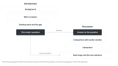

::: {.callout-note collapse="true"}
## This week's goals

- By the end of this week, you can answer the question raised in the Introduction in the first paragraph of the Discussion.
- You can compare your main results with earlier studies from your W7 reference table. When your results differ, you can explain why.
- You can choose verbs and hedging that match the strength of the evidence.
- You can write limitations and next steps that come from the design of this study, not general statements that fit any study.
:::

# 1. Principles {#principles}

The examples come from a fictional example study. In this study, the fictional drug compound X reduced fibrosis in the mouse unilateral ureteral obstruction (UUO) model. The groups are sham, UUO + vehicle and UUO + compound X (10 mg/kg), with n = 6 male C57BL/6J mice per group, 8 weeks old. Kidneys were collected on day 7. As in the Methods example in [W5](w05_methods_legends.qmd), compound X was given daily from the day of surgery (day 0) to day 6. The numbers are made up. The reference numbers in the examples are placeholders for numbers from your W7 reference table.

## The first paragraph answers the question of the Introduction

{fig-alt="On the left, the four boxes of the Introduction narrow to the question of this study. From that question, an arrow goes to the answer to the question on the right. The Discussion then widens to comparison with earlier studies, limitations, and next steps and the last sentence. A dashed line shows that the last sentence also answers the same question."}

- Write with the question from the last paragraph of your W9 Introduction beside you. Example: *Here, we tested whether compound X reduces fibrosis in the mouse UUO model.*
- Present the results in order of importance, not in figure order. Do not summarize the Results again figure by figure.
- Before: *In this study, we first examined body weight and serum creatinine (Figure 1). We then performed Masson's trichrome staining (Figure 2) and qPCR (Figure 3).*
- After: *Compound X reduced kidney fibrosis after UUO in mice. The fibrotic area fell from 18.2% to 9.6%. Compound X also lowered the expression of Col1a1 and Acta2 and the phosphorylation of Smad3.*
- Choose one name for each key term and use it throughout the manuscript. Do not call the fibrotic area scarring or ECM accumulation in other places.

## Compare with earlier studies: which agree, which differ, and why

- Take the papers to compare with from your W7 table. If your results differ, give the most likely reason. Common reasons are the model, dose, timing of treatment, observation period, cohort and measurement technique.
- Write what the data showed and what you inferred in separate sentences.
- Before: *Our findings are consistent with previous studies [7–12].*
- After: *Mice lacking Smad3 also develop less fibrosis after UUO [7], and our results with compound X are consistent with this. Unlike a previous study of a Smad3 inhibitor [8], we found no change in serum creatinine. In UUO the contralateral kidney is intact. Serum creatinine therefore reflects both kidneys and can stay normal even when the obstructed kidney is injured.*
- If you cite numbers all at once, as in [7]–[12], readers cannot tell which paper showed what. Write one comparison per paper.

## Match hedging to the strength of the evidence

| Kind of evidence | Verbs and phrases to use | Example |
|---|---|---|
| Measured directly and tested | reduced, increased, did not change | *Compound X reduced the fibrotic area by 47%.* |
| Changed together, cause not tested | was accompanied by, is associated with, suggests | *Lower fibrosis was accompanied by lower Smad3 phosphorylation. This suggests that compound X acts at least partly through Smad3.* |
| Speculation beyond the data | may, one possibility is (in a separate sentence) | *One possibility is that compound X also reduces inflammation, which we did not measure.* |

- Overstated sentence: *Compound X reverses kidney fibrosis by blocking TGF-β/Smad3 signaling and is a promising therapy for patients with CKD.* This sentence has three problems. Compound X was given from the day of surgery, so it reduced the development of fibrosis rather than reversing it. "by blocking" is a causal link that was not tested. The sentence also extends a mouse result to patients.
- Understated sentence: *Compound X might potentially have a possible effect on fibrosis.* This result was measured directly, with P = 0.0004. With three hedges stacked together, it is no longer clear what was found. Write it like the first row of the table.
- Dry lab example (fictional): the proportion of the myofibroblast subtype MF2 was 24% in 8 patients with fibrosis and 7% in 6 controls (P = 0.008). This is a direct observation. The claim that the subtype "drives" fibrosis is a causal link that was not tested. Write "may contribute to", and state in the limitations that the data are cross-sectional.

## Write only the limitations that apply to this study, with their effect on the conclusion

- For each limitation, write three things: what the limitation is, which part of the conclusion it weakens, and how you reduced it or how it could be reduced.
- Before: *This study has several limitations. First, the sample size was small. Second, only one model was used. Further studies are needed.*
- After: *We started compound X on the day of surgery. Our data therefore show that it limits the development of fibrosis, not that it reverses established fibrosis. We used only male mice, so the effect in female mice is unknown.*
- Limitations that often apply in dry lab work include a small sample of 8 patients and 6 controls, and batch effects from combining public data from several institutions. Others are cross-sectional data from one time point, which cannot show the order of events, and cell annotation that changes with the choice of marker genes. The number of samples used for validation with spatial transcriptomics can also be a limitation.

## Next steps come from the limitations, and the last sentence matches the Introduction

- Do not write only "Further studies are needed". Say which experiment answers which question.
- Before: *Further studies are needed to clarify the mechanism.*
- After: *Starting compound X after fibrosis is established, for example 3 days after UUO, would test whether it can reverse fibrosis. Testing it in Smad3-deficient mice would show whether its effect depends on Smad3.*
- The last sentence is a one-sentence answer to the question in the last paragraph of the Introduction. Example: *Compound X limits fibrosis after UUO in mice, and the lower Smad3 phosphorylation suggests that it acts at least partly through this pathway.*

# 2. Try it with AI {#try-with-ai}

Get a paragraph plan and candidate limitations from AI. Then check the hedging of a first paragraph that you write yourself (25 min).

1. Without AI (5 min): put the question from the last paragraph of your Introduction next to your conclusion sentences from W6 (one for each figure, with numbers).
2. (10 min) Get a paragraph plan and candidate limitations with the first prompt. Mark each candidate limitation as applies, does not apply or not sure.
3. Without AI (5 min): write the first paragraph yourself.
4. (5 min) Check the hedging of the first paragraph with the second prompt. You decide whether to change anything.

```text
I am planning the paragraphs of the Discussion of a biomedical research paper in English. Do not write any sentences. Answer only with two tables.

Table 1 columns: paragraph | main point in one sentence | figure that supports it | papers to compare with (numbers below only)
- The first paragraph answers the question of the Introduction.
- Order the results by importance, not by figure order.
- For papers to compare with, use only numbers from the reference table below. If no paper fits, write "none".

Table 2 columns: limitation of this study | which part of the conclusion it weakens | how to reduce it, or the next experiment
- List only limitations that actually arise from the design below.
- If you list a limitation that fits any study, such as "sample size was small", also say why it is a problem in this design.

[Question of the Introduction]
[Conclusion sentence for each figure, with numbers]
[Design: species, model, groups and n, timing and duration of treatment, what was measured]
[Reference table: number | bibliographic details | my one-line summary, written after reading the paper]
```

```text
Below is the first paragraph of my Discussion. Do not rewrite it. Check each sentence and answer in a table.
Table columns: sentence number | kind of evidence (measured directly / changed together / speculation beyond the data) | verb or hedge used | stronger than, weaker than or matching the evidence
Accept as evidence only what is in the conclusion sentences below.

[Conclusion sentences]
[My first paragraph]
```

- Track A: the design details and conclusion sentences come from your own manuscript, so they are in the "Conditional (track A)" row. A new experiment idea for the next steps may be an idea not yet filed in a grant or patent. If so, it is in the "Do not put in" row. Leave that cell empty and write it yourself.
- Track B: you are in the "Free to use" row. Write without reading the Discussion of the original paper. Take the papers to compare with only from your W7 table, and do not use the paper you chose as the starting point of a literature search. Do not put the title, authors or DOI of the paper you chose into a prompt, and turn web search off. This week's exercise is to find limitations from the figures and Methods alone. You compare them with the limitations that the real authors wrote in the W15 comparison memo.
- For both tracks, the papers to compare with and the links between citations and claims are in the "Always verify" row.

# 3. Verify and revise {#verify-and-revise}

These are the places where AI often goes wrong in a Discussion.

- It writes generic limitations. "small sample size", "single model" and "further studies are needed" appear almost every time. Check whether each one connects to this design, and which sentence of the conclusion it weakens.
- It writes more strongly than the results. It turns correlation into causation ("by blocking"), prevention into treatment ("reverses"), mice into people ("in patients") and one model into a whole disease ("CKD"). Read side by side with the conclusion sentences of the Results to catch this.
- The citations do not support the claims. AI cites several numbers at once, or cites papers with opposite results after "consistent with". Check the source for each number.
- It adds new results or numbers that are not in the Results. Compare with the conclusion sentences.
- It stacks hedges. Example: "may possibly suggest". Keep only one.

::: {.callout-warning}
## Do not copy the list of limitations that AI gives you

If you ask AI for limitations, you get almost the same list every time. Keep only the ones that apply to your design. For each one you keep, write which sentence of the conclusion it weakens. Limitations that only your design has (timing of treatment, sex, limits of the measures you used) are often missing from the AI list, so find them yourself.
:::

Checklist:

- [ ] The first paragraph answers the question of the Introduction.
- [ ] For each paper I compare with, I found the result in the source, and I said correctly whether it agrees or differs.
- [ ] In each sentence, the strength of the verb matches the kind of evidence.
- [ ] Each limitation states its effect on the conclusion.
- [ ] The next steps follow from the limitations.
- [ ] The last sentence answers the same question as the last paragraph of the Introduction.
- [ ] There are no results or numbers that are not in the Results.

This week, check the source for citations, cross-check limitations and interpretation (with your supervisor and classmates), and read side by side for sentences that AI revised.

# Assignment {#assignment}

Draft Discussion

- Length: 4–6 paragraphs, about 500–800 words.
- Format: an English manuscript with line numbers. Cite with the numbers from your W7 reference table. Submit the paragraph plan and the limitations table (limitation, effect on the conclusion, how to reduce it) with it.
- Track A: write at least one limitation that only your design has, such as the timing of treatment, sex or the measures you used.
- Track B: state in one line that you wrote without reading the Discussion of the original paper.
- Grading criteria:
  - The first paragraph answers the question of the Introduction, and the last sentence matches the Introduction.
  - Hedging matches the strength of the evidence.
  - The limitations apply to this design, and their effect on the conclusion is stated.
- If you used AI, submit your AI use log with the draft. Submit through the university LMS.
- Deadlines are announced separately.

# Notes {#notes}

Answering the question raised in the Introduction, hedging, and writing limitations (discussion-builder)
