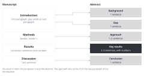

::: {.callout-note collapse="true"}
## This week's goals

- By the end of this week, you can write an Abstract in five parts: background, gap, approach, key results with numbers, and conclusion.
- You can check the word limit and format of the Abstract on your target journal's page.
- When you need to cut words, you can cut units of content instead of grammar.
- You can write three title options of different types and compare their strengths and weaknesses.
:::

# 1. Principles {#principles}

The examples come from two fictional example studies. The wet lab example is a study in which the fictional drug compound X reduced fibrosis in the mouse unilateral ureteral obstruction (UUO) model. The dry lab example is a study that reanalyzed public single-cell RNA sequencing data from human kidney biopsies. It found a myofibroblast subtype, MF2, that was more abundant in patients with fibrosis. The numbers are made up.

## The Abstract has five parts, and each part comes from another part of the manuscript

{fig-alt="Arrows lead from the Introduction, Methods, Results and Discussion of the manuscript on the left to the background, gap, approach, key results and conclusion of the Abstract on the right."}

| Part | Sentences | Where it comes from |
|---|---|---|
| Background | 1 | First paragraph of the Introduction |
| Gap | 1 | Gap sentence of the Introduction |
| Approach | 1–2 | Last paragraph of the Introduction, and the species, model and n in the Methods |
| Key results | 2–3 | Conclusion sentences of the Results. Include the numbers |
| Conclusion | 1 | Last sentence of the Discussion |

- No result or claim should appear only in the Abstract. The numbers must match the Results.
- The three journals in the table under the next principle do not allow references in the Abstract. Most other journals are the same.
- State the species you studied in the Abstract. PLOS ONE requires this in its submission guidelines ([submission guidelines](https://journals.plos.org/plosone/s/submission-guidelines)).

## Check the word limit and format on your target journal's page

| Journal | Abstract | Title |
|---|---|---|
| [Nature Communications](https://www.nature.com/ncomms/submit/article) | Up to 200 words, no references | Up to 15 words |
| [Scientific Reports](https://www.nature.com/srep/author-instructions/submission-guidelines) | Up to 200 words, one paragraph without subheadings, no references | Up to 20 words. Give the main message as one scientifically accurate sentence, without puns or idioms |
| [PLOS ONE](https://journals.plos.org/plosone/s/submission-guidelines) | Up to 300 words, no citations, state the species studied | Up to 250 characters (characters, not words). If the study could be mistaken for a clinical study, name the animal model in the title |

- These details were checked on each journal's page on 2026-11-10. Guidelines change, so check them again before you submit ([W13](w13_submission.qmd)).
- Some journals require a structured abstract with subheadings such as Background, Methods, Results and Conclusions. Check the abstract format in your target journal's instructions.

## To cut words, cut content, not grammar

- When you are over the word limit, it is tempting to drop articles, verbs and connectives and to string nouns together. This lowers the word count but makes the text harder to read. Information can also disappear along with the grammar.
- Instead, drop whole pieces of less important content. List what you dropped so that your coauthors can see it.
- Original results part (59 words):
  *Compound X did not change body weight or serum creatinine. It reduced the fibrotic area on Masson's trichrome staining from 18.2% to 9.6% (n = 6 per group; P = 0.0004). It lowered Col1a1 expression by 52% and Acta2 expression by 38%. Fn1 expression did not change significantly. Compound X also lowered the ratio of phosphorylated to total Smad3.*

- Version cut by dropping grammar (24 words). If you only ask AI to make the text shorter, you often get something like this:
  *Compound X: unchanged body weight/creatinine, reduced trichrome fibrotic area (18.2% vs 9.6%, P = 0.0004), decreased Col1a1/Acta2 expression (52%/38%), unchanged Fn1, lower p-Smad3/Smad3 ratio.*

  It has no verbs, and slashes and a noun stack ("trichrome fibrotic area") have appeared. n = 6 has also disappeared without any note.
- Version cut by dropping content (32 words):
  *Compound X reduced the fibrotic area from 18.2% to 9.6% (n = 6 per group; P = 0.0004). It also lowered the expression of Col1a1 and Acta2 and the phosphorylation of Smad3.*

  Three things were dropped: the result that body weight and serum creatinine did not change, the percentage decrease for each gene, and the result that Fn1 did not change significantly. The dropped results stay in the Results as they are. The main numbers, n and the P value stay in the Abstract unchanged.
- By word count alone, the version without grammar is shorter. But the version without the less important content is the one that readers can read in one pass.

## Write three title options of different types, then choose

| Type | Wet lab example | Dry lab example |
|---|---|---|
| Result (declarative sentence) | *Compound X reduces kidney fibrosis after ureteral obstruction in mice* (10 words) | *A myofibroblast subtype is more abundant in fibrotic human kidneys* (10 words) |
| Descriptive | *Effects of compound X on fibrosis and Smad3 signaling in a mouse model of unilateral ureteral obstruction* (17 words) | *Single-cell reanalysis of myofibroblast subtypes in human kidney biopsies with and without fibrosis* (13 words) |
| Question | *Does compound X limit kidney fibrosis after ureteral obstruction in mice?* (11 words) | *Which myofibroblasts are more abundant in fibrotic human kidneys?* (9 words) |

- Result type: readers know the conclusion from the title alone. This type also fits the Scientific Reports guidelines. It is easy to use a verb that is stronger than the results. For example, mouse UUO results cannot support "prevents chronic kidney disease". In the dry lab example, "expands" means an increase over time, so "is more abundant" is the right choice for data from one time point.
- Descriptive type: there is less risk of overstating, and the title contains search terms. It does not show what you found. Nouns tend to pile up. The wet lab example has 17 words, so it goes over the 15-word limit of Nature Communications.
- Question type: it draws readers' interest. The answer is not in the title. It may not suit journals such as Scientific Reports, which ask for the main message in one sentence.
- Put the species and model in all three types. The verb of the title must not be stronger than the conclusion sentence of the Abstract.

# 2. Try it with AI {#try-with-ai}

Get an Abstract draft from AI, shorten it in two ways, and compare the two versions side by side. Finally, get three title options (30 min).

1. Without AI (5 min): gather the material. You need the background sentence, the gap sentence and the last paragraph of the Introduction, the conclusion sentences of the Results (with numbers and n), the last sentence of the Discussion, and the Abstract word limit of your target journal.
2. (5 min) Get an Abstract draft with the first prompt.
3. (10 min) Shorten the draft twice. The first time, only ask "Make it shorter." The second time, use the prompt that asks AI to cut units of content. Put the two versions side by side, count the words yourself, and look for numbers and n that have disappeared.
4. (10 min) Get three title options with the third prompt, and choose one by the criteria in section 1.

The target word count follows your target journal. If you have no journal yet, practice with 200 words. If your draft is already shorter than the target, set the target 50 words below the length of the draft.

```text
Write a draft Abstract in English using only the material below.
- Order: background 1 sentence, gap 1 sentence, approach 1–2 sentences, key results 2–3 sentences, conclusion 1 sentence
- Use only numbers that are in the conclusion sentences below. Do not make up new numbers or new claims.
- Do not include references.
- Write only one claim per sentence. Do not shorten by dropping articles or verbs.

[Material]
(paste here)
```

```text
Shorten this Abstract to [target word count] words or fewer. Rules:
- Do not shorten by dropping articles, verbs or connectives, or by stringing nouns together. Keep every sentence complete.
- Instead, drop whole units of less important content.
- List separately what you dropped, and give a one-line reason for each.
- Keep the numbers and n that remain exactly as in the original Abstract.
```

```text
Write English titles for the Abstract below, one of each of the three types.
1. A title that states the main result as a declarative sentence
2. A title that describes what was studied
3. A title that asks a question
Rules: [journal limit] or fewer, include the species and model studied, do not use a verb stronger than the conclusion of the Abstract, do not string together three or more nouns.

(paste the Abstract)
```

- Track A: the Abstract material is the core of your manuscript, so it is in the "Conditional (track A)" row. Results that you will patent are in the "Do not put in" row.
- Track B: you are in the "Free to use" row. Write without reading the Abstract of the original paper. Do not put the title, authors or DOI of the paper you chose into a prompt, and turn web search off. Track B students already saw the real title when they chose the paper in W1. Even so, write all three types. You compare them with the real title in the W15 comparison memo.
- Whether the numbers or meaning changed in an Abstract that AI revised is in the "Always verify" row.

# 3. Verify and revise {#verify-and-revise}

These are the places where AI often goes wrong in the Abstract and title.

- It shortens by dropping grammar. Articles and verbs disappear, and slashes and noun stacks appear. Read it side by side with the original version to catch this.
- While shortening, it deletes n, units or the comparison group. Only "reduced by 47%" remains, and what it was compared with disappears. Check the source: compare with the Results.
- Numbers change. AI rounds them (18.2% becomes 18%) or mixes up two numbers. Compare them one by one with the conclusion sentences of the Results.
- It adds claims to the conclusion that are not in the text. Example: "highlighting its therapeutic potential for patients". Read it side by side with the last sentence of the Discussion.
- It counts words wrongly. Do not trust the word count that AI gives you. Count the words yourself with a word processor.
- It makes up journal guidelines. Example: "Nature Communications allows 150 words". Check the source on the journal's page.
- The species is missing from the title, or the verb of the title is stronger than the conclusion of the Abstract. Read the title side by side with the conclusion sentence of the Abstract.

Checklist:

- [ ] All five parts are there, and I can say which sentence of the manuscript each part came from.
- [ ] The numbers, n and P values match the Results.
- [ ] Every sentence is complete. Nothing was shortened into slashes or noun stacks.
- [ ] I have a list of what I dropped, and dropping it does not change the conclusion.
- [ ] I counted the words myself, and the count is within the journal's limit.
- [ ] All three title options include the species and model, and no verb is stronger than the conclusion of the Abstract.

This week you read side by side more than anything else. Check the source for numbers against the Results, and for journal guidelines on the journal's page.

# Assignment {#assignment}

Abstract, and three title options

- Length: the Abstract stays within your target journal's word limit. If you have not chosen a journal, write 200 words or fewer. For the title, write three options of different types.
- Format: put the following in one file, in this order.
  1. The final Abstract and its word count
  2. The version before shortening, the shortened version, and the list of what you dropped (with a one-line reason for each)
  3. The three title options with their word counts, the option you chose, and 2–3 lines on why
  4. Your target journal's guidelines for the Abstract and title, and the URL of the page where you checked them
- Make the numbers in the Abstract match the Results of your W8 revised version.
- Track A: choose the target journal with your supervisor, and follow its guidelines.
- Track B: follow the guidelines of the journal that published the original paper. State in one line that you wrote without reading the Abstract of the original paper. After you submit this assignment, you may read the whole original paper. At that point, keep a separate copy of the whole manuscript you have submitted. This version is the baseline for the W15 comparison memo.
- Grading criteria:
  - The five parts are there, and the numbers and n match the Results.
  - The sentences stayed complete when you shortened the Abstract, and what you dropped is listed with reasons.
  - The three title options are of different types, and none of them is stronger than the results.
- If you used AI, submit your AI use log with the assignment. Submit through the university LMS.
- Deadlines are announced separately.

# Notes {#notes}

To cut words, cut content, not grammar
