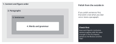

::: {.callout-note collapse="true"}
## This week's goals

By the end of this week, you will be able to:

- Find translationese in your manuscript and rewrite those sentences in English word order.
- Use the ten patterns from [W3](w03_readable_sentences.qmd) as a checklist and go through the whole manuscript.
- Make a term list so that you call each concept by only one term.
- Read a peer's manuscript without AI and tell the author where you got stuck, with locations and questions.
:::

# 1. Principles {#principles}

The examples come from the fictional example study that we have used since W4: the UUO fibrosis model with compound X, and the reanalysis of single-cell RNA sequencing data from kidney biopsies. The numbers are made up.

## Polish from large units down to small ones

{fig-alt="Four nested boxes. From the outside in: content and figure order, paragraphs, sentences, words and grammar. On the right is what to check first."}

- Work in this order: content and figure order → paragraphs → sentences → words and grammar.
- If you polish sentences first, that work is wasted when you later cut or move a paragraph.
- This week, look at one thing first. Does the conclusion sentence of each figure ([W4](w04_figure_storyboard.qmd)) appear with the same strength in the first sentence of its Results paragraph, in the Abstract and in the Title?

## Translationese comes from carrying Korean word order and habits into English

- Rule: do not translate a Korean sentence word by word. Decide the subject and the verb of the English sentence first.
- The habits below often appear when you think in Korean and then put the sentence into English.

| Korean habit | Before | After |
|---|---|---|
| ~임을 확인하였다 (it was confirmed that) | It was confirmed that the fibrotic area was decreased by compound X treatment. | Compound X reduced the fibrotic area from 18.2% to 9.6% (P = 0.0004; Fig. 2b). |
| ~의 경우 (in the case of) | In the case of the UUO + compound X group, body weight was not different with the UUO + vehicle group. | Body weight did not differ between the UUO + compound X and UUO + vehicle groups (Fig. 1b). |
| ~을 통해 (through) | Through single-cell RNA sequencing analysis, it was found that the myofibroblast subtype proportion was increased in fibrosis patients. | The proportion of MF2 myofibroblasts was higher in patients with fibrosis than in controls (24% vs 7%, P = 0.008; Fig. 3). |
| ~에 대한 분석을 수행하였다 (performed an analysis about) | Analysis about the expression of fibrosis markers was performed by qPCR. | We measured *Col1a1*, *Acta2* and *Fn1* expression by qPCR. |
| 또한 ~. 또한 ~. (Also …. Also ….) | Also, *Col1a1* expression was decreased. Also, *Acta2* expression was decreased. | Compound X lowered *Col1a1* expression by 52% and *Acta2* expression by 38% compared with vehicle (Fig. 3). |
| ~로 사료된다 (it is considered that) | It is considered that compound X inhibits fibrosis through the TGF-β/Smad3 pathway. | Compound X also lowered Smad3 phosphorylation (Fig. 4), which suggests that it may act through TGF-β/Smad3 signaling. |

- Look also for grammar mistakes that have the same cause. Examples are plural forms of uncountable nouns, such as informations, researches and evidences, and different with (→ different from).

## Check for signs of AI writing with the ten W3 patterns

- For what each pattern means and for examples, go back to [W3](w03_readable_sentences.qmd#principles). This week you use the patterns as a checklist for the whole manuscript.
- In an English manuscript, it is quicker to search first for the markers below with the find function (Ctrl+F). You do not need to fix every match. Judge whether that sentence is hard to read.

| W3 pattern | What to search for in an English manuscript |
|---|---|
| 1 Noun stack | Noun clusters such as fibrosis marker gene expression level |
| 2 Related words far apart | Sentences in which a long modifier follows the subject and the verb comes late |
| 3 Inanimate subject with an action verb | Verbs such as unveil, orchestrate and fuel (Figure 2 shows and These results suggest are fine) |
| 4 Coined words and rare word combinations | New terms or abbreviations used without a definition |
| 5 Dropped function words | Missing that and the |
| 6 Nominalization | was performed, the analysis of, the measurement of |
| 7 Clauses chained with commas | , highlighting / , suggesting / , underscoring / , leading to |
| 8 Nouns turned into verbs | Made-up verbs such as QC'd and benchmarked |
| 9 English-style commas in Korean sentences | Does not apply to an English manuscript. Look for it in notes and reports you write in Korean |
| 10 Formulaic phrases and visual decoration | plays a crucial role, sheds light on, pivotal, Notably, em dash, bold text |

## Use one term for one concept

- Rule: do not call the same thing by different names. Readers take a different name to mean a different thing.
- English composition classes teach you to avoid repetition. Do not apply that rule in a paper.
- Make a term list. Then match the manuscript, the figure axis labels, the figure legends and the Abstract to it.

| Concept | Chosen term | Other names found in the manuscript |
|---|---|---|
| Area with fibrosis | fibrotic area | fibrosis area, collagen area, Masson-positive area |
| The kidney whose ureter was tied | obstructed kidney | UUO kidney, ligated kidney, injured kidney |
| The group given the drug | UUO + compound X | CK group, K-treated mice, treatment group |
| The myofibroblast subtype that increased | MF2 | MF2 cluster, subpopulation 2, fibrotic cell state |

- Spell out an abbreviation the first time it appears, and use only that abbreviation after that. Whether you spell it out again in the Abstract and in the main text depends on the rules of the target journal ([W13](w13_submission.qmd)).
- Gene and protein notation (italics, capital letters) follows different rules for each species. Check the journal's rules and use one style throughout the manuscript.

## When you read a peer's manuscript, report how you read it instead of rewriting it

- This week is the second peer review week, after [W8](w08_midterm_review.qmd).
- Under the AI use rules, a peer's manuscript, figure order cards and reference table are someone else's manuscript. Do not put them into AI. Read them yourself.
- The reader does not rewrite sentences for the author. Instead, the reader gives back the three things below.
  - Write down the conclusion of each figure as you read it, in one sentence per figure. The author compares these with their own conclusion sentences. If you read a different conclusion, the manuscript did not get that conclusion across.
  - Give the location (page and line) of each sentence you had to read again, and say why.
  - Note the terms where you could not tell whether two names meant the same thing. Write them as questions. Example: Is the "collagen area" in Fig. 2 the same as the "fibrotic area" in the Abstract?
- Write each comment in this order: location, what stopped you, then a question. This is the same structure as the response to reviewers in W14.

# 2. Try it with AI {#try-with-ai}

Check two paragraphs of your manuscript, and pull out a list of the terms used in the whole manuscript (25 min).

1. Choose two paragraphs from your manuscript. One Results paragraph and one paragraph from the Introduction or the Discussion work well (3 min).
2. Use the first prompt to get the problem sentences as a table (5 min). If you get a whole revised paragraph back, it is hard to find what changed. If you get only the flagged parts and the revised sentences, it is easier to read them side by side.
3. Put each sentence that AI revised next to your original sentence. Decide one by one whether to accept it (10 min).
4. Use the second prompt to get a list of terms. Check it yourself with the find function, and make your term list (5 min).
5. Record what you accepted and what you discarded in your AI use log (2 min).

```text
Below is one paragraph from an English manuscript that I wrote. Do not rewrite the paragraph. List in a table only the sentences that meet the criteria below.

Criteria
1. Expressions carried over word for word from Korean (e.g., It was confirmed that, In the case of, Through ... analysis, It is considered that)
2. Phrases with three or more nouns in a row, and verbs turned into nouns (e.g., was performed, the analysis of)
3. Long sentences with an -ing tail after a comma (e.g., , highlighting / , suggesting)
4. Formulaic phrases (e.g., plays a crucial role, sheds light on, pivotal)

Table columns: sentence number | flagged part | criterion number | minimally revised sentence
Rule: Do not change numbers, units, gene names, P values or the strength of claims (words such as suggest, show and may). If you think one of these should change, do not change it. Note it separately below the table.

[paragraph]
```

```text
In the manuscript below, find every place where the same thing is called by different names. Do not revise the manuscript. Only list them in a table.

Table columns: item | names used in the manuscript | the section where each name appears (Abstract, Results, etc.) and the first few words of that sentence
Also check whether each abbreviation is spelled out the first time it appears.

[manuscript]
```

- Track A: these are sentences from your own manuscript, so they fall in the "Conditional (track A)" row of the AI traffic light. Get your supervisor's agreement, and use only tools set so that your input is not used for training. Do not put in raw data or figure files.
- Track B: a track B manuscript falls in the "Free to use" row. You have submitted the W11 assignment, so you may now read the original paper. Do not copy sentences from the original paper. Mark the places you revised after reading the original paper, and write about them in the W15 comparison memo.
- For both tracks, sentences that AI revised fall in the "Always verify" row. Check whether the meaning changed. A peer's manuscript, cards and reference table fall in the "Do not put in" row for either track. You may put in review comments that you received from a peer if you meet the conditions for [received reviews](../ai_rules.qmd#received-reviews).

# 3. Verify and revise {#verify-and-revise}

These are the places where AI often goes wrong in polishing, and how to check them. Mostly you read side by side. For numbers you check the source, and for peer comments you cross-check. Do not accept all of the AI's suggestions at once. Each sentence may read more smoothly, but the terms and the strength of claims across the manuscript become inconsistent.

- [ ] The strength of claims has not changed. Look for increased → significantly increased, suggest → demonstrate, and places where may was dropped. (read side by side)
- [ ] Numbers, units and symbols are unchanged. Compare n = 6 per group, mean ± SD versus ± SEM, P values and μm with your figures and analysis results. (check the source)
- [ ] Gene and protein notation (italics, capital letters) has not changed. (read side by side)
- [ ] AI has not replaced terms with synonyms to avoid repetition. Where it did, change them back to the terms in your term list. (read side by side)
- [ ] AI has not added new signs of AI writing. Check whether , highlighting or Notably newly appears in the revised sentences. (read side by side)
- [ ] Each citation number is still attached to the claim it was attached to before. (read side by side)
- [ ] The sentences have not all been made about the same length. Short and long sentences are mixed naturally.
- [ ] Where a peer read a figure conclusion differently, you resolved it by revising the sentence. If you judged that the peer was wrong, you wrote down why. (cross-check)

# Assignment {#assignment}

Revised full manuscript

- Length: the whole manuscript you have written so far (Title, Abstract, Introduction, Results, Discussion, Methods, Figure legend, references).
- Format
  - Revised manuscript: a Word file. Turn on track changes so that the changes are visible. Add line numbers.
  - Term list: use the table format in the principles above. List the other names that you actually found in your manuscript.
  - Table of responses to peer comments: peer comment | addressed or not | where it changed (page, line). For each comment you did not address, give the reason.
  - The review you wrote for your peer: the three things in the principles above (one sentence for each figure conclusion, the location of and reason for each sentence that stopped you, and questions about confusing terms).
- Differences by track: track B students mark the places they revised after reading the original paper. The reference point for the W15 comparison memo is the version you submitted in W11, not this revised manuscript.
- Grading criteria
  - There is less translationese and fewer W3 patterns, and the meaning and numbers did not change during revision.
  - The whole manuscript follows the term list.
  - For each peer comment, the table says whether and where you addressed it, or why you did not.
- The review you wrote for your peer is graded as part of the peer review score (the W12 share of 10%, out of 20% of the total grade). The criteria are the same as in [W8](w08_midterm_review.qmd#assignment). We check that each comment has a location and a reason, and that major and minor problems are kept apart. The instructor does the grading.
- Submission: through the university LMS. Deadlines are announced separately.
- If you used AI, submit your AI use log as well.

# Notes {#notes}

Checking for translationese and signs of AI writing, consistent terminology, and swapping drafts with a peer
