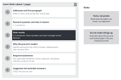

::: {.callout-note collapse="true"}
## This week's goals

By the end of this week, you will be able to:

- Compare two or three candidate journals by scope, recent papers, article types, costs and policies.
- Find the rules in the Guide for Authors that apply to your manuscript, and turn them into a submission checklist.
- Write a cover letter in a set structure.
- Find and delete exaggeration, empty praise of the journal and made-up facts in a cover letter written by AI.
:::

# 1. Principles {#principles}

The journals on this page are only examples of author guideline pages. They are not recommendations for where to submit. The examples come from the fictional example study (the UUO fibrosis model with compound X).

## Choose a journal by the people who will read your manuscript

- Rule: first check whether the people who would read and cite this manuscript read that journal. Do not choose by a single metric.
- Look for candidates in two places. One is the journals that appear often in your reference table from [W7](w07_literature.qmd). The other is the journals that published papers with a similar question or method in the past two or three years, which you can find in PubMed. Record this search in the W7 search log form as well.
- Fill in the table below for each candidate. In each cell, give the link or DOI of the page that supports it.

| Item | What to check |
|---|---|
| Scope (Aims & Scope) | Copy the sentence that matches your manuscript word for word |
| Recent similar papers | DOIs of at least two papers from the past two or three years |
| Article types | The type that fits your manuscript, and its limits on words and figures |
| Access and costs | Whether the journal is open access, and a link to the page on article processing charges (APCs) |
| Policies | AI policy, data sharing, reporting guidelines, whether preprints are allowed, whether peer review records are published |
| Is the journal trustworthy? | The [Think. Check. Submit.](https://thinkchecksubmit.org/) checklist, and the indexing information in the [NLM Catalog](https://www.ncbi.nlm.nih.gov/nlmcatalog/) |

## Read the author guidelines on the journal's own pages

- Rule: author guidelines differ between journals and change often. Read the journal's pages yourself instead of relying on memory or an AI summary.
- Example: the rules of two journals differ even for the same kind of research paper (checked in 2026-11).
  - [Nature Communications, Article](https://www.nature.com/ncomms/submit/article): the Abstract has at most 200 words and contains no references. The main text (excluding the Abstract, Methods, references and figure legends) should be no longer than about 5,000 words. Each figure legend may have up to 350 words. No particular format is required at first submission.
  - [PLOS ONE, Submission guidelines](https://journals.plos.org/plosone/s/submission-guidelines): the Abstract has at most 300 words. There is no limit on the length of the main text or on the number of figures. Pages must be numbered, and lines must be numbered continuously. The cover letter may be at most one page long.
- Limits also differ between article types within the same journal. Find the page for your manuscript's article type.

## Fill in the submission checklist before you enter the submission system

- Manuscript format: word counts (Title, Abstract, main text), order of sections, reference style, page numbers and line numbers.
- Title page: authors, affiliations and the contact details of the corresponding author. Check whether the journal requires ORCID.
- Figure files: file format, resolution, size and fonts. Check the figure specifications that you matched in [W4](w04_figure_storyboard.qmd) again against the target journal's rules. Do not use AI to make or edit data figures ([AI use rules](../ai_rules.qmd#in-the-paper)).
- Reporting guideline checklists: for animal studies, use [ARRIVE](https://arriveguidelines.org/). For clinical studies, find the guideline that fits your study design in the [EQUATOR Network](https://www.equator-network.org/). Some journals use their own form. Example: the [Nature Portfolio reporting summary](https://www.nature.com/nature-portfolio/editorial-policies/reporting-standards).
- Ethics: give the approval number from the animal ethics committee or the IRB in the Methods.
- Data availability statement: state where the raw data are deposited (for example, a GEO accession). In dry lab work, give the accessions of the public data you reanalyzed and the location of your code.
- AI use disclosure: as the [AI use rules](../ai_rules.qmd#in-the-paper) say, state your AI use in the Methods or the Acknowledgments, following the target journal's rules. Check what you confirmed in [W5](w05_methods_legends.qmd) again against the target journal's rules. Some journals also ask you to state it in the cover letter. Example: the [ICMJE recommendations](https://www.icmje.org/recommendations/browse/artificial-intelligence/ai-use-by-authors.html).
- Conflicts of interest, funding and author contributions: use the journal's forms. Examples: the [ICMJE disclosure form](https://www.icmje.org/disclosure-of-interest/), and [CRediT](https://credit.niso.org/) for classifying author contributions.
- Cover letter, and suggested and excluded reviewers (when the journal asks for them).

## Put in the cover letter only the facts that the editor needs to decide whether to send it for review

{fig-alt="Six parts numbered 1 to 6: addressee and first paragraph, research question and why it matters, main results, why this journal's readers, required statements, suggested and excluded reviewers. Two rules are on the right."}

- Structure (about one page)
  1. Addressee and first paragraph: the editor's name (check it on the journal's page), the manuscript title and the article type.
  2. The research question and why it matters: one or two sentences.
  3. Main results: two or three sentences. Use the same numbers and the same strength of claim as in the Abstract.
  4. Why this journal's readers: specific sentences from the Aims & Scope, and related papers published in this journal (only those whose DOIs you have checked).
  5. Required statements: the manuscript is not under consideration elsewhere, all authors agree, conflicts of interest, whether there is a preprint, and AI use.
  6. Suggested and excluded reviewers, if the journal asks for them.
- Rule: write facts that can be checked instead of praise and adjectives.

| Before | After |
|---|---|
| We are pleased to submit our novel and groundbreaking manuscript to your prestigious journal. | We submit our manuscript, "[Title]," for consideration as an Article in [Journal]. |
| Our study is the first to demonstrate that compound X completely prevents kidney fibrosis and offers a new therapy for patients with CKD. | In mice with unilateral ureteral obstruction, compound X (10 mg/kg) reduced the fibrotic area from 18.2% to 9.6% compared with vehicle (n = 6 per group, P = 0.0004). It also lowered *Col1a1* and *Acta2* expression. |
| Given your journal's recent special issue on fibrosis, our work is a perfect fit. | [Journal] recently published [Author et al., Year, DOI], which tested [...] in the same model. Our study extends that work by [...]. |

- The Before sentence in the second row stretches a mouse result into a treatment for patients. Nothing supports completely or the first.
- The Before sentence in the third row mentions a special issue. Write a fact about the journal, like this one, only if you have checked it on the journal's page.

# 2. Try it with AI {#try-with-ai}

Make a checklist from the author guidelines, and get a draft cover letter from a fact memo (30 min).

1. On the target journal's author guidelines page, copy the part that applies to your article type (5 min).
2. Use the first prompt to get a checklist. Choose three items and compare them with the original text (5 min).
3. Write a fact memo (5 min). It contains one sentence with the research question, three main results (with the numbers exactly as in your manuscript), a sentence copied from the Aims & Scope, DOIs of related papers, and the required statements.
4. Use the second prompt to get a draft cover letter (5 min).
5. Revise the draft with the checklist in section 3 below, and record your AI use in your AI use log (10 min).

```text
Below is the [article type] section of the author guidelines of [journal name]. Make a submission checklist using only what is written in this text.

For each item, quote the original sentence from the guidelines word for word. If an item below is not in this text, do not make it up. Write "not in the text" instead.
Items: word counts (Title, Abstract, main text), number of figures and file specifications, reference style, page and line numbers, reporting guidelines, Data availability, AI use disclosure, conflicts of interest, cover letter requirements

[original text of the author guidelines]
```

```text
Using only the fact memo below, write a draft cover letter in English to [journal name].

Rules
- Structure: manuscript title and article type → research question and why it matters → main results → link to the readers of this journal → required statements
- Do not add facts that are not in the fact memo (a special issue of the journal, the editor's name, other papers, numbers). If something is needed but missing, write [needs checking].
- Do not use words such as novel, first, groundbreaking, prestigious or leading.
- Keep the strength of each claim the same as in the sentences of the fact memo.
- 350 words or fewer.

[fact memo]
```

- Author guidelines and the Aims & Scope are public text, so they fall in the "Free to use" row for both tracks.
- Track A: the sentences and numbers from your own manuscript that go into the fact memo fall in the "Conditional (track A)" row. Get your supervisor's agreement, and use only tools set so that your input is not used for training. Do not put in raw data or figure files.
- Track B: a track B manuscript falls in the "Free to use" row. Use the journal that published the original paper as your target journal. For the journal comparison, practice by asking where this manuscript would fit if you sent it somewhere else.
- The checklist and the cover letter that AI writes fall in the "Always verify" row for both tracks.

# 3. Verify and revise {#verify-and-revise}

These are the places where AI often goes wrong with cover letters and submission preparation. Check statements about the journal against the source. Read statements about the results side by side with the Abstract. Cross-check your choice of journal with your supervisor (for track B, with the instructor).

- [ ] Exaggeration: there are no words such as novel, first, unprecedented or completely. The letter does not stretch mouse results into a treatment for patients. (read side by side)
- [ ] The numbers and strength of claims in the main results are the same as in the Abstract. (read side by side)
- [ ] There is no empty praise of the journal (prestigious, leading, broad readership). Instead, the letter gives specific content from the Aims & Scope.
- [ ] You checked every fact about the journal (special issues, recent papers, the editor's name, sentences on scope) on the journal's page or through the DOI. You deleted the sentences you could not check. (check the source)
- [ ] The statements on preprints, submission history, conflicts of interest and AI use are true. No sentence is a default that AI filled in.
- [ ] If you included suggested reviewers, you found their names and affiliations yourself, and none of them is a collaborator or works at your institution. Do not ask AI for reviewer names.
- [ ] The rules in the checklist are not mixed with those of other journals or with old rules. For items without a quoted original sentence, you looked them up again on the page. (check the source)

::: {.callout-warning}
## A common mistake
Giving AI only the journal's name and asking about its rules. AI may answer with the rules as they were when it was trained, or mix in the rules of other journals. Paste in the text of the guidelines page, and have AI answer with the original sentences.
:::

# Assignment {#assignment}

Cover letter

- Length: the cover letter is at most one page (250–400 words in English).
- Format
  - Cover letter: a letter that names the target journal and the manuscript title. Follow the structure above.
  - Journal comparison table: two or three candidates. Use the table format in the principles above, with a link or DOI in each cell.
  - Submission checklist: one target journal. For each item, give the supporting text from the guidelines page and the current state of your manuscript (meets it, or needs fixing).
- Differences by track: track A students choose, with their supervisor, a journal that they could really submit to. Track B students write to the journal that published the original paper, and put one or two other candidates in the comparison table.
- Grading criteria
  - Structure: the results, the link to the journal and the required statements are all there.
  - Facts: every sentence about the journal and the results can be checked through a link, a DOI or the manuscript.
  - Strength of claims: there is no exaggeration, and the claims are the same as in the Abstract.
- Submission: through the university LMS. Deadlines are announced separately.
- If you used AI, submit your AI use log as well.

# Notes {#notes}

Choosing a journal, the Guide for Authors, and the submission checklist
