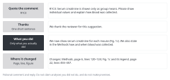

::: {.callout-note collapse="true"}
## This week's goals

By the end of this week, you will be able to:

- Answer a reviewer comment in this order: quote the comment → thanks → what you did → where it changed.
- Answer a comment you do not accept politely and with evidence, and still find something to fix in the manuscript.
- Read a published Peer Review File and analyze how the real authors responded.
- Find promises you did not make, made-up analyses and changed numbers in a draft response written by AI.
:::

# 1. Principles {#principles}

The reviewer comments and responses in the examples are made up, based on the fictional example study (the UUO fibrosis model with compound X). For a real case, see the example of a published peer review record in [Resources](../resources.qmd#papers).

## Answer each comment in four parts

{fig-alt="On the left are four boxes: quote the comment, thanks, what you did, where it changed. On the right is the English sentence for each box."}

- Rule: quote the comment → one sentence of thanks → what you did → where it changed.
- Number the comments by reviewer and copy them as they are (R1C1 is Comment 1 of Reviewer 1).
- Keep the thanks short, in one sentence. Do not repeat long praise for every comment.
- Be specific about what you did. Say what you analyzed or changed, and what the result was.
- Give the location of each change as page, line and figure numbers. If you also copy the changed sentences, the reviewer does not have to search the manuscript.

Fictional comment R1C3: Serum creatinine is shown only as group means. Please show individual values and explain how blood was collected.

- Before: We thank the reviewer for this excellent and insightful comment. We have revised the manuscript accordingly.
- After: We thank the reviewer for this suggestion. We now show serum creatinine for each mouse (Fig. 1c). We also state in the Methods how and when blood was collected. Changes: Methods, page 6, lines 120–124; Fig. 1c and its legend, page 22, lines 455–457.

## When you do not accept a comment, give your evidence and match your claim to it

- Rule: do not write only a refusal. Explain with facts why you did not do it. Then fix what you can fix in the manuscript, such as a sentence on limitations or the scope of the conclusion.
- One comment may contain several requests. Split it into sentences and answer each request.

Fictional comment R2C1: A second fibrosis model, such as folic acid nephropathy, is needed to support the conclusion.

- Before: We respectfully disagree. This experiment is not necessary for our study.
- After: We agree that a second model would show whether the effect of compound X depends on obstruction. We did not add this experiment because it requires a new animal protocol that could not be approved within the revision period. We now state this as a limitation and restrict our conclusion to the UUO model (Discussion, page 15, lines 318–322).

A real case: read R1C2 in the Peer Review File of Weinand et al. (2024). The reviewer asked the authors to look again at the samples with few cells, to remove them if needed, and at least to state this as a limitation. The authors showed the results of a reanalysis without those samples and explained why they kept the samples. They also added this analysis to the Results and the limitation to the Discussion. In this way they answered all three requests.

## Write only what you did

- Rule: every have added and now show in the response letter must be found at that location in the revised manuscript.
- Do not answer with promises about the future (we will, in future studies). If you did not do something, say that you did not do it.
- The numbers in the response letter must be the same as those in the revised manuscript. For example, if the revised manuscript gives the fibrotic area as 18.2% and 9.6%, the response letter gives the same values.
- At the top of the letter, state which version the page and line numbers refer to: the version with tracked changes or the clean version.

## If a reviewer misread the manuscript, take it as a sign that the manuscript did not explain enough

- Rule: do not blame the reviewer. Fix the place in the manuscript where the misunderstanding arose.
- Before: The reviewer has misunderstood our data. We clearly measured the fibrotic area in the cortex only.
- After: We did not state this clearly in the original manuscript. We measured the fibrotic area in the cortex only. We now state this in the Methods (page 7, line 140) and in the Figure 2 legend (page 23, line 470).

## Summarize the main changes at the top of the response letter

- If several reviewers raised the same point, group it in a summary at the top. In the answers to each comment, refer back to that summary.
- The response letter of Weinand et al. (2024) also first summarized four main changes, and gave for each change the numbers of the comments it addressed.

# 2. Try it with AI {#try-with-ai}

Take one comment from a published Peer Review File, get two AI drafts of a response, and compare them with the real authors' response (30 min).

Practice material: [Weinand et al. (2024), *Nature Communications* 15:4650](https://doi.org/10.1038/s41467-024-48620-7). The Peer Review File (PDF, 54 pages) is under Supplementary information on the paper's page. It contains, in this order, the first-round comments of three reviewers, the authors' response letter and the second-round reviewer comments. This journal publishes the peer review records of all research articles submitted on or after 2022-11-01 ([Nature Communications, Transparent Peer Review](https://www.nature.com/ncomms/submit/tpr-faq)). The file does not include confidential comments sent only to the editor, or the editor's letters.

1. Choose one comment. If this is your first time, we suggest R1C2. Do not read the authors' response yet (3 min).
2. Put only the reviewer comment into the first prompt, and get a response (3 min).
3. Now read the authors' response. List what the authors actually did and where the manuscript changed (8 min).
4. Put the comment and that list into the second prompt, and get a response (3 min).
5. Put the two drafts next to the authors' response, and mark them with the checklist in section 3 (10 min).
6. Record this in your AI use log (3 min).

```text
Below is one reviewer comment from a published Peer Review File. Write a response to this comment in English from the authors' point of view.

[reviewer comment]
```

```text
Write a response in English to the reviewer comment below. The only things the authors actually did are those in the [what we did] list.

Rules
- Order: quote the comment → one sentence of thanks → what we did → where the manuscript changed
- Do not add analyses, experiments or numbers that are not in [what we did].
- Do not make promises about the future (we will, in future studies).
- Give only the locations written in [locations]. If none is given, write [location needs checking].
- Split the comment into its separate requests. Below the response, show in a table whether each request was answered.

[reviewer comment]
[what we did]
[locations]
```

- A published Peer Review File is part of a published paper, so it falls in the "Free to use" row for both tracks. The analyses, numbers and locations in a response written by AI fall in the "Always verify" row.
- Track A: use Weinand et al. (2024) above.
- Track B: use the Peer Review File of the paper you chose. You already read the original paper after W11, so read the Peer Review File together with the original paper. Choose a comment that also applies to your own manuscript. In the second prompt, fill in [what we did] and [locations] with what you actually changed in your manuscript. If the Peer Review File of your paper is not published, use the same material as track A.

::: {.callout-warning}
## After a real submission, the rules are different
The practice material this week is a Peer Review File that has already been published. A manuscript that you have actually submitted is under review, so it falls in the "Do not put in" row of the AI traffic light. You may put in the review comments that you received on that manuscript if you meet the conditions for [received reviews](../ai_rules.qmd#received-reviews). Even then, give AI only the comment and the [what we did] list, as in the second prompt above. Do not put in sentences from your manuscript.

Check the journal's rules first. For example, the [Nature Portfolio AI policy](https://www.nature.com/nature-portfolio/editorial-policies/ai) gives translating and organizing reviewer comments as an example of permitted AI use. The same policy also says not to upload manuscripts and peer review reports to public AI systems that are not secure.
:::

# 3. Verify and revise {#verify-and-revise}

These are the places where AI often goes wrong in responses to reviewers. Check the authors' response and the revised manuscript against the source. Read the AI draft side by side with the [what we did] list.

- [ ] Made-up analyses: there are no experiments or analyses that the authors did not do (additional staining, a validation cohort). (read side by side)
- [ ] Promises you did not make: if the draft says we will or will be addressed in future studies, delete it, or state truthfully that you did not do it.
- [ ] Changed numbers: the numbers of samples and cells and the P values are the same as in the authors' response or the revised manuscript. (check the source)
- [ ] Made-up locations: the page, line and figure numbers exist, and the content that the response describes is at that place. (check the source)
- [ ] New references: you found each reference newly cited in the response yourself, as in [W7](w07_literature.qmd). You checked it through its DOI or PubMed and recorded it in your search log. Do not use references that AI suggested as they are. (check the source)
- [ ] Missed requests: when you split the comment into its requests, none of them is left unanswered.
- [ ] Strength of claims: there are no phrases stronger than what you did, such as fully addressed or clearly demonstrates. (read side by side)
- [ ] Tone: the thanks is one sentence, and no sentence blames the reviewer.

The first draft, made from the comment alone, will probably contain many made-up analyses and promises. The difference between the two drafts shows why you give AI a list of facts.

# Assignment {#assignment}

One response letter

- Length: an English response to one reviewer comment (150–300 words) and a comparison memo written in Korean (half a page).
- Format
  - Response: quote the comment → thanks → what you did → where it changed.
  - Comparison memo: where your response differs from the real authors' response, and what you would take from the authors' response and what you would fix.
- Differences by track
  - Track A: one comment from Weinand et al. (2024). We suggest one of R1C2, R1C7 and R3C10. For what was done and where it changed, use only what the authors' response says.
  - Track B: one comment from the Peer Review File of your paper that also applies to your manuscript. Actually revise your manuscript, and give the page and line numbers of your manuscript.
  - Instead of Weinand et al. (2024), track A students may answer a comment they received in the W12 peer review. In that case, what you did and where it changed come from what you actually changed in your revised manuscript. There is no authors' response, so in the comparison memo write where the AI's first draft and your response differ. Peer comments follow the conditions for [received reviews](../ai_rules.qmd#received-reviews).
- Grading criteria
  - All four parts are there, and every request in the comment is answered.
  - What you did, the numbers and the locations match the source (the authors' response or your revised manuscript), and there are no promises you did not make.
  - Where you did not accept a request, you give evidence, and you made a matching change in the manuscript.
- Submission: through the university LMS. Deadlines are announced separately.
- If you used AI, submit your AI use log as well.

# Notes {#notes}

Practicing responses with a published Peer Review File: thanks → what you did → where the change is
