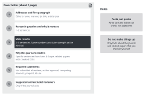
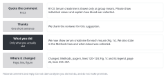

::: {.callout-note collapse="true"}
## This week's goals

By the end of this week, you will be able to:

- Compare two or three candidate journals by scope, recent papers, article types, costs and policies.
- Find the rules in the Guide for Authors that apply to your manuscript, and turn them into a submission checklist.
- Write a cover letter in a set structure.
- Find and delete exaggeration, empty praise of the journal and made-up facts in a cover letter written by AI.
- Answer a reviewer comment in this order: quote the comment → thanks → what you did → where it changed.
- Answer a comment you do not accept politely and with evidence, and still find something to fix in the manuscript.
- Read a published Peer Review File and analyze how the real authors responded.
- Find promises you did not make, made-up analyses and changed numbers in a draft response written by AI.
:::

# 1. Principles {#principles}

This week covers two jobs together: sending the manuscript to a journal, and answering the reviewers' comments. The first four principles are about preparing to submit. The last five are about responding to reviewers.

## Preparing to submit {#submission}

The journals on this page are only examples of author guideline pages. They are not recommendations for where to submit. The examples come from the fictional example study (the UUO fibrosis model with compound X).

### 1) Choose a journal by the people who will read your manuscript

- Rule: first check whether the people who would read and cite this manuscript read that journal. Do not choose by a single metric.
- Look for candidates in two places. One is the journals that appear often in your reference table from [W8](w08_literature.qmd). The other is the journals that published papers with a similar question or method in the past two or three years, which you can find in PubMed. Record this search in the W8 search log form as well.
- Fill in the table below for each candidate. In each cell, give the link or DOI of the page that supports it.

| Item | What to check |
|---|---|
| Scope (Aims & Scope) | Copy the sentence that matches your manuscript word for word |
| Recent similar papers | DOIs of at least two papers from the past two or three years |
| Article types | The type that fits your manuscript, and its limits on words and figures |
| Access and costs | Whether the journal is open access, and a link to the page on article processing charges (APCs) |
| Policies | AI policy, data sharing, reporting guidelines, whether preprints are allowed, whether peer review records are published |
| Is the journal trustworthy? | The [Think. Check. Submit.](https://thinkchecksubmit.org/) checklist, and the indexing information in the [NLM Catalog](https://www.ncbi.nlm.nih.gov/nlmcatalog/) |

### 2) Read the author guidelines on the journal's own pages

- Rule: author guidelines differ between journals and change often. Read the journal's pages yourself instead of relying on memory or an AI summary.
- Example: the rules of two journals differ even for the same kind of research paper (checked in 2026-11).
  - [Nature Communications, Article](https://www.nature.com/ncomms/submit/article): the Abstract has at most 200 words and contains no references. The main text (excluding the Abstract, Methods, references and figure legends) should be no longer than about 5,000 words. Each figure legend may have up to 350 words. No particular format is required at first submission.
  - [PLOS ONE, Submission guidelines](https://journals.plos.org/plosone/s/submission-guidelines): the Abstract has at most 300 words. There is no limit on the length of the main text or on the number of figures. Pages must be numbered, and lines must be numbered continuously. The cover letter may be at most one page long.
- Limits also differ between article types within the same journal. Find the page for your manuscript's article type.

### 3) Fill in the submission checklist before you enter the submission system

- Manuscript format: word counts (Title, Abstract, main text), order of sections, reference style, page numbers and line numbers.
- Title page: authors, affiliations and the contact details of the corresponding author. Check whether the journal requires ORCID.
- Figure files: file format, resolution, size and fonts. Check the figure specifications that you matched in [W5](w05_figure_storyboard.qmd) again against the target journal's rules. Do not use AI to make or edit data figures ([AI use rules](../ai_rules.qmd#in-the-paper)).
- Reporting guideline checklists: for animal studies, use [ARRIVE](https://arriveguidelines.org/). For clinical studies, find the guideline that fits your study design in the [EQUATOR Network](https://www.equator-network.org/). Some journals use their own form. Example: the [Nature Portfolio reporting summary](https://www.nature.com/nature-portfolio/editorial-policies/reporting-standards).
- Ethics: give the approval number from the animal ethics committee or the IRB in the Methods.
- Data availability statement: state where the raw data are deposited (for example, a GEO accession). In dry lab work, give the accessions of the public data you reanalyzed and the location of your code.
- AI use disclosure: as the [AI use rules](../ai_rules.qmd#in-the-paper) say, state your AI use in the Methods or the Acknowledgments, following the target journal's rules. Check what you confirmed in [W6](w06_methods_legends.qmd) again against the target journal's rules. Some journals also ask you to state it in the cover letter. Example: the [ICMJE recommendations](https://www.icmje.org/recommendations/browse/artificial-intelligence/ai-use-by-authors.html).
- Conflicts of interest, funding and author contributions: use the journal's forms. Examples: the [ICMJE disclosure form](https://www.icmje.org/disclosure-of-interest/), and [CRediT](https://credit.niso.org/) for classifying author contributions.
- Cover letter, and suggested and excluded reviewers (when the journal asks for them).

### 4) Put in the cover letter only the facts that the editor needs to decide whether to send it for review

{fig-alt="Six parts numbered 1 to 6: addressee and first paragraph, research question and why it matters, main results, why this journal's readers, required statements, suggested and excluded reviewers. Two rules are on the right."}

- Structure (about one page)
  1. Addressee and first paragraph: the editor's name (check it on the journal's page), the manuscript title and the article type.
  2. The research question and why it matters: one or two sentences.
  3. Main results: two or three sentences. Use the same numbers and the same strength of claim as in the Abstract.
  4. Why this journal's readers: specific sentences from the Aims & Scope, and related papers published in this journal (only those whose DOIs you have checked).
  5. Required statements: the manuscript is not under consideration elsewhere, all authors agree, conflicts of interest, whether there is a preprint, and AI use.
  6. Suggested and excluded reviewers, if the journal asks for them.
- Rule: write facts that can be checked instead of praise and adjectives.

| Before | After |
|---|---|
| We are pleased to submit our novel and groundbreaking manuscript to your prestigious journal. | We submit our manuscript, "[Title]," for consideration as an Article in [Journal]. |
| Our study is the first to demonstrate that compound X completely prevents kidney fibrosis and offers a new therapy for patients with CKD. | In mice with unilateral ureteral obstruction, compound X (10 mg/kg) reduced the fibrotic area from 18.2% to 9.6% compared with vehicle (n = 6 per group, P = 0.0004). It also lowered *Col1a1* and *Acta2* expression. |
| Given your journal's recent special issue on fibrosis, our work is a perfect fit. | [Journal] recently published [Author et al., Year, DOI], which tested [...] in the same model. Our study extends that work by [...]. |

- The Before sentence in the second row stretches a mouse result into a treatment for patients. Nothing supports completely or the first.
- The Before sentence in the third row mentions a special issue. Write a fact about the journal, like this one, only if you have checked it on the journal's page.

## Responding to reviewers {#response}

The reviewer comments and responses in the examples are made up, based on the fictional example study (the UUO fibrosis model with compound X). For a real case, see the example of a published peer review record in [Resources](../resources.qmd#papers).

### 1) Answer each comment in four parts

{fig-alt="On the left are four boxes: quote the comment, thanks, what you did, where it changed. On the right is the English sentence for each box."}

- Rule: quote the comment → one sentence of thanks → what you did → where it changed.
- Number the comments by reviewer and copy them as they are (R1C1 is Comment 1 of Reviewer 1).
- Keep the thanks short, in one sentence. Do not repeat long praise for every comment.
- Be specific about what you did. Say what you analyzed or changed, and what the result was.
- Give the location of each change as page, line and figure numbers. If you also copy the changed sentences, the reviewer does not have to search the manuscript.

Fictional comment R1C3: Serum creatinine is shown only as group means. Please show individual values and explain how blood was collected.

```{.text .before}
We thank the reviewer for this excellent and insightful comment. We have revised the manuscript accordingly.
```

```{.text .after}
We thank the reviewer for this suggestion. We now show serum creatinine for each mouse (Fig. 1c). We also state in the Methods how and when blood was collected. Changes: Methods, page 6, lines 120–124; Fig. 1c and its legend, page 22, lines 455–457.
```

### 2) When you do not accept a comment, give your evidence and match your claim to it

- Rule: do not write only a refusal. Explain with facts why you did not do it. Then fix what you can fix in the manuscript, such as a sentence on limitations or the scope of the conclusion.
- One comment may contain several requests. Split it into sentences and answer each request.

Fictional comment R2C1: A second fibrosis model, such as folic acid nephropathy, is needed to support the conclusion.

```{.text .before}
We respectfully disagree. This experiment is not necessary for our study.
```

```{.text .after}
We agree that a second model would show whether the effect of compound X depends on obstruction. We did not add this experiment because it requires a new animal protocol that could not be approved within the revision period. We now state this as a limitation and restrict our conclusion to the UUO model (Discussion, page 15, lines 318–322).
```

A real case: read R1C2 in the Peer Review File of Weinand et al. (2024). The reviewer asked the authors to look again at the samples with few cells, to remove them if needed, and at least to state this as a limitation. The authors showed the results of a reanalysis without those samples and explained why they kept the samples. They also added this analysis to the Results and the limitation to the Discussion. In this way they answered all three requests.

### 3) Write only what you did

- Rule: every have added and now show in the response letter must be found at that location in the revised manuscript.
- Do not answer with promises about the future (we will, in future studies). If you did not do something, say that you did not do it.
- The numbers in the response letter must be the same as those in the revised manuscript. For example, if the revised manuscript gives the fibrotic area as 18.2% and 9.6%, the response letter gives the same values.
- At the top of the letter, state which version the page and line numbers refer to: the version with tracked changes or the clean version.

### 4) If a reviewer misread the manuscript, take it as a sign that the manuscript did not explain enough

- Rule: do not blame the reviewer. Fix the place in the manuscript where the misunderstanding arose.

```{.text .before}
The reviewer has misunderstood our data. We clearly measured the fibrotic area in the cortex only.
```

```{.text .after}
We did not state this clearly in the original manuscript. We measured the fibrotic area in the cortex only. We now state this in the Methods (page 7, line 140) and in the Figure 2 legend (page 23, line 470).
```

### 5) Summarize the main changes at the top of the response letter

- If several reviewers raised the same point, group it in a summary at the top. In the answers to each comment, refer back to that summary.
- The response letter of Weinand et al. (2024) also first summarized four main changes, and gave for each change the numbers of the comments it addressed.

# 2. Try it with AI {#try-with-ai}

## Practice 1. Submission checklist and cover letter {#practice-submission}

Make a checklist from the author guidelines, and get a draft cover letter from a fact memo (30 min).

1. On the target journal's author guidelines page, copy the part that applies to your article type (5 min).
2. Use the first prompt to get a checklist. Choose three items and compare them with the original text (5 min).
3. Write a fact memo (5 min). It contains one sentence with the research question, three main results (with the numbers exactly as in your manuscript), a sentence copied from the Aims & Scope, DOIs of related papers, and the required statements.
4. Use the second prompt to get a draft cover letter (5 min).
5. Revise the draft with the [cover letter and submission checklist](#verify-submission) in section 3 below, and record your AI use in your AI use log (10 min).

```text
Below is the [article type] section of the author guidelines of [journal name]. Make a submission checklist using only what is written in this text.

For each item, quote the original sentence from the guidelines word for word. If an item below is not in this text, do not make it up. Write "not in the text" instead.
Items: word counts (Title, Abstract, main text), number of figures and file specifications, reference style, page and line numbers, reporting guidelines, Data availability, AI use disclosure, conflicts of interest, cover letter requirements

[original text of the author guidelines]
```

```text
Using only the fact memo below, write a draft cover letter in English to [journal name].

Rules
- Structure: manuscript title and article type → research question and why it matters → main results → link to the readers of this journal → required statements
- Do not add facts that are not in the fact memo (a special issue of the journal, the editor's name, other papers, numbers). If something is needed but missing, write [needs checking].
- Do not use words such as novel, first, groundbreaking, prestigious or leading.
- Keep the strength of each claim the same as in the sentences of the fact memo.
- 350 words or fewer.

[fact memo]
```

- Author guidelines and the Aims & Scope are public text, so they fall in the "Free to use" row for both tracks.
- Track A: the sentences and numbers from your own manuscript that go into the fact memo fall in the "Conditional (track A)" row. Get your supervisor's agreement, and use only tools set so that your input is not used for training. Do not put in raw data or figure files.
- Track B: a track B manuscript falls in the "Free to use" row. Use the journal that published the original paper as your target journal. For the journal comparison, practice by asking where this manuscript would fit if you sent it somewhere else.
- The checklist and the cover letter that AI writes fall in the "Always verify" row for both tracks.

## Practice 2. Responding to reviewers {#practice-response}

Take one comment from a published Peer Review File, get two AI drafts of a response, and compare them with the real authors' response (30 min).

Practice material: [Weinand et al. (2024), *Nature Communications* 15:4650](https://doi.org/10.1038/s41467-024-48620-7). The Peer Review File (PDF, 54 pages) is under Supplementary information on the paper's page. It contains, in this order, the first-round comments of three reviewers, the authors' response letter and the second-round reviewer comments. This journal publishes the peer review records of all research articles submitted on or after 2022-11-01 ([Nature Communications, Transparent Peer Review](https://www.nature.com/ncomms/submit/tpr-faq)). The file does not include confidential comments sent only to the editor, or the editor's letters.

1. Choose one comment. If this is your first time, we suggest R1C2. Do not read the authors' response yet (3 min).
2. Put only the reviewer comment into the first prompt, and get a response (3 min).
3. Now read the authors' response. List what the authors actually did and where the manuscript changed (8 min).
4. Put the comment and that list into the second prompt, and get a response (3 min).
5. Put the two drafts next to the authors' response, and mark them with the [responding to reviewers checklist](#verify-response) in section 3 (10 min).
6. Record this in your AI use log (3 min).

```text
Below is one reviewer comment from a published Peer Review File. Write a response to this comment in English from the authors' point of view.

[reviewer comment]
```

```text
Write a response in English to the reviewer comment below. The only things the authors actually did are those in the [what we did] list.

Rules
- Order: quote the comment → one sentence of thanks → what we did → where the manuscript changed
- Do not add analyses, experiments or numbers that are not in [what we did].
- Do not make promises about the future (we will, in future studies).
- Give only the locations written in [locations]. If none is given, write [location needs checking].
- Split the comment into its separate requests. Below the response, show in a table whether each request was answered.

[reviewer comment]
[what we did]
[locations]
```

- A published Peer Review File is part of a published paper, so it falls in the "Free to use" row for both tracks. The analyses, numbers and locations in a response written by AI fall in the "Always verify" row.
- Track A: use Weinand et al. (2024) above.
- Track B: use the Peer Review File of the paper you chose. You already read the original paper after [W12](w12_abstract_title.qmd), so read the Peer Review File together with the original paper. Choose a comment that also applies to your own manuscript. In the second prompt, fill in [what we did] and [locations] with what you actually changed in your manuscript. If the Peer Review File of your paper is not published, use the same material as track A.

::: {.callout-warning}
## After a real submission, the rules are different
The practice material this week is a Peer Review File that has already been published. A manuscript that you have actually submitted is under review, so it falls in the "Do not put in" row of the AI traffic light. You may put in the review comments that you received on that manuscript if you meet the conditions for [received reviews](../ai_rules.qmd#received-reviews). Even then, give AI only the comment and the [what we did] list, as in the second prompt above. Do not put in sentences from your manuscript.

Check the journal's rules first. For example, the [Nature Portfolio AI policy](https://www.nature.com/nature-portfolio/editorial-policies/ai) gives translating and organizing reviewer comments as an example of permitted AI use. The same policy also says not to upload manuscripts and peer review reports to public AI systems that are not secure.
:::

::: {#ai-lab}
AI lab: press the "Put in the AI lab" button under a prompt block above, or write a prompt yourself and send it. Fill in the blanks in the prompt with your own text before you send it. The class code is announced separately. On one page the conversation continues. To start again, press "New conversation". Do practice 1 and practice 2 in separate conversations. In practice 2, also send the second prompt in a new conversation, so that the second draft does not copy the first. Text that you put in this box goes to an outside AI service through the course API key. Input sent through the API is not used for training by default. Follow the AI traffic light notes above for what you may put in. Put in your own manuscript (track A) only with your supervisor's agreement. Do not put in raw data or figure files. The AI in this box does not search the web. In your AI use log, write "AI lab" and the model name shown under each reply as the tool.
:::

# 3. Verify and revise {#verify-and-revise}

## Cover letter and submission {#verify-submission}

These are the places where AI often goes wrong with cover letters and submission preparation. Check statements about the journal against the source. Read statements about the results side by side with the Abstract. Cross-check your choice of journal with your supervisor (for track B, with the instructor).

- [ ] Exaggeration: there are no words such as novel, first, unprecedented or completely. The letter does not stretch mouse results into a treatment for patients. (read side by side)
- [ ] The numbers and strength of claims in the main results are the same as in the Abstract. (read side by side)
- [ ] There is no empty praise of the journal (prestigious, leading, broad readership). Instead, the letter gives specific content from the Aims & Scope.
- [ ] You checked every fact about the journal (special issues, recent papers, the editor's name, sentences on scope) on the journal's page or through the DOI. You deleted the sentences you could not check. (check the source)
- [ ] The statements on preprints, submission history, conflicts of interest and AI use are true. No sentence is a default that AI filled in.
- [ ] If you included suggested reviewers, you found their names and affiliations yourself, and none of them is a collaborator or works at your institution. Do not ask AI for reviewer names.
- [ ] The rules in the checklist are not mixed with those of other journals or with old rules. For items without a quoted original sentence, you looked them up again on the page. (check the source)

::: {.callout-warning}
## A common mistake
Giving AI only the journal's name and asking about its rules. AI may answer with the rules as they were when it was trained, or mix in the rules of other journals. Paste in the text of the guidelines page, and have AI answer with the original sentences.
:::

## Responding to reviewers {#verify-response}

These are the places where AI often goes wrong in responses to reviewers. Check the authors' response and the revised manuscript against the source. Read the AI draft side by side with the [what we did] list.

- [ ] Made-up analyses: there are no experiments or analyses that the authors did not do (additional staining, a validation cohort). (read side by side)
- [ ] Promises you did not make: if the draft says we will or will be addressed in future studies, delete it, or state truthfully that you did not do it.
- [ ] Changed numbers: the numbers of samples and cells and the P values are the same as in the authors' response or the revised manuscript. (check the source)
- [ ] Made-up locations: the page, line and figure numbers exist, and the content that the response describes is at that place. (check the source)
- [ ] New references: you found each reference newly cited in the response yourself, as in [W8](w08_literature.qmd). You checked it through its DOI or PubMed and recorded it in your search log. Do not use references that AI suggested as they are. (check the source)
- [ ] Missed requests: when you split the comment into its requests, none of them is left unanswered.
- [ ] Strength of claims: there are no phrases stronger than what you did, such as fully addressed or clearly demonstrates. (read side by side)
- [ ] Tone: the thanks is one sentence, and no sentence blames the reviewer.

The first draft, made from the comment alone, will probably contain many made-up analyses and promises. The difference between the two drafts shows why you give AI a list of facts.

# Assignment {#assignment}

A cover letter and one response letter

- Length: the cover letter is at most one page (250–400 words in English). An English response to one reviewer comment (150–300 words) and a comparison memo written in Korean (half a page).
- Format
  - Cover letter: a letter that names the target journal and the manuscript title. Follow the structure above.
  - Target journal table: one target journal. Use the table format in the principles above, with a link or DOI in each cell.
  - Submission checklist: one target journal. For each item, give the supporting text from the guidelines page and the current state of your manuscript (meets it, or needs fixing).
  - Response: quote the comment → thanks → what you did → where it changed.
  - Comparison memo: where your response differs from the real authors' response, and what you would take from the authors' response and what you would fix.
- Differences by track
  - Cover letter: track A students choose, with their supervisor, a journal that they could really submit to. Track B students write to the journal that published the original paper.
  - Response
    - Track A: one comment from Weinand et al. (2024). We suggest one of R1C2, R1C7 and R3C10. For what was done and where it changed, use only what the authors' response says.
    - Track B: one comment from the Peer Review File of your paper that also applies to your manuscript. Actually revise your manuscript, and give the page and line numbers of your manuscript.
    - Instead of Weinand et al. (2024), track A students may answer a comment they received in the [W13](w13_polishing.qmd) peer review. In that case, what you did and where it changed come from what you actually changed in your revised manuscript. There is no authors' response, so in the comparison memo write where the AI's first draft and your response differ. Peer comments follow the conditions for [received reviews](../ai_rules.qmd#received-reviews).
- Grading criteria
  - Cover letter structure: the results, the link to the journal and the required statements are all there.
  - Cover letter facts: every sentence about the journal and the results can be checked through a link, a DOI or the manuscript.
  - Cover letter strength of claims: there is no exaggeration, and the claims are the same as in the Abstract.
  - Response: all four parts are there, and every request in the comment is answered.
  - Response: what you did, the numbers and the locations match the source (the authors' response or your revised manuscript), and there are no promises you did not make.
  - Response: where you did not accept a request, you give evidence, and you made a matching change in the manuscript.
- Submission: through the university LMS. Deadlines are announced separately.
- If you used AI, submit your AI use log as well.

# Notes {#notes}

Choosing a journal, the Guide for Authors, and the submission checklist. Practicing responses with a published Peer Review File: thanks → what you did → where the change is
