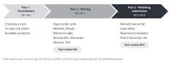

::: {.callout-note collapse="true"}
## This week's goals

By the end of this week, you will be able to:

- Present the conclusions of your manuscript in the order of its figures.
- Check your own manuscript with the final checklist, which collects the checklists of earlier weeks.
- Organize your AI use log for the semester, and explain what you gave to AI and how you checked the results.
- (Track B) Compare the published paper with your manuscript, and write about the differences and their reasons.
:::

# 1. Principles {#principles}

{fig-alt="Three arrow-shaped blocks: Part 1 Foundations W1–W3, Part 2 Writing W4–W11, Part 3 Polishing and submission W12–W15. Under each block are what that part produces and the peer review weeks."}

## The presentation follows the figure order of your manuscript

- Rule: speak in this order: the research question → one conclusion sentence for each figure → limitations → next steps.
- Start from the conclusion sentences on your figure order cards from [W4](w04_figure_storyboard.qmd), and use the versions you polished in the manuscript. The presentation and the manuscript must tell the same story.
- Use the data figures from your manuscript on your slides without changes. Do not use AI to make or edit data figures ([AI use rules](../ai_rules.qmd#in-the-paper)).
- Format details, such as presentation time and order, are announced separately.

<!-- Note for the instructor. Decide and announce each year: presentation time, time for questions, presentation order, number and format of slides, and whether presentation files are submitted -->

## There are three things to submit, and the comparison memo counts toward the final manuscript score

| Submission | Who | Weight |
|---|---|---|
| Final manuscript | Everyone | 30% |
| AI use log for the semester | Everyone | 15% |
| Comparison memo on the published paper | Track B | Included in the 30% for the final manuscript |

- For the weights of all graded items, see [Grading in the course overview](../index.qmd#grading).
- The 30 points for the final manuscript are divided by the criteria below. For track B, 2 points are taken from each of the first three criteria and given to the comparison memo.

| Criterion | What we look at | Track A | Track B |
|---|---|---|---|
| Consistency | The conclusion of each figure carries through the Results, Discussion, Abstract and Title with the same strength | 9 | 7 |
| Accuracy | Numbers and references can be checked against the sources | 9 | 7 |
| Readability | The manuscript passes the checklists of W3 and W12 | 9 | 7 |
| Format | The manuscript follows the author guidelines of the target journal chosen in W13 | 3 | 3 |
| Comparison memo | The memo finds the differences and explains their reasons, following the principles below | | 6 |
| Total | | 30 | 30 |

## The AI use log shows what you gave to AI and how you checked it

- This course looks not at whether you used AI, but at what you gave to AI and how you checked the results.
- Collect the log for the whole semester in one file, using the [form in the AI use rules](../ai_rules.qmd#ai-log).
- If you filled in a missing day from memory, mark that row as such. Do not make up plausible entries afterwards.
- Put a half-page summary at the top of the log. It covers the tasks you mostly gave to AI, two or three typical suggestions that you discarded and why, and the checking method you used most often.
- The AI use disclosure in your manuscript (W13) must match this log.

## The track B comparison memo finds the differences and explains why they arose

- The reference point for the comparison is the version you submitted in W11, because it is the last version before you read the original paper. Mark separately the places that you revised after that by looking at the original paper.
- Do not treat the published paper as the right answer. A difference does not mean that you were wrong. Also note the places where your manuscript is clearer.
- What to compare

| Part of the manuscript | What to look at in your manuscript | What to look at in the published paper |
|---|---|---|
| Figures and Results | The conclusion sentence of each figure | The Results subheadings and the first sentences of paragraphs |
| Introduction | The research gap and question that you set up | The gap and question that the authors set up |
| Discussion | The earlier studies you compared with, and the limitations | The earlier studies the authors compared with, and the limitations |
| Abstract and Title | Main claims, numbers and strength of claims | The same items |
| Peer Review File | Reviewer comments that also apply to your manuscript | How the authors answered those comments |

- What to reflect on
  - Why did the differences arise? Separate the differences that came from information you could not get from the figures and Methods alone from those that came from reading too much or too little into the results.
  - Did AI contribute to any of the differences? Point to the relevant rows of your AI use log.
  - Name one or two things you would change the next time you write a paper from your own data.

# 2. Try it with AI {#try-with-ai}

Pull all the numbers in your manuscript into a table to compare them, and get questions that the audience is likely to ask (25 min).

1. Use the first prompt to get a table of numbers (5 min).
2. Check every mismatch that the table marks. Also choose five numbers that were not marked, and compare them with your figures and analysis results (10 min).
3. Use the second prompt to get likely questions. Write the answers yourself. For questions that your manuscript cannot answer, decide whether to include them in the presentation as limitations (7 min).
4. Record this in your AI use log (3 min).

```text
Extract every number in the manuscript below into a table. Do not change the manuscript.

Table columns: number | unit or statistical notation (n, mean ± SD, P, etc.) | section where it appears (Abstract, Results, Figure legend, Discussion) | first few words of that sentence
If the same measurement is given differently in different sections, collect those cases separately below the table.

[manuscript]
```

```text
Below is the Abstract of my paper. Write five questions that a researcher in the same field might ask after hearing a talk on this study. Do not write the answers. For each question, note which sentence of the Abstract it comes from.

[Abstract]
```

- Track A: this is your own manuscript, so it falls in the "Conditional (track A)" row. Get your supervisor's agreement, and use only tools set so that your input is not used for training. Do not put in raw data or figure files.
- Track B: a track B manuscript falls in the "Free to use" row.
- The table of numbers falls in the "Always verify" row for both tracks.

# 3. Verify and revise {#verify-and-revise}

These are the places where AI often goes wrong when it makes a table of numbers. Check the numbers against the source (your figures and analysis results). Cross-check the likely questions with your supervisor or peers.

- AI leaves numbers out. Numbers in figure legends and in tables are especially easy to miss. Count the numbers in the Abstract yourself and match them with the table.
- AI changes units and statistical notation. It mixes up ± SD and ± SEM, or n as the number of mice and n as the number of cells.
- AI groups different measurements as if they were the same one, and so reports mismatches that do not exist.
- The likely questions may assume, as fact, something that is not in the manuscript. Check the premise of each question against the manuscript first.

## Final checklist

This list collects the checks of earlier weeks in manuscript order. Use it together with the detailed lists on each week's page.

- [ ] The order of the figure order cards and the order of the Results paragraphs are the same. The first sentence of each paragraph is the conclusion sentence of that figure. ([W4](w04_figure_storyboard.qmd), [W6](w06_results.qmd))
- [ ] Each figure legend gives n, the statistical test and what the error bars show. Someone could repeat the experiments or analyses from the Methods alone. ([W5](w05_methods_legends.qmd))
- [ ] The Results report the results, and the interpretation goes in the Discussion. ([W6](w06_results.qmd))
- [ ] You checked every reference through its DOI or PubMed, and each citing sentence matches the content of that paper. There is a verification log. ([W7](w07_literature.qmd))
- [ ] The last paragraph of the Introduction states the question and the approach of this study. ([W9](w09_introduction.qmd))
- [ ] The Discussion starts with the main findings, compares them with earlier studies, states the limitations and answers the question of the Introduction. ([W10](w10_discussion.qmd))
- [ ] The numbers and the strength of claims in the Abstract and Title are the same as in the Results, and the word counts are within the journal's limits. ([W11](w11_abstract_title.qmd))
- [ ] For each peer review comment, you record whether and where you addressed it, or why you did not. ([W8](w08_midterm_review.qmd), [W12](w12_polishing.qmd))
- [ ] You checked for the ten W3 patterns and for translationese, and the whole manuscript follows the term list. ([W3](w03_readable_sentences.qmd), [W12](w12_polishing.qmd))
- [ ] You filled in the submission checklist of the target journal, and the manuscript has a Data availability statement and a statement disclosing AI use. ([W13](w13_submission.qmd))
- [ ] The AI use log covers every place in the manuscript where you used AI. No data figure was made or edited with AI. ([W2](w02_ai_basics.qmd), [AI use rules](../ai_rules.qmd))

# Assignment {#assignment}

Manuscript, AI use log, (B) comparison memo

- Length and format
  - Final manuscript: a short manuscript built on three or four figures. It has a Title page, Abstract, Introduction, Results, Discussion, Methods, Figure legend, references and an AI use disclosure. Follow the format of the target journal from W13, and add line numbers. Submit a Word file and a PDF.
  - AI use log: collect the whole semester in one file, with a half-page summary at the top.
  - Comparison memo (track B): the comparison table and the reflection points from the principles above, in at most two pages.
- Differences by track: track A students submit the manuscript and the AI use log. Track B students also submit the comparison memo. Track B students mark in the manuscript the places that they revised after W11 by looking at the original paper.
- Grading criteria: we follow the point table for the final manuscript in the principles above and the [grading weights](../index.qmd#grading). For the AI use log, we check whether each row describes a specific way of checking.
- Submission: through the university LMS. Deadlines are announced separately.
- You do not submit the final checklist. Use it to check your work yourself before you submit.

# Notes {#notes}

Presenting and submitting the manuscript
