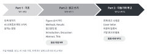
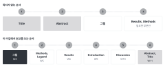
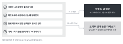

::: {.callout-note collapse="true"}
## 이번 주 목표

이번 주가 끝나면 다음을 할 수 있다.

- 독자가 논문을 읽는 순서와 이 수업에서 원고를 쓰는 순서를 비교해 설명할 수 있다.
- 원고를 그림부터 쓰는 이유를 자기 연구에 빗대어 말할 수 있다.
- 기준에 따라 트랙 A와 트랙 B 가운데 하나를 고를 수 있다.
- 트랙 A는 그림 3~4개의 목록을, 트랙 B는 다시 쓸 논문을 정할 수 있다.
:::

# 1. 원칙 {#principles}

{fig-alt="세 개의 화살표 모양 칸: Part 1 기초 W1–W3, Part 2 원고 쓰기 W4–W11, Part 3 다듬기와 투고 W12–W15. 각 칸 아래에 그 Part에서 만드는 것과 동료 리뷰 주차가 적혀 있다."}

## 독자는 Title, Abstract, 그림 순서로 읽는다

- 독자 대부분은 논문을 처음부터 끝까지 읽지 않음. Title을 보고 읽을지 정하고, Abstract로 내용을 짐작하고, 그림을 훑은 뒤 필요한 부분만 Results나 Methods에서 찾아 읽음.
- 그래서 Title, Abstract, 그림만 보고도 논문의 핵심 주장을 알 수 있어야 함.
- 강의 중 2분 활동: 최근 읽은 논문 한 편을 어떤 순서로 읽었는지 적게 하고 몇 명에게 물어봄.

## 이 수업은 그림부터 쓰고 Title을 맨 마지막에 쓴다

{fig-alt="두 줄의 순서도. 위 줄은 독자가 읽는 순서로 Title, Abstract, 그림, 필요한 부분의 Results와 Methods다. 아래 줄은 이 수업에서 쓰는 순서로 그림(W4), Methods와 Legend(W5), Results(W6), Introduction(W9), Discussion(W10), Abstract와 Title(W11)이다."}

| 쓰는 순서 | 원고 부분 | 주차 | 앞 단계에서 받아 오는 것 |
|---|---|---|---|
| 1 | 그림 (Figure 스토리보드) | [W4](w04_figure_storyboard.qmd) | 데이터, 그림마다 결론 문장 |
| 2 | Methods, Figure legend | [W5](w05_methods_legends.qmd) | 그림에 들어간 실험과 분석 |
| 3 | Results | [W6](w06_results.qmd) | Figure 순서 카드 (단락 순서) |
| 4 | Introduction | [W9](w09_introduction.qmd) | Results가 답한 질문, [W7](w07_literature.qmd) 참고문헌 표 |
| 5 | Discussion | [W10](w10_discussion.qmd) | Results, W7 참고문헌 표 |
| 6 | Abstract, Title | [W11](w11_abstract_title.qmd) | 원고 전체 |

- 쓰는 순서는 읽는 순서와 거의 반대임. 뒤에 쓰는 부분일수록 앞 부분을 해석하거나 요약하기 때문. Abstract와 Title은 원고 전체를 요약하므로 맨 마지막에 씀.
- Introduction을 먼저 쓰면 결과가 답하지 못하는 질문을 열기 쉬움. 그림을 먼저 정하면 Introduction은 Results가 실제로 답한 질문으로 끝나게 됨.

## 그림 하나는 결론 하나를 보여 준다

- 그림마다 결론을 한 문장(결론 문장)으로 쓸 수 있어야 함. 쓸 수 없다면 그 그림이 두 가지를 보여 주거나, 아직 결론이 없는 것임.
- 결론 문장은 무엇을 했는지가 아니라 무엇을 알았는지를 씀. 자세한 방법은 [W4](w04_figure_storyboard.qmd)에서 다룸.
- 예문은 가상의 예시임. 마우스 일측 요관 폐쇄(unilateral ureteral obstruction, UUO) 모델에 가상의 약물 compound X를 투여한 연구.
  - 전: Figure 2 shows Masson's trichrome staining and quantification of the fibrotic area.
  - 후: Compound X reduced the fibrotic area in UUO kidneys.
- dry lab 예문도 가상의 예시임. 공개 데이터로 사람 신장 생검의 단일세포 RNA 시퀀싱(single-cell RNA sequencing) 데이터를 다시 분석한 연구.
  - 전: Figure 3 presents the proportions of fibroblast subtypes across samples.
  - 후: The MF2 myofibroblast subtype made up a larger share of fibroblasts in biopsies from patients with fibrosis.

## 트랙은 데이터와 동의로 정한다

- 두 트랙의 차이는 [강의 소개의 두 트랙 표](../index.qmd#tracks)를 따름.

{fig-alt="왼쪽에 네 조건이 있다. 그림 3~4개 분량의 결과, 지도교수 동의, 동료 리뷰에서 공개 가능, 과제나 특허 출원 전 아이디어가 아님. 모두 해당하면 트랙 A 내 원고, 하나라도 아니면 트랙 B 공개 논문 다시 쓰기로 이어진다."}

- 트랙 A는 아래가 모두 해당할 때 고름.
  - 그림 3~4개 분량의 결과가 이미 있음. 또는 W4까지 그림 순서를 정할 수 있음.
  - 지도교수가 이 원고를 수업에서 쓰는 데 동의함.
  - 같은 반 학생이 동료 리뷰(W8, W12)에서 원고를 읽어도 됨.
  - 결과가 과제나 특허 출원 전의 아이디어가 아님. 이런 내용은 AI 신호등의 넣지 않기 칸이라 AI 실습을 거의 할 수 없음.
- 트랙 B는 아래 가운데 하나라도 해당하면 고름.
  - 아직 데이터가 없거나, 그림 3~4개 분량이 되지 않음.
  - 지도교수 동의를 받기 어렵거나, 결과를 동료에게 보여 줄 수 없음.
- 애매하면 이번 주 안에 지도교수와 담당교수에게 물음.
- 동료의 원고는 남의 원고임. 같은 반 학생의 Figure 순서 카드, 초안, 참고문헌 표는 AI에 넣지 않음([AI 사용 규칙](../ai_rules.qmd#traffic-light)의 넣지 않기 칸). 자세한 내용은 [W2](w02_ai_basics.qmd)에서 다룸.

## 트랙 B 논문은 다섯 가지 기준으로 고른다

- 오픈 액세스여서 누구나 전문을 볼 수 있음.
- 심사 기록(Peer Review File)이 공개되어 있음. 그러면 [W14](w14_reviewer_response.qmd)에서 그 논문의 실제 리뷰로 답변서를 써 볼 수 있음. 예: [참고자료](../resources.qmd#papers)의 Weinand et al. (2024).
- high impact journal에 실린 원저(original research article)임. 리뷰 논문은 고르지 않음.
- 자기 분야와 가까움. 그래야 Methods와 그림만 보고 Results를 다시 쓸 수 있음.
- 아직 읽지 않은 논문임. 이미 읽은 논문은 Results와 Discussion이 머리에 남아 있어서 다시 쓰기 연습이 되지 않음.
- 논문 전체가 아니라 main figure 3~4개를 골라 다시 씀. 논문과 고른 그림은 담당교수 승인을 받아 확정함.

::: {.callout-warning}
## 결과를 미리 읽지 않기

- 검색 결과 화면에서 Abstract를 펼치지 않음. 저널 페이지에서는 그림과 Methods로 바로 감.
- AI에게 고른 논문을 요약해 달라고 하지 않음. AI의 요약을 읽으면 Abstract와 Results를 읽은 것과 같음.
- 논문을 고른 뒤에는 그 논문의 Title이나 DOI를 AI에 넣지 않음. AI가 답하면서 Results를 드러낼 수 있음.
- W11 과제를 낼 때까지 AI의 웹 검색 기능을 끔. 답에 웹 출처 링크가 붙어 나오면 그 답은 쓰지 않음([AI 사용 규칙](../ai_rules.qmd#track-b)).
- 고른 논문을 문헌 검색([W7](w07_literature.qmd))의 출발점으로 쓰지 않음. 그 논문을 인용한 논문이나 관련 논문 목록에서 결과가 드러날 수 있음.
- Title은 피할 수 없음. W11에서 Title 3안을 쓴 뒤 실제 Title과 비교함.
- 원래 논문의 Figure legend는 [W5](w05_methods_legends.qmd)에서 내 legend를 낸 뒤에 읽음. legend를 직접 써 보기 위해서임.
- 원래 논문의 참고문헌 목록은 [W10](w10_discussion.qmd) Discussion 초안을 낸 뒤에 봄.
- 원래 논문 전체는 W11 과제(Abstract와 Title)를 낸 뒤부터 읽음. W11에 낸 판이 W15 비교 메모의 기준이 됨.
:::

# 2. AI로 해 보기 {#try-with-ai}

실습: AI에게 논문 구조를 묻고 비교하기 (25분)

1단계, 공통 (8분): 아래 프롬프트로 읽는 순서와 쓰는 순서를 물음. 답을 이 페이지의 원칙과 비교함. 다른 점 하나를 골라, 어느 쪽 이유가 자기 연구에 맞는지 2~3줄로 씀.

```text
I am a graduate student in biomedical science. I am writing my first research article.
1. In what order do most readers read a research article (title, abstract, figures, introduction, results, methods, discussion)? Explain briefly.
2. In what order would you recommend writing the sections, and why?
Answer in plain English in under 200 words.
```

2단계, 트랙 A (15분): 가상의 예시로 연습함. 자기 결과는 아직 넣지 않음. 지도교수 동의와 도구 설정은 W2에서 확인함. AI가 낸 순서와 결론 문장을 받은 뒤, 결론 문장이 그림이 보여 주는 것보다 세게 말하는 곳에 표시함. 그다음 자기 그림 목록은 AI 없이 직접 씀.

```text
Below are four figures from a hypothetical mouse study, in random order.
- Western blots of TGF-β/Smad3 signaling proteins
- Study design, body weight and serum creatinine
- qPCR of fibrosis marker genes (Col1a1, Acta2, Fn1)
- Masson's trichrome staining and quantification of the fibrotic area
The study tested whether compound X reduces kidney fibrosis after unilateral ureteral obstruction (UUO). There were 6 mice per group.
1. Put the figures in the order you would present them in a paper. Explain the order in one sentence per figure.
2. Write one conclusion sentence for each figure. Do not invent numbers.
```

2단계, 트랙 B (15분): 후보 논문을 찾음. 목록이 나오면 DOI를 하나씩 열어 실제로 있는지, 오픈 액세스인지, 심사 기록이 있는지 확인함.

```text
List five original research articles in [my field, e.g. kidney fibrosis] that meet all of these conditions:
- open access
- published in a high-impact journal in 2020 or later
- the journal published the peer review file with the article
For each article, give only the title, authors, journal, year and DOI.
Do not summarize the articles or describe their results.
```

3단계 (2분): [AI 사용 기록](../ai_rules.qmd#ai-log)에 한 줄 남김.

AI 신호등: 1단계와 트랙 A의 2단계는 자유롭게 칸이다(개념 설명, 가상의 예시). 트랙 B가 받은 논문 목록은 참고문헌이므로 꼭 검증 칸이다.

::: {.callout-tip}
## 프롬프트 요령

- 원하는 형식과 길이를 정해 줌(under 200 words, title and DOI only).
- 하지 말아야 할 일을 적음(Do not invent numbers, Do not summarize). 트랙 B에서는 이 한 줄이 결과를 미리 읽는 일을 막음.
:::

# 3. 검증하고 다듬기 {#verify-and-revise}

AI가 자주 틀리는 지점

- 쓰는 순서: Introduction부터 쓰라거나 IMRaD 순서대로 쓰라고 답하는 경우가 많음. 틀린 사실이 아니라 다른 선택임. 이 수업은 그림부터 쓰되, 두 쪽의 이유를 비교해 봄.
- 결론 문장: 그림이 보여 주는 것보다 세게 씀. 예를 들어 섬유화가 생기기 전부터 약을 준 실험이라면 "reverses fibrosis"는 설계와 맞지 않음. reverse는 이미 생긴 섬유화가 줄었다는 뜻이기 때문. 마우스 결과를 "in patients"로 넓히기도 함.
- 결론 문장에 주지 않은 수치나 배경지식을 섞음. 프롬프트에서 막아도 생김.
- 논문 추천: 없는 논문, 다른 논문을 가리키는 DOI, 오픈 액세스가 아닌 논문, 심사 기록이 없는 논문이 섞임.

확인 목록

- [ ] 트랙 B 후보 논문의 DOI를 직접 열고, 제목, 저자, 저널, 연도가 맞는지 봄. (원문 확인)
- [ ] 저널 페이지에서 오픈 액세스 표시와 Peer Review File 링크를 직접 찾음. (원문 확인)
- [ ] AI가 쓴 결론 문장을 그림 설명 옆에 두고, 그림이 보여 주는 것보다 세게 말하지 않는지 봄. (나란히 읽기)
- [ ] 트랙 선택을 지도교수, 담당교수와 확인함. (교차 확인)
- [ ] 트랙 B는 AI가 낸 다섯 편 가운데 몇 편이 조건을 모두 만족했는지 세어 둠. W2 검증 실습의 재료로 씀.

# 과제 {#assignment}

A: 그림 목록 / B: 논문 고르기

- 공통
  - 맨 위에 고른 트랙과 그 이유를 2~3줄로 씀.
  - 제출은 학교 LMS. 마감은 따로 공지함.
  - AI를 썼으면 [AI 사용 기록](../ai_rules.qmd#ai-log)을 함께 냄.
- 트랙 A: 그림 목록
  - 분량: A4 1쪽 이내.
  - 형식: 그림 3~4개를 그림 번호, 한 줄 내용, 데이터 상태(있음 / 분석 중 / 실험 예정)의 표로 정리. 한 줄 내용은 영어로 씀. 결론을 이미 알면 결론 문장으로 써도 됨.
  - 한 줄 내용 예(가상의 예시): Study design, body weight and serum creatinine after UUO.
  - 지도교수 동의 증빙을 함께 냄. 지도교수의 동의 메일을 전달하거나, 서명한 [지도교수 동의서](../../assets/forms/supervisor_consent_ko.docx)를 냄. 메일로 받을 때는 동의서의 네 항목에 대한 동의 여부가 메일에 들어 있어야 함.
  - 평가 기준: 그림마다 한 가지 내용을 보여 주는가. 그림 3~4개가 하나의 질문으로 이어지는가. 데이터 상태가 W4 일정에 맞는가.
- 트랙 B: 논문 고르기
  - 분량: A4 1쪽 이내.
  - 형식: 고른 논문 1편과 예비 논문 1편의 서지 정보(저자, 제목, 저널, 연도, DOI 링크), 오픈 액세스 확인, Peer Review File 링크, main figure 수와 다시 쓸 그림 3~4개, 자기 분야와 가까운 이유 2~3줄, Results·Introduction·Discussion·Abstract를 읽지 않았다는 확인 한 줄.
  - 평가 기준: 다섯 가지 기준을 모두 만족하는가. 서지 정보가 정확하고 DOI가 열리는가. 고른 이유가 자기 연구와 구체적으로 이어지는가.

# 메모 {#notes}

논문이 읽히는 순서와 쓰는 순서, 트랙 정하기
