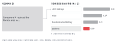
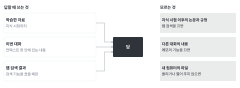
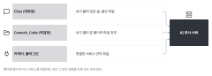
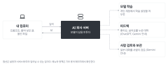
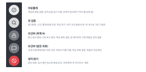

::: {.callout-note collapse="true"}
## 이번 주 목표

이번 주가 끝나면 다음을 할 수 있다.

- AI가 답을 만드는 방식과, 도구마다 AI에 들어가는 범위가 어떻게 다른지 설명할 수 있다.
- AI에 넣으려는 내용이 AI 신호등의 어느 칸인지 판단할 수 있다.
- AI 답변에서 확인할 주장을 골라내고, 확인 3가지 가운데 알맞은 방법으로 확인할 수 있다.
- 학교와 투고할 저널의 AI 규정을 원문에서 찾아, AI 사용을 원고의 어디에 밝혀야 하는지 말할 수 있다.
- AI 사용 기록을 쓰고, 그 기록으로 논문에 넣을 AI 사용 표기 문장을 쓸 수 있다.
:::

# 1. 원칙 {#principles}

이번 주는 두 부분으로 나눔. 앞부분은 AI 도구가 어떻게 움직이는지 다룸. 뒷부분은 이 수업의 AI 규칙을 사례에 적용함. 용어는 [기초 용어](../glossary.qmd)에 모아 둠.

## AI는 그럴듯한 다음 말을 고른다

{fig-alt="지금까지의 글 'Compound X reduced the fibrotic area in' 뒤에 올 후보 네 개와 확률 막대가 있다. UUO kidneys, mice, the obstructed kidney, patients 순이고, patients는 그럴듯하지만 이 연구에는 틀린 말로 표시되어 있다."}

- 대규모 언어 모델(LLM)은 많은 글을 학습해서, 앞의 글 다음에 올 말을 이어 씀. 답할 때 사실을 찾아보지 않음.
- 그래서 틀린 내용도 자연스러운 문장으로 나옴. 없는 참고문헌이 대표적임([W7](w07_literature.qmd)).
- 학습한 자료에는 마지막 시점(지식 시점)이 있음. 그 뒤의 논문과 규정은 모름.
- 웹 검색 기능을 켜면 검색 결과를 읽고 답함. 하지만 결과를 잘못 요약하기도 하므로 출처는 직접 엶.
- 한 대화 안에서만 앞 내용을 기억함. 대화가 너무 길면 앞부분을 놓침. 새 주제는 새 대화에서 시작함.
- 수업 중 시연(5분): 같은 질문을 웹 검색을 켜고 한 번, 끄고 한 번 물음. 두 답의 내용과 출처를 비교함.

{fig-alt="왼쪽의 학습한 자료, 이번 대화, 웹 검색 결과가 가운데 답으로 이어진다. 오른쪽에는 모르는 것 세 가지가 있다."}

## 도구마다 AI에 들어가는 범위가 다르다

{fig-alt="Chat은 붙여 넣은 글과 올린 파일, Cowork와 Code는 열어 준 폴더의 파일 전부, 커넥터와 플러그인은 연결한 서비스 안의 파일이 AI 회사 서버로 간다."}

| 방식 | 예 | AI에 들어가는 것 |
|---|---|---|
| Chat (대화형) | claude.ai, ChatGPT, Gemini | 내가 붙여 넣거나 올린 내용 |
| Cowork, Code (작업형) | Claude Cowork, Claude Code, Codex | 내가 열어 준 폴더의 파일, 연결한 앱의 내용 |
| 커넥터, 플러그인 | Google Drive 같은 저장소 연결 | 연결한 서비스 안의 파일 |

- 작업형 도구에 폴더를 열어 주면 그 폴더의 파일을 AI가 직접 읽음. 그래서 환자 정보, 원 데이터, 동료 원고가 든 폴더는 열어 주지 않음.
- 커넥터, 스킬, 플러그인, MCP, API의 뜻은 [기초 용어](../glossary.qmd#extensions)에서 봄.

## 내 입력은 회사 서버로 간다

{fig-alt="왼쪽 내 컴퓨터에서 가운데 AI 회사 서버로 입력이 가고 답이 돌아온다. 서버에서 오른쪽의 모델 학습, 피드백, 사람 검토와 보관으로 점선이 이어진다."}

- AI 채팅은 클라우드 서비스임. 입력한 내용은 내 컴퓨터를 떠나 회사 서버에서 처리됨.
- 개인 계정에서는 입력이 모델 학습에 쓰일 수 있음. 입력이 학습에 쓰이지 않게 먼저 설정함([서비스별 설정 위치](../glossary.qmd#training-settings)).
- 설정을 꺼도 피드백 버튼(좋아요, 싫어요)을 누른 대화는 학습에 쓰일 수 있음(ChatGPT, Gemini 안내). 일부 서비스는 대화 일부를 사람이 검토함.
- 기관 계정(학교, 회사 계약)은 데이터 정책이 따로 있음. 내 계정이 어느 쪽인지 확인함.

## AI 사용 규칙은 사례에 적용해 익힌다

규칙은 [AI 사용 규칙](../ai_rules.qmd) 페이지에 있음. 아래에서 그 규칙을 사례에 적용해 봄. 표를 다시 옮기지 않고 링크로 보여 줌.

### 넣기 전에 신호등 칸부터 정한다

{fig-alt="세로 신호등 모양. 위에서부터 자유롭게, 꼭 검증, 조건부 (트랙 A), 조건부 (받은 리뷰), 넣지 않기 다섯 칸과 각 칸에 해당하는 예가 있다."}

- 칸은 넣으려는 내용과 그 내용의 주인이 정함. 기준은 [신호등 표](../ai_rules.qmd#traffic-light)를 따름. 애매하면 넣기 전에 담당교수에게 물음.
- 수업 중 연습(10분): 아래 사례를 칸에 나눈 뒤 이유를 말하게 함. 강사용 답을 함께 적어 둠.

| 사례 | 칸 | 이유 |
|---|---|---|
| UUO 모델이 어떤 원리로 섬유화를 일으키는지 물음 | 자유롭게 | 공개된 일반 주제 |
| 트랙 B 논문의 Methods 한 단락을 Title과 DOI 없이 넣고 문법 구조를 물음 | 자유롭게 | 공개 논문 |
| 트랙 B가 W6에 웹 검색을 켠 채 Results 초안을 다듬어 달라고 함 | 자유롭게이지만 웹 검색을 끄고 다시 함 | W11까지는 웹 검색을 끔 |
| AI가 추천한 UUO 모델 참고문헌 5편 | 꼭 검증 | 참고문헌 |
| AI가 추천한 그래프 종류 | 꼭 검증 | 통계 방법 추천과 같게 다룸 |
| AI가 짠 R 코드로 그린 그래프 | 꼭 검증 | 점 개수와 평균이 데이터와 맞는지 확인 |
| 내 Results 한 단락의 문법 교정. 지도교수 동의를 받았고 입력이 학습에 쓰이지 않게 설정함 | 조건부 (트랙 A) | 조건을 모두 지킴 |
| 같은 단락을 설정을 확인하지 않은 계정에 넣음 | 조건부 (트랙 A)이지만 넣지 않음 | 조건을 지키지 않음 |
| 웨스턴 블롯 원본 이미지 파일 | 조건부 (트랙 A)이지만 넣지 않음 | 원 데이터와 그림 파일은 넣지 않음 |
| 그래프 코드를 받으려고 원 데이터 파일을 올림 | 조건부 (트랙 A)이지만 넣지 않음 | 원 데이터는 넣지 않음. 열 이름만 줌 |
| 동료 리뷰에서 받은 의견. 리뷰어 이름을 지우고 입력이 학습에 쓰이지 않게 설정함 | 조건부 (받은 리뷰) | 조건을 모두 지킴 |
| 환자 생검의 임상 정보 표 | 넣지 않기 | 환자 정보 |
| 같은 반 학생의 Figure 순서 카드, 초안, 참고문헌 표 | 넣지 않기 | 남의 원고 |
| 아직 발표하지 않은 가설, 연구실이 준비 중인 과제 아이디어 | 넣지 않기 | 과제·특허 전 아이디어 |

- 같은 반 학생의 작업물은 학술지에서 심사하는 원고와 같게 다룸. 카드, 초안, 참고문헌 표 모두 해당함. 동료 리뷰(W8, W12)에서 받은 원고는 AI에 넣지 않고 직접 읽고 씀.
- 내 원고에 대해 받은 리뷰 의견은 다름. 리뷰어 이름을 지우고 학습 제외 설정을 한 도구에서는 넣을 수 있음([받은 리뷰](../ai_rules.qmd#received-reviews)).
- 입력이 학습에 쓰이지 않게 하는 설정은 도구마다 위치와 이름이 다름. [기초 용어](../glossary.qmd#training-settings)에 정리했음.

### AI 답변은 주장 하나씩 확인한다

- AI 답변을 통째로 믿거나 통째로 버리지 않음. 확인할 주장을 하나씩 꺼내 종류에 맞는 방법으로 확인함([확인 3가지](../ai_rules.qmd#three-checks)).

| 주장 종류 | 확인 방법 | 어떻게 |
|---|---|---|
| 참고문헌 | 원문 확인 | DOI를 열고 PubMed에서 제목을 찾음. 그 논문에 해당 내용이 있는지 봄 |
| 수치 (기간, 용량, 비율, 표본 수) | 원문 확인 | 원 논문의 어느 그림, 표, 문장에 있는지 찾음 |
| 개념 설명, 방법 추천 | 교차 확인 | 교재나 리뷰 논문, 동료, 교수 |
| AI가 고친 문장 | 나란히 읽기 | 원래 문장 옆에 두고 주장과 수치가 같은지 봄 |

- 가장 잡기 어려운 오류는 논문은 실제로 있는데 그 논문이 AI가 말한 내용을 말하지 않는 경우임. DOI가 열렸다고 확인이 끝난 것이 아님.
- 예: 아래는 AI 답변에 나올 법한 문장을 지어낸 것임.
  - AI 답변: Fibrosis in the UUO model peaks at day 3 and resolves by day 14 (Smith et al., 2018).
  - 쪼갠 주장: (1) peaks at day 3, 수치. (2) resolves by day 14, 수치. (3) Smith et al., 2018, 참고문헌.
  - 참고문헌부터 확인함. 출처가 없거나 그런 말을 하지 않으면 (1)과 (2)도 근거 없는 주장이 됨.

### 학교와 저널의 AI 규정이 이 수업 규칙보다 먼저다

- 아래는 2026-11-10에 각 원문 페이지에서 확인한 내용임. 규정은 자주 바뀌므로 투고할 때([W13](w13_submission.qmd)) 다시 확인함.
- [ICMJE 권고안 II.A.4](https://www.icmje.org/recommendations/browse/roles-and-responsibilities/defining-the-role-of-authors-and-contributors.html)
  - AI 사용은 cover letter와 원고에 밝힘. 글쓰기 도움은 Acknowledgments에, 데이터 수집, 분석, 그림 생성은 Methods에 씀.
  - AI는 저자가 될 수 없음. AI가 만든 내용을 1차 출처로 인용하지 않음([V.A](https://www.icmje.org/recommendations/browse/artificial-intelligence/ai-use-by-authors.html)).
  - 리뷰어는 기밀이 보장되지 않는 AI에 원고를 올리지 않음. 저널이 명시적으로 허용한 경우만 예외([V.B](https://www.icmje.org/recommendations/browse/artificial-intelligence/ai-use-by-reviewers.html)).
- [Springer Nature (Nature Portfolio)](https://www.nature.com/nature-portfolio/editorial-policies/ai)
  - AI 사용을 위험도에 따라 green, amber, red로 나눔. 문법과 가독성 다듬기는 green이며, green도 어떻게 썼는지 밝히라고 안내함.
  - AI가 Results나 Discussion을 혼자 쓰게 하는 것, AI를 저자로 올리는 것, 검증할 원자료 없이 그림을 만드는 것은 red로 허용하지 않음([원고 준비 항목](https://www.springernature.com/gp/policies/editorial-policies/ai-manuscript-preparation)).
  - AI로 만든 시각 자료는 원고의 AI Declaration과 그 그림의 legend에 밝힘.
- [Science 저널](https://www.science.org/content/page/science-journals-editorial-policies)
  - AI 사용은 cover letter, 그리고 용도에 따라 Methods나 Acknowledgments에 밝힘. AI는 저자가 될 수 없음.
  - AI로 만든 이미지는 편집자의 명시적 허락 없이 쓸 수 없음. 리뷰어는 원고의 어떤 부분도 AI에 넣지 않음.
- [Elsevier](https://www.elsevier.com/about/policies-and-standards/generative-ai-policies-for-journals)
  - References 바로 앞에 AI 사용을 밝히는 절을 따로 둠. 이 절의 제목과 권장 문구가 정해져 있음.
  - 문법, 맞춤법, 문장부호의 기본 점검은 밝히지 않아도 됨. AI가 문장 구조나 구성을 크게 바꿨으면 밝힘.
  - 현미경, 조직, 웨스턴 블롯처럼 실험에서 얻은 1차 이미지는 AI로 만들거나 고치지 않음. 리뷰어는 원고를 AI에 올리지 않음.
- 경북대학교: 연구윤리센터의 [경북대학교 연구자를 위한 생성형 AI 연구윤리 가이드](https://gsee.knu.ac.kr/content/notice.html?fidx=6113&gtid=grad_notice&pg=vv) (2026, 학과 공지에 첨부된 PDF)
  - 미공개 연구데이터와 개인정보는 AI에 넣지 않음. 부득이하면 먼저 비식별화함. 특허 출원 예정 기술은 어떤 경우에도 넣지 않음.
  - AI 사용 사실은 방법론에 밝히는 것이 원칙임(점검표에는 방법론 또는 사사). 밝히지 않으면 연구부정행위로 볼 수 있음.
  - 교수학습센터의 [학습자를 위한 AI 활용 가이드](https://knu.ac.kr/wbbs/wbbs/bbs/btin/viewBtin.action?bbs_cde=1&btin.appl_no=000000&btin.bbs_cde=1&btin.doc_no=1337233&menu_idx=67) (2026-04)도 있음.
  - 이 수업에서는 실습을 위해 [조건부 (트랙 A) 칸](../ai_rules.qmd#traffic-light)을 허용함. 대신 그 칸의 조건(지도교수 동의, 학습 제외 설정, 원 데이터와 그림 파일 제외)을 모두 지킴.
- 같은 일이라도 저널마다 다름. 예: 문법 교정을 Elsevier는 밝히지 않아도 된다고 하고, Springer Nature는 밝히라고 안내함. 그래서 투고할 저널의 규정을 직접 읽어야 함. 학교 규정이 더 엄격하면 학교 규정을 따름. 예외는 위의 조건부 (트랙 A) 칸 하나임.

### 논문에는 AI를 무엇에 썼는지 구체적으로 밝힌다

- AI 사용 표기에 들어갈 것: 도구 이름과 버전, 맡긴 일, 저자가 결과를 확인했고 책임진다는 것.
- 이 문장은 [AI 사용 기록](../ai_rules.qmd#ai-log)이 있어야 정확히 쓸 수 있음.
- 전: AI was used in the preparation of this manuscript.
- 후 (Acknowledgments, 글쓰기 도움): During the preparation of this manuscript, the authors used [tool name and version] to check grammar and improve the readability of the text. The authors reviewed and edited all suggested changes and take full responsibility for the content of the article.
- 후 (Methods, 분석 코드 도움. 가상의 예시인 단일세포 RNA 시퀀싱 재분석): We used [tool name and version] to help write the Python code that plotted the UMAP embeddings. The authors reviewed and tested all code before use.
- 위 문장은 일반 예시임. 저널이 정한 문구가 있으면 그 문구를 씀.

# 2. AI로 해 보기 {#try-with-ai}

실습: AI 답변 하나를 주장 단위로 확인하기 (35분)

1. 설정 확인 (5분): 자기 계정에서 입력이 학습에 쓰이지 않게 설정되어 있는지 확인하고, 아니면 설정함. 새 대화를 열고, 웹 검색과 메모리 기능이 켜져 있는지 봄. 트랙 B는 웹 검색을 끄는 방법도 확인함. W11 과제를 낼 때까지 끄고 씀.
2. 질문 고르기 (3분): 답에 참고문헌과 수치가 함께 나올 질문을 고름.
3. AI에게 묻기 (5분): 아래 예를 자기 분야에 맞게 바꿔 씀.
4. 주장 쪼개기 (5분): 답변을 주장 단위로 나눠 표에 옮김. 열은 주장, 종류, 확인 방법.
5. 확인하기 (12분): 참고문헌부터 확인함. 결과는 맞음, 일부 틀림, 틀림, 확인 못 함 가운데 하나로 적음.
6. 기록하기 (5분): AI 사용 기록에 한 줄 남기고, 옆 사람과 무엇이 틀렸는지 비교함.

wet lab 예:

```text
In the mouse unilateral ureteral obstruction (UUO) model, at which time points after surgery is interstitial fibrosis usually measured, and with which methods?
Give three references that support your answer, with authors, year, journal and DOI.
```

dry lab 예:

```text
Which public single-cell RNA sequencing datasets of human kidney biopsies include patients with kidney fibrosis?
For each dataset, give the accession number, the number of donors, and the original paper with its DOI.
```

- 트랙 A: 자기 분야의 일반 질문을 씀. 자기 미발표 결과와 수치는 넣지 않음.
- 트랙 B: W1에서 고른 논문의 분야를 묻는 질문을 씀. 고른 논문의 Title이나 DOI는 넣지 않음. AI가 그 논문의 Results를 드러낼 수 있기 때문.
- AI 신호등: 질문은 자유롭게 칸, 답에 나온 참고문헌과 수치는 꼭 검증 칸.

::: {.callout-tip}
## 프롬프트 요령

- DOI나 accession number를 함께 달라고 하면 확인이 빨라짐. 하지만 DOI도 지어낸 것일 수 있음.
- AI에게 확실하냐고 다시 묻는 것은 확인이 아님. 같은 틀린 답이 다시 나올 수 있음. 확인은 원문에서 함.
:::

# 3. 검증하고 다듬기 {#verify-and-revise}

이번 주는 원문 확인과 교차 확인을 주로 씀. 나란히 읽기는 [W3](w03_readable_sentences.qmd)에서 연습함.

AI가 자주 틀리는 지점

- 없는 논문: 실제 저자 이름, 그럴듯한 제목, 실제 저널 이름이 섞여 있음.
- DOI가 다른 논문을 가리키거나, 연도나 저자 순서가 틀림.
- 논문은 있는데 그 논문이 AI가 말한 내용을 말하지 않음.
- 수치: 다른 모델이나 다른 종의 값을 섞음. 단위가 다름. 범위를 값 하나로 줄임.
- 데이터셋: accession number가 다른 데이터를 가리키거나, 공여자 수가 원 논문과 다름.
- 최신 내용: 도구가 학습한 뒤에 나온 논문이나 바뀐 규정을 모름. 저널 AI 규정은 AI에게 묻지 않고 원문에서 읽음.

확인 목록

- [ ] 참고문헌마다 DOI를 직접 열었다. (원문 확인)
- [ ] 열린 논문의 제목, 저자, 연도가 AI 답과 같다. (원문 확인)
- [ ] AI가 그 논문을 근거로 말한 내용이 실제로 그 논문에 있다. 어느 그림, 표, 문장인지 적었다. (원문 확인)
- [ ] 수치와 accession number를 원 논문이나 데이터베이스(예: GEO)에서 찾았다. (원문 확인)
- [ ] 개념 설명과 방법 추천은 교재나 리뷰 논문 한 편과 맞춰 봤다. (교차 확인)
- [ ] 확인하지 못한 주장은 확인 못 함으로 남기고 원고에 쓰지 않는다.
- [ ] AI 사용 기록에 맡긴 일, 받아들인 것, 버린 것과 이유를 적었다.

# 과제 {#assignment}

AI 답변 하나 검증해 오기

- 분량: A4 1~2쪽. AI 답변 원문은 부록으로 붙이고 분량에 넣지 않음.
- 형식
  1. 도구 이름, 날짜, 프롬프트 원문.
  2. 검증 표: 주장, 종류, 확인 방법(확인 3가지 가운데), 결과(맞음 / 일부 틀림 / 틀림 / 확인 못 함), 근거(DOI, URL, 그림이나 표 번호).
  3. 같은 질문을 다시 한다면 프롬프트를 어떻게 바꿀지 3~5줄.
  4. 투고하고 싶은 저널 하나의 AI 규정 원문 링크와, 그 저널에서 AI 사용을 어디에 밝히는지 한 줄.
  5. 이번 과제에서 AI를 쓴 방식을 논문의 AI 사용 표기처럼 영어 한두 문장으로 씀.
- 트랙별 차이: 트랙 A는 자기 분야의 질문을 씀. 트랙 B는 고른 논문의 분야를 묻되, 그 논문의 Title과 DOI는 넣지 않음. 트랙 B는 W1 실습에서 받은 논문 목록을 검증 대상으로 써도 됨. 이때 고른 논문은 목록에서 뺌.
- 평가 기준
  - 답변에서 확인할 주장을 빠짐없이 골라냈는가.
  - 근거가 구체적인가(DOI와 그림, 표, 문장 위치까지).
  - 저널 규정을 원문 페이지에서 찾았는가.
- 제출은 학교 LMS. 마감은 따로 공지함.
- 이번 과제의 AI 사용도 [AI 사용 기록](../ai_rules.qmd#ai-log)에 적어 함께 냄.

# 메모 {#notes}

AI 신호등, 확인 3가지, 학교·저널의 AI 규정, AI 사용 표기
