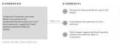

::: {.callout-note collapse="true"}
## 이번 주 목표

이번 주가 끝나면 다음을 할 수 있다.

- AI가 쓴 영어 문장이 왜 읽기 어려운지 근거를 들어 설명할 수 있다.
- 읽기 어려운 문장 패턴 10가지를 영어 문단에서 찾아 번호를 붙일 수 있다.
- 찾은 문장을 뜻, 수치, 용어를 바꾸지 않고 최소한으로 고칠 수 있다.
- 너무 많이 고친 문장(과잉 수정)을 알아볼 수 있다.
:::

# 1. 원칙 {#principles}

## 짧게 쓰라는 말은 문장 하나에 담는 생각을 줄이라는 뜻이다

- AI 글은 문법이 맞아도 읽는 데 힘이 더 듦. 문장 하나에 정보를 빽빽하게 담는 쪽으로 쏠려 있기 때문.
  - Reinhart et al. (2025, [PNAS](https://doi.org/10.1073/pnas.2422455122)): 지시를 따르도록 조정한(instruction-tuned) 모델은 사람 글보다 현재분사절(present participial clause)을 2~5배, 명사화(nominalization)를 1.5~2배 많이 씀.
  - Clark, Martin & Mahowald (2026, [arXiv:2610.29162](https://arxiv.org/abs/2610.29162), 심사 전 프리프린트): 조사한 모델 9개 모두 사람 글보다 무생물 주어에 사람의 행동 동사를 더 많이 쓰고, 드문 단어 조합을 더 많이 씀. 대부분은 서로 관련된 단어 사이가 더 멀고 명사를 더 많이 쌓음. 저자들은 모델이 수학, 코드, 추론처럼 정보 밀도가 중요한 과제에 맞춰 훈련된 결과라는 가설을 제시함.
  - Futrell, Mahowald & Gibson (2015, [PNAS](https://doi.org/10.1073/pnas.1502134112)): 37개 언어 모두에서 서로 관련된 단어 사이 거리가 무작위 기준보다 짧았음. 사람 언어는 관련된 단어를 가까이 두는 쪽으로 쓰임.
- 규칙: 짧게 쓰려고 관사, 전치사, 관계대명사, 동사를 빼지 않음. 문장을 나눔. 분량을 줄여야 하면 문법이 아니라 내용을 뺌.
- 예문은 가상의 예시임(마우스 UUO 모델과 가상의 약물 compound X. 수치는 지어낸 것).
  - 전: Compound X treatment-associated fibrotic area reduction was accompanied by decreased Col1a1 and Acta2 expression, suggesting Smad3 pathway-mediated antifibrotic activity.
  - 후: Compound X reduced the fibrotic area in UUO kidneys. It also lowered the expression of Col1a1 and Acta2. These changes suggest that Smad3 signaling mediates the antifibrotic effect of compound X.

{fig-alt="왼쪽에 생각 세 개를 담은 영어 문장 하나가 있다. 오른쪽에는 같은 내용을 나눈 영어 문장 세 개가 번호와 함께 있다."}

## 읽기 어려운 문장은 10가지 패턴으로 찾는다

아래 표는 이번 주 실습과 [W12 다듬기](w12_polishing.qmd)에서 점검표로 씀. 번호를 바꾸지 않음.

| # | 패턴 | 찾는 단서 | 고치는 방법 |
|---|---|---|---|
| 1 | 명사 나열 (noun stack) | 명사가 셋 이상 이어짐 | 동사로 풀어 씀 |
| 2 | 관련된 말이 멂 | 주어와 동사 사이가 긺, 명사에 붙은 수식어가 긺 | 문장을 나눔 |
| 3 | 무생물 주어와 행동 동사 | The data tell, the filter swallows | 실제 행위자를 주어로, 동사를 정확하게 |
| 4 | 새로 만든 말, 드문 단어 조합 | 처음 보는 복합어, 한 대상에 이름이 여럿 | 흔한 말로. 새 용어는 한 번 정의하고 그대로 씀 |
| 5 | 기능어 빠짐 | 관사, that, 전치사, be동사가 빠진 메모체 | 빠진 말을 되살림 |
| 6 | 명사화 | the analysis of, resulted in a reduction of | 동사로 씀 |
| 7 | 절을 쉼표로 길게 이음 | ..., enabling X, revealing Y, highlighting Z | 주어와 동사가 있는 문장으로 나눔 |
| 8 | 명사를 동사로 바꿈 | pipelined, operationalized | 풀어 씀 |
| 9 | 한국어 문장의 영어식 쉼표 | 또한, 본 연구는, | 쉼표를 뺌 |
| 10 | 상투 표현과 시각적 꾸밈 | plays a crucial role, underscore, 굵은 글씨, em dash | 구체적인 주장을 한 번 씀 |

## 패턴마다 예문으로 익힌다

dry lab 예문도 가상의 예시임(공개 데이터로 사람 신장 생검의 단일세포 RNA 시퀀싱 데이터를 다시 분석한 연구).

1. 명사 나열
   - 전: We performed myofibroblast subtype marker gene expression comparison.
   - 후: We compared which marker genes each myofibroblast subtype expressed.
   - 굳은 전문용어(single-cell RNA sequencing, differential expression analysis)는 그대로 씀. 새 묶음을 만들지 않음.
2. 관련된 말이 멂
   - 전: The myofibroblast subtype that we identified after integrating public datasets of kidney biopsies from patients with and without fibrosis and removing batch effects was expanded in fibrotic samples.
   - 후: We integrated public datasets of kidney biopsies from patients with and without fibrosis and removed batch effects. In the integrated data, one myofibroblast subtype was expanded in fibrotic samples.
3. 무생물 주어와 행동 동사
   - 전: The QC filter quietly swallows low-quality cells. / Compound X fights fibrosis in the injured kidney.
   - 후: The QC filter removes low-quality cells without a warning. / Compound X reduced fibrosis in UUO kidneys.
   - Figure 2 shows, These results suggest 같은 관례적 표현은 적당히 쓰면 괜찮음. 은유 동사(swallow, fight, tell a story)가 문제임.
4. 새로 만든 말, 드문 단어 조합
   - 전: Compound X lowered the fibro-burden index. (같은 단락에서 MF2 cells, the profibrotic cluster, these activated stromal cells가 모두 같은 세포를 가리킴)
   - 후: Compound X reduced the fibrotic area. (세포 이름은 MF2 하나로 통일함)
   - 새 용어가 꼭 필요하면 한 번 정의하고 그대로 씀. 예: We defined the fibrotic area as the percentage of the tissue area stained blue with Masson's trichrome.
5. 기능어 빠짐
   - 전: Kidneys harvested day 7 post-UUO, fixed, sectioned, stained with Masson's trichrome.
   - 후: We harvested the kidneys 7 days after UUO. The kidneys were fixed, sectioned and stained with Masson's trichrome.
   - 전: the samples the lab sequenced / 후: the samples that the lab sequenced
   - Figure legend 제목처럼 굳은 형식은 예외임([W5](w05_methods_legends.qmd)).
6. 명사화
   - 전: Administration of compound X resulted in a reduction of collagen deposition.
   - 후: Compound X reduced collagen deposition.
   - 전: We performed an analysis of Smad3 phosphorylation. / 후: We analyzed Smad3 phosphorylation.
7. 절을 쉼표로 길게 이음
   - 전: We integrated the datasets, enabling cell-type annotation across studies, revealing an expanded MF2 subtype, and highlighting its contribution to fibrosis.
   - 후: We integrated the datasets. This allowed us to annotate cell types across studies. In patients with fibrosis, MF2 made up a larger share of fibroblasts. MF2 contributes to fibrosis.
   - 나눠 쓰면 마지막 문장이 비율 차이만으로는 뒷받침되지 않는 인과 주장임이 드러남. -ing 꼬리는 근거 없는 주장이 숨기 쉬운 자리임.
8. 명사를 동사로 바꿈
   - 전: We pipelined the QC and clustering steps.
   - 후: We combined the QC and clustering steps into one pipeline.
9. 한국어 문장의 영어식 쉼표
   - 전: 또한, 본 연구는, 기존 연구와 달리, 공개 데이터를 다시 분석하였다.
   - 후: 또한 본 연구는 기존 연구와 달리 공개 데이터를 다시 분석하였다.
   - 영어에서는 However, Moreover 뒤에 쉼표를 찍는 것이 규칙임. 쉼표 습관은 두 언어 사이에서 옮겨 오지 않음.
   - 이 수업에서는 한국어로 먼저 쓴 초안, AI가 한국어로 쓴 설명, 번역 전 메모에서 만남. LLM이 쓴 한국어는 사람 글과 쉼표 쓰는 방식이 다르다는 보고가 있음(Park et al. 2025, [arXiv:2503.00032](https://arxiv.org/abs/2503.00032)).
10. 상투 표현과 시각적 꾸밈
    - 전: These findings underscore the crucial role of Smad3 signaling in renal fibrosis and pave the way for novel therapeutic strategies.
    - 후: In UUO kidneys, compound X reduced the fibrotic area from 18.2% to 9.6%.
    - 상투 표현 자리에는 데이터가 보여 주는 구체적인 주장을 씀. Reinhart et al. (2025)의 표 1에서 GPT-4o 글은 underscore를 사람 글보다 107배, intricate를 119배 자주 썼음.
    - 시각적 꾸밈: 평범한 단어에 굵은 글씨, 강조용 따옴표, em dash, 논리가 이어지는 내용을 글머리 기호로 나열하는 것.

## 너무 많이 고치지 않는다

- 하나의 기준(문장 길이, 가독성 점수)으로 판단하지 않음. Wang, Bilal & Zaman (2026, [arXiv:2609.17301](https://arxiv.org/abs/2609.17301), 심사 전 프리프린트)은 ChatGPT와 Gemini 대화 84,000건 이상을 분석함. 답의 길이, 가독성, 어휘 다양성은 하나씩 보면 이해의 어려움과 일정한 관계가 없었고, 이 특성들이 어떻게 섞이느냐에 따라 달랐음.
- 모든 문장을 같은 길이로 자르지 않음. 그것도 어색함.
- 수치, 유전자 이름, 인용, 주장의 세기는 그대로 둠. may, might 같은 hedge를 새로 넣지 않음.
- 학술 문체를 유지함. 문장이 쉬워진다고 말투가 가벼워지는 것은 아님.
- 이미 잘 읽히는 문장은 고치지 않음.

# 2. AI로 해 보기 {#try-with-ai}

실습: AI가 쓴 문단에서 패턴 찾기 (30분)

1. 쓰게 하기 (5분): 아래 프롬프트로 AI에게 Results 문단을 쓰게 함. 데이터는 가상의 예시임.
2. 혼자 찾기 (10분): 문장에 번호를 붙이고, 표(#, 원문 구간, 패턴 번호, 고친 문장)에 적음. 실제 문제만, 독자에게 부담이 큰 것부터 적음.
3. 짝과 비교 (5분): 같은 문장에 다른 번호를 붙였으면 이유를 말함. 짝의 표와 문단은 AI에 넣지 않음.
4. AI에게 점검시키기 (5분): 점검 프롬프트로 같은 문단을 점검하게 함. 내 표와 비교해서 AI가 놓친 것과 너무 많이 고친 것을 표시함.
5. 나란히 읽기 (5분): 고친 문장 2~3개를 원래 문장 옆에 두고 뜻과 수치가 같은지 봄.

wet lab 데이터:

```text
Write one Results paragraph (about 150 words) for a research article in a high-impact journal.
Use only the data below. They are invented for a class exercise.
- Mice: male C57BL/6J, 8 weeks old. Kidneys were harvested 7 days after unilateral ureteral obstruction (UUO).
- Groups (n = 6 each): sham, UUO + vehicle, UUO + compound X (10 mg/kg)
- Fibrotic area (Masson's trichrome): UUO + vehicle 18.2%, UUO + compound X 9.6% (P = 0.0004)
- mRNA, UUO + compound X vs UUO + vehicle: Col1a1 −52%, Acta2 −38%, Fn1 −21% (Fn1 not significant)
- Body weight and serum creatinine did not differ.
```

dry lab 데이터:

```text
Write one Results paragraph (about 150 words) for a research article in a high-impact journal.
Use only the data below. They are invented for a class exercise.
- Data: public single-cell RNA sequencing data of human kidney biopsies from 8 patients with fibrosis and 6 patients without fibrosis
- After integration, fibroblasts formed several subtypes. One myofibroblast subtype is called MF2.
- MF2 made up 24% of fibroblasts in patients with fibrosis and 7% in patients without fibrosis (P = 0.008).
```

점검 프롬프트:

```text
Review the paragraph above for sentences that are hard to read.
Look for noun stacks, long distances between related words, nominalizations, chains of -ing clauses, coined terms, missing function words and formulaic phrases.
Return a table with the original phrase, the problem and a minimal fix.
Do not change any number, gene name, statistical result or claim.
```

- 트랙 A: 위 가상의 예시 데이터를 씀. 자기 그림 하나의 내용으로 해도 되지만, 조건부 (트랙 A) 칸의 조건(지도교수 동의, 학습에 쓰이지 않는 설정, 원 데이터와 그림 파일은 넣지 않기)을 모두 지킬 때만 가능함.
- 트랙 B: 고른 논문의 Methods 한 단락을 아래 프롬프트로 다듬게 함. 사람이 쓴 원문과 AI가 다듬은 글을 비교하면 AI가 더한 패턴이 잘 보임. Title, DOI, 저자 이름은 넣지 않고, 논문에 대해 묻지 않음. 웹 검색은 끔.

```text
Rewrite the following Methods paragraph in a more polished academic style.
[고른 논문의 Methods 한 단락]
```

- AI 신호등: 가상의 예시와 공개 논문의 Methods는 자유롭게 칸. 트랙 A의 자기 내용은 조건부 (트랙 A) 칸. AI가 고친 문장의 뜻이 바뀌었는지는 꼭 검증 칸.

::: {.callout-tip}
## 프롬프트 요령

- 이번 실습에서는 패턴을 찾으려고 일부러 high-impact journal 문체를 요청함. 실제 원고를 다듬을 때는 이렇게 요청하지 않음.
- AI에게 고치게 할 때는 Do not change any number 같은 줄을 넣음. 그래도 바뀔 수 있으니 나란히 읽기로 확인함.
:::

# 3. 검증하고 다듬기 {#verify-and-revise}

이번 주는 나란히 읽기를 주로 쓰고, 수치는 프롬프트에 준 데이터와 맞춰 보는 원문 확인을 씀.

AI가 자주 틀리는 지점

- 유의하지 않은 결과에 significantly를 붙임. 위 데이터에서 Fn1은 유의하지 않은데 "significantly reduced Col1a1, Acta2 and Fn1"처럼 묶어 쓰기 쉬움.
- 주지 않은 결론을 더함. 체중과 혈청 크레아티닌은 차이가 없었는데 "improved renal function"이라고 쓰거나, 용량이 하나뿐인데 "dose-dependent"라고 씀. Smad3 데이터를 주지 않았는데 "via Smad3"를 붙임.
- 주지 않은 수치를 만듦. 예: 24%와 7%에서 "3.4-fold"를 계산해 넣음. 계산이 맞아도 새 수치이므로 확인 대상임.
- 인과를 세게 씀. associated with를 drives로, suggests를 demonstrates로 바꿈. 마우스 결과를 환자 치료로 넓히기도 함.
- 유전자 표기를 바꿈. 마우스 유전자는 Col1a1, 사람 유전자는 COL1A1처럼 씀.
- 한 대상을 여러 이름으로 부름(MF2, the profibrotic cluster, these cells).
- 점검을 맡기면: 문제가 아닌 문장까지 고치거나, 굳은 전문용어를 명사 나열로 잘못 짚거나, hedge를 더함. 한 패턴을 고치다 새 용어를 만드는 등 다른 패턴을 만들기도 함.

확인 목록

- [ ] 수치, 단위, n, P값이 프롬프트에 준 데이터와 같다. (원문 확인)
- [ ] 주지 않은 수치, 결론, 통계 표현이 없다. (원문 확인)
- [ ] 고친 문장의 주장 세기(suggest, show, demonstrate)가 원래 문장과 같다. (나란히 읽기)
- [ ] 유전자와 단백질 표기, 종이 그대로다. (나란히 읽기)
- [ ] 같은 대상을 같은 용어로 부른다.
- [ ] 새 hedge나 새 내용이 들어오지 않았다.
- [ ] 문장 길이가 자연스럽게 섞여 있다.

# 과제 {#assignment}

AI가 쓴 문단에서 패턴 찾기

- 분량: AI가 쓴 영어 문단 1개(120~200 단어)와 분석. A4 1~2쪽.
- 형식
  1. 도구 이름, 날짜, 프롬프트 원문.
  2. AI 문단 원문. 문장마다 번호를 붙임.
  3. 점검 표: #, 원문 구간, 패턴 번호, 고친 문장. 독자에게 부담이 큰 문제부터 적음.
  4. 고친 문단. 표에 올린 문장만 고침.
  5. 나란히 읽기 메모 2~3줄: 고치면서 뜻이나 수치가 바뀐 곳이 없는지, AI 점검과 내 점검이 어디서 달랐는지.
- 트랙별 차이: 트랙 A는 가상의 예시나 자기 분야 주제로 AI가 쓴 문단을 씀. 자기 결과는 조건부 (트랙 A) 칸의 조건을 지킬 때만 넣음. 트랙 B는 고른 논문의 Methods 한 단락을 AI가 다듬은 글을 씀.
- 평가 기준
  - 패턴 번호를 정확히 붙였는가. 많이 찾은 것보다 정확히 찾은 것을 높이 봄.
  - 최소 수정인가. 뜻, 수치, 용어를 지켰는가.
  - 너무 많이 고친 곳을 알아보고 피했는가.
- 제출은 학교 LMS. 마감: `TODO: 마감`
- AI를 썼으므로 [AI 사용 기록](../ai_rules.qmd#ai-log)을 함께 냄.

# 메모 {#notes}

AI 글이 읽기 어려운 이유와 패턴 10가지 (plain-prose)
