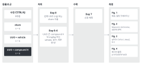
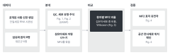
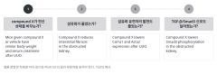
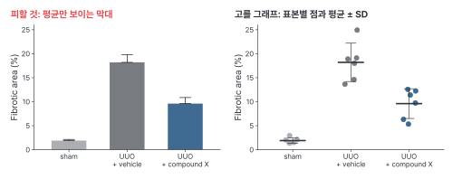
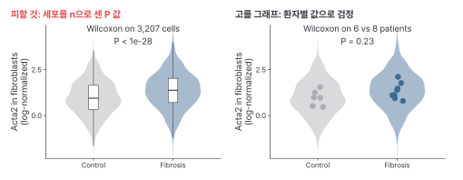
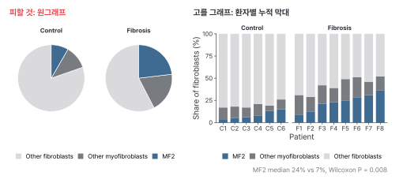

::: {.callout-note collapse="true"}
## 이번 주 목표

- 그림마다 결론을 영어 한 문장으로 쓸 수 있다.
- 그림 순서를 논문의 논증 순서로 정하고, 그 이유를 설명할 수 있다.
- 독자가 봐야 할 비교에 맞춰 그래프 종류를 고를 수 있다.
- 투고할 저널의 그림 규격과 이미지 규정을 찾아 내 그림에 적용할 수 있다.
:::

# 1. 원칙 {#principles}

- Part 2는 그림에서 시작한다. 이번 주에 정한 그림 순서를 [W5](w05_methods_legends.qmd) legend와 [W6](w06_results.qmd) Results가 그대로 따른다.
- 예문은 수업 공통의 가상의 예시 연구에서 가져온다. 수치는 지어낸 것이다.
  - wet lab: 마우스 일측 요관 폐쇄(unilateral ureteral obstruction, UUO) 모델에 가상의 약물 compound X를 투여했다. 그림 4개, 군당 n = 6.
  - dry lab: 공개된 사람 신장 생검 단일세포 RNA 시퀀싱(single-cell RNA sequencing) 데이터를 다시 분석해서, 섬유화 환자에서 늘어난 근섬유아세포 아형(가상의 이름 MF2)을 찾았다.

{fig-alt="왼쪽부터 동물과 군(수컷 C57BL/6J 8주령, sham, UUO + vehicle, UUO + compound X 각 n = 6), 처치(day 0 수술, day 0–6 compound X 10 mg/kg 또는 vehicle 경구 투여), 수확(day 7 신장 채취), 측정(Fig. 1 체중과 혈청 크레아티닌, Fig. 2 Masson's trichrome, Fig. 3 qPCR, Fig. 4 웨스턴 블롯)."}

{fig-alt="왼쪽부터 데이터(공개된 사람 신장 생검 단일세포 RNA 시퀀싱, 섬유화 환자 8명과 대조군 6명), 분석(QC, 세포 유형 주석, 섬유아세포 아형 나누기), 비교(환자별 MF2 비율, Wilcoxon), 검증(표지 유전자, 공간 전사체)."}

## 원칙 1. 그림마다 결론 문장을 하나 쓴다

- 결론 문장(conclusion sentence)은 그림 하나가 보여 주는 주장을 한 문장으로 쓴 것이다. 방법이나 그래프 이름이 아니라 결과를 쓴다.
- 주어는 연구 대상(약물, 세포, 유전자)으로, 동사는 결과(reduces, lowers, is more abundant in)로 쓴다.
- 데이터가 보여 주는 만큼만 쓴다. 관찰 데이터에 drives, mediates 같은 인과 동사를 쓰지 않는다.
- 결론 문장이 써지지 않는 그림은 아직 주장이 없다. 본문에서 빼거나 Supplementary로 보낼 후보다.
- 예문:
  - Before: Masson's trichrome staining of kidney sections after UUO.
  - After: Compound X reduces interstitial fibrosis in the obstructed kidney.
  - Before: UMAP of fibroblasts from human kidney biopsies.
  - After: The myofibroblast subtype MF2 is more abundant in kidneys with fibrosis.
  - Before: Compound X prevents fibrosis by blocking TGF-β/Smad3 signaling.
  - After: Compound X lowers Smad3 phosphorylation in the obstructed kidney.

## 원칙 2. 그림 순서는 논증 순서다

- 독자는 그림을 순서대로 읽으면서 질문 하나에 답을 하나씩 얻는다. 앞 그림이 남긴 질문에 다음 그림이 답하도록 놓는다.
- 실험한 순서나 기법 종류로 정하지 않는다. 각 그림이 답하는 질문으로 정한다.
- 결론 문장만 순서대로 이어 읽었을 때 Abstract의 결과 부분처럼 읽혀야 한다.
- 한 그림 안의 패널도 같다. 왼쪽에서 오른쪽, 위에서 아래로 읽는 순서가 논증 순서다.

{fig-alt="Figure 1부터 4까지 네 장의 카드가 번호 순서로 놓여 있다. 각 카드 위에는 답하는 질문, 아래에는 영어 결론 문장이 있다."}

| Figure | 답하는 질문 | 결론 문장 (가상의 예시) |
|---|---|---|
| 1 | compound X가 전신 상태를 바꾸는가? | Mice given compound X or vehicle have similar body weight and serum creatinine after UUO. |
| 2 | 섬유화가 줄었는가? | Compound X reduces interstitial fibrosis in the obstructed kidney. |
| 3 | 섬유화 유전자의 발현도 줄었는가? | Compound X lowers Col1a1 and Acta2 expression after UUO. |
| 4 | TGF-β/Smad3 신호도 달라졌는가? | Compound X lowers Smad3 phosphorylation in the obstructed kidney. |

## 원칙 3. 그래프 종류는 보여 줄 비교로 고른다

- 먼저 독자가 무엇과 무엇을 비교해야 하는지 정한다. 그래프는 그다음에 고른다.

| 독자가 볼 것 | 고를 그래프 | 피할 것 |
|---|---|---|
| 군 몇 개, 표본 적음 (군당 n = 6) | 표본별 점과 평균, 오차 막대 | 평균만 보이는 막대그래프. n과 분포가 가려진다 |
| 군별 분포 | 상자그림이나 바이올린 그림에 표본별 점 | 세포 하나하나를 독립 표본으로 계산한 P 값 |
| 구성 비율 (세포 유형 비율) | 표본별 누적 막대, 또는 표본별 점이 있는 비율 그래프 | 원그래프 |
| 같은 대상의 처치 전후 | 짝을 선으로 이은 그래프 (paired plot) | 짝을 무시한 두 군 비교 |
| 여러 클러스터의 표지 유전자 | 점 그래프 (dot plot) | 세포 단위 히트맵 |
| 단일세포 지도 | UMAP은 위치 안내용. 변수 하나로만 색칠한다 | 점 사이 거리를 해석하기 |

{fig-alt="왼쪽은 세 군의 평균 막대와 오차 막대만 있는 그래프. 오른쪽은 같은 데이터를 마우스마다 점으로 찍고 평균과 표준편차를 표시한 그래프."}

{fig-alt="두 그래프 모두 대조군과 섬유화 환자의 세포별 Acta2 분포를 바이올린으로 그렸다. 왼쪽은 세포 3,207개로 검정해 P < 1e-28이다. 오른쪽은 환자별 평균을 점으로 찍고 6명 대 8명으로 검정해 P = 0.23이다."}

{fig-alt="왼쪽은 대조군과 섬유화 환자의 섬유아세포 구성을 원그래프 두 개로 그렸다. 오른쪽은 환자 14명 각각의 구성을 누적 막대로 그렸고, MF2 비율의 중앙값은 7%와 24%다."}

- 막대그래프나 선 그래프는 서로 다른 분포를 같은 모양으로 보여 줄 수 있다. 표본이 적은 연구에서는 개별 점을 함께 보여 준다 (Weissgerber et al. 2015, [doi:10.1371/journal.pbio.1002128](https://doi.org/10.1371/journal.pbio.1002128)).
- 강조색은 주장에 필요한 것 하나에만 쓰고, 나머지는 회색으로 둔다.
- 같은 군이나 같은 세포 유형은 모든 그림에서 같은 색으로 칠한다. 빨강과 초록 짝을 피하고, 색각 이상 시뮬레이션으로 구분되는지 본다.
- 범주는 알파벳 순서가 아니라 의미 순서로 놓는다. 예: sham → UUO + vehicle → UUO + compound X.

## 원칙 4. 저널 그림 규격을 처음부터 맞춘다

- 다 그린 그림을 나중에 줄이면 글자와 선이 읽히지 않는다. 처음부터 최종 크기로 그린다.
- 두 저널의 규격 예시다 (2026-11-10에 각 저널 페이지에서 확인).

| 항목 | Nature | PLOS ONE |
|---|---|---|
| 너비 | 1단 89 mm, 2단 183 mm, 필요하면 1.5단 120–136 mm | 6.68–19.05 cm (300 dpi에서 789–2,250 px) |
| 최대 높이 | 쪽 깊이 247 mm | 22.23 cm |
| 해상도 | 사진 이미지 300–600 dpi | 300–600 dpi |
| 파일 형식 | 사진은 TIFF나 PSD. 그래프와 선 그림은 Adobe Illustrator(.ai), EPS, PDF 같은 벡터 형식 | TIFF 또는 EPS |
| 글자 | 패널 표시는 8 pt 굵은 소문자 a, b, c. 나머지 글자는 5–7 pt | Arial, Times, Symbol 글꼴, 8–12 pt |
| 색 | RGB 권장 | RGB 또는 grayscale |

- 원문: [Nature, Final submission](https://www.nature.com/nature/for-authors/final-submission), [Nature 그림 준비 안내](https://research-figure-guide.nature.com/figures/preparing-figures-our-specifications/), [PLOS ONE, Figures](https://journals.plos.org/plosone/s/figures).
- 규격은 저널마다 다르고 바뀔 수 있다. 투고 직전에 그 저널 페이지에서 다시 확인한다 ([W13](w13_submission.qmd)).

## 원칙 5. 데이터 그림은 AI로 만들거나 고치지 않는다

- 데이터 그림(블롯, 현미경 사진 등)은 AI로 만들거나 고치지 않는다 ([AI 사용 규칙](../ai_rules.qmd#in-the-paper)).
- 저널의 이미지 규정도 함께 지킨다. [Nature Portfolio 이미지 규정](https://www.nature.com/nature-portfolio/editorial-policies/image-integrity)의 요지는 다음과 같다.
  - 밝기와 대비는 이미지 전체에, 대조군에도 똑같이 조정한다.
  - 복제 도구나 지우기 도구(cloning, healing)는 쓰지 않는다.
  - 다른 시점이나 다른 위치에서 얻은 이미지를 붙이면 경계를 표시하고 legend에 적는다.
  - 생명과학 논문은 최종본과 함께 자르지 않은 원래 젤·블롯 이미지를 낸다.
- PLOS ONE도 이어 붙인 젤에 가는 흰색이나 검은색 선을 넣고 legend에 적게 한다. 밴드 둘레를 너무 바짝 자르지 말라고도 적고 있다 ([PLOS ONE, Figures](https://journals.plos.org/plosone/s/figures)).
- 처리하기 전 원본 파일(현미경 원본, 블롯 스캔)을 보관한다. 장비와 처리 소프트웨어는 [W5](w05_methods_legends.qmd) Methods에 적는다.
- 실험 설계 개요도에 생성 AI 이미지를 써도 되는지는 저널마다 다르다. 투고할 저널의 규정을 확인한다.
- 그래프를 그리는 코드(R, Python)는 AI가 짜도 된다. 데이터 파일은 AI에 넣지 않고, 코드는 내 컴퓨터에서 돌린다. 그림이 데이터를 맞게 보여 주는지는 본인이 확인한다. 확인할 것과 AI 사용 기록에 적는 예는 [AI 사용 규칙](../ai_rules.qmd#plot-code)에 있다.

# 2. AI로 해 보기 {#try-with-ai}

결론 문장과 그림 순서를 AI에게 점검받는다 (25분).

1. (10분) AI 없이 그림마다 결론 문장 한 줄과 답하는 질문 한 줄을 쓴다. 트랙 A는 W1 과제의 그림 목록으로, 트랙 B는 고른 논문의 그림으로 쓴다.
2. (10분) 아래 프롬프트에 결론 문장과 데이터 설명을 글로만 넣는다.
3. (5분) AI 답을 원칙 1~3과 맞춰 보고, 받아들일 것만 고친다. 받아들인 것과 버린 것을 [AI 사용 기록](../ai_rules.qmd#ai-log)에 적는다.

```text
I am planning the figures for a short research paper. Below are my figures in order.
For each figure I give one conclusion sentence and a short description of the data
(groups, n per group, type of measurement). I have not attached any data or images.

Please do three things:
1. For each conclusion sentence, say whether it states a claim or only describes
   a method or a plot. If a sentence claims more than the described data can show
   (for example, a causal mechanism from a correlation), point this out.
2. Read the sentences in order. Say where the argument jumps, repeats or goes
   backward. Suggest a new order only if it makes the argument clearer, and say why.
3. For each figure, name the comparison the reader must see. Suggest one plot type
   for it and one alternative, with the trade-off. Do not invent results or statistics.

Figure 1: [conclusion sentence] | Data: [groups, n per group, measurement]
Figure 2: [conclusion sentence] | Data: [groups, n per group, measurement]
```

- 트랙 A: [AI 신호등](../ai_rules.qmd#traffic-light)의 조건부 (트랙 A) 칸이다. 지도교수 동의를 받고, 입력이 학습에 쓰이지 않는 설정의 도구만 쓴다. 그림 파일과 원 데이터는 넣지 않고, 글로 쓴 설명만 넣는다. 이 실습에는 구체적인 수치가 필요 없으니 수치도 빼고 넣는다.
- 트랙 B: 공개 논문이므로 자유롭게 칸이다. 다만 논문 제목, 저자, DOI는 넣지 않고, 웹 검색은 끈다. AI가 그 논문의 Results를 알려 주면 W15에 할 비교가 의미를 잃는다.
- AI가 추천한 그래프 종류는 통계 방법 추천과 같이 꼭 검증 칸으로 다룬다. 원칙 3의 표와 같은 분야 최근 논문의 그림으로 확인한다.
- 프롬프트에 데이터를 붙이지 않았다고 밝히고 결과를 지어내지 말라고 적은 것은, 빈칸이 있으면 AI가 그럴듯한 수치로 채우는 일이 많기 때문이다.
- 짝 점검 (선택, 5분): 짝과 결론 문장만 바꿔 읽고, 순서대로 읽힐 때 막히는 곳을 말해 준다. 짝의 카드는 남의 원고이므로 AI에 넣지 않는다.

# 3. 검증하고 다듬기 {#verify-and-revise}

AI가 이번 주 작업에서 자주 틀리는 지점:

- 결론 문장을 데이터보다 크게 고친다. reduces를 prevents로, is associated with를 drives로 바꾼다.
- 평균 막대그래프를 기본으로 추천한다. 단일세포 데이터에서 세포 수를 n으로 삼는 그래프와 검정을 추천한다.
- UMAP에서 클러스터 사이 거리를 해석한다.
- 저널 규격을 오래된 값이나 다른 저널의 값으로 말한다.
- 논증과 관계없이 기법 종류(조직, RNA, 단백질)대로 순서를 바꾼다.

확인 목록:

- [ ] 결론 문장마다 주어가 연구 대상이고, 동사가 결과다.
- [ ] 결론 문장의 동사가 데이터 종류에 맞다. 중재 실험이면 reduces, 관찰 데이터면 is higher in이나 is associated with를 쓴다.
- [ ] 결론 문장만 순서대로 이어 읽어도 논문의 주장이 보인다.
- [ ] 그래프마다 n이 보이고, 그 n은 실험 단위(동물, 환자)의 수다.
- [ ] 같은 군은 모든 그림에서 같은 색이고, 색각 이상 시뮬레이션에서도 구분된다.
- [ ] 그림 너비, 글자 크기, 해상도, 파일 형식이 투고할 저널 페이지와 맞다.
- [ ] 데이터 그림의 원본 파일과 이미지 처리 기록이 있다.

이번 주에 쓰는 확인 3가지:

- 원문 확인: 저널 규격과 이미지 규정은 저널 페이지에서 직접 확인한다.
- 교차 확인: 그래프 종류와 그림 순서는 지도교수나 같은 분야 최근 논문의 그림과 비교한다.
- 나란히 읽기: AI가 고친 결론 문장은 원래 문장 옆에 두고 주장이 커지지 않았는지 본다.

# 과제 {#assignment}

Figure 순서 카드

- 분량: 그림마다 카드 한 장. 트랙 A는 3~4장, 트랙 B는 논문 본문 그림 수만큼 쓴다. 맨 앞에 원고 전체의 주장을 영어 한 문장으로 쓴다.
- 형식: 카드마다 아래 항목을 채운다. 결론 문장은 영어로, 나머지는 한국어로 써도 된다. 파일 하나(Word 또는 PDF)로 낸다.

| 항목 | 쓰는 것 | 예 (가상의 예시, Figure 2) |
|---|---|---|
| Figure 번호 | 원고에서의 순서 | Figure 2 |
| 답하는 질문 | 앞 그림이 남긴 질문 | compound X가 섬유화를 줄이는가? |
| 결론 문장 | 영어 한 문장 | Compound X reduces interstitial fibrosis in the obstructed kidney. |
| 패널 | 패널마다 무엇을 어떤 그래프로 보여 주는지 | a: Masson's trichrome 대표 사진 (군마다 한 장, 같은 배율, 척도 막대). b: 섬유화 면적 %, 마우스별 점과 평균 ± SD |
| 핵심 통계 | 결론을 받치는 비교 하나. 비교하는 군, n과 단위, 검정 | UUO + vehicle 대 UUO + compound X. n = 6 마리/군. one-way ANOVA 후 Tukey 다중 비교 |
| Results 단락 | W6 Results의 몇 번째 단락이 되는지, 소제목 후보 | 두 번째 단락. Compound X reduces fibrosis after UUO |

- 트랙 A: 내 그림으로 쓴다. 아직 끝나지 않은 분석은 핵심 통계 칸에 "예정"이라고 적고, 수치를 미리 지어 넣지 않는다.
- 트랙 B: 고른 논문의 그림과 Methods만 보고 쓴다. Results는 읽지 않는다. 검정 이름은 Methods의 통계 분석 절에서 찾는다.
- 평가 기준:
  1. 결론 문장이 주장이고, 그림의 데이터가 보여 주는 범위를 넘지 않는다.
  2. 그림 순서가 논증이 되고, 질문 칸에 그 이유가 드러난다.
  3. 그래프 종류와 핵심 통계(n과 단위, 검정)가 보여 줄 비교에 맞다.
- 이 카드는 W5 legend와 W6 Results 단락 순서의 뼈대가 된다. 그림이 바뀌면 카드를 고쳐서 계속 쓴다.
- 제출: 학교 LMS. 마감은 따로 공지한다. AI를 썼으면 AI 사용 기록을 함께 낸다.

# 메모 {#notes}

그림마다 결론 한 문장, 저널 그림 규격 (figure-chooser)
