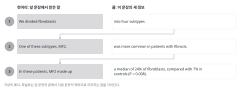

::: {.callout-note collapse="true"}
## 이번 주 목표

이번 주가 끝나면 다음을 할 수 있다.

- 문단의 주장을 한 문장으로 쓰고, 독자가 첫머리에서 그 문단이 무엇을 다루는지 알게 할 수 있다.
- 앞 문장에서 받은 말로 다음 문장을 시작하고, 새 정보를 문장 끝에 둘 수 있다.
- 핵심어를 한 이름으로 정하고 문단 안에서 바꾸지 않을 수 있다.
- AI가 쓴 문단에서 주장이 늦게 나오는 곳, 연결이 끊긴 곳, This가 가리키는 것이 불분명한 곳을 찾을 수 있다.
:::

# 1. 원칙 {#principles}

[W3](w03_readable_sentences.qmd)에서는 문장 하나를 읽기 쉽게 고쳤다. 이번 주에는 문장을 이어서 문단 하나를 만든다. 독자는 문장을 하나씩 읽지만 내용은 문단 단위로 이해한다. 문장이 모두 읽기 쉬워도 순서와 연결이 맞지 않으면 문단은 읽히지 않는다.

이번 주 원칙은 두 자료를 바탕으로 한다. 하나는 Zeiger (2000) *Essentials of Writing Biomedical Research Papers*의 3장(문단 구조)이다. 다른 하나는 Gopen & Swan (1990) "The Science of Scientific Writing"이다. Mensh & Kording (2017)의 규칙 몇 가지도 함께 쓴다. 서지 정보는 [참고자료](../resources.qmd#books)에 있다. 예문은 [W5](w05_figure_storyboard.qmd) 이후 주차와 같은 가상의 예시 연구에서 가져왔고, 수치는 지어낸 것이다.

## 문단 하나에는 주장 하나를 쓰고, 첫머리에서 그 주장을 알린다

- 규칙: 문단을 쓰기 전에 그 문단이 말하려는 것을 한 문장으로 쓴다. 이 문장이 주제문(topic sentence)이다. 나머지 문장은 주제문을 뒷받침한다.
- 주제문은 문단 첫머리에 둔다. 독자는 첫 문장을 읽고 이 문단에서 무엇을 얻을지 정한다. 주장이 마지막에 나오면 독자는 앞 문장들이 왜 거기 있는지 모른 채 읽는다.
- Introduction과 Discussion 문단은 첫 문장이 주제문이다([W10](w10_introduction.qmd)의 문단 계획표). Results 단락은 목적 문장으로 시작하고 해석 문장으로 끝난다([W7](w07_results.qmd)). 이때도 첫 문장만 읽으면 이 단락이 무엇을 다루는지 알 수 있다.
- 주장을 한 문장으로 쓸 수 없으면 문단에 주장이 둘 있거나 아직 주장이 없는 것이다. 주장이 둘이면 문단을 나눈다.
- Mensh & Kording (2017)은 문단 안에서도 맥락, 내용, 결론 순서를 권한다. 첫 문장은 주제를 열고, 가운데 문장은 내용을 담고, 마지막 문장은 독자가 기억할 결론을 남긴다. 주제문을 첫머리에 두라는 원칙과 같은 방향이다. 독자는 첫 문장에서 무엇을 읽을지 알고, 마지막 문장에서 무엇을 가져갈지 안다.
- 점검: 주제문만 이어서 읽어 본다. 그것만으로 글의 줄기가 보여야 한다.
- 예문 (wet lab, 가상의 예시):
  - 전: We measured the fibrotic area with Masson's trichrome staining. We also measured *Col1a1* and *Acta2* expression by qPCR. Compound X lowered both. Therefore, compound X reduced fibrosis at both the tissue level and the gene expression level.
  - 후: Compound X reduced fibrosis at both the tissue level and the gene expression level. It lowered the fibrotic area on Masson's trichrome staining. It also lowered the expression of the fibrosis marker genes *Col1a1* and *Acta2*.
  - 전의 셋째 문장 Compound X lowered both에서 both가 무엇인지 알려면 앞의 두 문장을 다시 읽어야 한다. 후에서는 주장이 먼저 나오므로 뒤의 두 문장이 그 근거로 읽힌다.

## 문장은 앞 문장에서 받은 말로 시작하고, 새 정보는 문장 끝에 둔다

- Gopen & Swan (1990)에 따르면 독자는 문장 첫머리(topic position)를 보고 이 문장이 무엇에 관한 것인지 판단한다. 그리고 강조할 정보를 문장 끝(stress position)에서 찾는다.
- 규칙: 문장 첫머리에는 앞 문장에 이미 나온 말을 둔다. 이 문장이 새로 알려 주는 것은 문장 끝에 둔다. 그러면 앞 문장의 끝이 다음 문장의 첫머리로 이어진다.
- 예문 (dry lab, 가상의 예시):
  - 전: We divided fibroblasts into four subtypes. A median of 24% of fibroblasts in patients with fibrosis, compared with 7% in controls, belonged to one subtype, MF2 (P = 0.008).
  - 후: We divided fibroblasts into four subtypes. One of these subtypes, MF2, was more common in patients with fibrosis. In these patients, MF2 made up a median of 24% of fibroblasts, compared with 7% in controls (P = 0.008).
  - 전의 둘째 문장은 새 정보인 수치로 시작한다. 앞 문장과 이어지는 말(subtype)은 문장 끝에 있다. 후에서는 둘째 문장이 앞 문장의 subtypes를 받아 시작하고, 셋째 문장이 앞 문장의 patients with fibrosis를 받아 시작한다.

{fig-alt="영어 문장 세 개가 위에서 아래로 있다. 문장마다 왼쪽 칸에 첫머리, 오른쪽 칸에 새 정보가 있다. 화살표가 첫 문장의 끝 into four subtypes에서 둘째 문장의 첫머리 One of these subtypes로, 둘째 문장의 끝 patients with fibrosis에서 셋째 문장의 첫머리 In these patients로 이어진다."}

- 주어와 동사를 가까이 두라는 [W3](w03_readable_sentences.qmd)의 패턴 2도 같은 이유에서 나온다. 독자는 주어를 읽은 뒤 동사가 나올 때까지 이 문장이 무엇을 말하는지 모른다.

## 핵심어는 주제문에 넣고, 같은 말로 되풀이한다

- 규칙: 문단의 핵심어(key term)는 주제문에 넣는다. 그 뒤로는 같은 말로 되풀이한다.
- 같은 단어를 반복하지 말라는 작문 규칙은 과학 글에 맞지 않는다. 말이 바뀌면 독자는 다른 대상으로 읽는다. Mensh & Kording (2017)도 같은 단어를 여러 번 쓰는 데는 문제가 없고, 다른 단어를 쓰면 독자가 뜻이 조금 다른지 의심하게 된다고 쓴다.
- 예: 한 문단에 MF2 cells, the profibrotic cluster, these activated stromal cells가 함께 나오면 독자는 세 집단을 떠올린다. MF2 하나로 쓴다. 이 기준은 W3의 패턴 4와 같다. 원고 전체의 용어 통일은 [W13](w13_polishing.qmd)에서 다시 점검한다.

## 문장 사이의 관계는 맞는 연결어로 드러낸다

- 규칙: 두 문장의 관계가 대조, 원인과 결과, 덧붙임, 예시, 순서 가운데 무엇인지 먼저 정한다. 그다음 그 관계에 맞는 연결어를 쓴다. 자주 쓰는 연결어는 [표현 모음](../phrases.qmd#connectives)에 있다.
- 관계가 없는 곳에 연결어를 넣지 않는다. 문장마다 Moreover나 Furthermore를 붙이면 독자는 모든 문장을 같은 무게의 덧붙임으로 읽는다. 한국어 초안의 "또한 ~. 또한 ~."를 옮겨도 같은 일이 생긴다([W13](w13_polishing.qmd)의 번역투 표).
- 앞 원칙대로 앞 문장에서 받은 말로 문장을 시작하면 연결어가 없어도 관계가 드러나는 때가 많다. 연결어는 그것으로 부족할 때 쓴다.
- 예문 (wet lab, 가상의 예시):
  - 전: Compound X lowered the fibrotic area. Moreover, body weight did not differ between the groups. Moreover, compound X lowered Smad3 phosphorylation.
  - 후: Compound X lowered the fibrotic area. It also lowered Smad3 phosphorylation. In contrast, body weight did not differ between the groups.
  - 후에서는 compound X가 바꾼 것 두 가지를 먼저 묶었다. 바꾸지 않은 것은 In contrast로 구분했다.

## 순서와 문장 형식을 한 번 정하면 끝까지 지킨다

- 규칙: 비교하는 대상의 순서를 한 번 정하면 바꾸지 않는다. 예: sham, UUO + vehicle, UUO + compound X 순서로 군을 소개했으면 수치도 그 순서로 쓴다.
- 실험한 시간 순서대로 쓰지 않는다. 독자에게 필요한 것은 어떤 경로로 결과에 이르렀는지가 아니라 주장과 그 근거다(Mensh & Kording 2017, 규칙 3).
- 한 주제는 한곳에서 다룬다. 같은 주장을 받치는 두 근거처럼 비슷한 생각은 바로 이어서 쓴다. 주제가 갈지자로 오가면 독자는 주제가 바뀔 때마다 다시 따라잡아야 한다(규칙 4).
- 하위 주제가 여럿이면 주제문에서 몇 개인지 알린다. 그리고 하위 주제마다 같은 문장 형식으로 쓴다. 이것을 병렬 구조(parallel form)라고 한다. 독자는 형식이 같으면 같은 종류의 내용으로 읽는다.
- 예문 (dry lab, 가상의 예시):
  - 전: We confirmed the identity of MF2 in two ways. Its marker genes were checked. Also, spatial transcriptomics data of kidney sections showed MF2.
  - 후: We confirmed the identity of MF2 in two ways. First, MF2 cells expressed known myofibroblast marker genes. Second, MF2 cells were present in spatial transcriptomics data from kidney sections.

## This와 It이 가리키는 것을 분명히 쓴다

- 규칙: 문장 첫머리의 This, It, These가 앞 문장의 무엇을 가리키는지 독자가 바로 알 수 있어야 한다. 앞 문장에 명사가 여럿이면 This 뒤에 명사를 붙인다.
- 예문 (wet lab, 가상의 예시):
  - 전: Compound X lowered the fibrotic area and Smad3 phosphorylation in UUO kidneys. This suggests that it acts through TGF-β/Smad3 signaling.
  - 후: Compound X lowered the fibrotic area and Smad3 phosphorylation in UUO kidneys. The lower Smad3 phosphorylation suggests that compound X acts through TGF-β/Smad3 signaling.
  - 전의 This는 섬유화 감소인지, Smad3 인산화 감소인지, 둘 다인지 알 수 없다. it도 compound X인지 the fibrotic area인지 헷갈린다. 후에서는 근거와 주어를 명사로 썼다. 주장의 세기(suggests)는 바꾸지 않았다.

# 2. AI로 해 보기 {#try-with-ai}

실습: AI에게 문단의 짜임을 묻고, 직접 고치기 (30분)

1. 혼자 읽기 (5분): 첫 번째 프롬프트 안의 연습 문단(가상의 예시)을 읽는다. 문단의 주장을 한 문장으로 적는다. 주제문이 몇 번째 문장인지, 같은 대상이 몇 가지 이름으로 나오는지, This가 무엇을 가리키는지 표시한다.
2. AI에게 짜임 묻기 (5분): 첫 번째 프롬프트를 보낸다. AI에게 문단을 고치게 하지 않고 짜임만 표로 받는다.
3. 비교 (5분): 내 표시와 AI의 표를 나란히 놓고 다른 곳을 찾는다. 다른 곳마다 누가 맞는지 위의 원칙으로 판단한다.
4. 직접 고치기 (10분): 원칙에 따라 문단을 직접 고친다. 그다음 두 번째 프롬프트로 고친 문단을 점검받는다.
5. 기록 (5분): [AI 사용 기록](../ai_rules.qmd#ai-log)에 적는다.

```text
아래 영어 문단의 짜임만 분석해 줘. 문단을 고쳐 쓰지 마.

1. 이 문단의 주장을 한 문장으로 써 줘. 그 주장을 담은 문장(주제문)이 몇 번째 문장인지 알려 줘.
2. 문장마다 표 한 줄로 정리해 줘. 열: 문장 번호, 문장 첫머리의 말, 그 말이 앞 문장에 나왔는지(예/아니오), 문장 끝의 새 정보.
3. 같은 대상을 가리키는 말이 여러 가지면 모두 적어 줘.
4. Moreover, This, Therefore 같은 말마다 앞 문장과 어떤 관계를 나타내는지, 그 관계가 맞는지 적어 줘.

[문단]
We reanalyzed public single-cell RNA sequencing data from kidney biopsies of 8 patients with fibrosis and 6 controls. Fibroblasts were divided into four subtypes. Moreover, the profibrotic cluster made up a median of 24% of fibroblasts in patients with fibrosis and 7% in controls (P = 0.008). Moreover, these activated stromal cells were present in spatial transcriptomics data from kidney sections. This was not seen in controls. Therefore, the MF2 myofibroblast subtype is expanded in kidney fibrosis.
```

```text
아래는 내가 위 문단을 고친 것이다. 다시 쓰지 말고 아래 네 가지만 점검해 줘. 문제가 있으면 문장 번호와 이유만 적어 줘.

1. 첫 문장만 읽어도 문단이 무엇을 다루는지 알 수 있는가.
2. 각 문장이 앞 문장에 나온 말로 시작하는가. 아니라면 관계를 맞는 연결어로 드러내는가.
3. 같은 대상을 한 가지 이름으로만 부르는가.
4. 원래 문단에 없던 사실, 수치, 주장이 들어갔는가. 원래보다 세거나 약해진 주장이 있는가.

[내가 고친 문단]
```

AI 신호등: 연습 문단은 가상의 예시이므로 자유롭게 칸이다. 트랙 A가 자기 원고의 문단으로 해 보려면 조건부 (트랙 A) 칸 조건을 지킨다.

::: {.callout-tip}
## 프롬프트 요령

- 고쳐 쓰지 말라고 적는다. AI가 문단을 다시 써 주면 무엇이 문제였는지 배울 수 없고, 원래 없던 사실이 섞이기 쉽다.
- 점검할 항목을 번호로 정해 준다. 그래야 AI의 답을 원칙과 하나씩 맞춰 볼 수 있다.
:::

::: {#ai-lab}
AI 실습 창: 위 프롬프트 블록의 실습 창에 넣기 버튼을 누르거나 프롬프트를 직접 써서 보낸다. 프롬프트의 빈자리는 보내기 전에 내 내용으로 채운다. 수업 코드는 따로 공지한다. 한 페이지 안에서는 대화가 이어진다. 그래서 4단계의 점검 프롬프트를 보내면 AI는 2단계에서 보낸 원래 문단과 비교한다. 처음부터 다시 하려면 새 대화를 누른다. 이 창에 넣은 글은 수업용 API 키로 외부 AI 서비스에 전달된다. API로 보낸 입력은 기본 설정에서 모델 학습에 쓰이지 않는다. 넣어도 되는 내용은 위의 AI 신호등 안내를 따른다. 트랙 A의 자기 원고는 지도교수 동의를 받았을 때만 넣는다. 원 데이터와 그림 파일은 넣지 않는다. 이 창의 AI는 웹 검색을 하지 않는다. AI 사용 기록의 도구 칸에는 AI 실습 창과 답 아래에 나오는 모델 이름을 적는다.
:::

# 3. 검증하고 다듬기 {#verify-and-revise}

AI의 답에서 확인할 것

- 주제문: AI가 고른 주제문이 내가 고른 것과 다르면 원칙 1로 판단한다. 첫 문장이 방법 설명이라는 이유만으로 주제문이라고 답할 수 있다.
- 표의 "앞 문장에 나왔는가" 칸: 비슷한 말을 같은 말로 판단하기 쉽다. 예: subtypes가 앞에 나왔다고 the profibrotic cluster도 앞에 나온 말로 보는 경우.
- 고쳐 쓰지 말라고 해도 고친 문단을 덧붙일 수 있다. 그 문단에서 This was not seen in controls를 MF2 cells were absent from controls처럼 원래 없던 사실로 바꾸기도 한다.

확인 목록

- [ ] AI가 고른 주제문과 내가 고른 주제문을 비교했고, 다르면 원칙 1로 판단했다.
- [ ] AI 표의 "앞 문장에 나왔는가" 칸을 문단과 나란히 놓고 한 줄씩 확인했다. (나란히 읽기)
- [ ] 내가 고친 문단의 수치(8명, 6명, 24%, 7%, P = 0.008)가 원래 문단과 같다. (나란히 읽기)
- [ ] 원래 문단에 없던 사실이 없다. 뜻이 불분명한 문장은 사실을 지어 채우지 않고, 근거가 없으면 지웠다.
- [ ] 주장의 세기가 원래와 같다. is expanded를 drives나 causes로 바꾸지 않았다.

::: {.callout-note collapse="true"}
## 고친 예 (먼저 직접 고친 뒤에 연다)

```{.text .no-ai-lab}
To find fibroblast subtypes that differ in kidney fibrosis, we reanalyzed public
single-cell RNA sequencing data from kidney biopsies of 8 patients with fibrosis
and 6 controls. We divided fibroblasts into four subtypes. One of these subtypes,
MF2, made up a median of 24% of fibroblasts in patients with fibrosis and 7% in
controls (P = 0.008). MF2 cells were also present in spatial transcriptomics data
from kidney sections. Thus, MF2 is more common in kidneys with fibrosis.
```

- Results 단락이므로 [W7](w07_results.qmd)의 순서(목적, 한 일, 결과, 해석)를 따랐다. 첫 문장의 목적만 읽어도 단락이 무엇을 다루는지 알 수 있다.
- 세 가지 이름(the profibrotic cluster, these activated stromal cells, MF2)을 MF2 하나로 바꿨다. 셋째 문장부터는 앞 문장의 subtypes와 MF2를 받아 시작한다.
- Moreover 두 개를 지웠다. 둘째 Moreover 자리의 관계는 덧붙임이라서 also로 썼다.
- This was not seen in controls는 무엇을 가리키는지 알 수 없고 근거 수치도 없어서 지웠다. 근거가 있다면 무엇이 보이지 않았는지 명사로 쓴다.
:::

# 과제 {#assignment}

한 문단 요약

- 분량: 영어 문단 하나(150~200단어)와 점검표.
- 형식
  - 문단: [W1](w01_orientation.qmd) 과제의 다섯 문장 요약(질문, 왜 중요한가, 한 일, 찾은 것, 의미)을 한 문단으로 다시 쓴다. 첫 문장에는 이 연구의 주장을 쓴다.
  - 점검표: 주제문에 밑줄을 긋는다. 핵심어 목록을 만들고 대상마다 한 이름만 적는다. 문장마다 앞 문장에서 받은 말을 괄호로 표시한다.
  - 처음 쓴 판과 고친 판을 함께 낸다.
- 트랙별 차이: 트랙 A는 자기 연구로 쓴다. 트랙 B는 고른 논문의 그림과 Methods만 보고 쓴다. 찾은 것과 의미는 그림에서 짐작한 것으로 쓰고, 짐작이라고 밝힌다.
- 이 문단은 학기 동안 원고의 줄기를 확인하는 기준으로 쓴다.
- 평가 기준
  - 첫 문장만 읽어도 문단의 주장을 알 수 있다.
  - 문장마다 앞 문장에서 받은 말로 시작하거나, 관계를 맞는 연결어로 드러낸다.
  - 같은 대상을 한 이름으로 부른다. This와 It이 가리키는 것이 분명하다.
- 제출: 학교 LMS. 마감은 따로 공지한다.
- AI를 썼으면 [AI 사용 기록](../ai_rules.qmd#ai-log)을 함께 낸다.

# 메모 {#notes}

주제문, 앞 문장에서 받은 말로 시작하기, 핵심어 되풀이, 연결어, 병렬 구조, 가리키는 말 (Zeiger 3장, Gopen & Swan 1990, Mensh & Kording 2017 규칙 3·4, plain-prose)
