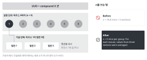
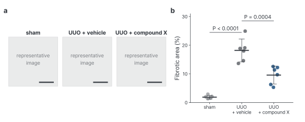

::: {.callout-note collapse="true"}
## 이번 주 목표

- 다른 연구실이 같은 실험을 반복할 수 있을 만큼 Methods를 쓸 수 있다.
- Methods와 Figure legend에서 시제와 태를 일관되게 쓸 수 있다.
- n이 무엇을 센 것인지 밝히고, 검정, 오차 막대, 정확한 P 값을 쓸 수 있다.
- 제목 문장, 패널 설명, n과 통계 순서로 Figure legend를 쓸 수 있다.
:::

# 1. 원칙 {#principles}

- 예문은 [W4](w04_figure_storyboard.qmd)와 같은 가상의 예시 연구에서 가져온다. 마우스 일측 요관 폐쇄(UUO) 모델에 가상의 약물 compound X를 주었고, 군당 n = 6이다. 수치와 조건은 지어낸 것이다.
- Methods와 legend는 W4 Figure 순서 카드를 따라 쓴다. 카드의 핵심 통계 칸이 legend의 n과 통계 문장이 된다.

## 원칙 1. 반복할 수 있을 만큼 쓴다 (재현성)

- 기준 질문: 같은 분야의 다른 연구실 대학원생이 이 Methods만 보고 같은 실험을 할 수 있는가.
- wet lab에서 빠지기 쉬운 것: 동물의 계통, 성별, 나이, 구입처. 시약의 제조사, 카탈로그 번호, 용량, 투여 경로와 시점. 정량 방법(어느 영역을 몇 장 찍었는지, 눈가림을 했는지). 소프트웨어 이름과 버전.
- dry lab에서 빠지기 쉬운 것: 데이터 출처와 accession 번호, 세포를 거른 기준, 패키지 이름과 버전, 주요 파라미터, 코드를 공개한 위치.
- 표준 방법은 인용하고, 바꾼 점만 적는다. "as described previously"로 끝내지 않는다. 인용한 방법 논문이 실제로 있는지는 [W7](w07_literature.qmd)의 방법으로 확인한다.
- 연구 설계마다 보고 지침(reporting guideline)이 있다.
  - 동물실험: [ARRIVE 2.0](https://arriveguidelines.org/arrive-guidelines). 최소 항목인 Essential 10은 연구 설계, 표본 크기, 포함·제외 기준, 무작위 배정, 눈가림, 결과 측정, 통계 방법, 실험동물, 실험 절차, 결과다 (Percie du Sert et al. 2020, [doi:10.1371/journal.pbio.3000410](https://doi.org/10.1371/journal.pbio.3000410)).
  - 다른 설계(관찰 연구, 임상시험, 진단 연구 등)는 [EQUATOR Network](https://www.equator-network.org/)에서 맞는 지침을 찾는다.
- 예문:
  - Before: Mice underwent UUO and were treated with compound X. Kidneys were harvested and analyzed.
  - After: Male C57BL/6J mice (8 weeks old) underwent left UUO. Compound X (10 mg/kg) or vehicle was given by oral gavage once daily from day 0 to day 6. Kidneys were harvested on day 7.

## 원칙 2. 시제와 태를 맞춘다

- 이 연구에서 한 일은 과거 시제로 쓴다. 그림이 보여 주는 것과 일반적 사실은 현재 시제로 쓴다 (legend의 "Data are mean ± SD").
- 수동태는 누가 했는지가 중요하지 않을 때 쓴다. 능동태 we를 쓸지는 투고할 저널의 최근 논문을 보고 정한다. 한 절 안에서는 하나로 맞춘다.
- 동사를 명사로 바꾸지 않는다. 한 문장에는 한 단계만 쓴다.
- 예문:
  - Before: Quantification of the fibrotic area was performed using ImageJ.
  - After: Fibrotic area was quantified in ImageJ (version 1.54).
  - Before: Kidneys were fixed in 10% formalin, followed by paraffin embedding, and then 4-μm sections were cut and stained with Masson's trichrome.
  - After: Kidneys were fixed in 10% formalin and embedded in paraffin. Sections (4 μm) were stained with Masson's trichrome.

## 원칙 3. n이 무엇을 센 것인지 쓴다

{fig-alt="왼쪽에 한 군의 마우스 여섯 마리와 마우스 1의 절편 세 장이 있다. 오른쪽에 n = 18로 쓴 Before와 n = 6 mice per group으로 쓴 After가 있다."}

- n은 실험 단위(experimental unit)의 수다. 실험 단위는 처치를 독립적으로 받은 단위다. 마우스 한 마리, 환자 한 명, 따로 준비한 배양이 각각 하나다 (Lazic et al. 2018, [doi:10.1371/journal.pbio.2005282](https://doi.org/10.1371/journal.pbio.2005282)).
- 같은 마우스에서 찍은 사진 여러 장이나 같은 시료의 qPCR well 세 개는 기술 반복(technical replicate)이다. 평균을 내서 그 마우스의 값 하나로 쓴다.
- 단일세포 데이터에서는 세포 수가 아니라 환자(공여자) 수가 n이다.
- Methods에는 실험 단위, 기술 반복을 합친 방법, 제외한 동물과 그 이유를 쓴다.
- 예문:
  - Before: n = 18 (6 mice × 3 sections).
  - After: n = 6 mice per group. For each mouse, values from three sections were averaged.

## 원칙 4. 통계는 검정, 오차 막대, 정확한 P 값까지 쓴다

- 검정 이름, 양측인지 단측인지, 짝지은 비교인지, 다중 비교 보정, 통계 소프트웨어와 버전을 쓴다.
- 오차 막대가 SD인지, SEM인지, 95% 신뢰구간인지 legend에 쓴다. 셋은 서로 다른 정보를 준다. SD는 데이터가 퍼진 정도를, SEM과 신뢰구간은 평균을 얼마나 정확히 추정했는지를 보여 준다 (Cumming et al. 2007, [doi:10.1083/jcb.200611141](https://doi.org/10.1083/jcb.200611141)).
- P 값은 되도록 정확한 값으로 쓴다 (P = 0.012). 아주 작은 값을 P < 0.0001처럼 쓸지는 저널 규정을 따른다.
- [Nature Portfolio Reporting Summary](https://www.nature.com/documents/nr-reporting-summary-flat.pdf)의 통계 항목이 좋은 점검표다. 군마다 정확한 n과 단위, 서로 다른 표본인지 같은 표본을 반복 측정했는지, 검정과 양측·단측 여부, 가능한 경우 정확한 P 값을 요구한다.
- 예문:
  - Before: Data are presented as mean ± SEM. *P < 0.05.
  - After: Data are mean ± SD; each dot is one mouse (n = 6 per group). P values are from one-way ANOVA with Tukey's multiple comparisons test.

## 원칙 5. Figure legend는 제목, 패널 설명, n과 통계 순서로 쓴다

- 제목 문장: 그림 전체가 보여 주는 것을 한 문장으로 쓴다. W4 결론 문장에서 시작한다. 결론을 제목에 쓰는 저널과 내용만 쓰는 저널이 있으니 투고할 저널의 논문을 보고 맞춘다.
- 패널 설명: 패널마다 무엇을, 어떤 조건에서, 어떻게 측정했는지 쓴다. 본문을 읽지 않아도 그림을 이해할 수 있어야 한다. Methods의 절차는 다시 쓰지 않는다.
- n과 통계: 점 하나가 무엇인지, n과 단위, 오차 막대 종류, 검정을 쓴다. 사진에는 척도 막대의 길이를 쓴다.
- legend에는 해석을 쓰지 않는다. 해석은 Results와 Discussion에 쓴다.
- 아래 legend가 설명하는 그림이다(가상의 예시). 실제 원고에서는 a 자리에 대표 사진이 들어간다.

{fig-alt="a 패널에는 sham, UUO + vehicle, UUO + compound X의 대표 사진 자리 세 칸과 척도 막대가 있다. b 패널에는 세 군의 섬유화 면적이 마우스별 점과 평균 ± SD로 있고, sham 대 vehicle P < 0.0001, vehicle 대 compound X P = 0.0004가 표시되어 있다."}

- Before:

```text
Figure 2. Masson's trichrome staining. Compound X significantly decreased fibrosis,
suggesting that it may be a promising therapy. *P < 0.05.
```

- After:

```text
Figure 2. Compound X reduces interstitial fibrosis after UUO.
(a) Representative Masson's trichrome images of kidneys from sham, UUO + vehicle
and UUO + compound X mice on day 7. Scale bars, 100 μm.
(b) Fibrotic area as a percentage of cortical area. Each dot is one mouse (mean of
three sections). Bars show mean ± SD; n = 6 mice per group. P values are from
one-way ANOVA with Tukey's multiple comparisons test.
```

# 2. AI로 해 보기 {#try-with-ai}

AI에게 Methods 단락을 주고, 독자가 재현할 수 없는 것을 찾게 한다 (25분).

1. (5분) 아래 연습용 단락(가상의 예시)으로 다 함께 먼저 해 본다. 이 단락에는 일부러 빠진 정보가 많다.
2. (10분) 트랙 A는 자기 Methods 단락 하나로, 트랙 B는 고른 논문의 Methods 단락 하나로 같은 프롬프트를 돌린다.
3. (10분) AI가 낸 목록을 ARRIVE Essential 10이나 해당 보고 지침과 맞춰 본다. 빠진 정보는 실험 노트, 프로토콜, 분석 기록에서 찾아 채운다.

```text
Mice underwent UUO and were treated with compound X or vehicle. Kidneys were
harvested and fibrosis was assessed by Masson's trichrome staining. Fibrotic area
was quantified using ImageJ. Data were analyzed by t-test and P < 0.05 was
considered significant.
```

```text
Below is a Methods paragraph from a biomedical research paper. Read it as a
researcher in another lab who wants to repeat the experiment exactly.

1. List every piece of information that is missing or too vague to repeat the
   experiment. Group the items under: animals or samples, interventions,
   measurement and quantification, statistics, ethics.
2. For each item, say in one sentence why a reader needs it.
3. Do not rewrite the paragraph. Do not suggest values for the missing information.

Methods paragraph:
[paste here]
```

::: {.callout-note collapse="true"}
## 연습용 단락에서 찾을 것 (강사용)
동물의 계통, 성별, 나이, 구입처. 어느 쪽 요관을 묶었는지와 sham 군. compound X의 용량, 경로, 기간과 vehicle 성분. 군 배정 방법(무작위 배정)과 눈가림. 조직을 얻은 날짜. 절편 두께와 마우스당 절편 수. 정량한 영역, 사진 수, 역치 기준, ImageJ 버전. n과 실험 단위, 제외 기준. 세 군을 비교하는데 t 검정을 쓴 점(다중 비교), 양측 여부. 동물실험 윤리 승인.
:::

- 트랙 A: [AI 신호등](../ai_rules.qmd#traffic-light)의 조건부 (트랙 A) 칸이다. 지도교수 동의를 받고, 입력이 학습에 쓰이지 않는 설정의 도구만 쓴다. 원 데이터, 그림 파일, 실험 노트 사진은 넣지 않는다. 특허 전 방법이나 공개하지 않을 조건은 빼고 넣는다.
- 트랙 B: 공개 논문의 Methods이므로 자유롭게 칸이다. 웹 검색은 끈다. AI가 빠졌다고 한 정보가 Supplementary나 인용한 방법 논문에 있는지 확인한다.
- 연습용 단락은 가상의 예시이므로 자유롭게 칸이다.

::: {.callout-warning}
## 빠진 값을 AI에게 채우게 하지 않는다
AI는 빠진 자리에 흔한 값(8주령 수컷, 7일, 10 mg/kg)을 그럴듯하게 넣는다. Methods의 값은 실험 노트와 분석 기록에서만 가져온다.
:::

# 3. 검증하고 다듬기 {#verify-and-revise}

AI가 이번 주 작업에서 자주 틀리는 지점:

- 빠진 값을 흔한 값으로 채운다 (계통, 나이, 용량, 날짜, 소프트웨어 버전).
- 문장을 다듬으면서 검정 이름을 바꾸거나 SD를 SEM으로 바꾼다.
- n의 단위를 바꾼다. n = 6 mice가 n = 6 independent experiments가 된다.
- 정확한 P 값을 P < 0.05로 뭉치거나, 없는 P 값을 만든다.
- 카탈로그 번호, RRID, 방법 논문 인용을 지어낸다.
- legend에 해석이나 significantly를 넣는다.

확인 목록:

- [ ] Methods의 모든 값이 실험 노트, 프로토콜, 분석 기록에 있다.
- [ ] 보고 지침의 필수 항목을 다 썼거나, 해당하지 않는 이유를 적었다.
- [ ] 그림마다 legend에 n과 단위, 오차 막대 종류, 검정이 있고, Methods와 같다.
- [ ] legend의 n과 검정이 W4 카드의 핵심 통계 칸과 같다.
- [ ] Methods는 과거 시제, legend의 데이터 설명은 현재 시제로 맞췄다.
- [ ] AI가 고친 문장에서 수치, 단위, 검정 이름이 바뀌지 않았다.
- [ ] 인용한 방법 논문이 실제로 있다 (DOI와 PubMed로 확인).
- [ ] 투고할 저널이 AI 사용을 Methods에 밝히라고 하는지 확인했다 ([AI 사용 규칙](../ai_rules.qmd#in-the-paper)).

이번 주에 쓰는 확인 3가지:

- 원문 확인: Methods의 값은 실험 노트와 분석 기록으로, 방법 논문은 DOI와 PubMed로 확인한다.
- 교차 확인: AI가 낸 재현성 목록을 ARRIVE 같은 보고 지침과 맞춰 보고, 그 실험을 함께 한 사람에게 묻는다.
- 나란히 읽기: AI가 고친 Methods와 legend를 원래 문장 옆에 두고 수치와 검정이 그대로인지 본다.

# 과제 {#assignment}

Methods, legend 초안

- 트랙 A:
  - Methods: 그림 3~4개에 필요한 하위 절을 모두 쓰고, 통계 분석 하위 절과 윤리 승인 문장을 넣는다. 대략 800~1,500 단어.
  - legend: 그림마다 하나씩 쓴다.
- 트랙 B:
  - legend: 그림마다 하나씩, 원 논문의 legend를 읽기 전에 그림만 보고 쓴다.
  - Methods: 논문의 Methods 중 그림 두 개에 해당하는 하위 절과 통계 분석 절을 내 말로 다시 쓴다. 문장을 옮겨 오지 않는다. 같은 부분에 대해 AI 실습에서 만든 재현성 목록을 함께 낸다.
  - TODO: 강사 결정. 트랙 B가 원 논문의 legend를 언제 읽어도 되는지. 이 초안은 내 legend를 낸 뒤에 읽고 비교한다고 가정했다.
- 형식: 영어 원고, 파일 하나(Word 또는 PDF).
- 평가 기준:
  1. 다른 연구실이 반복할 수 있을 만큼 쓰였고, 보고 지침의 필수 항목이 들어 있다.
  2. n과 단위, 검정, 오차 막대, P 값이 legend와 Methods에서 같고 정확하다.
  3. 시제와 태가 일관되고, 명사 나열 없이 한 문장에 한 단계씩 쓰였다.
- 제출: 학교 LMS. 마감: TODO: 마감. AI를 썼으면 AI 사용 기록을 함께 낸다.

# 메모 {#notes}

재현성, 시제와 태, n과 통계 표기
