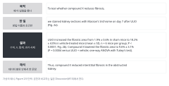

::: {.callout-note collapse="true"}
## 이번 주 목표

- W4 Figure 순서 카드를 따라 그림 하나에 단락 하나를 쓸 수 있다.
- 단락을 목적, 한 일, 결과, 짧은 해석 순서로 쓸 수 있다.
- 결과 문장에 수치, n, 통계를 정확히 넣고, 결과와 해석을 나눌 수 있다.
- AI가 Results에서 자주 내는 오류(지어낸 수치, 검정 없는 significantly, 인과 과장)를 찾아 고칠 수 있다.
:::

# 1. 원칙 {#principles}

- 예문은 [W4](w04_figure_storyboard.qmd), [W5](w05_methods_legends.qmd)와 같은 가상의 예시 연구에서 가져온다. 수치는 지어낸 것이다.
  - wet lab: 마우스 일측 요관 폐쇄(UUO) 모델, 가상의 약물 compound X, 군당 n = 6.
  - dry lab: 사람 신장 생검 단일세포 RNA 시퀀싱 재분석, 섬유화 환자에서 늘어난 근섬유아세포 아형(가상의 이름 MF2).

## 원칙 1. 그림 하나에 단락 하나, 카드 순서대로 쓴다

- W4 카드의 순서가 Results 단락의 순서다. 카드의 결론 문장은 단락 소제목 후보가 된다. 소제목을 쓸지는 투고할 저널의 논문을 보고 정한다.
- 단락 안에서는 패널 순서대로 쓰고, 문장마다 해당 패널을 괄호로 단다 (Fig. 2a).
- 한 단락에 그림 두 개를 섞지 않는다. 그림 하나가 너무 크면 단락을 둘로 나눈다.

## 원칙 2. 단락은 목적, 한 일, 결과, 짧은 해석 순서로 쓴다

- 목적 (한 문장): 왜 이 실험을 했는지 쓴다. 앞 단락이 남긴 질문이다.
- 한 일 (한 문장): 방법 이름과 조건만 쓴다. 세부 절차는 Methods에 있다.
- 결과 (두세 문장): 수치, n, 통계를 쓴다. 시제는 과거다.
- 해석 (한 문장): 이 결과가 무엇을 뜻하는지 데이터 범위 안에서 쓴다. 문헌과 비교하는 일은 [W10](w10_discussion.qmd) Discussion에서 한다.
- 예시 단락 (가상의 예시, Figure 2):

```text
To test whether compound X reduces fibrosis, we stained kidney sections with
Masson's trichrome on day 7 after UUO (Fig. 2a). UUO increased the fibrotic area
from 1.9% ± 0.6% in sham mice to 18.2% ± 4.0% in vehicle-treated mice (mean ± SD,
n = 6 mice per group; P < 0.0001; Fig. 2b). Compound X lowered the fibrotic area
to 9.6% ± 3.1% (P = 0.0004 versus UUO + vehicle; one-way ANOVA with Tukey's test).
Thus, compound X reduced interstitial fibrosis in the obstructed kidney.
```

{fig-alt="왼쪽에 목적, 한 일, 결과, 해석 네 칸이 있고, 오른쪽에 각 칸에 해당하는 예시 단락의 영어 문장이 있다."}

## 원칙 3. 결과와 해석을 나눈다

- 결과 문장은 관찰한 것을 쓴다. 해석 문장은 그 뜻을 쓰고, These data indicate나 suggest처럼 해석임을 드러낸다.
- 해석은 단락 끝에 한 문장으로 둔다. 결과 문장 안에 해석을 섞지 않는다.
- 이 모델에서 얻은 결과를 사람 질환이나 치료 효과로 넓히지 않는다.
- 예문:
  - Before: Compound X reduced fibrosis, indicating that it is a promising therapy for chronic kidney disease.
  - After: Compound X lowered the fibrotic area from 18.2% to 9.6% (n = 6 mice per group; P = 0.0004; Fig. 2b). These data indicate that compound X limits fibrosis in the UUO model.

## 원칙 4. 수치에는 n과 통계를 붙이고, significantly는 검정한 비교에만 쓴다

- 수치는 요약값(평균 ± SD, 또는 중앙값과 사분위 범위), n과 단위, 검정, P 값을 함께 쓴다. 변화량을 쓸 때는 무엇과 비교했는지 밝힌다.
- n과 검정을 본문과 legend 중 어디에 쓸지는 저널 형식을 따른다. 어느 쪽이든 독자가 수치마다 n과 검정을 찾을 수 있어야 한다.
- significantly는 통계 검정을 한 비교에만 쓴다. 차이의 크기를 말하려면 dramatically, markedly 대신 수치를 쓴다.
- 차이가 없으면 had no effect가 아니라 did not differ로 쓰고 P 값을 붙인다. 차이를 찾지 못했다는 것이 효과가 없다는 증거는 아니다.
- 예문:
  - Before: Compound X significantly improved kidney function.
  - After: Body weight and serum creatinine did not differ between UUO + vehicle and UUO + compound X mice (P = 0.41 and P = 0.57; Fig. 1b, c).
  - Before: MF2 cells were significantly increased in fibrotic kidneys (P < 10^-50).
  - After: The proportion of MF2 cells among fibroblasts was higher in biopsies with fibrosis than in controls (median 24% versus 7%; n = 8 and 6 patients; P = 0.008, Wilcoxon rank-sum test).
- 마지막 예문의 Before는 세포 수만 개를 독립 표본으로 계산했다. 비교의 단위는 환자다 ([W5](w05_methods_legends.qmd) 원칙 3).

## 원칙 5. 인과를 넘겨 말하지 않는다

- 약물을 주고 결과를 본 중재 실험이면 reduced, lowered를 쓸 수 있다.
- 기전은 다르다. 신호 변화가 함께 나타난 것만 보였다면 was accompanied by로 쓴다. 차단 실험(억제제, knockout)이 없으면 through, by inhibiting, mediates를 쓰지 않는다.
- 관찰 데이터(환자 비교, 단일세포 아형 비율)는 was higher in, was associated with로 쓴다. drives, causes를 쓰지 않는다.
- 예문:
  - Before: Compound X attenuated fibrosis by inhibiting TGF-β/Smad3 signaling (Fig. 4).
  - After: Compound X also lowered the ratio of phosphorylated to total Smad3 (Fig. 4b). Whether this change is needed for the reduction in fibrosis remains to be tested.

# 2. AI로 해 보기 {#try-with-ai}

내가 쓴 단락을 AI에게 다듬게 하고, 나란히 읽어서 바뀐 것을 찾는다 (30분).

1. (10분) AI 없이 W4 카드 하나와 W5 legend로 단락 하나를 쓴다. 원칙 2의 순서를 따른다.
2. (5분) 아래 프롬프트에 카드와 단락을 넣는다.
3. (10분) 원래 단락과 AI 판을 옆에 두고 읽는다. 수치, n, 검정, significantly, 인과 동사, 새로 생긴 해석을 하나씩 대조한다.
4. (5분) 받아들인 수정과 버린 수정을 [AI 사용 기록](../ai_rules.qmd#ai-log)에 적는다.

```text
Below is one paragraph from the Results section of my manuscript and the figure
card it is based on. Edit the paragraph for clarity and grammar only.

Rules:
- Do not change, round or add any number, n, unit, P value or test name.
- Do not add "significantly" or any other claim of statistical significance.
- Do not add interpretation, mechanism or causal language that is not already there.
- Keep one idea per sentence. Split long sentences instead of compressing them.
- After the edited paragraph, list every change you made and the reason for it.

Figure card:
[paste card]

Paragraph:
[paste paragraph]
```

- 트랙 A: [AI 신호등](../ai_rules.qmd#traffic-light)의 조건부 (트랙 A) 칸이다. 지도교수 동의를 받고, 입력이 학습에 쓰이지 않는 설정의 도구만 쓴다. 단락과 카드의 글만 넣고, 원 데이터와 그림 파일은 넣지 않는다.
- 트랙 B: 자유롭게 칸이다. 논문의 그림, 내 legend, 논문의 Methods만 보고 쓴다. 원 논문의 Results는 읽지 않는다. 논문 제목과 DOI는 AI에 넣지 않는다. AI가 원래 Results 문장을 가져올 수 있기 때문이다.
- 어느 트랙이든 AI가 고친 문장은 꼭 검증 칸이다. 뜻이 바뀌었는지 직접 확인한다.
- 짝 읽기 (선택): 짝의 단락에서 결과 문장과 해석 문장을 구분해 표시해 준다. 짝의 원고는 남의 원고이므로 AI에 넣지 않는다.

::: {.callout-warning}
## 초안을 AI에게 처음부터 쓰게 하지 않는 이유
카드만 주고 단락을 쓰게 하면 AI는 카드에 없는 수치, 검정, 기전을 채워 넣는 일이 많다. 아래 연습 문단이 그런 예다. 내가 먼저 쓰고 AI에게는 다듬기만 맡긴다.
:::

# 3. 검증하고 다듬기 {#verify-and-revise}

연습: 아래 카드와 AI가 쓴 문단(둘 다 가상의 예시)을 비교해서 틀린 곳을 모두 찾는다.

```text
Figure 3 card (key statistics), UUO + compound X versus UUO + vehicle,
n = 6 mice per group, one-way ANOVA with Tukey's test:
  Col1a1 mRNA  -52%  P = 0.003
  Acta2 mRNA   -38%  P = 0.02
  Fn1 mRNA     -21%  P = 0.19

AI-written paragraph:
Compound X significantly reduced the expression of all three fibrosis markers
(Fig. 3). Col1a1 mRNA decreased by approximately 50%, Acta2 by 40% and Fn1 by 35%
(n = 8 per group, P < 0.05). These results demonstrate that compound X suppresses
fibroblast activation through TGF-β/Smad3 signaling.
```

::: {.callout-note collapse="true"}
## 찾을 것 (강사용)
Fn1은 P = 0.19인데 세 유전자 모두 significantly 줄었다고 썼다. 52%와 38%를 50%와 40%로 반올림했다. Fn1의 35%는 카드에 없는 수치다. n이 6에서 8로 바뀌었다. 서로 다른 P 값 세 개를 P < 0.05 하나로 뭉쳤다. Figure 3에는 없는 TGF-β/Smad3 기전을 인과로 썼고, demonstrate로 해석을 키웠다.
:::

AI가 이번 주 작업에서 자주 틀리는 지점:

- 수치를 반올림하거나, 카드에 없는 수치를 만든다.
- 검정하지 않은 비교나 P > 0.05인 비교에 significantly를 붙인다.
- n과 단위를 바꾸거나 빼먹는다.
- 상관이나 동반 변화를 인과로 쓴다 (through, mediates, drives). show를 demonstrate나 prove로 키운다.
- 해석과 문헌 비교를 결과 문장 안에 끼워 넣는다.

확인 목록:

- [ ] 단락의 모든 수치가 카드와 분석 결과 파일의 값과 같고, 반올림하지 않았다.
- [ ] 수치마다 n과 단위가 있고, W5 legend의 n과 같다.
- [ ] significantly가 붙은 비교마다 검정과 P 값이 있다.
- [ ] P > 0.05인 비교를 reduced나 increased로 쓰지 않았다.
- [ ] 인과 동사는 차단 실험이나 조작 실험이 있을 때만 썼다.
- [ ] 해석은 단락 끝 한 문장이고, 문헌 비교는 Discussion으로 넘겼다.
- [ ] 단락 순서가 W4 카드 순서와 같다.

이번 주에 쓰는 확인 3가지:

- 원문 확인: 수치는 분석 결과 파일(트랙 B는 논문의 그림과 내 legend)과 하나씩 대조한다.
- 나란히 읽기: AI가 고친 단락을 원래 단락 옆에 두고 수치, 검정, 주장의 세기가 그대로인지 본다.
- 교차 확인: 짝이나 지도교수가 결과 문장과 해석 문장을 구분해 읽어 준다.

# 과제 {#assignment}

Results 초안

- 분량: W4 카드 수만큼 단락을 쓴다 (3~4단락). 단락마다 대략 100~200 단어. 소제목을 넣어도 된다.
- 형식: 영어 원고, 파일 하나(Word 또는 PDF). 단락마다 앞에 해당 카드 번호를 적는다.
- 트랙 A: 내 결과로 쓴다. 아직 끝나지 않은 분석은 [pending]으로 자리를 표시하고, 수치를 미리 지어 넣지 않는다.
- 트랙 B: 논문의 그림, 내 W5 legend, 논문의 Methods만 보고 쓴다. 원 논문의 Results는 읽지 않는다. 실제 논문과의 비교는 W15에 낸다.
- 평가 기준:
  1. 단락이 카드 순서를 따르고, 목적, 한 일, 결과, 해석 순서로 쓰였다.
  2. 수치, n, 통계가 정확하고 legend와 일치한다. significantly는 검정한 비교에만 썼다.
  3. 결과와 해석이 나뉘어 있고, 데이터가 보여 주는 범위를 넘는 인과 주장이 없다.
- 제출: 학교 LMS. 마감: TODO: 마감. AI를 썼으면 AI 사용 기록을 함께 낸다.

# 메모 {#notes}

그림 하나에 단락 하나, 수치·n·통계 쓰기
