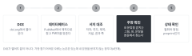

::: {.callout-note collapse="true"}
## 이번 주 목표

- 리뷰, 최근 원저, 인용 따라가기 순서로 문헌을 찾고 검색 기록을 남길 수 있다.
- AI가 낸 참고문헌이 실제로 있는지, 서지 정보가 맞는지, 인용한 주장이 논문에 있는지 확인할 수 있다.
- 인용할 주장과 논문을 짝지은 참고문헌 표를 만들어 Introduction과 Discussion에 쓸 수 있다.
:::

# 1. 원칙 {#principles}

- 이번 주 표는 [W9](w09_introduction.qmd) Introduction과 [W10](w10_discussion.qmd) Discussion의 근거가 된다. 그래서 논문만 모으지 않고, 그 논문으로 받칠 주장을 함께 적는다.
- 예문의 compound X는 수업 공통의 가상의 예시 연구에 나오는 가상의 약물이다. 예문의 참고문헌 번호는 자리 표시다.

## 원칙 1. 리뷰로 지도를 먼저 그린다

- 최근 리뷰 2~3편(대략 5년 이내)을 먼저 읽는다. 그 분야의 용어, 주요 접근, 대표 논문, 아직 다투는 문제를 파악한다.
- 리뷰에서 검색어 후보와 기준 논문(anchor paper) 2~3편을 얻는다.
- 리뷰는 원저를 대신하지 않는다. 구체적인 결과는 그 결과를 낸 원저를 인용한다.
- 예문:
  - Before: Many studies have reported that TGF-β is important in fibrosis [1–12].
  - After: TGF-β1 increased collagen production by kidney fibroblasts in culture [3] and in mice after UUO [4].

## 원칙 2. 최근 원저를 찾고, preprint는 표시한다

- 원저는 기본으로 최근 3년을 최신순으로 본다. 부족하면 기간을 넓힌다.
- 검색어는 적어도 세 가지로 바꿔 본다. 동의어, 유전자 별칭, 예전 용어를 쓴다.
  - 예: kidney fibrosis / renal fibrosis / tubulointerstitial fibrosis. UUO / unilateral ureteral obstruction. Acta2 / α-SMA.
  - PubMed에서는 MeSH 용어로도 찾는다. 예: "Ureteral Obstruction"[MeSH] AND "Fibrosis"[MeSH].
- 출판된 논문은 [PubMed](https://pubmed.ncbi.nlm.nih.gov/)에서, preprint는 [bioRxiv](https://www.biorxiv.org/)와 medRxiv에서 찾는다.
- preprint는 동료 심사를 거치지 않은 글이다. 표에 [preprint]로 표시하고, 출판본이 나왔는지 확인한다. 출판본이 있으면 출판본을 인용한다.

## 원칙 3. 인용을 앞뒤로 따라간다

- 기준 논문 2~3편에서 뒤로 간다. 그 논문이 인용한 논문을 본다.
- 앞으로도 간다. 그 논문을 인용한 논문, 특히 최근 12개월 논문을 본다. 데이터베이스의 피인용(Cited by) 목록을 쓴다.
- 멈추는 기준: 새로 검색해도 이미 표에 있는 논문만 나오면 멈춘다.

## 원칙 4. 초록이 아니라 결과를 읽고, 주장과 논문을 맞춘다

- 인용할 주장이 논문의 어느 그림, 표, 문장에 있는지 찾아서 표에 적는다. 초록만 읽은 논문은 따로 표시한다.
- 조건이 같은지 본다. 종(사람, 마우스), 세포와 조직, 실험 방식(in vitro, in vivo), 질환 단계가 같아야 같은 주장으로 인용할 수 있다.
- 읽지 않은 논문은 인용하지 않는다. 다른 논문의 참고문헌 목록에서 그대로 옮겨 오지 않는다.
- 예문 (가상의 예시. [7]은 간 성상세포 배양 실험이라고 하자):
  - Before: Compound X inhibits Smad3 phosphorylation in kidney fibroblasts [7].
  - After: Compound X lowered Smad3 phosphorylation in cultured hepatic stellate cells [7].

## 원칙 5. 반대 결과를 찾고, 검색을 기록한다

- 근거가 한 연구실, 한 코호트, 한 방법, 한 종에 몰려 있지 않은지 본다.
- 반대 결과와 음성 결과를 일부러 찾는다. 예: no association, did not reduce, failed to replicate를 검색어에 더한다.
- 검색할 때마다 날짜, 데이터베이스, 검색어, 필터, 결과 수, 고른 논문 수를 적는다. 이 기록은 W9, W10에서 검색을 갱신할 때와 [W14](w14_reviewer_response.qmd)에서 리뷰어 질문에 답할 때 다시 쓴다.

# 2. AI로 해 보기 {#try-with-ai}

AI에게 참고문헌을 받아서 한 편씩 검증한다 (30분).

- 배경: AI가 낸 참고문헌에는 지어낸 것과 서지가 틀린 것이 섞여 있다.
  - Walters와 Wilder (2023)는 ChatGPT가 쓴 짧은 문헌 고찰의 인용 636개를 확인했다. 지어낸 인용이 GPT-3.5에서 55%, GPT-4에서 18%였다. 실제로 있는 논문의 인용에도 오류가 각각 43%, 24% 있었다 ([doi:10.1038/s41598-023-41032-5](https://doi.org/10.1038/s41598-023-41032-5)).
  - Bhattacharyya et al. (2023)은 ChatGPT-3.5가 쓴 의학 글의 참고문헌 115개를 확인했다. 47%는 지어낸 것, 46%는 실제로 있지만 정보가 틀린 것이었고, 정확한 것은 7%였다. 가장 흔한 오류는 틀린 PMID였다 ([doi:10.7759/cureus.39238](https://doi.org/10.7759/cureus.39238)).
  - 두 연구는 2023년 모델로 한 것이다. 그 뒤 모델과 검색 기능이 바뀌었지만, 확인하는 방법은 같다.
- Nature Portfolio의 [AI 정책](https://www.nature.com/nature-portfolio/editorial-policies/ai)은 인용을 지어내는 일을 허용하지 않는 사용으로 분류한다.

순서:

1. (5분) 주장 하나를 정한다. 공통 주제는 가상의 예시 연구의 배경(UUO 모델의 TGF-β/Smad3 신호, 또는 사람 신장 섬유화의 근섬유아세포 아형)이다. 트랙 A는 자기 분야의 공개된 일반 주제를 써도 된다.
2. (5분) 아래 프롬프트로 참고문헌 5편을 받는다.
3. (15분) 3절의 순서로 한 편씩 확인하고, 분류 표의 다섯 가지 중 하나로 분류한다.
4. (5분) 분류별 개수를 반 전체가 모아 본다.

```text
I am writing the Introduction of a biomedical paper.
Give me five peer-reviewed papers that support this statement:
"[one claim, e.g. TGF-β/Smad3 signaling promotes kidney fibrosis after
unilateral ureteral obstruction in mice]"

For each paper, give the first author, year, title, journal, DOI and PMID.
Then give the specific result (figure or experiment) in that paper that supports
the statement. If you are not sure that a paper exists, say so instead of guessing.
```

- 트랙 A: 공개된 일반 주제는 자유롭게 칸이다. 아직 발표하지 않은 가설, 결과, 과제 아이디어는 [AI 신호등](../ai_rules.qmd#traffic-light)의 넣지 않기 칸이다.
- 트랙 B: 고른 논문의 주제로 해도 되지만 논문 제목과 DOI는 넣지 않고, 웹 검색은 끈다. AI가 그 논문의 Introduction과 Discussion 내용을 알려 줄 수 있다.
- AI가 낸 참고문헌은 어느 트랙이든 꼭 검증 칸이다.
- 짝과 표를 바꿔 몇 편을 다시 확인해 보는 것은 좋다. 짝의 표에는 아직 발표하지 않은 주장이 들어 있으니 AI에 넣지 않는다.

::: {.callout-tip}
## 검색 기능이 있는 AI 도구도 같다
웹이나 논문 데이터베이스를 검색하는 AI 도구가 낸 논문도 같은 순서로 확인한다. 논문이 실제로 있어도, 그 논문에 내가 인용할 주장이 있는지는 따로 확인해야 한다.
:::

# 3. 검증하고 다듬기 {#verify-and-revise}

참고문헌 한 편을 확인하는 순서:

{fig-alt="번호 1부터 5까지 DOI, 데이터베이스, 서지 대조, 주장 확인, 상태 확인 다섯 단계가 차례로 놓여 있다."}

1. DOI: `https://doi.org/` 뒤에 DOI를 붙여 연다. 열리지 않으면 기록한다. 열려도 다른 논문이 나오면 불일치다.
2. 데이터베이스: [PubMed](https://pubmed.ncbi.nlm.nih.gov/)에서 제목으로 찾고 PMID를 대조한다. PubMed에 없는 분야의 논문은 [Crossref 검색](https://search.crossref.org/)으로 찾는다.
3. 서지 대조: 저자(첫 저자 철자), 연도, 제목, 저널, 권과 쪽을 논문 페이지와 하나씩 맞춘다.
4. 주장 확인: 주장을 받치는 그림, 표, 문장을 본문에서 찾아 위치를 적는다. 종, 세포, 조건이 내 문장과 같은지 본다.
5. 상태 확인: 철회나 정정이 있었는지 PubMed 기록, 저널 페이지, [Retraction Watch Database](https://retractiondatabase.org/)에서 본다. preprint면 출판본이 나왔는지 본다.

| 분류 | 뜻 | 할 일 |
|---|---|---|
| 확인됨 | 논문이 있고, 서지와 주장이 맞다 | 참고문헌 표에 넣는다 |
| 서지 오류 | 논문은 있지만 연도, 저널, 저자, PMID 등이 틀리다 | 논문 페이지의 정보로 고치고 기록한다 |
| 주장 불일치 | 논문은 있지만 그 주장이 없거나 조건이 다르다 | 내 문장을 논문에 맞게 고치거나 다른 논문을 찾는다 |
| 찾을 수 없음 | DOI가 없거나 다른 논문으로 연결되고, 데이터베이스에도 없다 | 버리고, 지어낸 참고문헌으로 기록한다 |
| 철회됨 | 철회 표시가 있다 | 인용하지 않는다. 철회 자체를 다룰 때만 예외다 |

AI가 이번 주 작업에서 자주 틀리는 지점:

- 그럴듯한 제목에 실제 연구자 이름을 붙여 없는 논문을 만든다.
- 실제로 있는 DOI나 PMID를 다른 논문에 붙인다.
- 연도, 권, 쪽, PMID를 틀리게 쓴다.
- 실제 논문에 없는 결과를 붙인다. 마우스 결과를 사람 결과로, 배양 세포 결과를 동물 결과로 옮긴다.
- 리뷰를 원저처럼, preprint를 출판 논문처럼 소개한다.
- 철회된 논문을 그대로 낸다.

이번 주에 쓰는 확인 3가지:

- 원문 확인: 이번 주의 중심이다. DOI, PubMed, 논문 본문으로 한 편씩 확인한다.
- 교차 확인: 리뷰 논문의 설명이나 지도교수의 판단과 맞춰 본다.
- 나란히 읽기: AI가 요약한 논문 내용을 논문의 해당 문장 옆에 두고, 주장의 범위가 같은지 본다.

참고문헌 목록은 참고문헌 관리 프로그램(예: Zotero, EndNote)에 DOI나 PMID로 불러와서 만든다. AI가 준 서지를 그대로 붙여 넣지 않는다.

# 과제 {#assignment}

참고문헌 표와 검증 기록

- 분량: 참고문헌 15편 내외(리뷰 2~3편 포함), AI가 제안한 참고문헌의 검증 기록 5편 이상(실습한 것 포함), 검색 기록.
- 형식: 아래 표 세 개를 파일 하나(Excel 또는 Word)로 낸다.
- 표 1. 참고문헌 표

| 열 | 쓰는 것 |
|---|---|
| 번호 | 1, 2, 3 … |
| 인용할 주장 | 이 논문으로 받칠 내 문장 (영어 한 문장) |
| 쓸 곳 | Introduction 몇 번째 단락, Discussion 비교, Methods 중 하나 |
| 서지 | 첫 저자, 연도, 저널 또는 [preprint] |
| DOI, PMID | 직접 열어 확인한 값 |
| 설계와 데이터 | 종, n, 기술 (예: 마우스 UUO, 군당 n = 6, qPCR) |
| 주장을 받치는 결과 | 결과 한 줄과 위치 (예: Fig. 3b) |
| 찾은 경로 | 리뷰, 데이터베이스 검색, 인용 따라가기(뒤로·앞으로), AI 제안 |
| 확인 | DOI, PubMed, 서지 대조, 본문 확인. 초록만 읽었으면 표시 |

- 표 2. AI 제안 참고문헌 검증 기록: 날짜, 도구, AI가 준 서지, DOI 결과, PubMed 결과, 서지 대조, 주장 확인, 분류(3절 표의 다섯 가지).
- 표 3. 검색 기록: 날짜, 데이터베이스, 검색어, 필터, 결과 수, 고른 논문 수.
- 트랙 A: 내 원고의 Introduction과 Discussion에 쓸 주장을 기준으로 찾는다.
- 트랙 B: 고른 논문의 주제로 찾되, 논문의 Introduction과 Discussion은 읽지 않는다. 고른 논문은 검색의 출발점(기준 논문)으로 쓰지 않는다.
- 트랙 B는 고른 논문의 참고문헌 목록을 W10 Discussion 초안을 낸 뒤에 본다. 내 표와 겹치는 정도는 W15 비교 메모에 쓴다.
- 평가 기준:
  1. 모든 참고문헌의 실재, 서지, 주장을 확인했고, 주장을 받치는 위치를 적었다.
  2. 리뷰, 최근 원저, 인용 따라가기, 반대 결과가 고루 들어 있고, preprint가 표시되어 있다.
  3. 검색 기록이 다른 사람이 다시 따라 할 수 있을 만큼 구체적이다.
- 제출: 학교 LMS. 마감은 따로 공지한다. AI를 썼으면 AI 사용 기록을 함께 낸다.

# 메모 {#notes}

검색 원칙, AI가 지어낸 참고문헌 잡기 (literature-scout)
