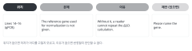

::: {.callout-note collapse="true"}
## 이번 주 목표

- 이번 주가 끝나면 동료의 Methods와 Results를 리뷰 양식에 따라 읽고, 위치와 이유가 있는 코멘트를 쓸 수 있다.
- 받은 코멘트마다 반영할지 정하고, 반영하지 않으면 그 이유를 한 줄로 쓸 수 있다.
- 동료 원고를 AI에 넣으면 안 되는 이유를 설명하고, 이번 주의 AI 사용을 자기 원고 점검으로 한정할 수 있다.
- AI 자기 점검과 사람의 리뷰가 각각 무엇을 잡고 무엇을 놓치는지 비교할 수 있다.
:::

# 1. 원칙 {#principles}

이번 주는 동료 리뷰(peer review) 주간이다. W5의 Methods와 W6의 Results를 서로 바꿔 읽는다. 예문은 가상의 예시 연구를 쓴다. 마우스 일측 요관 폐쇄(unilateral ureteral obstruction, UUO) 모델에 가상의 약물 compound X를 투여한 연구다. 수치는 지어낸 것이다.

## 리뷰어는 고쳐 쓰지 않고 문제를 짚는다

- 리뷰어가 문장을 새로 써 주면 저자는 왜 고쳐야 하는지 배우지 못한다. 리뷰어의 문장이 저자 원고에 그대로 들어가기도 한다.
- 문장 수준의 제안은 한두 곳에 예시로만 든다. 나머지는 저자가 고친다.

## 코멘트 하나에 위치, 문제, 이유를 쓴다

{fig-alt="네 칸에 위치 Lines 14–16, 문제, 이유, 제안이 각각 영어 문장 조각으로 들어 있다."}

- 제안은 있으면 덧붙인다. 위치가 없는 코멘트는 저자가 어디를 고칠지 모른다. 이유가 없는 코멘트는 저자가 반영할지 판단할 수 없다.
- Before: *The Methods are unclear.*
- After: *Lines 14–16 (qPCR): The reference gene used for normalization is not given. Without it, a reader cannot repeat the ΔΔCt calculation. Please name the gene.*
- Before: *The Results need more data.*
- After: *Line 42: "Compound X markedly reduced fibrosis" gives no number. Please add the fibrotic area of each group (mean ± SD), n, and the statistical test, as in the Figure 2B legend.*

## 중요한 것부터 쓴다

- 큰 문제(major): 다시 할 수 없는 Methods, 빠진 n이나 통계, 본문과 그림의 수치가 다른 곳, 데이터보다 센 해석.
- 작은 문제(minor): 단어, 문법, 형식.
- 작은 문제 20개와 큰 문제 0개로 된 리뷰는 저자에게 도움이 적다. 큰 문제 3개를 먼저 고르고, 작은 문제는 그다음에 쓴다.

## Results 안에서 결과와 해석을 나눠 읽는다

- Results 문장은 측정한 것을 말한다. 기전이나 의미는 Discussion에서 다룬다.
- Before: *Compound X reduced Col1a1 mRNA by 52% (Figure 3A), indicating that it blocks TGF-β signaling.*
- 리뷰 코멘트: Figure 3은 mRNA만 측정했다. 신호 전달은 Figure 4에서 다룬다. 뒷부분은 해석이므로 Discussion으로 옮기거나 Figure 4 단락과 연결하라고 쓴다.
- After: *Compound X reduced Col1a1 mRNA by 52% compared with vehicle (Figure 3A).*

## 동료 원고는 AI에 넣지 않는다

- [AI 사용 규칙](../ai_rules.qmd)의 넣지 않기 칸에 "심사 중인 원고(리뷰어로 받은 남의 원고 포함)"가 있다. 동료의 원고가 여기에 해당한다. 동료의 Figure 순서 카드와 참고문헌 표도 같다. 트랙 A 원고에는 발표하지 않은 데이터가 있고, 트랙 B 원고도 동료가 쓴 글이다. 그래서 트랙과 관계없이 넣지 않는다.
- 원고 전체뿐 아니라 문장 일부를 붙여 넣는 것도 안 된다. AI에 요약을 시키거나 코멘트 초안을 받는 것도 안 된다.
- 리뷰하다 생긴 개념 질문은 원고 문장 없이 일반 질문으로 묻는다. 이것은 자유롭게 칸이다. 예: *What should a Methods section report about qPCR normalization?*
- 받은 원고 파일은 리뷰에만 쓰고 다른 사람에게 보내지 않는다. 리뷰가 끝나면 지운다.

## 리뷰 진행 순서

1. 수업 전: 저자는 Methods, Results, Figure와 legend 최신본에 줄 번호를 넣어 LMS에 올린다. 기한은 따로 공지한다.
2. 짝 정하기: 두 명씩 서로 바꿔 읽는다. 짝은 강사가 무작위로 정한다. 다른 분야 학생과 짝이 되면 전공이 다른 독자도 이해하게 쓰는 연습이 된다. Scientific Reports도 투고 전에 전공이 다른 동료에게 원고를 보여 주라고 권한다([투고 안내](https://www.nature.com/srep/author-instructions/submission-guidelines)).
3. 읽기(40분): 처음에는 끝까지 한 번 읽기만 한다. 두 번째 읽을 때 아래 양식을 채운다.
4. 대화(10분): 리뷰어는 큰 문제 3개를 말로 설명한다. 저자는 반박하지 않고, 코멘트를 이해했는지 질문만 한다.
5. 리뷰어는 양식을 저자에게 주고 LMS에도 올린다.

트랙 B 원고를 리뷰할 때 리뷰어는 원 논문의 Results를 찾아 읽지 않는다. 이미 읽었더라도 저자에게 알려 주지 않는다. 저자는 아직 그 부분을 읽지 않은 상태다.

## 리뷰 양식

각 항목에 예, 부분, 아니오로 답하고, 문제가 있으면 줄 번호와 코멘트를 쓴다. 동물 실험이면 [ARRIVE Essential 10](https://arriveguidelines.org/arrive-guidelines)을 옆에 두고 본다.

| # | 항목 | 확인 질문 |
|---|---|---|
| M1 | 재현성 | 다른 연구실이 이 Methods만 보고 같은 실험이나 분석을 할 수 있는가? 시약과 출처, 농도, 시간, 장비, 소프트웨어 버전, 파라미터가 있는가? dry lab이면 데이터 accession 번호와 코드 위치가 있는가? |
| M2 | n | n이 무엇을 세는지(동물, 환자, 세포, 시야) 분명한가? 군마다 n이 있고, 제외한 표본과 그 기준이 있는가? |
| M3 | 통계 | 검정 이름, 비교한 군, 다중 비교 보정, 오차 막대가 SD인지 SEM인지 적었는가? |
| M4 | 승인과 출처 | 동물 실험이나 인체 연구 승인 번호, 공개 데이터의 출처가 있는가? |
| R1 | 단락 구성 | 그림 하나에 단락 하나인가? 단락 첫 문장이 그 그림의 결론 문장인가? |
| R2 | 수치, n, 통계 | 비교마다 수치, n, 검정과 P 값이 있고 그림과 같은가? |
| R3 | 결과와 해석 | 해석이나 기전 설명이 섞인 문장이 있는가? 데이터보다 센 표현(prove, demonstrate, markedly)이 있는가? |
| R4 | 읽기 | 한 문장에 생각이 하나인가? 명사 나열, 긴 수식어, 번역투가 있는가? ([W3](w03_readable_sentences.qmd)의 패턴) |
| R5 | 서로 맞는지 | Results에 나온 방법이 Methods에 있는가? legend의 n과 통계가 본문과 같은가? |

양식 끝에 두 가지를 쓴다. 먼저 고칠 큰 문제 3개, 그리고 잘된 점 하나를 구체적으로 쓴다.

# 2. AI로 해 보기 {#try-with-ai}

이번 주 실습에서 AI는 저자가 자기 원고에만 쓴다. 리뷰 전에 AI로 자기 원고를 점검해 두고, 리뷰를 받은 뒤 AI 결과와 동료 코멘트를 비교한다(25분).

1. 리뷰 시작 전(10분): 자기 Methods와 Results를 아래 프롬프트로 점검받는다. 결과는 저장해 두고, 리뷰가 끝날 때까지 원고를 고치지 않는다.
2. 1절의 순서대로 동료 리뷰를 주고받는다.
3. 리뷰 뒤(10분): AI 결과와 동료 코멘트를 나란히 놓고 네 칸으로 나눈다. 둘 다 짚은 것, 동료만 짚은 것, AI만 짚은 것, AI가 틀린 것이다.
4. (5분) 반영할 코멘트를 고른다. 과제의 반영 표로 이어진다.

```text
아래는 내가 쓴 논문 원고의 Methods와 Results다. 고쳐 쓰지 말고 점검만 해 줘.
다음 질문마다 문제가 있는 곳을 줄 번호와 함께 목록으로 적어 줘.
1. 다른 연구실이 이 Methods만 보고 실험이나 분석을 똑같이 할 수 있는가? 빠진 정보는 무엇인가?
2. 비교마다 n, 수치, 통계 검정이 있는가? n이 무엇을 세는지 분명한가?
3. Results 문장 가운데 결과가 아니라 해석인 문장은 무엇인가?
4. 한 문장에 생각이 둘 이상이거나, 명사를 셋 이상 이은 문장은 무엇인가?
원고에 없는 정보를 추측해서 채우지 마. 확실하지 않으면 "확인 필요"라고 적어 줘.

[Methods]
(붙여 넣기)

[Results]
(붙여 넣기)
```

리뷰를 받은 뒤 내 문장을 고칠 때 AI를 쓴다면 아래처럼 묻는다. 받은 코멘트는 [받은 리뷰](../ai_rules.qmd#received-reviews) 조건을 지키면 그대로 넣어도 된다. 그래도 내 말로 한 줄로 바꿔 넣기를 권한다. 코멘트를 내 말로 바꿔 보면 내가 그 코멘트를 이해했는지 확인할 수 있다.

```text
동료 리뷰에서 아래 지적을 받았다. 지적 내용은 내가 요약한 것이다.
지적: qPCR 정규화에 쓴 기준 유전자가 Methods에 없다.
아래 내 문단에서 이 지적에 답하려면 어떤 정보를 어디에 넣어야 하는지 알려 줘.
문장을 새로 쓰지 말고, 넣을 정보의 종류와 위치만 말해 줘. 정보 자체는 내가 실험 기록에서 확인한다.

[내 문단]
(붙여 넣기)
```

- 트랙 A: 자기 원고는 조건부 칸이다. 지도교수 동의를 받고, 입력이 학습에 쓰이지 않는 설정의 도구만 쓴다. 원 데이터와 그림 파일은 넣지 않는다. 조건을 맞출 수 없으면 첫 프롬프트의 질문 네 개를 체크리스트로 삼아 직접 점검한다.
- 트랙 B: 자기가 다시 쓴 원고라서 자유롭게 칸이다. 다만 고른 논문의 제목, 저자, DOI는 넣지 않고, 웹 검색은 끈다. AI가 실제 논문의 Results를 알려 줄 수 있기 때문이다.
- AI가 "빠졌다"고 한 정보는 꼭 검증 칸이다. 원고에 정말 없는지 직접 찾아본다.
- 동료 원고는 어느 단계에서도 넣지 않기 칸이다.

# 3. 검증하고 다듬기 {#verify-and-revise}

AI 자기 점검이 자주 틀리는 지점과 확인 방법이다.

- 원고에 이미 있는 정보를 없다고 한다. legend나 다른 단락에 있을 때 특히 그렇다. 원문 확인으로 자기 원고에서 찾아본다.
- 빠진 정보를 추측으로 채운다. 시약 회사, 카탈로그 번호, 소프트웨어 버전, 기준 유전자 이름이 흔하다. 원문 확인으로 실험 노트나 분석 기록에서 직접 확인한다.
- 분야 관행을 규정처럼 말한다. 예: "저널은 반드시 SEM을 쓰라고 요구한다." 투고할 저널의 규정 원문을 확인하고, 지도교수에게 교차 확인한다.
- 통계 검정을 바꾸라고 권한다. 맞는 지적일 수도 있지만 꼭 검증 칸이다. AI의 말만 듣고 검정을 바꾸지 않고, 지도교수나 통계 교재로 교차 확인한다.
- 문장을 다듬으면서 뜻을 바꾼다. 예: "reduced"를 "significantly attenuated"로 바꾼다. 나란히 읽기로 잡는다.
- AI가 처음부터 못 잡는 것도 있다. 그림을 넣지 않았으므로 본문과 그림의 수치가 다른 곳은 찾지 못한다. 같은 분야 독자가 어디서 헷갈리는지도 모른다. 이것은 동료 리뷰가 맡는다.

반영할 때 확인 목록:

- [ ] 코멘트마다 반영, 부분 반영, 반영하지 않음 가운데 하나로 정했다.
- [ ] 반영하지 않은 코멘트에는 이유를 한 줄로 썼다. 리뷰어가 틀렸다고 판단했으면 그 근거를 썼다.
- [ ] 고친 곳의 수치, n, 통계가 그림과 legend와 같다.
- [ ] AI가 제안한 정보는 실험 노트나 원 데이터에서 직접 확인했다.
- [ ] 고친 문장을 원래 문장과 나란히 읽고, 주장이 세지거나 약해지지 않았는지 보았다.

# 과제 {#assignment}

리뷰 반영본

- 제출물(LMS):
  1. 반영본: 고친 Methods와 Results. 줄 번호를 넣고, 고친 곳은 변경 내용 추적이나 색으로 표시한다.
  2. 반영 표: 받은 코멘트마다 한 줄씩 쓴다.
  3. 내가 동료에게 쓴 리뷰 양식. 이 리뷰는 동료 리뷰 점수로 채점한다.
  4. AI를 썼으면 AI 사용 기록. 2절의 네 칸 비교를 3~5줄로 붙인다.
- 반영 표 형식:


| # | 코멘트 요약(내 말로) | 처리 | 고친 위치 또는 반영하지 않은 이유 |
|---|---|---|---|
| 1 (예시) | qPCR 기준 유전자가 Methods에 없다 | 반영 | Methods 15행에 기준 유전자 이름을 넣었다 |
| | | | |

- 트랙 A: 보충한 실험 정보는 실험 노트에서 확인한 것만 쓴다.
- 트랙 B: Methods 정보는 원 논문의 Methods에서 확인한다. Results, Introduction, Discussion, Abstract는 여전히 읽지 않는다.
- 평가 기준:
  - 리뷰: 코멘트마다 위치와 이유가 있고, 큰 문제와 작은 문제를 나눴다.
  - 반영: 코멘트마다 처리와 이유가 있다. 반영하지 않은 코멘트에도 근거가 있다.
  - 반영본: 수치, n, 통계가 그림과 legend와 맞는다.
- 점수: 리뷰 양식은 동료 리뷰 점수(평가의 20% 가운데 W8 몫 10%)로, 반영 표와 반영본은 주차 과제로 채점한다. 채점은 담당교수가 한다. [W12](w12_polishing.qmd)의 리뷰도 같은 기준으로 채점한다.
- 제출: 학교 LMS. 마감은 따로 공지한다.

# 메모 {#notes}

Methods·Results 동료 리뷰
