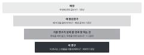

::: {.callout-note collapse="true"}
## 이번 주 목표

- 이번 주가 끝나면 Introduction을 배경, 왜 중요한가, 기존 연구가 못 하는 것, 이 연구의 네 단계로 설계할 수 있다.
- 문단마다 주장을 한 문장으로 정하고, 그 근거를 W7 참고문헌 표에서 찾아 붙일 수 있다.
- 기존 연구의 빈틈(gap)을 검색한 만큼만 쓰고, 그 gap과 이 연구의 설계가 맞는지 확인할 수 있다.
- AI가 붙인 인용이 문장의 주장을 실제로 뒷받침하는지 원문으로 확인할 수 있다.
:::

# 1. 원칙 {#principles}

예문은 가상의 예시 연구를 쓴다. 마우스 일측 요관 폐쇄(unilateral ureteral obstruction, UUO) 모델에 가상의 약물 compound X를 투여했더니 섬유화가 줄었다는 연구다. compound X와 수치는 지어낸 것이다. 예문의 [1]과 [2]만 실제 문헌이고 DOI를 확인했다. 나머지 번호는 W7 참고문헌 표의 번호가 들어갈 자리다.

- [1] Kovesdy CP. Epidemiology of chronic kidney disease: an update 2022. *Kidney Int Suppl.* 2022;12:7–11. <https://doi.org/10.1016/j.kisu.2021.11.003>
- [2] Chevalier RL, Forbes MS, Thornhill BA. Ureteral obstruction as a model of renal interstitial fibrosis and obstructive nephropathy. *Kidney Int.* 2009;75:1145–1152. <https://doi.org/10.1038/ki.2009.86>

## 깔때기 네 단계로 짜고, 첫 문장은 구체적인 사실로 시작한다

{fig-alt="위에서 아래로 좁아지는 네 칸: 배경, 왜 중요한가, 기존 연구가 보여 준 것과 못 하는 것, 이 연구. 칸마다 독자가 묻는 것과 보통 분량이 적혀 있다."}

| 단계 | 독자가 묻는 것 | 보통 분량 |
|---|---|---|
| 배경 | 무엇에 관한 글인가? | 1문단 |
| 왜 중요한가 | 왜 이것을 알아야 하나? | 배경 끝이나 1문단 |
| 기존 연구가 보여 준 것과 못 하는 것 | 무엇을 이미 알고, 무엇을 아직 모르나? | 1~2문단 |
| 이 연구 | 이 연구는 그 빈틈을 어떻게 메우나? | 마지막 1문단 |

- 그림 3~4개 분량의 원고라면 4~5문단이면 된다.
- 첫 문장에는 독자가 확인할 수 있는 사실이나 숫자를 하나 쓴다.
- Before: *Kidney fibrosis has attracted increasing attention in recent years and plays a crucial role in chronic kidney disease.*
- After: *Chronic kidney disease affects more than 800 million people worldwide [1]. Fibrosis is the hallmark of progressive kidney disease of almost any cause [2].*
- Before 문장에는 확인할 수 있는 내용이 없다. "attracted increasing attention"과 "plays a crucial role"은 AI 글에 흔한 상투 표현이다.

## 문단마다 주장 한 문장, 근거는 W7 표에서 가져온다

문장을 쓰기 전에 문단 계획표를 먼저 만든다. 계획표의 근거 칸이 비어 있으면 세 가지 중 하나를 한다. W7로 돌아가 근거를 찾거나, 주장을 약하게 고치거나, 그 주장을 뺀다.

| 문단 | 주장 한 문장 | 근거 | 상태 |
|---|---|---|---|
| 1. 배경 | CKD는 흔하고, 섬유화는 진행하는 신장 질환의 공통 특징이다 | [1], [2] | 근거 있음 |
| 2. 왜 중요한가 | 섬유화를 직접 줄이는 치료가 부족하다 | 없음 | 근거 필요 |
| 3. 알려진 것 | TGF-β/Smad3 신호가 섬유화를 일으킨다는 것은 세포와 동물 모델에서 보였다 | [3]–[5] | 확인 필요: [5]는 간 섬유화 논문이다 |
| 4. 못 하는 것 | compound X는 배양 세포에서 Smad3 인산화를 줄였지만, 생체 신장에서는 시험되지 않았다 | [6], W7 검색 기록 | 확인 필요: "시험되지 않았다"는 검색 기록으로 확인 |
| 5. 이 연구 | UUO 모델에서 compound X가 섬유화를 줄이는지 시험했다 | 이 원고의 Figure 1–4 | |

## 기존 연구는 나열하지 말고 묶어서 무엇을 보여 주는지 쓴다

- 논문마다 한 문장씩 쓰면 독자가 공통점을 직접 찾아야 한다. 문헌들이 함께 보여 주는 것을 한 문장으로 쓰고 번호를 묶어 단다.
- Before: *[3] showed that Smad3-deficient mice had less fibrosis after UUO. [4] reported that TGF-β1 increased collagen expression in fibroblasts. [5] found that a Smad3 inhibitor reduced fibrosis in another model.*
- After: *Studies in cultured cells and in mouse models show that TGF-β/Smad3 signaling drives collagen production and kidney fibrosis [3, 4].*
- After 문장에서 [5]가 빠졌다. 계획표에서 [5]는 간 섬유화 논문이었다. 묶을 때도 번호마다 그 문장을 뒷받침하는지 다시 본다.

## Gap은 검색한 만큼만 쓴다

- "No study has"는 W7 검색 기록이 그것을 보여 줄 때만 쓴다. 그렇지 않으면 "few studies have"에 문헌 번호를 달거나, "to our knowledge"를 쓰고 검색 기록을 남긴다.
- gap은 이 연구가 답할 수 있는 크기로 쓴다. 흔한 gap은 네 가지다. 이 해상도의 데이터가 없다. 설계에 교란 요인이 있다. 기존 방법으로는 X를 구분할 수 없다. 결과가 서로 다르다.
- Before: *However, no study has investigated anti-fibrotic drugs in the kidney.*
- After: *Compound X lowers Smad3 phosphorylation in cultured fibroblasts [6]. Whether it reduces kidney fibrosis in vivo has not been reported.*
- dry lab 예시(가상, 근섬유아세포 아형 MF2를 찾은 연구): *Earlier single-cell studies of human kidney fibrosis grouped all myofibroblasts together [7, 8]. It is unclear whether specific myofibroblast subtypes are more abundant in fibrotic kidneys.*

## 마지막 문단의 설계는 gap에 답한다

- gap이 "생체에서 시험되지 않았다"이면 설계는 생체 실험이어야 한다. gap이 "사람 데이터가 없다"이면 마우스 실험으로는 답할 수 없다.
- 투고할 저널이 결과 미리보기를 쓰는 편이면 마지막 문장에 주요 결과를 한 문장으로 쓴다. 이때 동사의 세기는 Results와 같게 한다.
- Before: *In this study, we investigated the role of compound X in kidney disease using various methods.*
- After: *Here, we tested whether compound X reduces fibrosis in the mouse UUO model. We measured the fibrotic area, fibrosis marker genes and Smad3 phosphorylation. Compound X reduced the fibrotic area and lowered Smad3 phosphorylation.*
- 이 마지막 문단의 질문은 W10 Discussion 첫 문단에서 답한다. 질문 문장을 따로 적어 둔다.

# 2. AI로 해 보기 {#try-with-ai}

문단 계획표를 AI와 함께 만들고, 근거 칸을 직접 확인한다. 문장은 계획표를 확인한 뒤에 쓴다(25분).

1. AI 없이(5분): 이 연구의 질문, gap, 주요 결과를 한 문장씩 쓴다. 주요 결과는 W6의 결론 문장에서 가져온다.
2. (10분) 아래 첫 프롬프트에 세 문장과 W7 참고문헌 표를 넣고 문단 계획표를 받는다.
3. (10분) 근거 칸을 번호마다 원문 확인한다. 그 문헌이 정말 그 주장을 하는지 보고 상태 칸을 고친다.
4. 과제로: 확인한 계획표로 문단을 직접 쓴다. AI 초안을 받는다면 두 번째 프롬프트를 쓰고 고친다.

```text
영어 의생명 연구 논문의 Introduction을 쓰려고 한다. 아직 문장은 쓰지 말고 문단 계획표만 만들어 줘.

구조: 배경, 왜 중요한가, 기존 연구가 보여 준 것과 못 하는 것, 이 연구
표의 열: 문단 | 주장 한 문장(영어) | 근거(아래 참고문헌 번호) | 상태(근거 있음 / 근거 필요 / 확인 필요)

규칙:
- 근거는 아래 참고문헌 표에 있는 번호만 쓴다. 표에 없는 문헌을 새로 넣지 않는다.
- 한 줄 요약만으로 그 주장을 뒷받침하는지 확실하지 않으면 상태를 "확인 필요"로 적는다.
- "no study has"처럼 단정하는 gap은 쓰지 않는다.
- "plays a crucial role", "has attracted increasing attention" 같은 표현은 쓰지 않는다.

[이 연구의 질문, gap, 주요 결과]
(세 문장 붙여 넣기)

[참고문헌 표: 번호 | 저자, 연도, 저널, DOI | 내가 원문을 읽고 쓴 한 줄 요약]
(W7 표 붙여 넣기)
```

```text
아래 문단 계획표의 3번 문단을 영어로 써 줘.
- 한 문장에 주장 하나만 쓴다.
- 인용 번호는 계획표에 적힌 것만 쓴다. 문장마다 어느 번호가 그 문장을 뒷받침하는지 괄호로 표시한다.
- 명사를 셋 이상 잇지 않는다.
- 근거가 없는 문장이 필요하면 쓰지 말고 [근거 필요]라고 적는다.

(확인한 계획표 붙여 넣기)
```

::: {.callout-tip}
## 한 줄 요약은 직접 쓴 것을 넣는다

AI에 넣는 문헌 요약은 W7에서 원문을 읽고 직접 쓴 것이어야 한다. 서지 정보만 넣으면 AI는 그 문헌의 내용을 기억에 기대어 채운다. 그렇게 채운 내용은 틀려도 겉보기에는 그럴듯하다.
:::

- 트랙 A: 질문, gap, 주요 결과는 자기 원고 내용이라 조건부 칸이다. 특허를 낼 결과나 아직 공개하지 않을 아이디어는 넣지 않기 칸이다.
- 트랙 B: 자유롭게 칸이다. 논문의 Introduction을 읽지 않은 채로 쓴다. 근거는 W7 표에서만 가져온다. W7에서 고른 논문을 문헌 검색의 출발점으로 쓰지 않았으므로, W7 표는 그 논문의 참고문헌 목록과 따로 만든 것이다. 프롬프트에 고른 논문의 제목, 저자, DOI를 넣지 않는다. 웹 검색 기능이 있는 도구는 검색을 끄고 쓴다. AI가 실제 논문의 Introduction을 가져올 수 있기 때문이다.
- 두 트랙 모두 인용과 그 연결은 꼭 검증 칸이다.

# 3. 검증하고 다듬기 {#verify-and-revise}

AI가 Introduction에서 자주 틀리는 지점이다.

- 인용이 문장을 뒷받침하지 않는다. 다른 장기, 다른 종, 배양 세포의 결과를 생체 결과처럼 붙인다. 원문 확인으로 그 문헌의 초록과 Results에서 해당 주장을 찾는다.
- 표에 없는 문헌을 끼워 넣거나 번호를 바꾼다. 원문 확인으로 번호를 W7 표와 대조한다.
- gap을 부풀린다. 흔한 표현은 "no study has", "for the first time", "remains completely unknown"이다. W7 검색 기록과 대조하고, 지도교수나 동료에게 정말 아무도 하지 않았는지 교차 확인한다.
- 상투 표현으로 시작한다. "a growing body of evidence" 뒤에 구체적인 근거가 없으면 지운다.
- 마지막 문단의 결과 미리보기가 Results보다 세다. 예: "reverses", "prevents CKD". Results 결론 문장과 나란히 읽기로 잡는다.
- 문헌을 하나씩 나열한다. 묶어서 다시 쓴다.

::: {.callout-warning}
## 문헌이 실제로 있어도 내용이 안 맞을 수 있다

W7에서는 문헌이 실제로 있는지 확인했다. W9에서는 그 문헌이 이 문장을 뒷받침하는지 확인한다. AI가 쓴 인용은 번호도 맞고 문헌도 실제로 있지만, 그 문헌이 다른 것을 보인 경우가 많다.
:::

확인 목록:

- [ ] 문단마다 주장 문장이 하나 있고, 계획표와 같다.
- [ ] 인용 번호마다 원문에서 그 주장을 찾았다. 수치는 초록이 아니라 본문에서 확인했다.
- [ ] gap 문장의 범위가 W7 검색 기록과 맞는다.
- [ ] 마지막 문단의 설계가 gap에 답한다. 종, 모델, 데이터 종류가 맞는다.
- [ ] 결과 미리보기의 동사가 Results와 같은 세기다.
- [ ] AI가 고친 문장은 원래 문장과 나란히 읽었다.

이번 주에 쓰는 확인은 세 가지 모두다. 인용은 원문 확인, gap은 교차 확인, AI가 고친 문장은 나란히 읽기로 본다.

# 과제 {#assignment}

Introduction 초안

- 분량: 4~5문단, 400~600단어 안팎.
- 형식: 영어 원고에 줄 번호를 넣는다. 인용은 W7 참고문헌 표의 번호로 단다. 확인을 마친 문단 계획표(문단, 주장, 근거, 상태)를 함께 낸다.
- 트랙 A: 지도교수와 gap 문장을 한 번 확인하면 좋다.
- 트랙 B: 실제 논문의 Introduction을 읽지 않고 썼다는 것을 한 줄로 적는다. 실제 논문의 gap과는 W15 비교 메모에서 비교한다.
- 평가 기준:
  - 네 단계가 보이고, 문단마다 주장이 하나다.
  - 인용이 그 문장의 주장을 실제로 뒷받침한다.
  - gap과 마지막 문단의 설계가 맞는다.
- AI를 썼으면 AI 사용 기록을 함께 낸다. 제출은 학교 LMS다.
- 마감은 따로 공지한다.

# 메모 {#notes}

배경 → 왜 중요한가 → 기존 연구가 못 하는 것 → 이 연구 (intro-builder)
