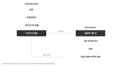

::: {.callout-note collapse="true"}
## 이번 주 목표

- 이번 주가 끝나면 Discussion 첫 문단에서 Introduction이 던진 질문에 답할 수 있다.
- 주요 결과를 W7 참고문헌 표의 기존 연구와 비교하고, 결과가 다르면 그 이유를 쓸 수 있다.
- 근거의 세기에 맞게 동사와 완곡 표현(hedging)을 고를 수 있다.
- 어느 연구에나 붙는 일반론이 아니라 이 연구의 설계에서 생기는 한계와 다음 단계를 쓸 수 있다.
:::

# 1. 원칙 {#principles}

예문은 가상의 예시 연구를 쓴다. 마우스 일측 요관 폐쇄(unilateral ureteral obstruction, UUO) 모델에서 가상의 약물 compound X가 섬유화를 줄였다는 연구다. 군은 sham, UUO + vehicle, UUO + compound X(10 mg/kg)이고, 8주령 수컷 C57BL/6J 마우스를 군당 n = 6으로 썼다. 신장은 7일째에 얻었다. [W5](w05_methods_legends.qmd) Methods 예문대로 compound X는 수술 당일(day 0)부터 6일째까지 매일 주었다. 수치는 지어낸 것이다. 예문의 문헌 번호는 W7 참고문헌 표의 번호가 들어갈 자리다.

## 첫 문단은 Introduction의 질문에 대한 답이다

{fig-alt="왼쪽 Introduction 네 칸이 좁아져 이 연구의 질문에 이른다. 그 질문에서 오른쪽 Discussion의 질문에 대한 답으로 화살표가 가고, Discussion은 기존 연구와 비교, 한계, 다음 단계와 마지막 문장으로 넓어진다. 점선은 마지막 문장도 같은 질문에 답한다는 뜻이다."}

- W9 Introduction의 마지막 문단에 적은 질문을 옆에 두고 쓴다. 예: *Here, we tested whether compound X reduces fibrosis in the mouse UUO model.*
- 결과는 그림 순서가 아니라 중요한 순서로 쓴다. Results를 그림마다 다시 요약하지 않는다.
- Before: *In this study, we first examined body weight and serum creatinine (Figure 1). We then performed Masson's trichrome staining (Figure 2) and qPCR (Figure 3).*
- After: *Compound X reduced kidney fibrosis after UUO in mice. The fibrotic area fell from 18.2% to 9.6%. Compound X also lowered the expression of Col1a1 and Acta2 and the phosphorylation of Smad3.*
- 핵심 용어는 원고 전체에서 하나로 정해 쓴다. fibrotic area를 다른 곳에서 scarring이나 ECM accumulation으로 바꿔 부르지 않는다.

## 기존 연구와 비교한다: 누구와 같고, 누구와 다르고, 왜 다른가

- 비교할 문헌은 W7 표에서 가져온다. 다르면 가장 그럴듯한 이유를 쓴다. 흔한 이유는 모델, 용량, 투여 시점, 관찰 기간, 코호트, 측정 기술이다.
- 데이터가 보여 준 것과 추론한 것을 다른 문장에 쓴다.
- Before: *Our findings are consistent with previous studies [7–12].*
- After: *Mice lacking Smad3 also develop less fibrosis after UUO [7], and our results with compound X are consistent with this. Unlike a previous study of a Smad3 inhibitor [8], we found no change in serum creatinine. In UUO the contralateral kidney is intact. Serum creatinine therefore reflects both kidneys and can stay normal even when the obstructed kidney is injured.*
- [7]–[12]처럼 번호를 한꺼번에 달면 어느 문헌이 무엇을 보였는지 알 수 없다. 문헌 하나에 비교 한 가지를 쓴다.

## hedging은 근거의 세기에 맞춘다

| 근거의 종류 | 쓰는 동사와 표현 | 예 |
|---|---|---|
| 직접 측정하고 검정했다 | reduced, increased, did not change | *Compound X reduced the fibrotic area by 47%.* |
| 함께 변했지만 원인은 시험하지 않았다 | was accompanied by, is associated with, suggests | *Lower fibrosis was accompanied by lower Smad3 phosphorylation. This suggests that compound X acts at least partly through Smad3.* |
| 데이터 밖의 추측이다 | may, one possibility is (따로 문장으로) | *One possibility is that compound X also reduces inflammation, which we did not measure.* |

- 과장한 문장: *Compound X reverses kidney fibrosis by blocking TGF-β/Smad3 signaling and is a promising therapy for patients with CKD.* 문제가 세 가지다. 수술 당일부터 주었으므로 reverse가 아니라 발생을 줄인 것이다. "by blocking"은 시험하지 않은 인과다. 마우스 결과를 환자로 넓혔다.
- 지나치게 약하게 쓴 문장: *Compound X might potentially have a possible effect on fibrosis.* 직접 측정했고 P = 0.0004인 결과다. hedge를 세 개 겹쳐서 무엇을 찾았는지가 흐려졌다. 표의 첫 줄처럼 쓴다.
- dry lab 예시(가상): 근섬유아세포(myofibroblast) 아형 MF2의 비율이 섬유화 환자 8명에서 24%, 대조군 6명에서 7%였다(P = 0.008). 이것은 직접 관찰이다. 그 아형이 섬유화를 "drives"한다는 것은 시험하지 않은 인과다. "may contribute to"로 쓰고, 단면 자료라는 점을 한계에 적는다.

## 한계는 이 연구에 해당하는 것만, 결론에 미치는 영향과 함께 쓴다

- 한계마다 세 가지를 쓴다. 무엇이 한계인지, 결론의 어느 부분이 약해지는지, 어떻게 줄였거나 줄일 수 있는지.
- Before: *This study has several limitations. First, the sample size was small. Second, only one model was used. Further studies are needed.*
- After: *We started compound X on the day of surgery. Our data therefore show that it limits the development of fibrosis, not that it reverses established fibrosis. We used only male mice, so the effect in female mice is unknown.*
- dry lab에서 자주 해당하는 한계: 환자 8명과 대조군 6명이라는 작은 표본, 여러 기관의 공개 데이터를 합쳐서 생기는 배치 효과, 한 시점의 단면 자료라서 순서를 말할 수 없음, 표지 유전자 선택에 따라 달라지는 세포 주석, 공간 전사체 검증에 쓴 표본 수.

## 다음 단계는 한계에서 나오고, 마지막 문장은 Introduction과 맞춘다

- "Further studies are needed"만 쓰지 않는다. 어떤 실험이 어떤 질문에 답하는지 쓴다.
- Before: *Further studies are needed to clarify the mechanism.*
- After: *Starting compound X after fibrosis is established, for example 3 days after UUO, would test whether it can reverse fibrosis. Testing it in Smad3-deficient mice would show whether its effect depends on Smad3.*
- 마지막 문장은 Introduction 마지막 문단의 질문에 대한 한 문장 답이다. 예: *Compound X limits fibrosis after UUO in mice, and the lower Smad3 phosphorylation suggests that it acts at least partly through this pathway.*

# 2. AI로 해 보기 {#try-with-ai}

AI로 문단 계획표와 한계 후보를 받고, 직접 쓴 첫 문단의 hedging을 점검한다(25분).

1. AI 없이(5분): Introduction 마지막 문단의 질문과 W6의 결론 문장(그림마다, 수치 포함)을 나란히 놓는다.
2. (10분) 첫 프롬프트로 문단 계획표와 한계 후보를 받는다. 한계 후보마다 해당함, 해당하지 않음, 모름을 표시한다.
3. AI 없이(5분): 첫 문단을 직접 쓴다.
4. (5분) 두 번째 프롬프트로 첫 문단의 hedging을 점검한다. 고칠지는 내가 정한다.

```text
영어 의생명 연구 논문의 Discussion 문단 계획을 세우려고 한다. 문장은 쓰지 말고 표 두 개로만 답해 줘.

표 1의 열: 문단 | 요점 한 문장 | 근거가 되는 그림 | 비교할 문헌(아래 번호만)
- 첫 문단은 Introduction 질문에 대한 답이다.
- 결과는 그림 순서가 아니라 중요한 순서로 놓는다.
- 비교할 문헌은 아래 참고문헌 표에 있는 번호만 쓴다. 맞는 문헌이 없으면 "없음"이라고 적는다.

표 2의 열: 이 연구의 한계 | 결론의 어느 부분이 약해지는가 | 줄이는 방법이나 다음 실험
- 아래 설계에서 실제로 생기는 한계만 적는다.
- "sample size was small"처럼 어느 연구에나 붙는 한계를 적으려면, 이 설계에서 왜 문제인지 함께 적는다.

[Introduction의 질문]
[그림마다 결론 문장, 수치 포함]
[설계: 종, 모델, 군과 n, 처리 시점과 기간, 측정한 것]
[참고문헌 표: 번호 | 서지 정보 | 내가 원문을 읽고 쓴 한 줄 요약]
```

```text
아래는 내가 쓴 Discussion 첫 문단이다. 고쳐 쓰지 말고 문장마다 표로 점검해 줘.
표의 열: 문장 번호 | 근거의 종류(직접 측정 / 함께 변함 / 데이터 밖 추측) | 쓰인 동사나 hedge 표현 | 근거보다 센지, 약한지, 맞는지
근거는 아래 결론 문장에 있는 것만 인정한다.

[결론 문장]
[내 첫 문단]
```

- 트랙 A: 설계 정보와 결론 문장은 자기 원고 내용이라 조건부 칸이다. 다음 단계에 쓸 새 실험 아이디어가 과제나 특허 전 아이디어라면 넣지 않기 칸이다. 그 칸은 비워 두고 직접 쓴다.
- 트랙 B: 자유롭게 칸이다. 실제 논문의 Discussion을 읽지 않은 채로 쓴다. 비교할 문헌은 W7 표에서만 가져오고, 고른 논문을 문헌 검색의 출발점으로 쓰지 않는다. 프롬프트에 고른 논문의 제목, 저자, DOI를 넣지 않고, 웹 검색 기능은 끈다. 그림과 Methods만 보고 한계를 찾는 것이 이번 주 연습이다. 실제 저자가 쓴 한계와는 W15 비교 메모에서 비교한다.
- 비교할 문헌과 인용 연결은 두 트랙 모두 꼭 검증 칸이다.

# 3. 검증하고 다듬기 {#verify-and-revise}

AI가 Discussion에서 자주 틀리는 지점이다.

- 일반적인 한계를 쓴다. "small sample size", "single model", "further studies are needed"가 거의 언제나 나온다. 이 설계와 연결되는지, 결론의 어느 문장을 약하게 만드는지 확인한다.
- 결과보다 세게 쓴다. 상관을 인과로("by blocking"), 예방을 치료로("reverses"), 마우스를 사람으로("in patients"), 한 모델을 질환 전체로("CKD") 넓힌다. Results 결론 문장과 나란히 읽기로 잡는다.
- 인용이 주장을 뒷받침하지 않는다. 번호 여러 개를 한꺼번에 달거나, 반대 결과를 낸 문헌을 "consistent with"에 붙인다. 번호마다 원문 확인한다.
- Results에 없는 새 결과나 수치를 넣는다. 결론 문장과 대조한다.
- hedge를 겹친다. 예: "may possibly suggest". 하나만 남긴다.

::: {.callout-warning}
## AI가 낸 한계 목록을 그대로 옮기지 않는다

한계를 물으면 AI는 거의 같은 목록을 낸다. 그 가운데 내 설계에 해당하는 것만 남긴다. 남긴 한계마다 결론의 어느 문장이 약해지는지 쓴다. 내 설계에만 있는 한계(투여 시점, 성별, 측정 지표의 한계)는 AI 목록에 없는 경우가 많으므로 직접 찾는다.
:::

확인 목록:

- [ ] 첫 문단이 Introduction의 질문에 답한다.
- [ ] 비교 문헌마다 원문에서 그 결과를 찾았고, 같은지 다른지가 맞다.
- [ ] 문장마다 동사의 세기가 근거의 종류와 맞는다.
- [ ] 한계마다 결론에 미치는 영향이 적혀 있다.
- [ ] 다음 단계가 한계와 이어진다.
- [ ] 마지막 문장이 Introduction 마지막 문단과 같은 질문에 답한다.
- [ ] Results에 없는 결과나 수치가 없다.

이번 주에는 인용에 원문 확인, 한계와 해석에 교차 확인(지도교수, 동료), AI가 고친 문장에 나란히 읽기를 쓴다.

# 과제 {#assignment}

Discussion 초안

- 분량: 4~6문단, 500~800단어 안팎.
- 형식: 영어 원고에 줄 번호를 넣는다. 인용은 W7 참고문헌 표의 번호로 단다. 문단 계획표와 한계 표(한계, 결론에 미치는 영향, 줄이는 방법)를 함께 낸다.
- 트랙 A: 투여 시점, 성별, 측정 지표처럼 내 설계에만 있는 한계를 하나 이상 쓴다.
- 트랙 B: 실제 논문의 Discussion을 읽지 않고 썼다는 것을 한 줄로 적는다.
- 평가 기준:
  - 첫 문단이 Introduction의 질문에 답하고, 마지막 문장이 Introduction과 맞는다.
  - hedging이 근거의 세기와 맞는다.
  - 한계가 이 설계에 해당하고, 결론에 미치는 영향이 적혀 있다.
- AI를 썼으면 AI 사용 기록을 함께 낸다. 제출은 학교 LMS다.
- 마감은 따로 공지한다.

# 메모 {#notes}

서론의 질문에 답하기, hedging, 한계 쓰기 (discussion-builder)
