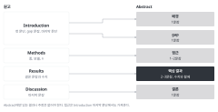

::: {.callout-note collapse="true"}
## 이번 주 목표

- 이번 주가 끝나면 Abstract를 배경, gap, 접근, 수치가 있는 핵심 결과, 결론의 다섯 부분으로 쓸 수 있다.
- 투고할 저널의 Abstract 단어 수와 형식을 저널 페이지에서 확인할 수 있다.
- 단어 수를 줄여야 할 때 문법이 아니라 내용 단위로 뺄 수 있다.
- 유형이 다른 Title 세 안을 쓰고 장단점을 비교할 수 있다.
:::

# 1. 원칙 {#principles}

예문은 가상의 예시 연구 두 개를 쓴다. wet lab 예시는 마우스 일측 요관 폐쇄(unilateral ureteral obstruction, UUO) 모델에서 가상의 약물 compound X가 섬유화를 줄였다는 연구다. dry lab 예시는 공개된 사람 신장 생검 단일세포 RNA 시퀀싱 데이터를 다시 분석해서 섬유화 환자에서 늘어난 근섬유아세포(myofibroblast) 아형 MF2를 찾은 연구다. 수치는 지어낸 것이다.

## Abstract는 다섯 부분이고, 내용은 원고의 다른 부분에서 가져온다

{fig-alt="왼쪽 원고의 Introduction, Methods, Results, Discussion에서 오른쪽 Abstract의 배경, gap, 접근, 핵심 결과, 결론으로 화살표가 이어진다."}

| 부분 | 문장 수 | 가져오는 곳 |
|---|---|---|
| 배경 | 1 | Introduction 첫 문단 |
| gap | 1 | Introduction의 gap 문장 |
| 접근 | 1~2 | Introduction 마지막 문단, Methods의 종, 모델, n |
| 핵심 결과 | 2~3 | Results 결론 문장. 수치를 함께 쓴다 |
| 결론 | 1 | Discussion 마지막 문장 |

- Abstract에만 있는 결과나 주장은 없어야 한다. 수치는 Results와 같아야 한다.
- 다음 원칙의 표에 있는 세 저널은 모두 Abstract에 참고문헌을 넣지 않게 한다. 다른 저널도 대개 그렇다.
- 연구한 종을 Abstract에 쓴다. PLOS ONE은 이것을 투고 규정으로 요구한다([투고 안내](https://journals.plos.org/plosone/s/submission-guidelines)).

## 단어 수와 형식은 투고할 저널 페이지에서 확인한다

| 저널 | Abstract | Title |
|---|---|---|
| [Nature Communications](https://www.nature.com/ncomms/submit/article) | 200단어 이하, 참고문헌 없음 | 15단어 이하 |
| [Scientific Reports](https://www.nature.com/srep/author-instructions/submission-guidelines) | 200단어 이하, 소제목 없는 한 문단, 참고문헌 없음 | 20단어 이하. 주요 메시지를 과학적으로 정확한 한 문장으로 쓰고, 말장난과 관용구를 쓰지 않는다 |
| [PLOS ONE](https://journals.plos.org/plosone/s/submission-guidelines) | 300단어 이하, 인용 없음, 연구한 종을 쓴다 | 250자 이하(단어가 아니라 글자 수). 임상 연구로 오해할 수 있으면 동물 모델을 제목에 쓴다 |

- 위 내용은 2026년 11월 10일에 각 저널 페이지에서 확인했다. 규정은 바뀌므로 투고 전에 다시 확인한다([W13](w13_submission.qmd)).
- Background, Methods, Results, Conclusions 같은 소제목을 붙이는 구조화 초록(structured abstract)을 요구하는 저널도 있다. 투고할 저널의 안내에서 초록 형식을 확인한다.

## 줄일 때는 문법이 아니라 내용을 뺀다

- 단어 수가 넘치면 관사, 동사, 접속어를 빼고 명사를 이어 붙이고 싶어진다. 그러면 단어는 줄지만 읽기는 더 어려워진다. 정보가 함께 사라지기도 한다.
- 대신 덜 중요한 내용을 통째로 뺀다. 뺀 내용은 공저자가 볼 수 있게 목록으로 적어 둔다.
- 원래 결과 부분(59단어):
  *Compound X did not change body weight or serum creatinine. It reduced the fibrotic area on Masson's trichrome staining from 18.2% to 9.6% (n = 6 per group; P = 0.0004). It lowered Col1a1 expression by 52% and Acta2 expression by 38%. Fn1 expression did not change significantly. Compound X also lowered the ratio of phosphorylated to total Smad3.*

- 문법을 빼서 줄인 판(24단어). AI에 줄여 달라고만 하면 흔히 이런 꼴이 나온다:
  *Compound X: unchanged body weight/creatinine, reduced trichrome fibrotic area (18.2% vs 9.6%, P = 0.0004), decreased Col1a1/Acta2 expression (52%/38%), unchanged Fn1, lower p-Smad3/Smad3 ratio.*

  동사가 없고, 빗금과 명사 나열("trichrome fibrotic area")이 생겼다. n = 6도 말없이 사라졌다.
- 내용을 뺀 판(32단어):
  *Compound X reduced the fibrotic area from 18.2% to 9.6% (n = 6 per group; P = 0.0004). It also lowered the expression of Col1a1 and Acta2 and the phosphorylation of Smad3.*

  뺀 내용은 세 가지다. 체중과 혈청 크레아티닌이 변하지 않았다는 결과, 유전자별 감소율, 그리고 Fn1이 유의하게 변하지 않았다는 결과다. 뺀 결과는 Results에 그대로 남는다. 주요 수치, n, P 값은 Abstract에도 그대로 남겼다.
- 단어 수만 보면 문법을 뺀 판이 더 짧다. 그래도 독자가 한 번에 읽을 수 있는 쪽은 내용을 뺀 판이다.

## Title은 유형이 다른 세 안을 써 보고 고른다

| 유형 | wet lab 예시 | dry lab 예시 |
|---|---|---|
| 결과형(평서문) | *Compound X reduces kidney fibrosis after ureteral obstruction in mice* (10단어) | *A myofibroblast subtype is more abundant in fibrotic human kidneys* (10단어) |
| 설명형 | *Effects of compound X on fibrosis and Smad3 signaling in a mouse model of unilateral ureteral obstruction* (17단어) | *Single-cell reanalysis of myofibroblast subtypes in human kidney biopsies with and without fibrosis* (13단어) |
| 질문형 | *Does compound X limit kidney fibrosis after ureteral obstruction in mice?* (11단어) | *Which myofibroblasts are more abundant in fibrotic human kidneys?* (9단어) |

- 결과형: 독자가 제목만 보고 결론을 안다. Scientific Reports 규정과도 맞는다. 결과보다 센 동사를 쓰기 쉽다. 예를 들어 "prevents chronic kidney disease"는 마우스 UUO 결과로 말할 수 없다. dry lab 예시에서 "expands"는 시간에 따른 증가를 뜻하므로 한 시점의 자료로는 "is more abundant"가 맞다.
- 설명형: 과장할 위험이 적고 검색어가 들어간다. 무엇을 찾았는지는 보이지 않는다. 명사가 길게 이어지기 쉽다. wet lab 예시는 17단어라서 Nature Communications의 15단어 기준을 넘는다.
- 질문형: 독자의 관심을 끈다. 답이 제목에 없다. 주요 메시지를 한 문장으로 쓰라는 Scientific Reports 같은 저널에는 맞지 않을 수 있다.
- 세 유형 모두 종과 모델을 넣는다. 제목의 동사는 Abstract 결론 문장보다 세면 안 된다.

# 2. AI로 해 보기 {#try-with-ai}

AI로 Abstract 초안을 받고, 두 가지 방식으로 줄여 본 뒤 나란히 비교한다. 마지막으로 Title 세 안을 받는다(30분).

1. AI 없이(5분): 재료를 모은다. Introduction의 배경 문장, gap 문장, 마지막 문단, Results 결론 문장(수치, n 포함), Discussion 마지막 문장, 투고할 저널의 Abstract 단어 수다.
2. (5분) 첫 프롬프트로 Abstract 초안을 받는다.
3. (10분) 초안을 두 번 줄인다. 한 번은 "줄여 줘"라고만 하고, 한 번은 내용 단위로 빼라는 프롬프트를 쓴다. 두 판을 나란히 놓고 단어 수를 직접 세고, 사라진 수치와 n을 찾는다.
4. (10분) 세 번째 프롬프트로 Title 세 안을 받고, 1절의 기준으로 고른다.

목표 단어 수는 투고할 저널을 따른다. 저널이 아직 없으면 200단어로 연습한다. 초안이 이미 목표보다 짧으면 목표를 초안보다 50단어 적게 잡는다.

```text
아래 재료만 써서 영어 Abstract 초안을 써 줘.
- 순서: 배경 1문장, gap 1문장, 접근 1~2문장, 핵심 결과 2~3문장, 결론 1문장
- 수치는 아래 결론 문장에 있는 것만 쓴다. 새 수치나 새 주장을 만들지 않는다.
- 참고문헌은 넣지 않는다.
- 한 문장에 주장 하나만 쓴다. 관사와 동사를 빼서 줄이지 않는다.

[재료]
(붙여 넣기)
```

```text
이 Abstract를 [목표 단어 수]단어 이하로 줄여 줘. 규칙:
- 관사, 동사, 접속어를 빼거나 명사를 이어 붙여서 줄이지 않는다. 모든 문장은 완전한 문장으로 둔다.
- 대신 덜 중요한 내용 단위를 통째로 뺀다.
- 무엇을 뺐는지 따로 목록으로 적고, 각각 왜 뺐는지 한 줄로 적는다.
- 남긴 수치와 n은 원래 Abstract와 똑같이 둔다.
```

```text
아래 Abstract에 맞는 영어 Title을 세 가지 유형으로 하나씩 써 줘.
1. 주요 결과를 평서문으로 말하는 제목
2. 무엇을 연구했는지 설명하는 제목
3. 질문하는 제목
규칙: [저널 기준] 이하, 연구한 종과 모델을 넣는다, Abstract 결론보다 센 동사를 쓰지 않는다, 명사를 셋 이상 잇지 않는다.

(Abstract 붙여 넣기)
```

- 트랙 A: Abstract 재료는 원고의 핵심이라 조건부 칸이다. 특허를 낼 결과는 넣지 않기 칸이다.
- 트랙 B: 자유롭게 칸이다. 실제 논문의 Abstract를 읽지 않은 채로 쓴다. 프롬프트에 고른 논문의 제목, 저자, DOI를 넣지 않고, 웹 검색 기능은 끈다. 트랙 B는 W1에서 논문을 고를 때 실제 제목을 이미 보았다. 그래도 세 유형을 모두 쓴다. 실제 제목과의 비교는 W15 비교 메모에서 한다.
- AI가 고친 Abstract에서 수치와 뜻이 바뀌었는지는 꼭 검증 칸이다.

# 3. 검증하고 다듬기 {#verify-and-revise}

AI가 Abstract와 Title에서 자주 틀리는 지점이다.

- 문법을 빼서 줄인다. 관사와 동사가 빠지고, 빗금과 명사 나열이 생긴다. 원래 판과 나란히 읽기로 잡는다.
- 줄이면서 n, 단위, 비교 대상을 지운다. "reduced by 47%"만 남고 무엇과 비교했는지가 사라진다. Results와 원문 확인한다.
- 수치가 바뀐다. 반올림하거나(18.2%를 18%로), 두 수치를 섞는다. Results 결론 문장과 하나씩 대조한다.
- 본문에 없는 주장을 결론에 붙인다. 예: "highlighting its therapeutic potential for patients". Discussion 마지막 문장과 나란히 읽는다.
- 단어 수를 틀리게 센다. AI가 적은 단어 수를 믿지 않고 워드프로세서로 직접 센다.
- 저널 규정을 지어낸다. 예: "Nature Communications allows 150 words". 저널 페이지에서 원문 확인한다.
- 제목에서 종이 빠지거나, 동사가 Abstract 결론보다 세다. Abstract 결론 문장과 나란히 읽는다.

확인 목록:

- [ ] 다섯 부분이 다 있고, 각 부분이 원고의 어느 문장에서 왔는지 말할 수 있다.
- [ ] 수치, n, P 값이 Results와 같다.
- [ ] 모든 문장이 완전한 문장이다. 빗금과 명사 나열로 줄인 곳이 없다.
- [ ] 뺀 내용 목록이 있고, 빼도 결론이 바뀌지 않는다.
- [ ] 단어 수를 직접 셌고 저널 기준 이하다.
- [ ] Title 세 안에 종과 모델이 있고, 동사가 Abstract 결론보다 세지 않다.

이번 주에는 나란히 읽기를 가장 많이 쓴다. 수치는 Results와 원문 확인하고, 저널 규정은 저널 페이지에서 원문 확인한다.

# 과제 {#assignment}

Abstract, Title 3안

- 분량: Abstract는 투고할 저널의 단어 수 이하다. 저널을 정하지 않았으면 200단어 이하로 쓴다. Title은 유형이 다른 세 안이다.
- 형식: 한 파일에 아래를 차례로 넣는다.
  1. Abstract 최종본과 단어 수
  2. 줄이기 전 판, 줄인 판, 뺀 내용 목록(뺀 이유 한 줄씩)
  3. Title 세 안과 각 단어 수, 고른 안과 그 이유 2~3줄
  4. 투고 예정 저널의 Abstract와 Title 규정, 그리고 확인한 페이지 URL
- Abstract의 수치는 W8 반영본의 Results와 맞춘다.
- 트랙 A: 투고할 저널을 지도교수와 정하고, 그 저널의 규정을 따른다.
- 트랙 B: 실제 논문이 실린 저널의 규정을 따른다. 실제 논문의 Abstract를 읽지 않고 썼다는 것을 한 줄로 적는다. 이 과제를 낸 뒤부터 실제 논문 전체를 읽어도 된다. 이때 낸 원고 전체를 따로 보관한다. 이 판이 W15 비교 메모의 기준이 된다.
- 평가 기준:
  - 다섯 부분이 있고, 수치와 n이 Results와 같다.
  - 줄일 때 문장을 완전하게 두었고, 뺀 내용과 이유가 적혀 있다.
  - Title 세 안이 서로 다른 유형이고, 결과보다 세게 쓰지 않았다.
- AI를 썼으면 AI 사용 기록을 함께 낸다. 제출은 학교 LMS다.
- 마감은 따로 공지한다.

# 메모 {#notes}

단어 수를 줄일 때는 문법이 아니라 내용을 빼기
