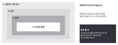

::: {.callout-note collapse="true"}
## 이번 주 목표

이번 주가 끝나면 다음을 할 수 있다.

- 내 원고에서 번역투(translationese) 문장을 찾아 영어 어순으로 고칠 수 있다.
- [W3](w03_readable_sentences.qmd)의 패턴 10가지를 점검표로 써서 원고 전체를 훑을 수 있다.
- 용어표(term list)를 만들어 한 개념을 한 용어로만 부를 수 있다.
- 동료 원고를 AI 없이 읽고 걸린 곳을 위치와 질문으로 돌려줄 수 있다.
:::

# 1. 원칙 {#principles}

예문은 W4부터 써 온 가상의 예시 연구(UUO 섬유화 모델과 compound X, 신장 생검 단일세포 RNA 시퀀싱 재분석)에서 가져왔다. 수치는 지어낸 것이다.

## 다듬기는 큰 것에서 작은 것 순서로 한다

{fig-alt="겹쳐진 네 상자. 바깥부터 내용과 그림 순서, 단락, 문장, 단어와 문법. 오른쪽에 먼저 볼 것이 적혀 있다."}

- 순서: 내용과 그림 순서 → 단락 → 문장 → 단어와 문법.
- 문장부터 다듬으면 나중에 단락을 빼거나 옮길 때 그 수고가 버려진다.
- 이번 주에 먼저 볼 것: 각 Figure의 결론 문장([W4](w04_figure_storyboard.qmd))이 Results 단락 첫 문장, Abstract, Title에 같은 강도로 들어 있는가.

## 번역투는 한국어 어순과 습관을 영어로 옮긴 데서 생긴다

- 규칙: 한국어 문장을 단어 단위로 옮기지 말고 영어 문장의 주어와 동사부터 정한다.
- 아래 습관은 한국어로 생각하고 영어로 옮길 때 자주 생긴다.

| 한국어 습관 | Before | After |
|---|---|---|
| ~임을 확인하였다 | It was confirmed that the fibrotic area was decreased by compound X treatment. | Compound X reduced the fibrotic area from 18.2% to 9.6% (P = 0.0004; Fig. 2b). |
| ~의 경우 | In the case of the UUO + compound X group, body weight was not different with the UUO + vehicle group. | Body weight did not differ between the UUO + compound X and UUO + vehicle groups (Fig. 1b). |
| ~을 통해 | Through single-cell RNA sequencing analysis, it was found that the myofibroblast subtype proportion was increased in fibrosis patients. | The proportion of MF2 myofibroblasts was higher in patients with fibrosis than in controls (24% vs 7%, P = 0.008; Fig. 3). |
| ~에 대한 분석을 수행하였다 | Analysis about the expression of fibrosis markers was performed by qPCR. | We measured *Col1a1*, *Acta2* and *Fn1* expression by qPCR. |
| 또한 ~. 또한 ~. | Also, *Col1a1* expression was decreased. Also, *Acta2* expression was decreased. | Compound X lowered *Col1a1* expression by 52% and *Acta2* expression by 38% compared with vehicle (Fig. 3). |
| ~로 사료된다 | It is considered that compound X inhibits fibrosis through the TGF-β/Smad3 pathway. | Compound X also lowered Smad3 phosphorylation (Fig. 4), which suggests that it may act through TGF-β/Smad3 signaling. |

- 같은 이유로 생기는 문법 실수도 함께 본다: informations, researches, evidences 같은 불가산 명사의 복수형, different with(→ different from).

## AI 티는 W3의 패턴 10가지로 점검한다

- 패턴의 뜻과 예문은 [W3](w03_readable_sentences.qmd#principles)를 다시 본다. 이번 주에는 원고 전체에 점검표로 쓴다.
- 영어 원고에서는 아래 표시를 찾기 기능(Ctrl+F)으로 먼저 찾으면 빠르다. 찾은 곳을 모두 고칠 필요는 없다. 그 문장이 읽기 어려운지를 판단한다.

| W3 패턴 | 영어 원고에서 찾을 표시 |
|---|---|
| 1 명사 나열 | fibrosis marker gene expression level 같은 명사 묶음 |
| 2 관련된 말이 멂 | 주어 뒤에 수식어가 길게 붙고 동사가 늦게 나오는 문장 |
| 3 무생물 주어와 행동 동사 | unveil, orchestrate, fuel 같은 동사 (Figure 2 shows, These results suggest는 괜찮다) |
| 4 새로 만든 말, 드문 단어 조합 | 정의 없이 쓴 새 용어나 약어 |
| 5 기능어 빠짐 | 빠진 that, the |
| 6 명사화 | was performed, the analysis of, the measurement of |
| 7 절을 쉼표로 길게 이음 | , highlighting / , suggesting / , underscoring / , leading to |
| 8 명사를 동사로 바꿈 | QC'd, benchmarked 같은 즉석 동사 |
| 9 한국어 문장의 영어식 쉼표 | 영어 원고에는 해당하지 않는다. 한국어로 쓴 메모와 보고서에서 본다 |
| 10 상투 표현과 시각적 꾸밈 | plays a crucial role, sheds light on, pivotal, Notably, em dash, 굵은 글씨 |

## 한 개념에는 한 용어만 쓴다

- 규칙: 같은 것을 다른 이름으로 부르지 않는다. 독자는 이름이 다르면 다른 것이라고 읽는다.
- 영작문 수업에서 배운 반복 피하기는 논문에서 쓰지 않는다.
- 용어표를 만들고 원고, Figure 축 이름, Figure legend, Abstract를 모두 거기에 맞춘다.

| 개념 | 정한 용어 | 원고에서 찾은 다른 이름 |
|---|---|---|
| 섬유화 면적 | fibrotic area | fibrosis area, collagen area, Masson-positive area |
| 묶은 쪽 신장 | obstructed kidney | UUO kidney, ligated kidney, injured kidney |
| 약물 투여군 | UUO + compound X | CK group, K-treated mice, treatment group |
| 늘어난 근섬유아세포 아형 | MF2 | MF2 cluster, subpopulation 2, fibrotic cell state |

- 약어는 처음 나올 때 풀어 쓰고 그 뒤로는 같은 약어만 쓴다. Abstract와 본문에서 각각 다시 풀어 쓰는지는 대상 저널 규정을 따른다([W13](w13_submission.qmd)).
- 유전자와 단백질 표기(이탤릭, 대소문자)는 종마다 규칙이 다르다. 저널 규정을 확인하고 원고 전체에서 한 가지로 맞춘다.

## 동료와 바꿔 읽을 때는 고쳐 주지 않고 읽은 경험을 돌려준다

- 이번 주는 [W8](w08_midterm_review.qmd)에 이어 두 번째 동료 리뷰(peer review) 주간이다.
- 동료의 원고, Figure 순서 카드, 참고문헌 표는 AI 사용 규칙에서 남의 원고다. AI에 넣지 않고 직접 읽는다.
- 읽는 사람은 문장을 대신 써 주지 않는다. 대신 아래 세 가지를 돌려준다.
  - 각 Figure의 결론을 읽은 대로 한 문장씩 적는다. 저자는 이것을 자기 결론 문장과 비교한다. 다르게 읽혔다면 원고가 그 결론을 전하지 못한 것이다.
  - 다시 읽어야 했던 문장의 위치(쪽, 줄)와 이유.
  - 같은 것인지 헷갈린 용어. 질문으로 쓴다. 예: Is the "collagen area" in Fig. 2 the same as the "fibrotic area" in the Abstract?
- 의견은 위치 + 무엇이 걸렸는지 + 질문 순서로 쓴다. W14 리뷰어 답변의 틀과 같다.

# 2. AI로 해 보기 {#try-with-ai}

내 원고 두 단락을 점검하고 원고 전체의 용어 목록을 뽑는다(25분).

1. 원고에서 단락 두 개를 고른다. Results 한 단락과 Introduction 또는 Discussion 한 단락이 좋다(3분).
2. 첫 번째 프롬프트로 걸리는 문장을 표로 받는다(5분). 고친 단락 전체를 받으면 어디가 바뀌었는지 찾기 어렵다. 걸린 구간과 고친 문장만 받아야 나란히 읽기가 쉽다.
3. AI가 고친 문장을 원래 문장 옆에 두고 하나씩 받아들일지 정한다(10분).
4. 두 번째 프롬프트로 용어 목록을 받고 찾기 기능으로 직접 확인해 용어표를 만든다(5분).
5. 받아들인 것과 버린 것을 AI 사용 기록에 적는다(2분).

```text
아래는 내가 쓴 영어 논문 원고의 한 단락이다. 단락을 새로 쓰지 말고 아래 기준에 걸리는 문장만 표로 정리해 줘.

기준
1. 한국어를 그대로 옮긴 표현 (예: It was confirmed that, In the case of, Through ... analysis, It is considered that)
2. 명사가 셋 이상 이어진 구, 동사를 명사로 바꾼 표현 (예: was performed, the analysis of)
3. 쉼표 뒤에 -ing 꼬리가 붙은 긴 문장 (예: , highlighting / , suggesting)
4. 상투 표현 (예: plays a crucial role, sheds light on, pivotal)

표의 열: 문장 번호 | 걸린 구간 | 기준 번호 | 최소한으로 고친 문장
규칙: 수치, 단위, 유전자 이름, P 값, 주장의 강도(suggest, show, may 같은 말)는 바꾸지 않는다. 바꿔야 할 것 같으면 고치지 말고 표 아래에 따로 적는다.

[단락]
```

```text
아래 원고에서 같은 대상을 서로 다른 이름으로 부른 곳을 모두 찾아 줘. 원고는 고치지 말고 표로만 정리해 줘.

표의 열: 대상 | 원고에 나온 이름들 | 각 이름이 나온 절(Abstract, Results 등)과 그 문장의 첫 단어 몇 개
약어가 처음 나올 때 풀어 썼는지도 확인해 줘.

[원고]
```

- 트랙 A: 본인 원고의 문장이므로 AI 신호등의 조건부 (트랙 A) 칸이다. 지도교수 동의를 받고, 입력이 학습에 쓰이지 않는 설정의 도구만 쓰고, 원 데이터와 그림 파일은 넣지 않는다.
- 트랙 B: 트랙 B 원고이므로 자유롭게 칸이다. 트랙 B는 W11 과제를 낸 뒤라 원래 논문을 읽어도 된다. 원래 논문의 문장을 옮겨 오지 않는다. 원래 논문을 보고 고친 곳은 표시해 두고 W15 비교 메모에 쓴다.
- 두 트랙 모두 AI가 고친 문장은 꼭 검증 칸이다(뜻이 바뀌었는지). 동료의 원고, 카드, 참고문헌 표는 어느 트랙이든 넣지 않기 칸이다. 동료에게 받은 리뷰 의견은 [받은 리뷰](../ai_rules.qmd#received-reviews) 조건을 지키면 넣을 수 있다.

# 3. 검증하고 다듬기 {#verify-and-revise}

다듬기에서 AI가 자주 틀리는 지점과 확인 방법이다. 주로 나란히 읽기를 쓰고, 수치는 원문 확인, 동료 의견은 교차 확인으로 쓴다. AI 제안은 한꺼번에 받아들이지 않는다. 문장 하나하나는 매끄러워져도 원고 전체의 용어와 주장 강도가 흔들린다.

- [ ] 주장의 강도가 바뀌지 않았다. increased → significantly increased, suggest → demonstrate, may가 빠진 곳을 찾는다. (나란히 읽기)
- [ ] 수치, 단위, 기호가 그대로다. n = 6 per group, mean ± SD와 ± SEM, P 값, μm를 그림과 분석 결과에 대어 본다. (원문 확인)
- [ ] 유전자와 단백질 표기(이탤릭, 대소문자)가 바뀌지 않았다. (나란히 읽기)
- [ ] AI가 반복을 피하려고 용어를 동의어로 바꾸지 않았다. 바꾼 곳은 용어표로 되돌린다. (나란히 읽기)
- [ ] AI가 새 AI 티를 넣지 않았다. 고친 문장에 , highlighting이나 Notably가 새로 생겼는지 본다. (나란히 읽기)
- [ ] 인용 번호가 원래 붙어 있던 주장에 그대로 붙어 있다. (나란히 읽기)
- [ ] 문장 길이가 모두 비슷하게 맞춰지지 않았다. 짧은 문장과 긴 문장이 자연스럽게 섞여 있다.
- [ ] 동료가 다르게 읽은 Figure 결론은 문장을 고쳐서 해결했다. 동료가 틀렸다고 판단했다면 그 이유를 적었다. (교차 확인)

# 과제 {#assignment}

전체 원고 수정본

- 분량: 지금까지 쓴 원고 전체(Title, Abstract, Introduction, Results, Discussion, Methods, Figure legend, 참고문헌).
- 형식
  - 수정본: Word 파일. 변경 내용 추적(track changes)을 켜서 고친 곳이 보이게 한다. 줄 번호를 넣는다.
  - 용어표: 위 원칙의 표 형식. 원고에서 실제로 찾은 다른 이름을 적는다.
  - 동료 의견 반영표: 동료 의견 | 반영했는가 | 바뀐 위치(쪽, 줄). 반영하지 않은 의견은 이유를 적는다.
  - 동료에게 써 준 리뷰: 위 원칙의 세 가지(Figure 결론 한 문장씩, 걸린 문장의 위치와 이유, 헷갈린 용어 질문).
- 트랙별 차이: 트랙 B는 원래 논문을 보고 고친 곳을 표시해서 낸다. W15 비교 메모의 기준은 이 수정본이 아니라 W11에 낸 판이다.
- 평가 기준
  - 번역투와 W3 패턴이 줄었고 고치면서 뜻과 수치가 바뀌지 않았다.
  - 원고 전체가 용어표대로 통일되었다.
  - 동료 의견마다 반영 여부와 위치, 또는 반영하지 않은 이유가 있다.
- 동료 리뷰 점수는 W8과 함께 평가의 15%다. TODO: 동료 리뷰 채점 기준(W8과 같은 기준을 쓸지)
- 제출: 학교 LMS. 마감: TODO: 마감
- AI를 썼으면 AI 사용 기록을 함께 낸다.

# 메모 {#notes}

번역투와 AI 티 점검, 용어 통일, 동료와 바꿔 읽기
