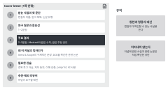

::: {.callout-note collapse="true"}
## 이번 주 목표

이번 주가 끝나면 다음을 할 수 있다.

- 대상 저널 후보 2~3곳을 범위, 최근 논문, 논문 유형, 비용, 정책으로 비교할 수 있다.
- 투고 규정(Guide for Authors)에서 내 원고에 해당하는 규정을 찾아 투고 체크리스트로 만들 수 있다.
- 정해진 구조로 Cover letter를 쓸 수 있다.
- AI가 쓴 Cover letter에서 과장, 저널에 대한 빈 칭찬, 지어낸 사실을 찾아 지울 수 있다.
:::

# 1. 원칙 {#principles}

이 페이지에 나오는 저널은 규정 페이지의 예시일 뿐이다. 투고할 저널로 권하는 것이 아니다. 예문은 가상의 예시 연구(UUO 섬유화 모델과 compound X)에서 가져왔다.

## 저널은 내 원고를 읽을 독자로 고른다

- 규칙: 이 원고를 읽고 인용할 사람이 그 저널을 읽는지부터 본다. 지표 하나만 보고 고르지 않는다.
- 후보는 두 곳에서 찾는다. 하나는 [W7](w07_literature.qmd) 참고문헌 표에서 자주 나온 저널이다. 다른 하나는 PubMed에서 최근 2~3년 사이 비슷한 질문이나 방법의 논문이 실린 저널이다. 이 검색도 W7의 검색 기록 양식에 남긴다.
- 후보마다 아래 표를 채운다. 칸마다 근거 페이지의 링크나 DOI를 적는다.

| 항목 | 확인할 것 |
|---|---|
| 범위(Aims & Scope) | 내 원고와 맞는 문장을 원문 그대로 옮긴다 |
| 최근 비슷한 논문 | 최근 2~3년 논문 2편 이상의 DOI |
| 논문 유형(article types) | 내 원고에 맞는 유형과 단어 수, 그림 수 제한 |
| 공개 방식과 비용 | 오픈 액세스 여부, 게재료(APC) 페이지 링크 |
| 정책 | AI 정책, 데이터 공개, 보고 지침, preprint 허용, 심사 기록 공개 여부 |
| 신뢰할 수 있는 저널인가 | [Think. Check. Submit.](https://thinkchecksubmit.org/) 점검표, [NLM Catalog](https://www.ncbi.nlm.nih.gov/nlmcatalog/)의 색인 정보 |

## 투고 규정은 원문을 읽는다

- 규칙: 투고 규정은 저널마다 다르고 자주 바뀐다. 기억이나 AI의 요약 대신 저널 페이지를 직접 읽는다.
- 예: 같은 연구 논문이라도 두 저널의 규정이 다르다(2026년 11월 확인).
  - [Nature Communications, Article](https://www.nature.com/ncomms/submit/article): Abstract 200단어 이하에 참고문헌을 넣지 않는다. 본문(Abstract, Methods, 참고문헌, Figure legend 제외)은 5,000단어 정도까지 권한다. Figure legend는 하나에 350단어까지다. 첫 투고 때는 특정 형식을 요구하지 않는다.
  - [PLOS ONE, Submission guidelines](https://journals.plos.org/plosone/s/submission-guidelines): Abstract 300단어 이하다. 본문 단어 수와 그림 수 제한은 없다. 쪽 번호와 이어지는 줄 번호를 넣어야 한다. Cover letter는 1쪽까지다.
- 같은 저널 안에서도 논문 유형마다 제한이 다르다. 내 원고의 유형 페이지를 찾는다.

## 투고 체크리스트는 투고 시스템에 들어가기 전에 채운다

- 원고 형식: 단어 수(Title, Abstract, 본문), 절 순서, 참고문헌 형식, 쪽 번호와 줄 번호.
- Title page: 저자, 소속, 교신저자 연락처. ORCID를 요구하는지 확인한다.
- Figure 파일: 파일 형식, 해상도, 크기, 글꼴. [W4](w04_figure_storyboard.qmd)에서 맞춰 둔 그림 규격을 대상 저널 규정으로 다시 확인한다. 데이터 그림은 AI로 만들거나 고치지 않는다([AI 사용 규칙](../ai_rules.qmd#in-the-paper)).
- 보고 지침 체크리스트: 동물 실험은 [ARRIVE](https://arriveguidelines.org/), 임상 연구는 [EQUATOR Network](https://www.equator-network.org/)에서 연구 설계에 맞는 지침을 찾는다. 저널이 따로 양식을 쓰기도 한다. 예: [Nature Portfolio reporting summary](https://www.nature.com/nature-portfolio/editorial-policies/reporting-standards).
- 윤리: 동물실험윤리위원회나 IRB 승인 번호를 Methods에 적는다.
- Data availability statement: 원 데이터를 어디에 두었는지 쓴다(예: GEO accession). dry lab은 다시 분석한 공개 데이터의 accession과 코드 위치를 쓴다.
- AI 사용 공개: [AI 사용 규칙](../ai_rules.qmd#in-the-paper)대로 대상 저널 규정에 맞춰 Methods나 Acknowledgments에 밝힌다. [W5](w05_methods_legends.qmd)에서 확인한 내용을 대상 저널 규정으로 다시 확인한다. Cover letter에도 쓰라는 곳이 있다. 예: [ICMJE 권고](https://www.icmje.org/recommendations/browse/artificial-intelligence/ai-use-by-authors.html).
- 이해 상충(conflicts of interest), 연구비, 저자 기여: 저널 양식을 쓴다. 예: [ICMJE disclosure form](https://www.icmje.org/disclosure-of-interest/), 저자 기여 분류 [CRediT](https://credit.niso.org/).
- Cover letter, 추천 리뷰어와 제외 리뷰어(저널이 요구할 때).

## Cover letter에는 편집자가 심사를 보낼지 정하는 데 필요한 사실만 쓴다

{fig-alt="번호 1부터 6까지 받는 사람과 첫 문단, 연구 질문과 중요성, 주요 결과, 왜 이 저널의 독자인가, 필요한 진술, 추천·제외 리뷰어가 있다. 오른쪽에 규칙 두 개가 있다."}

- 구조(1쪽 안팎)
  1. 받는 사람과 첫 문단: 편집자 이름(저널 페이지에서 확인), 원고 제목, 논문 유형.
  2. 연구 질문과 그것이 왜 중요한지: 1~2문장.
  3. 주요 결과: 2~3문장. Abstract와 같은 수치, 같은 주장 강도로 쓴다.
  4. 왜 이 저널의 독자인가: Aims & Scope의 구체적인 문장, 이 저널에 실린 관련 논문(DOI를 확인한 것만).
  5. 필요한 진술: 다른 곳에 투고 중이 아님, 모든 저자 동의, 이해 상충, preprint 여부, AI 사용.
  6. 저널이 요구하면 추천·제외 리뷰어.
- 규칙: 칭찬과 형용사 대신 확인할 수 있는 사실을 쓴다.

| Before | After |
|---|---|
| We are pleased to submit our novel and groundbreaking manuscript to your prestigious journal. | We submit our manuscript, "[Title]," for consideration as an Article in [Journal]. |
| Our study is the first to demonstrate that compound X completely prevents kidney fibrosis and offers a new therapy for patients with CKD. | In mice with unilateral ureteral obstruction, compound X (10 mg/kg) reduced the fibrotic area from 18.2% to 9.6% compared with vehicle (n = 6 per group, P = 0.0004). It also lowered *Col1a1* and *Acta2* expression. |
| Given your journal's recent special issue on fibrosis, our work is a perfect fit. | [Journal] recently published [Author et al., Year, DOI], which tested [...] in the same model. Our study extends that work by [...]. |

- 둘째 줄 Before는 마우스 결과를 환자 치료로 넓혔고 completely와 the first는 근거가 없다.
- 셋째 줄 Before의 special issue처럼 저널에 대한 사실은 저널 페이지에서 확인한 것만 쓴다.

# 2. AI로 해 보기 {#try-with-ai}

투고 규정으로 체크리스트를 만들고 사실 메모로 Cover letter 초안을 받는다(30분).

1. 대상 저널의 투고 규정 페이지에서 내 원고 유형에 해당하는 부분을 복사한다(5분).
2. 첫 번째 프롬프트로 체크리스트를 받는다. 항목 세 개를 골라 원문과 대어 본다(5분).
3. 사실 메모를 쓴다(5분): 연구 질문 한 문장, 주요 결과 세 개(원고 수치 그대로), Aims & Scope에서 옮긴 문장, 관련 논문 DOI, 필요한 진술.
4. 두 번째 프롬프트로 Cover letter 초안을 받는다(5분).
5. 아래 3절의 확인 목록으로 고치고 AI 사용 기록에 적는다(10분).

```text
아래는 [저널 이름]의 투고 규정 중 [논문 유형] 부분이다. 이 글에 적힌 내용만으로 투고 체크리스트를 만들어 줘.

항목마다 규정 원문의 문장을 그대로 함께 적어 줘. 아래 항목 중 이 글에 없는 것은 지어내지 말고 "글에 없음"이라고 적어 줘.
항목: 단어 수(Title, Abstract, 본문), Figure 수와 파일 규격, 참고문헌 형식, 쪽·줄 번호, 보고 지침, Data availability, AI 사용 공개, 이해 상충, Cover letter 요구 사항

[투고 규정 원문]
```

```text
아래 사실 메모만 써서 [저널 이름]에 보내는 Cover letter 초안을 영어로 써 줘.

규칙
- 구조: 원고 제목과 논문 유형 → 연구 질문과 중요성 → 주요 결과 → 이 저널 독자와의 연결 → 필요한 진술
- 사실 메모에 없는 사실(저널의 특집호, 편집자 이름, 다른 논문, 수치)을 더하지 않는다. 필요한데 없으면 [확인 필요]라고 쓴다.
- novel, first, groundbreaking, prestigious, leading 같은 말을 쓰지 않는다.
- 주장의 강도는 사실 메모의 문장과 같게 쓴다.
- 350단어 이내.

[사실 메모]
```

- 투고 규정과 Aims & Scope는 공개된 글이므로 두 트랙 모두 자유롭게 칸이다.
- 트랙 A: 사실 메모에 들어가는 본인 원고의 문장과 수치는 조건부 (트랙 A) 칸이다. 지도교수 동의, 학습에 쓰이지 않는 설정, 원 데이터와 그림 파일 넣지 않기를 지킨다.
- 트랙 B: 트랙 B 원고이므로 자유롭게 칸이다. 대상 저널은 원래 논문이 실린 저널로 한다. 저널 비교는 이 원고를 다른 곳에 낸다면 어디가 맞을지로 연습한다.
- AI가 만든 체크리스트와 Cover letter는 두 트랙 모두 꼭 검증 칸이다.

# 3. 검증하고 다듬기 {#verify-and-revise}

Cover letter와 투고 준비에서 AI가 자주 틀리는 지점이다. 저널에 관한 진술은 원문 확인, 결과에 관한 진술은 Abstract와 나란히 읽기를 쓴다. 저널 선택은 지도교수(트랙 B는 담당교수)와 교차 확인한다.

- [ ] 과장: novel, first, unprecedented, completely 같은 말이 없다. 마우스 결과를 환자 치료로 넓히지 않았다. (나란히 읽기)
- [ ] 주요 결과의 수치와 주장 강도가 Abstract와 같다. (나란히 읽기)
- [ ] 저널을 칭찬하는 빈말(prestigious, leading, broad readership)이 없다. 대신 Aims & Scope의 구체적인 내용이 있다.
- [ ] 저널에 대한 사실(특집호, 최근 논문, 편집자 이름, 범위 문장)은 모두 저널 페이지나 DOI로 확인했다. 확인하지 못한 문장은 지웠다. (원문 확인)
- [ ] preprint 여부, 투고 이력, 이해 상충, AI 사용 진술이 사실과 맞다. AI가 기본값으로 채운 문장이 없다.
- [ ] 추천 리뷰어를 넣었다면 이름과 소속을 직접 찾았고 공동연구자나 같은 기관 사람이 아니다. AI에게 리뷰어 이름을 묻지 않는다.
- [ ] 체크리스트의 규정이 다른 저널이나 옛 규정과 섞이지 않았다. 원문 문장이 붙지 않은 항목은 페이지에서 다시 찾았다. (원문 확인)

::: {.callout-warning}
## 흔한 실수
AI에 저널 이름만 주고 규정을 묻는 것. AI는 학습한 시점의 규정이나 다른 저널의 규정을 섞어 답할 수 있다. 규정 페이지의 글을 붙여 넣고 원문 문장과 함께 답하게 한다.
:::

# 과제 {#assignment}

Cover letter

- 분량: Cover letter 1쪽 이내(영어 250~400단어).
- 형식
  - Cover letter: 대상 저널 이름과 원고 제목을 넣은 편지. 위 구조를 따른다.
  - 저널 비교표: 후보 2~3곳. 위 원칙의 표 형식이고 칸마다 링크나 DOI가 있다.
  - 투고 체크리스트: 대상 저널 한 곳. 항목마다 규정 페이지의 근거와 내 원고의 현재 상태(맞음, 고칠 것)를 적는다.
- 트랙별 차이: 트랙 A는 실제로 투고할 만한 저널을 지도교수와 상의해서 고른다. 트랙 B는 원래 논문이 실린 저널을 대상으로 쓰고 비교표에는 다른 후보 1~2곳을 넣는다.
- 평가 기준
  - 구조: 결과, 저널과의 연결, 필요한 진술이 모두 있다.
  - 사실: 저널과 결과에 관한 모든 문장을 링크, DOI, 원고로 확인할 수 있다.
  - 주장 강도: 과장이 없고 Abstract와 같다.
- 제출: 학교 LMS. 마감은 따로 공지한다.
- AI를 썼으면 AI 사용 기록을 함께 낸다.

# 메모 {#notes}

저널 고르기, Guide for Authors, 투고 체크리스트
