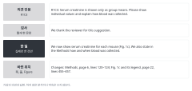

::: {.callout-note collapse="true"}
## 이번 주 목표

이번 주가 끝나면 다음을 할 수 있다.

- 리뷰어 의견 하나에 의견 인용 → 감사 → 한 일 → 바뀐 위치 순서로 답할 수 있다.
- 받아들이지 않는 의견에 근거를 들어 정중하게 답하고 그래도 원고에서 고칠 것을 찾을 수 있다.
- 공개된 심사 기록(Peer Review File)을 읽고 실제 저자의 답변 방식을 분석할 수 있다.
- AI가 쓴 답변 초안에서 하지 않은 약속, 지어낸 분석, 바뀐 수치를 찾을 수 있다.
:::

# 1. 원칙 {#principles}

예문의 리뷰어 의견과 답변은 가상의 예시 연구(UUO 섬유화 모델과 compound X)로 지어낸 것이다. 실제 사례는 [참고자료](../resources.qmd#papers)의 공개 심사 기록 예시를 가리킨다.

## 의견 하나에 네 부분으로 답한다

{fig-alt="왼쪽에 의견 인용, 감사, 한 일, 바뀐 위치 네 칸이 있고, 오른쪽에 각 칸의 영어 문장이 있다."}

- 규칙: 의견 인용 → 감사 한 문장 → 한 일 → 바뀐 위치.
- 의견은 리뷰어별로 번호를 붙여 그대로 옮긴다(R1C1은 Reviewer 1의 Comment 1).
- 감사는 짧게 한 문장으로 쓴다. 의견마다 긴 칭찬을 반복하지 않는다.
- 한 일은 구체적으로 쓴다. 무엇을 분석하거나 고쳤는지, 결과가 어땠는지 쓴다.
- 바뀐 위치는 쪽, 줄, Figure 번호로 쓴다. 바뀐 문장을 함께 옮기면 리뷰어가 원고를 뒤지지 않아도 된다.

가상의 의견 R1C3: Serum creatinine is shown only as group means. Please show individual values and explain how blood was collected.

- Before: We thank the reviewer for this excellent and insightful comment. We have revised the manuscript accordingly.
- After: We thank the reviewer for this suggestion. We now show serum creatinine for each mouse (Fig. 1c). We also state in the Methods how and when blood was collected. Changes: Methods, page 6, lines 120–124; Fig. 1c and its legend, page 22, lines 455–457.

## 받아들이지 않을 때는 근거를 대고 주장을 근거에 맞춘다

- 규칙: 거절만 쓰지 않는다. 왜 하지 않았는지를 사실로 설명한다. 그리고 원고에서 고칠 수 있는 것(한계 문장, 결론의 범위)을 고친다.
- 의견 하나에 요구가 여러 개 들어 있을 수 있다. 문장 단위로 나눠 각각에 답한다.

가상의 의견 R2C1: A second fibrosis model, such as folic acid nephropathy, is needed to support the conclusion.

- Before: We respectfully disagree. This experiment is not necessary for our study.
- After: We agree that a second model would show whether the effect of compound X depends on obstruction. We did not add this experiment because it requires a new animal protocol that could not be approved within the revision period. We now state this as a limitation and restrict our conclusion to the UUO model (Discussion, page 15, lines 318–322).

실제 사례: Weinand et al. (2024) 심사 기록의 R1C2를 읽는다. 리뷰어는 세포 수가 적은 샘플을 다시 살펴보고, 필요하면 빼고, 적어도 한계로 적으라고 했다. 저자들은 그 샘플을 빼고 다시 분석한 결과를 보이고 샘플을 그대로 둔 이유를 설명했다. 그리고 이 분석을 Results에, 한계를 Discussion에 더했다. 요구 세 가지에 모두 답한 셈이다.

## 한 일만 쓴다

- 규칙: 답변서의 모든 have added, now show는 수정본의 그 위치에서 찾을 수 있어야 한다.
- 앞으로 하겠다는 약속(we will, in future studies)으로 답을 대신하지 않는다. 하지 않은 일은 하지 않았다고 쓴다.
- 답변서의 수치는 수정본의 수치와 같아야 한다. 예: 수정본에 섬유화 면적을 18.2%와 9.6%로 썼다면 답변서에도 같은 값을 쓴다.
- 쪽과 줄 번호는 어느 판(변경 내용 추적본 또는 깨끗한 본)의 것인지 첫머리에 밝힌다.

## 리뷰어가 잘못 읽었으면 원고 설명이 부족했던 것으로 받는다

- 규칙: 리뷰어를 탓하지 않는다. 오해가 생긴 곳을 원고에서 고친다.
- Before: The reviewer has misunderstood our data. We clearly measured the fibrotic area in the cortex only.
- After: We did not state this clearly in the original manuscript. We measured the fibrotic area in the cortex only. We now state this in the Methods (page 7, line 140) and in the Figure 2 legend (page 23, line 470).

## 답변서 첫머리에 주요 변경을 요약한다

- 여러 리뷰어가 같은 점을 지적했으면 첫머리에 묶어 요약하고 의견별 답변에서는 그 요약을 가리킨다.
- Weinand et al. (2024)의 답변서도 주요 변경 네 가지를 먼저 요약하고 각 항목에 해당하는 의견 번호를 적었다.

# 2. AI로 해 보기 {#try-with-ai}

공개된 심사 기록의 의견 하나로 AI 답변 초안을 두 번 받고 실제 저자 답변과 비교한다(30분).

연습 자료: [Weinand et al. (2024), *Nature Communications* 15:4650](https://doi.org/10.1038/s41467-024-48620-7). 논문 페이지의 Supplementary information에 Peer Review File(PDF, 54쪽)이 있다. 1차 리뷰어 의견 세 개, 저자 답변서, 2차 리뷰어 의견 순서다. 이 저널은 2022년 11월 1일 이후 투고된 연구 논문의 심사 기록을 모두 공개한다([Nature Communications, Transparent Peer Review](https://www.nature.com/ncomms/submit/tpr-faq)). 편집자에게만 보낸 비공개 의견과 편집자의 편지는 들어 있지 않다.

1. 의견 하나를 고른다. 처음이면 R1C2를 권한다. 저자 답변은 아직 읽지 않는다(3분).
2. 첫 번째 프롬프트에 리뷰어 의견만 넣고 답변을 받는다(3분).
3. 이제 저자 답변을 읽고 저자가 실제로 한 일과 바뀐 위치를 목록으로 적는다(8분).
4. 두 번째 프롬프트에 의견과 그 목록을 넣고 답변을 받는다(3분).
5. 두 초안을 저자 답변과 나란히 놓고 3절의 확인 목록으로 표시한다(10분).
6. AI 사용 기록에 적는다(3분).

```text
아래는 공개된 논문 심사 기록(Peer Review File)에 있는 리뷰어 의견 하나다. 저자의 입장에서 이 의견에 대한 답변을 영어로 써 줘.

[리뷰어 의견]
```

```text
아래 리뷰어 의견에 대한 답변을 영어로 써 줘. 저자가 실제로 한 일은 [한 일] 목록에 있는 것뿐이다.

규칙
- 순서: 의견 인용 → 감사 한 문장 → 한 일 → 원고에서 바뀐 위치
- [한 일]에 없는 분석, 실험, 수치를 더하지 않는다.
- 앞으로 하겠다는 약속(we will, in future studies)을 쓰지 않는다.
- 바뀐 위치는 [위치]에 적힌 것만 쓴다. 없으면 [위치 확인 필요]라고 쓴다.
- 의견 안의 요구를 하나씩 나눠서 각 요구에 답했는지 답변 아래에 표로 보여 준다.

[리뷰어 의견]
[한 일]
[위치]
```

- 공개된 심사 기록은 공개 논문이므로 두 트랙 모두 자유롭게 칸이다. AI가 쓴 답변의 분석, 수치, 위치는 꼭 검증 칸이다.
- 트랙 A: 위의 Weinand et al. (2024)를 쓴다.
- 트랙 B: 내가 고른 논문의 심사 기록을 쓴다. 원래 논문은 W11 뒤에 이미 읽었으므로 심사 기록과 원래 논문을 함께 본다. 내 원고에도 해당하는 의견을 고르고 두 번째 프롬프트의 [한 일]과 [위치]는 내 원고에서 실제로 고친 것으로 채운다. 심사 기록이 공개되지 않은 논문이면 트랙 A와 같은 자료를 쓴다.

::: {.callout-warning}
## 실제 투고 뒤에는 다르다
이번 연습 자료는 이미 공개된 심사 기록이다. 실제로 투고한 원고는 심사 중이므로 AI 신호등의 넣지 않기 칸이다. 그 원고에 대해 받은 심사 의견은 [받은 리뷰](../ai_rules.qmd#received-reviews) 조건을 지키면 넣을 수 있다. 이때도 위의 두 번째 프롬프트처럼 의견과 [한 일] 목록만 주고, 원고 문장은 넣지 않는다.

학술지 규정을 먼저 확인한다. 예: [Nature Portfolio의 AI 정책](https://www.nature.com/nature-portfolio/editorial-policies/ai)은 리뷰어 의견을 번역하고 정리하는 데 AI를 쓰는 것을 허용하는 예로 든다. 같은 정책은 원고와 심사 보고서를 보안이 갖춰지지 않은 공개 AI 시스템에 올리지 말라고도 한다.
:::

# 3. 검증하고 다듬기 {#verify-and-revise}

리뷰어 답변에서 AI가 자주 틀리는 지점이다. 저자 답변과 수정본은 원문 확인, AI 초안과 [한 일] 목록은 나란히 읽기로 대조한다.

- [ ] 지어낸 분석: 저자가 하지 않은 실험이나 분석(additional staining, a validation cohort)이 들어 있지 않다. (나란히 읽기)
- [ ] 하지 않은 약속: we will, will be addressed in future studies가 있으면 지우거나, 하지 않았다고 사실대로 쓴다.
- [ ] 바뀐 수치: 샘플 수, 세포 수, P 값이 저자 답변이나 수정본과 같다. (원문 확인)
- [ ] 지어낸 위치: 쪽, 줄, Figure 번호가 실제로 있고, 그 자리에 말한 내용이 있다. (원문 확인)
- [ ] 새 참고문헌: 답변에 새로 인용한 문헌은 [W7](w07_literature.qmd)처럼 직접 찾아 DOI나 PubMed로 확인하고 검색 기록에 남겼다. AI가 제안한 문헌을 그대로 쓰지 않는다. (원문 확인)
- [ ] 빠진 요구: 의견 안의 요구를 하나씩 나눴을 때 답하지 않은 것이 없다.
- [ ] 주장 강도: fully addressed, clearly demonstrates처럼 한 일보다 센 표현이 없다. (나란히 읽기)
- [ ] 어조: 감사가 한 문장이고, 리뷰어를 탓하는 문장이 없다.

첫 번째 초안(의견만 넣은 것)에서는 지어낸 분석과 약속이 많이 나올 것이다. 두 초안의 차이를 보면 AI에 사실 목록을 주는 이유가 보인다.

# 과제 {#assignment}

답변서 1건

- 분량: 리뷰어 의견 1건에 대한 영어 답변(150~300단어)과 한국어 비교 메모(반 쪽).
- 형식
  - 답변: 의견 인용 → 감사 → 한 일 → 바뀐 위치.
  - 비교 메모: 내 답변과 실제 저자 답변이 어디서 다른지, 저자 답변에서 가져올 점과 고칠 점.
- 트랙별 차이
  - 트랙 A: Weinand et al. (2024)의 의견 하나(R1C2, R1C7, R3C10 중 하나를 권한다). 한 일과 위치는 저자 답변에 적힌 것만 쓴다.
  - 트랙 B: 내 논문의 심사 기록에서 내 원고에도 해당하는 의견 하나. 내 원고를 실제로 고치고, 내 원고의 쪽과 줄을 적는다.
  - 트랙 A는 Weinand et al. (2024) 대신 W12 동료 리뷰에서 받은 의견으로 써도 된다. 이때 한 일과 위치는 내 수정본에서 실제로 고친 것으로 쓴다. 저자 답변이 없으므로 비교 메모에는 AI의 첫 초안과 내 답변이 어디서 다른지 쓴다. 동료 의견은 [받은 리뷰](../ai_rules.qmd#received-reviews) 조건을 따른다.
- 평가 기준
  - 네 부분이 모두 있고, 의견 안의 요구마다 답했다.
  - 한 일, 수치, 위치가 원문(저자 답변 또는 내 수정본)과 맞고, 하지 않은 약속이 없다.
  - 받아들이지 않은 부분에 근거가 있고, 그에 맞춰 원고에서 고친 것이 있다.
- 제출: 학교 LMS. 마감은 따로 공지한다.
- AI를 썼으면 AI 사용 기록을 함께 낸다.

# 메모 {#notes}

공개된 Peer Review File로 답변 연습: 감사 → 한 일 → 바뀐 위치
