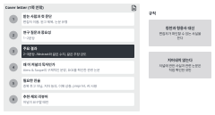
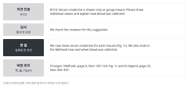

::: {.callout-note collapse="true"}
## 이번 주 목표

이번 주가 끝나면 다음을 할 수 있다.

- 대상 저널 후보 2~3곳을 범위, 최근 논문, 논문 유형, 비용, 정책으로 비교할 수 있다.
- 투고 규정(Guide for Authors)에서 내 원고에 해당하는 규정을 찾아 투고 체크리스트로 만들 수 있다.
- 정해진 구조로 Cover letter를 쓸 수 있다.
- AI가 쓴 Cover letter에서 과장, 저널에 대한 빈 칭찬, 지어낸 사실을 찾아 지울 수 있다.
- 리뷰어 의견 하나에 의견 인용 → 감사 → 한 일 → 바뀐 위치 순서로 답할 수 있다.
- 받아들이지 않는 의견에 근거를 들어 정중하게 답하고 그래도 원고에서 고칠 것을 찾을 수 있다.
- 공개된 심사 기록(Peer Review File)을 읽고 실제 저자의 답변 방식을 분석할 수 있다.
- AI가 쓴 답변 초안에서 하지 않은 약속, 지어낸 분석, 바뀐 수치를 찾을 수 있다.
:::

# 1. 원칙 {#principles}

이번 주에는 원고를 저널에 내는 일과 심사 의견에 답하는 일을 함께 다룬다. 앞의 네 원칙은 투고 준비, 뒤의 다섯 원칙은 리뷰어 답변에 관한 것이다.

## 투고 준비 {#submission}

이 페이지에 나오는 저널은 규정 페이지의 예시일 뿐이다. 투고할 저널로 권하는 것이 아니다. 예문은 가상의 예시 연구(UUO 섬유화 모델과 compound X)에서 가져왔다.

### 저널은 내 원고를 읽을 독자로 고른다

- 규칙: 이 원고를 읽고 인용할 사람이 그 저널을 읽는지부터 본다. 지표 하나만 보고 고르지 않는다.
- 후보는 두 곳에서 찾는다. 하나는 [W8](w08_literature.qmd) 참고문헌 표에서 자주 나온 저널이다. 다른 하나는 PubMed에서 최근 2~3년 사이 비슷한 질문이나 방법의 논문이 실린 저널이다. 이 검색도 W8의 검색 기록 양식에 남긴다.
- 후보마다 아래 표를 채운다. 칸마다 근거 페이지의 링크나 DOI를 적는다.

| 항목 | 확인할 것 |
|---|---|
| 범위(Aims & Scope) | 내 원고와 맞는 문장을 원문 그대로 옮긴다 |
| 최근 비슷한 논문 | 최근 2~3년 논문 2편 이상의 DOI |
| 논문 유형(article types) | 내 원고에 맞는 유형과 단어 수, 그림 수 제한 |
| 공개 방식과 비용 | 오픈 액세스 여부, 게재료(APC) 페이지 링크 |
| 정책 | AI 정책, 데이터 공개, 보고 지침, preprint 허용, 심사 기록 공개 여부 |
| 신뢰할 수 있는 저널인가 | [Think. Check. Submit.](https://thinkchecksubmit.org/) 점검표, [NLM Catalog](https://www.ncbi.nlm.nih.gov/nlmcatalog/)의 색인 정보 |

### 투고 규정은 원문을 읽는다

- 규칙: 투고 규정은 저널마다 다르고 자주 바뀐다. 기억이나 AI의 요약 대신 저널 페이지를 직접 읽는다.
- 예: 같은 연구 논문이라도 두 저널의 규정이 다르다(2026년 11월 확인).
  - [Nature Communications, Article](https://www.nature.com/ncomms/submit/article): Abstract 200단어 이하에 참고문헌을 넣지 않는다. 본문(Abstract, Methods, 참고문헌, Figure legend 제외)은 5,000단어 정도까지 권한다. Figure legend는 하나에 350단어까지다. 첫 투고 때는 특정 형식을 요구하지 않는다.
  - [PLOS ONE, Submission guidelines](https://journals.plos.org/plosone/s/submission-guidelines): Abstract 300단어 이하다. 본문 단어 수와 그림 수 제한은 없다. 쪽 번호와 이어지는 줄 번호를 넣어야 한다. Cover letter는 1쪽까지다.
- 같은 저널 안에서도 논문 유형마다 제한이 다르다. 내 원고의 유형 페이지를 찾는다.

### 투고 체크리스트는 투고 시스템에 들어가기 전에 채운다

- 원고 형식: 단어 수(Title, Abstract, 본문), 절 순서, 참고문헌 형식, 쪽 번호와 줄 번호.
- Title page: 저자, 소속, 교신저자 연락처. ORCID를 요구하는지 확인한다.
- Figure 파일: 파일 형식, 해상도, 크기, 글꼴. [W5](w05_figure_storyboard.qmd)에서 맞춰 둔 그림 규격을 대상 저널 규정으로 다시 확인한다. 데이터 그림은 AI로 만들거나 고치지 않는다([AI 사용 규칙](../ai_rules.qmd#in-the-paper)).
- 보고 지침 체크리스트: 동물 실험은 [ARRIVE](https://arriveguidelines.org/), 임상 연구는 [EQUATOR Network](https://www.equator-network.org/)에서 연구 설계에 맞는 지침을 찾는다. 저널이 따로 양식을 쓰기도 한다. 예: [Nature Portfolio reporting summary](https://www.nature.com/nature-portfolio/editorial-policies/reporting-standards).
- 윤리: 동물실험윤리위원회나 IRB 승인 번호를 Methods에 적는다.
- Data availability statement: 원 데이터를 어디에 두었는지 쓴다(예: GEO accession). dry lab은 다시 분석한 공개 데이터의 accession과 코드 위치를 쓴다.
- AI 사용 공개: [AI 사용 규칙](../ai_rules.qmd#in-the-paper)대로 대상 저널 규정에 맞춰 Methods나 Acknowledgments에 밝힌다. [W6](w06_methods_legends.qmd)에서 확인한 내용을 대상 저널 규정으로 다시 확인한다. Cover letter에도 쓰라는 곳이 있다. 예: [ICMJE 권고](https://www.icmje.org/recommendations/browse/artificial-intelligence/ai-use-by-authors.html).
- 이해 상충(conflicts of interest), 연구비, 저자 기여: 저널 양식을 쓴다. 예: [ICMJE disclosure form](https://www.icmje.org/disclosure-of-interest/), 저자 기여 분류 [CRediT](https://credit.niso.org/).
- Cover letter, 추천 리뷰어와 제외 리뷰어(저널이 요구할 때).

### Cover letter에는 편집자가 심사를 보낼지 정하는 데 필요한 사실만 쓴다

{fig-alt="번호 1부터 6까지 받는 사람과 첫 문단, 연구 질문과 중요성, 주요 결과, 왜 이 저널의 독자인가, 필요한 진술, 추천·제외 리뷰어가 있다. 오른쪽에 규칙 두 개가 있다."}

- 구조(1쪽 안팎)
  1. 받는 사람과 첫 문단: 편집자 이름(저널 페이지에서 확인), 원고 제목, 논문 유형.
  2. 연구 질문과 그것이 왜 중요한지: 1~2문장.
  3. 주요 결과: 2~3문장. Abstract와 같은 수치, 같은 주장 강도로 쓴다.
  4. 왜 이 저널의 독자인가: Aims & Scope의 구체적인 문장, 이 저널에 실린 관련 논문(DOI를 확인한 것만).
  5. 필요한 진술: 다른 곳에 투고 중이 아님, 모든 저자 동의, 이해 상충, preprint 여부, AI 사용.
  6. 저널이 요구하면 추천·제외 리뷰어.
- 규칙: 칭찬과 형용사 대신 확인할 수 있는 사실을 쓴다.

| Before | After |
|---|---|
| We are pleased to submit our novel and groundbreaking manuscript to your prestigious journal. | We submit our manuscript, "[Title]," for consideration as an Article in [Journal]. |
| Our study is the first to demonstrate that compound X completely prevents kidney fibrosis and offers a new therapy for patients with CKD. | In mice with unilateral ureteral obstruction, compound X (10 mg/kg) reduced the fibrotic area from 18.2% to 9.6% compared with vehicle (n = 6 per group, P = 0.0004). It also lowered *Col1a1* and *Acta2* expression. |
| Given your journal's recent special issue on fibrosis, our work is a perfect fit. | [Journal] recently published [Author et al., Year, DOI], which tested [...] in the same model. Our study extends that work by [...]. |

- 둘째 줄 Before는 마우스 결과를 환자 치료로 넓혔고 completely와 the first는 근거가 없다.
- 셋째 줄 Before의 special issue처럼 저널에 대한 사실은 저널 페이지에서 확인한 것만 쓴다.

## 리뷰어 답변 {#response}

예문의 리뷰어 의견과 답변은 가상의 예시 연구(UUO 섬유화 모델과 compound X)로 지어낸 것이다. 실제 사례는 [참고자료](../resources.qmd#papers)의 공개 심사 기록 예시를 가리킨다.

### 의견 하나에 네 부분으로 답한다

{fig-alt="왼쪽에 의견 인용, 감사, 한 일, 바뀐 위치 네 칸이 있고, 오른쪽에 각 칸의 영어 문장이 있다."}

- 규칙: 의견 인용 → 감사 한 문장 → 한 일 → 바뀐 위치.
- 의견은 리뷰어별로 번호를 붙여 그대로 옮긴다(R1C1은 Reviewer 1의 Comment 1).
- 감사는 짧게 한 문장으로 쓴다. 의견마다 긴 칭찬을 반복하지 않는다.
- 한 일은 구체적으로 쓴다. 무엇을 분석하거나 고쳤는지, 결과가 어땠는지 쓴다.
- 바뀐 위치는 쪽, 줄, Figure 번호로 쓴다. 바뀐 문장을 함께 옮기면 리뷰어가 원고를 뒤지지 않아도 된다.

가상의 의견 R1C3: Serum creatinine is shown only as group means. Please show individual values and explain how blood was collected.

- Before: We thank the reviewer for this excellent and insightful comment. We have revised the manuscript accordingly.
- After: We thank the reviewer for this suggestion. We now show serum creatinine for each mouse (Fig. 1c). We also state in the Methods how and when blood was collected. Changes: Methods, page 6, lines 120–124; Fig. 1c and its legend, page 22, lines 455–457.

### 받아들이지 않을 때는 근거를 대고 주장을 근거에 맞춘다

- 규칙: 거절만 쓰지 않는다. 왜 하지 않았는지를 사실로 설명한다. 그리고 원고에서 고칠 수 있는 것(한계 문장, 결론의 범위)을 고친다.
- 의견 하나에 요구가 여러 개 들어 있을 수 있다. 문장 단위로 나눠 각각에 답한다.

가상의 의견 R2C1: A second fibrosis model, such as folic acid nephropathy, is needed to support the conclusion.

- Before: We respectfully disagree. This experiment is not necessary for our study.
- After: We agree that a second model would show whether the effect of compound X depends on obstruction. We did not add this experiment because it requires a new animal protocol that could not be approved within the revision period. We now state this as a limitation and restrict our conclusion to the UUO model (Discussion, page 15, lines 318–322).

실제 사례: Weinand et al. (2024) 심사 기록의 R1C2를 읽는다. 리뷰어는 세포 수가 적은 샘플을 다시 살펴보고, 필요하면 빼고, 적어도 한계로 적으라고 했다. 저자들은 그 샘플을 빼고 다시 분석한 결과를 보이고 샘플을 그대로 둔 이유를 설명했다. 그리고 이 분석을 Results에, 한계를 Discussion에 더했다. 요구 세 가지에 모두 답한 셈이다.

### 한 일만 쓴다

- 규칙: 답변서의 모든 have added, now show는 수정본의 그 위치에서 찾을 수 있어야 한다.
- 앞으로 하겠다는 약속(we will, in future studies)으로 답을 대신하지 않는다. 하지 않은 일은 하지 않았다고 쓴다.
- 답변서의 수치는 수정본의 수치와 같아야 한다. 예: 수정본에 섬유화 면적을 18.2%와 9.6%로 썼다면 답변서에도 같은 값을 쓴다.
- 쪽과 줄 번호는 어느 판(변경 내용 추적본 또는 깨끗한 본)의 것인지 첫머리에 밝힌다.

### 리뷰어가 잘못 읽었으면 원고 설명이 부족했던 것으로 받는다

- 규칙: 리뷰어를 탓하지 않는다. 오해가 생긴 곳을 원고에서 고친다.
- Before: The reviewer has misunderstood our data. We clearly measured the fibrotic area in the cortex only.
- After: We did not state this clearly in the original manuscript. We measured the fibrotic area in the cortex only. We now state this in the Methods (page 7, line 140) and in the Figure 2 legend (page 23, line 470).

### 답변서 첫머리에 주요 변경을 요약한다

- 여러 리뷰어가 같은 점을 지적했으면 첫머리에 묶어 요약하고 의견별 답변에서는 그 요약을 가리킨다.
- Weinand et al. (2024)의 답변서도 주요 변경 네 가지를 먼저 요약하고 각 항목에 해당하는 의견 번호를 적었다.

# 2. AI로 해 보기 {#try-with-ai}

## 실습 1. 투고 체크리스트와 Cover letter {#practice-submission}

투고 규정으로 체크리스트를 만들고 사실 메모로 Cover letter 초안을 받는다(30분).

1. 대상 저널의 투고 규정 페이지에서 내 원고 유형에 해당하는 부분을 복사한다(5분).
2. 첫 번째 프롬프트로 체크리스트를 받는다. 항목 세 개를 골라 원문과 대어 본다(5분).
3. 사실 메모를 쓴다(5분): 연구 질문 한 문장, 주요 결과 세 개(원고 수치 그대로), Aims & Scope에서 옮긴 문장, 관련 논문 DOI, 필요한 진술.
4. 두 번째 프롬프트로 Cover letter 초안을 받는다(5분).
5. 아래 3절의 확인 목록으로 고치고 AI 사용 기록에 적는다(10분).

```text
아래는 [저널 이름]의 투고 규정 중 [논문 유형] 부분이다. 이 글에 적힌 내용만으로 투고 체크리스트를 만들어 줘.

항목마다 규정 원문의 문장을 그대로 함께 적어 줘. 아래 항목 중 이 글에 없는 것은 지어내지 말고 "글에 없음"이라고 적어 줘.
항목: 단어 수(Title, Abstract, 본문), Figure 수와 파일 규격, 참고문헌 형식, 쪽·줄 번호, 보고 지침, Data availability, AI 사용 공개, 이해 상충, Cover letter 요구 사항

[투고 규정 원문]
```

```text
아래 사실 메모만 써서 [저널 이름]에 보내는 Cover letter 초안을 영어로 써 줘.

규칙
- 구조: 원고 제목과 논문 유형 → 연구 질문과 중요성 → 주요 결과 → 이 저널 독자와의 연결 → 필요한 진술
- 사실 메모에 없는 사실(저널의 특집호, 편집자 이름, 다른 논문, 수치)을 더하지 않는다. 필요한데 없으면 [확인 필요]라고 쓴다.
- novel, first, groundbreaking, prestigious, leading 같은 말을 쓰지 않는다.
- 주장의 강도는 사실 메모의 문장과 같게 쓴다.
- 350단어 이내.

[사실 메모]
```

- 투고 규정과 Aims & Scope는 공개된 글이므로 두 트랙 모두 자유롭게 칸이다.
- 트랙 A: 사실 메모에 들어가는 본인 원고의 문장과 수치는 조건부 (트랙 A) 칸이다. 지도교수 동의, 학습에 쓰이지 않는 설정, 원 데이터와 그림 파일 넣지 않기를 지킨다.
- 트랙 B: 트랙 B 원고이므로 자유롭게 칸이다. 대상 저널은 원래 논문이 실린 저널로 한다. 저널 비교는 이 원고를 다른 곳에 낸다면 어디가 맞을지로 연습한다.
- AI가 만든 체크리스트와 Cover letter는 두 트랙 모두 꼭 검증 칸이다.

## 실습 2. 리뷰어 답변 {#practice-response}

공개된 심사 기록의 의견 하나로 AI 답변 초안을 두 번 받고 실제 저자 답변과 비교한다(30분).

연습 자료: [Weinand et al. (2024), *Nature Communications* 15:4650](https://doi.org/10.1038/s41467-024-48620-7). 논문 페이지의 Supplementary information에 Peer Review File(PDF, 54쪽)이 있다. 1차 리뷰어 의견 세 개, 저자 답변서, 2차 리뷰어 의견 순서다. 이 저널은 2022년 11월 1일 이후 투고된 연구 논문의 심사 기록을 모두 공개한다([Nature Communications, Transparent Peer Review](https://www.nature.com/ncomms/submit/tpr-faq)). 편집자에게만 보낸 비공개 의견과 편집자의 편지는 들어 있지 않다.

1. 의견 하나를 고른다. 처음이면 R1C2를 권한다. 저자 답변은 아직 읽지 않는다(3분).
2. 첫 번째 프롬프트에 리뷰어 의견만 넣고 답변을 받는다(3분).
3. 이제 저자 답변을 읽고 저자가 실제로 한 일과 바뀐 위치를 목록으로 적는다(8분).
4. 두 번째 프롬프트에 의견과 그 목록을 넣고 답변을 받는다(3분).
5. 두 초안을 저자 답변과 나란히 놓고 3절의 확인 목록으로 표시한다(10분).
6. AI 사용 기록에 적는다(3분).

```text
아래는 공개된 논문 심사 기록(Peer Review File)에 있는 리뷰어 의견 하나다. 저자의 입장에서 이 의견에 대한 답변을 영어로 써 줘.

[리뷰어 의견]
```

```text
아래 리뷰어 의견에 대한 답변을 영어로 써 줘. 저자가 실제로 한 일은 [한 일] 목록에 있는 것뿐이다.

규칙
- 순서: 의견 인용 → 감사 한 문장 → 한 일 → 원고에서 바뀐 위치
- [한 일]에 없는 분석, 실험, 수치를 더하지 않는다.
- 앞으로 하겠다는 약속(we will, in future studies)을 쓰지 않는다.
- 바뀐 위치는 [위치]에 적힌 것만 쓴다. 없으면 [위치 확인 필요]라고 쓴다.
- 의견 안의 요구를 하나씩 나눠서 각 요구에 답했는지 답변 아래에 표로 보여 준다.

[리뷰어 의견]
[한 일]
[위치]
```

- 공개된 심사 기록은 공개 논문이므로 두 트랙 모두 자유롭게 칸이다. AI가 쓴 답변의 분석, 수치, 위치는 꼭 검증 칸이다.
- 트랙 A: 위의 Weinand et al. (2024)를 쓴다.
- 트랙 B: 내가 고른 논문의 심사 기록을 쓴다. 원래 논문은 W12 뒤에 이미 읽었으므로 심사 기록과 원래 논문을 함께 본다. 내 원고에도 해당하는 의견을 고르고 두 번째 프롬프트의 [한 일]과 [위치]는 내 원고에서 실제로 고친 것으로 채운다. 심사 기록이 공개되지 않은 논문이면 트랙 A와 같은 자료를 쓴다.

::: {.callout-warning}
## 실제 투고 뒤에는 다르다
이번 연습 자료는 이미 공개된 심사 기록이다. 실제로 투고한 원고는 심사 중이므로 AI 신호등의 넣지 않기 칸이다. 그 원고에 대해 받은 심사 의견은 [받은 리뷰](../ai_rules.qmd#received-reviews) 조건을 지키면 넣을 수 있다. 이때도 위의 두 번째 프롬프트처럼 의견과 [한 일] 목록만 주고, 원고 문장은 넣지 않는다.

학술지 규정을 먼저 확인한다. 예: [Nature Portfolio의 AI 정책](https://www.nature.com/nature-portfolio/editorial-policies/ai)은 리뷰어 의견을 번역하고 정리하는 데 AI를 쓰는 것을 허용하는 예로 든다. 같은 정책은 원고와 심사 보고서를 보안이 갖춰지지 않은 공개 AI 시스템에 올리지 말라고도 한다.
:::

::: {#ai-lab}
AI 실습 창: 위 프롬프트 블록의 실습 창에 넣기 버튼을 누르거나 프롬프트를 직접 써서 보낸다. 프롬프트의 빈자리는 보내기 전에 내 내용으로 채운다. 수업 코드는 따로 공지한다. 한 페이지 안에서는 대화가 이어진다. 처음부터 다시 하려면 새 대화를 누른다. 실습 1과 실습 2는 서로 다른 대화에서 한다. 실습 2의 두 번째 프롬프트도 새 대화에서 보낸다. 그래야 두 번째 초안이 첫 초안을 따라 쓰지 않는다. 이 창에 넣은 글은 수업용 API 키로 외부 AI 서비스에 전달된다. API로 보낸 입력은 기본 설정에서 모델 학습에 쓰이지 않는다. 넣어도 되는 내용은 위의 AI 신호등 안내를 따른다. 트랙 A의 자기 원고는 지도교수 동의를 받았을 때만 넣는다. 원 데이터와 그림 파일은 넣지 않는다. 이 창의 AI는 웹 검색을 하지 않는다. AI 사용 기록의 도구 칸에는 AI 실습 창과 답 아래에 나오는 모델 이름을 적는다.
:::

# 3. 검증하고 다듬기 {#verify-and-revise}

## Cover letter와 투고 준비 {#verify-submission}

Cover letter와 투고 준비에서 AI가 자주 틀리는 지점이다. 저널에 관한 진술은 원문 확인, 결과에 관한 진술은 Abstract와 나란히 읽기를 쓴다. 저널 선택은 지도교수(트랙 B는 담당교수)와 교차 확인한다.

- [ ] 과장: novel, first, unprecedented, completely 같은 말이 없다. 마우스 결과를 환자 치료로 넓히지 않았다. (나란히 읽기)
- [ ] 주요 결과의 수치와 주장 강도가 Abstract와 같다. (나란히 읽기)
- [ ] 저널을 칭찬하는 빈말(prestigious, leading, broad readership)이 없다. 대신 Aims & Scope의 구체적인 내용이 있다.
- [ ] 저널에 대한 사실(특집호, 최근 논문, 편집자 이름, 범위 문장)은 모두 저널 페이지나 DOI로 확인했다. 확인하지 못한 문장은 지웠다. (원문 확인)
- [ ] preprint 여부, 투고 이력, 이해 상충, AI 사용 진술이 사실과 맞다. AI가 기본값으로 채운 문장이 없다.
- [ ] 추천 리뷰어를 넣었다면 이름과 소속을 직접 찾았고 공동연구자나 같은 기관 사람이 아니다. AI에게 리뷰어 이름을 묻지 않는다.
- [ ] 체크리스트의 규정이 다른 저널이나 옛 규정과 섞이지 않았다. 원문 문장이 붙지 않은 항목은 페이지에서 다시 찾았다. (원문 확인)

::: {.callout-warning}
## 흔한 실수
AI에 저널 이름만 주고 규정을 묻는 것. AI는 학습한 시점의 규정이나 다른 저널의 규정을 섞어 답할 수 있다. 규정 페이지의 글을 붙여 넣고 원문 문장과 함께 답하게 한다.
:::

## 리뷰어 답변 {#verify-response}

리뷰어 답변에서 AI가 자주 틀리는 지점이다. 저자 답변과 수정본은 원문 확인, AI 초안과 [한 일] 목록은 나란히 읽기로 대조한다.

- [ ] 지어낸 분석: 저자가 하지 않은 실험이나 분석(additional staining, a validation cohort)이 들어 있지 않다. (나란히 읽기)
- [ ] 하지 않은 약속: we will, will be addressed in future studies가 있으면 지우거나, 하지 않았다고 사실대로 쓴다.
- [ ] 바뀐 수치: 샘플 수, 세포 수, P 값이 저자 답변이나 수정본과 같다. (원문 확인)
- [ ] 지어낸 위치: 쪽, 줄, Figure 번호가 실제로 있고, 그 자리에 말한 내용이 있다. (원문 확인)
- [ ] 새 참고문헌: 답변에 새로 인용한 문헌은 [W8](w08_literature.qmd)처럼 직접 찾아 DOI나 PubMed로 확인하고 검색 기록에 남겼다. AI가 제안한 문헌을 그대로 쓰지 않는다. (원문 확인)
- [ ] 빠진 요구: 의견 안의 요구를 하나씩 나눴을 때 답하지 않은 것이 없다.
- [ ] 주장 강도: fully addressed, clearly demonstrates처럼 한 일보다 센 표현이 없다. (나란히 읽기)
- [ ] 어조: 감사가 한 문장이고, 리뷰어를 탓하는 문장이 없다.

첫 번째 초안(의견만 넣은 것)에서는 지어낸 분석과 약속이 많이 나올 것이다. 두 초안의 차이를 보면 AI에 사실 목록을 주는 이유가 보인다.

# 과제 {#assignment}

Cover letter와 답변서 1건

- 분량: Cover letter 1쪽 이내(영어 250~400단어). 리뷰어 의견 1건에 대한 영어 답변(150~300단어)과 한국어 비교 메모(반 쪽).
- 형식
  - Cover letter: 대상 저널 이름과 원고 제목을 넣은 편지. 위 구조를 따른다.
  - 대상 저널 표: 대상 저널 한 곳. 위 원칙의 표 형식이고 칸마다 링크나 DOI가 있다.
  - 투고 체크리스트: 대상 저널 한 곳. 항목마다 규정 페이지의 근거와 내 원고의 현재 상태(맞음, 고칠 것)를 적는다.
  - 답변: 의견 인용 → 감사 → 한 일 → 바뀐 위치.
  - 비교 메모: 내 답변과 실제 저자 답변이 어디서 다른지, 저자 답변에서 가져올 점과 고칠 점.
- 트랙별 차이
  - Cover letter: 트랙 A는 실제로 투고할 만한 저널을 지도교수와 상의해서 고른다. 트랙 B는 원래 논문이 실린 저널을 대상으로 쓴다.
  - 답변
    - 트랙 A: Weinand et al. (2024)의 의견 하나(R1C2, R1C7, R3C10 중 하나를 권한다). 한 일과 위치는 저자 답변에 적힌 것만 쓴다.
    - 트랙 B: 내 논문의 심사 기록에서 내 원고에도 해당하는 의견 하나. 내 원고를 실제로 고치고, 내 원고의 쪽과 줄을 적는다.
    - 트랙 A는 Weinand et al. (2024) 대신 W13 동료 리뷰에서 받은 의견으로 써도 된다. 이때 한 일과 위치는 내 수정본에서 실제로 고친 것으로 쓴다. 저자 답변이 없으므로 비교 메모에는 AI의 첫 초안과 내 답변이 어디서 다른지 쓴다. 동료 의견은 [받은 리뷰](../ai_rules.qmd#received-reviews) 조건을 따른다.
- 평가 기준
  - Cover letter의 구조: 결과, 저널과의 연결, 필요한 진술이 모두 있다.
  - Cover letter의 사실: 저널과 결과에 관한 모든 문장을 링크, DOI, 원고로 확인할 수 있다.
  - Cover letter의 주장 강도: 과장이 없고 Abstract와 같다.
  - 답변: 네 부분이 모두 있고, 의견 안의 요구마다 답했다.
  - 답변: 한 일, 수치, 위치가 원문(저자 답변 또는 내 수정본)과 맞고, 하지 않은 약속이 없다.
  - 답변: 받아들이지 않은 부분에 근거가 있고, 그에 맞춰 원고에서 고친 것이 있다.
- 제출: 학교 LMS. 마감은 따로 공지한다.
- AI를 썼으면 AI 사용 기록을 함께 낸다.

# 메모 {#notes}

저널 고르기, Guide for Authors, 투고 체크리스트. 공개된 Peer Review File로 답변 연습: 감사 → 한 일 → 바뀐 위치
