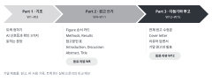

::: {.callout-note collapse="true"}
## 이번 주 목표

이번 주가 끝나면 다음을 할 수 있다.

- Figure 순서에 따라 내 원고의 결론을 발표할 수 있다.
- 지난 주차의 점검표를 모은 최종 점검표로 원고를 스스로 점검할 수 있다.
- 한 학기의 AI 사용 기록을 정리해서 무엇을 맡기고 어떻게 확인했는지 설명할 수 있다.
- (트랙 B) 실제 논문과 내 원고를 비교해 차이와 그 까닭을 쓸 수 있다.
:::

# 1. 원칙 {#principles}

{fig-alt="세 개의 화살표 모양 칸: Part 1 기초 W1–W3, Part 2 원고 쓰기 W4–W11, Part 3 다듬기와 투고 W12–W15. 각 칸 아래에 그 Part에서 만드는 것과 동료 리뷰 주차가 적혀 있다."}

## 발표는 원고의 Figure 순서를 따른다

- 규칙: 연구 질문 → Figure마다 결론 문장 하나 → 한계 → 다음 단계 순서로 말한다.
- 결론 문장은 [W4](w04_figure_storyboard.qmd)의 Figure 순서 카드에서 시작해 원고에서 다듬은 문장을 쓴다. 발표와 원고가 같은 이야기를 해야 한다.
- 슬라이드의 데이터 그림은 원고의 그림을 그대로 쓴다. 데이터 그림을 AI로 만들거나 고치지 않는다([AI 사용 규칙](../ai_rules.qmd#in-the-paper)).
- 발표 시간과 순서 같은 형식은 따로 공지한다.

<!-- 강사 참고. 해마다 정해서 공지할 것: 발표 시간, 질의응답 시간, 발표 순서, 슬라이드 수와 형식, 발표 자료 제출 여부 -->

## 제출물은 세 가지이고 비교 메모는 기말 원고 점수에 들어간다

| 제출물 | 누가 | 평가 비율 |
|---|---|---|
| 기말 원고 | 모두 | 30% |
| 한 학기 AI 사용 기록 | 모두 | 15% |
| 실제 논문과의 비교 메모 | 트랙 B | 기말 원고 30%에 포함 |

- 전체 평가 비율은 [강의 소개의 평가](../index.qmd#grading)를 본다.
- 기말 원고 30점은 아래 기준으로 나눠 본다. 트랙 B는 앞의 세 기준에서 2점씩 덜어 비교 메모에 둔다.

| 기준 | 보는 것 | 트랙 A | 트랙 B |
|---|---|---|---|
| 일관성 | 각 Figure의 결론이 Results, Discussion, Abstract, Title까지 같은 강도로 이어진다 | 9 | 7 |
| 정확성 | 수치와 참고문헌을 원문으로 확인할 수 있다 | 9 | 7 |
| 읽기 쉬움 | W3와 W12의 점검표를 통과한다 | 9 | 7 |
| 형식 | W13에서 고른 대상 저널의 투고 규정을 따른다 | 3 | 3 |
| 비교 메모 | 아래 원칙대로 차이를 찾고 그 까닭을 썼다 | | 6 |
| 합계 | | 30 | 30 |

## AI 사용 기록은 무엇을 맡기고 어떻게 확인했는지를 보여 준다

- 이 수업은 AI를 썼는지가 아니라 무엇을 맡기고 어떻게 확인했는지를 본다.
- 한 학기 기록을 [AI 사용 규칙의 양식](../ai_rules.qmd#ai-log)대로 한 파일에 모은다.
- 빠진 날을 기억으로 채운 행은 그렇다고 표시한다. 사후에 그럴듯하게 지어 쓰지 않는다.
- 기록 맨 앞에 반 쪽 요약을 붙인다: 주로 맡긴 일, 버린 제안 중 대표 사례 두세 개와 그 이유, 가장 자주 쓴 확인 방법.
- 원고에 넣은 AI 사용 공개 문구(W13)가 이 기록과 맞아야 한다.

## 트랙 B 비교 메모는 차이를 찾고 그 까닭을 쓴다

- 비교 기준은 W11에 낸 판이다. 원래 논문을 읽기 전의 마지막 판이기 때문이다. 그 뒤에 원래 논문을 보고 고친 곳은 따로 표시한다.
- 실제 논문을 정답으로 놓지 않는다. 차이가 있다고 내가 틀린 것은 아니다. 내 원고가 더 분명한 곳도 적는다.
- 비교할 것

| 원고 부분 | 내 원고에서 볼 것 | 실제 논문에서 볼 것 |
|---|---|---|
| Figure와 Results | 각 Figure의 결론 문장 | Results 소제목과 단락 첫 문장 |
| Introduction | 내가 세운 연구 공백(gap)과 질문 | 저자들이 세운 공백과 질문 |
| Discussion | 비교한 선행연구, 한계 | 저자들이 비교한 선행연구, 한계 |
| Abstract와 Title | 핵심 주장, 수치, 주장의 강도 | 같은 항목 |
| 심사 기록 | 리뷰어 지적 중 내 원고에도 해당하는 것 | 저자들이 그 지적에 어떻게 답했는가 |

- 돌아볼 것
  - 차이가 왜 생겼는가. 그림과 Methods만으로는 알 수 없던 정보 때문인지 내가 결과를 크게 또는 작게 해석했기 때문인지 나눠 쓴다.
  - AI가 차이에 영향을 준 곳이 있는가. AI 사용 기록의 해당 행을 가리킨다.
  - 다음에 내 데이터로 논문을 쓸 때 바꿀 것 한두 가지.

# 2. AI로 해 보기 {#try-with-ai}

원고 전체의 수치를 표로 뽑아 대조하고 발표 예상 질문을 받는다(25분).

1. 첫 번째 프롬프트로 수치 표를 받는다(5분).
2. 표시된 불일치를 모두 확인한다. 표시되지 않은 수치도 다섯 개를 골라 그림과 분석 결과에 대어 본다(10분).
3. 두 번째 프롬프트로 예상 질문을 받는다. 답은 내가 쓴다. 원고로 답할 수 없는 질문은 한계로 발표에 넣을지 정한다(7분).
4. AI 사용 기록에 적는다(3분).

```text
아래 원고에서 수치를 모두 뽑아 표로 만들어 줘. 원고는 고치지 마.

표의 열: 수치 | 단위나 통계 표시(n, mean ± SD, P 등) | 나온 절(Abstract, Results, Figure legend, Discussion) | 그 문장의 첫 단어 몇 개
같은 측정값이 절마다 다르게 적힌 곳이 있으면 표 아래에 따로 모아 줘.

[원고]
```

```text
아래는 내 논문의 Abstract다. 같은 분야 연구자가 이 연구 발표를 듣고 물을 만한 질문 다섯 개를 써 줘. 답은 쓰지 마. 질문마다 그 질문이 Abstract의 어느 문장에서 나왔는지 적어 줘.

[Abstract]
```

- 트랙 A: 본인 원고이므로 조건부 (트랙 A) 칸이다. 지도교수 동의, 학습에 쓰이지 않는 설정, 원 데이터와 그림 파일 넣지 않기를 지킨다.
- 트랙 B: 트랙 B 원고이므로 자유롭게 칸이다.
- 수치 표는 두 트랙 모두 꼭 검증 칸이다.

# 3. 검증하고 다듬기 {#verify-and-revise}

AI가 수치 표를 만들 때 자주 틀리는 지점이다. 수치는 원문 확인(그림과 분석 결과), 예상 질문은 지도교수나 동료와 교차 확인한다.

- 수치를 빠뜨린다. 특히 Figure legend와 표 안의 수치를 빠뜨리기 쉽다. Abstract의 수치는 직접 세어 표와 맞춘다.
- 단위와 통계 표시를 바꾼다. ± SD와 ± SEM, n(마리 수)과 n(세포 수)을 섞는다.
- 다른 측정값을 같은 것으로 묶어 없는 불일치를 만든다.
- 예상 질문이 원고에 없는 내용을 사실처럼 전제한다. 질문의 전제부터 원고와 대어 본다.

## 최종 점검표

지난 주차의 점검을 원고 순서대로 모았다. 각 주차 페이지의 자세한 목록과 함께 쓴다.

- [ ] Figure 순서 카드의 순서와 Results 단락 순서가 같다. 각 단락 첫 문장이 그 Figure의 결론 문장이다. ([W4](w04_figure_storyboard.qmd), [W6](w06_results.qmd))
- [ ] Figure legend마다 n, 통계 검정, 오차 막대의 뜻이 있다. Methods만 보고 실험이나 분석을 다시 할 수 있다. ([W5](w05_methods_legends.qmd))
- [ ] Results에는 결과를 쓰고, 해석은 Discussion에 쓴다. ([W6](w06_results.qmd))
- [ ] 모든 참고문헌을 DOI나 PubMed로 확인했고 인용한 문장이 그 논문 내용과 맞는다. 검증 기록이 있다. ([W7](w07_literature.qmd))
- [ ] Introduction의 마지막 단락이 이 연구의 질문과 접근을 말한다. ([W9](w09_introduction.qmd))
- [ ] Discussion이 주요 결과로 시작하고, 선행연구와 비교하고, 한계를 쓰고, Introduction의 질문에 답한다. ([W10](w10_discussion.qmd))
- [ ] Abstract와 Title의 수치와 주장 강도가 Results와 같고 단어 수가 저널 규정 안에 있다. ([W11](w11_abstract_title.qmd))
- [ ] 동료 리뷰 의견마다 반영 여부와 위치, 또는 반영하지 않은 이유가 있다. ([W8](w08_midterm_review.qmd), [W12](w12_polishing.qmd))
- [ ] W3의 패턴 10가지와 번역투를 점검했고 원고 전체가 용어표대로 통일되어 있다. ([W3](w03_readable_sentences.qmd), [W12](w12_polishing.qmd))
- [ ] 대상 저널의 투고 체크리스트를 채웠고 Data availability와 AI 사용 공개 문구가 있다. ([W13](w13_submission.qmd))
- [ ] AI 사용 기록이 원고에서 AI를 쓴 곳을 모두 담고 있다. AI로 만들거나 고친 데이터 그림이 없다. ([W2](w02_ai_basics.qmd), [AI 사용 규칙](../ai_rules.qmd))

# 과제 {#assignment}

원고, AI 사용 기록, (B) 비교 메모

- 분량과 형식
  - 기말 원고: 그림 3~4개 분량의 짧은 원고. Title page, Abstract, Introduction, Results, Discussion, Methods, Figure legend, 참고문헌, AI 사용 공개 문구를 갖춘다. W13 대상 저널의 형식을 따르고 줄 번호를 넣는다. Word 파일과 PDF.
  - AI 사용 기록: 한 학기 전체를 한 파일에 모으고 맨 앞에 반 쪽 요약을 붙인다.
  - 비교 메모(트랙 B): 위 원칙의 비교 표와 돌아볼 것. 2쪽 이내.
- 트랙별 차이: 트랙 A는 원고와 AI 사용 기록을 낸다. 트랙 B는 여기에 비교 메모를 더한다. 트랙 B는 W11 이후 원래 논문을 보고 고친 곳을 원고에 표시한다.
- 평가 기준: 위 원칙의 기말 원고 배점표와 [평가 비율](../index.qmd#grading)을 따른다. AI 사용 기록은 행마다 확인 방법이 구체적인지를 본다.
- 제출: 학교 LMS. 마감은 따로 공지한다.
- 최종 점검표는 내지 않는다. 내기 전에 스스로 확인하는 데 쓴다.

# 메모 {#notes}

원고 발표와 제출
