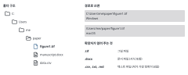
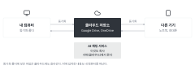
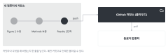
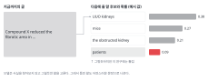
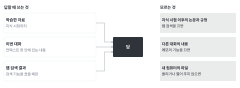
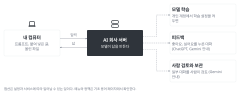
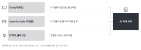
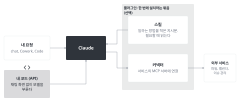

이 수업에서 쓰는 컴퓨터와 AI 용어를 모았다. AI 도구의 이름, 메뉴, 정책은 자주 바뀐다. 도구에 관한 내용은 2026-11-11에 공식 페이지에서 확인했고, 출처는 맨 아래에 있다.

# 컴퓨터 기초 {#computer}

{fig-alt="왼쪽에 C:, Users, me, paper 폴더와 그 안의 파일 세 개가 있다. 오른쪽에 같은 파일의 Windows와 macOS 경로, 확장자별 파일 종류가 있다."}

파일과 폴더
: 파일은 글, 그림, 데이터 하나하나를 담은 단위다. 폴더는 파일을 묶어 두는 곳이다.

경로 (path)
: 파일이 있는 위치를 폴더 이름으로 이어 적은 것이다. 예: `C:\Users\me\paper\figure1.tif` (Windows), `/Users/me/paper/figure1.tif` (macOS).

확장자
: 파일 이름 끝의 `.docx`, `.pdf`, `.tif`, `.csv` 같은 부분이다. 파일의 종류를 알려 준다.

텍스트 파일과 문서 파일
: `.txt`, `.md`, `.csv`는 글자만 담은 파일이라 어떤 편집기로도 열린다. `.docx`, `.pptx`는 서식까지 담은 파일이라 전용 프로그램이 필요하다. AI 도구는 텍스트 파일을 가장 정확하게 읽는다.

마크다운 (Markdown)
: `#`은 제목, `-`는 목록처럼 기호로 서식을 적는 텍스트 형식이다. AI 채팅의 답도 대개 마크다운으로 나온다. 이 교재 사이트도 마크다운 기반의 Quarto로 만든다.

터미널 (명령줄)
: 마우스 대신 글자로 명령을 입력해서 컴퓨터를 다루는 창이다. Windows에서는 PowerShell, macOS에서는 Terminal이다. Claude Code 같은 작업형 AI 도구는 터미널에서도 돌아간다.

로컬과 서버
: 로컬은 내 컴퓨터다. 서버는 네트워크로 연결해서 쓰는 다른 컴퓨터다. 연구실의 분석 서버, 학교 LMS, AI 회사의 컴퓨터가 모두 서버다.

# 클라우드와 계정 {#cloud}

{fig-alt="내 컴퓨터, 클라우드 저장소, 다른 기기가 양방향 동기화 화살표로 이어져 있다. 클라우드 아래에 AI 채팅 서비스가 있다."}

클라우드
: 인터넷 너머 회사의 서버에 저장하고 계산하는 방식이다. Google Drive, OneDrive가 클라우드이고, AI 채팅 서비스도 클라우드에서 돌아간다. AI에 입력한 내용은 내 컴퓨터를 떠나 그 회사의 서버로 간다.

동기화
: 내 컴퓨터의 폴더와 클라우드의 폴더를 같은 상태로 맞추는 것이다. 동기화 폴더에 넣은 파일은 클라우드에도 올라간다.

개인 계정과 기관 계정
: 같은 AI 서비스라도 개인 요금제와 기관(학교, 회사) 계약은 데이터 정책이 다르다. 예를 들어 OpenAI는 ChatGPT Business, Enterprise, Edu의 내용을 기본적으로 학습에 쓰지 않는다고 안내한다. 내가 쓰는 계정이 어느 쪽인지 확인한다.

# 버전 관리: git {#git}

{fig-alt="내 컴퓨터의 저장소에 커밋 세 개가 이어져 있다. 마지막 커밋에서 push로 GitHub 저장소에 가고, pull로 동료의 컴퓨터에 간다."}

git
: 파일이 바뀐 기록을 남기는 프로그램이다. 언제 무엇을 왜 바꿨는지 보고, 필요하면 예전 상태로 돌아갈 수 있다.

저장소 (repository)
: git이 기록을 관리하는 폴더다. 줄여서 리포(repo)라고 부른다.

커밋 (commit)
: 바뀐 내용을 설명 한 줄과 함께 기록으로 남기는 일이다.

push와 pull
: push는 내 컴퓨터의 커밋을 서버의 저장소로 올리는 일이다. pull은 서버의 새 커밋을 내 컴퓨터로 받는 일이다.

GitHub
: git 저장소를 클라우드에 두고 여러 사람이 함께 쓰는 서비스다. 이 교재 사이트도 [GitHub 저장소](https://github.com/kkonoo/AI_Sci_Writing_KNUmed)에 있다. 분석 코드와 원고 파일을 이렇게 관리하면 AI 도구가 무엇을 바꿨는지도 기록으로 확인할 수 있다.

# AI 모델과 서비스 {#ai}

{fig-alt="지금까지의 글 'Compound X reduced the fibrotic area in' 뒤에 올 후보 네 개와 확률 막대가 있다. UUO kidneys, mice, the obstructed kidney, patients 순이고, patients는 그럴듯하지만 이 연구에는 틀린 말로 표시되어 있다."}

{fig-alt="왼쪽의 학습한 자료, 이번 대화, 웹 검색 결과가 가운데 답으로 이어진다. 오른쪽에는 모르는 것 세 가지가 있다."}

생성형 AI, 대규모 언어 모델 (LLM)
: 많은 글을 학습해서, 앞에 온 글 다음에 올 말을 이어 쓰는 모델이다. 답을 할 때 사실을 찾아보는 것이 아니라 그럴듯한 다음 말을 고른다. 그래서 틀린 내용도 자연스러운 문장으로 쓴다.

모델과 앱
: 모델은 글을 만드는 엔진이다. 예: Claude, GPT, Gemini. 앱은 그 모델을 쓰는 화면이다. 예: claude.ai, ChatGPT, Gemini 앱. 같은 앱 안에서 모델을 골라 쓸 수 있다.

프롬프트
: AI에 주는 입력이다. 질문, 지시, 함께 붙인 자료가 모두 프롬프트에 들어간다.

토큰
: 모델이 글을 잘게 나누어 처리하는 단위다. 한 번에 넣을 수 있는 양과 사용량이 토큰으로 정해진다.

컨텍스트 창
: 모델이 한 번에 볼 수 있는 대화와 자료의 양이다. 대화가 너무 길어지면 앞 내용을 놓친다. 새 대화를 열면 이전 대화를 모른다. 메모리 기능을 켜면 예외가 생긴다.

지식 시점 (knowledge cutoff)
: 모델이 학습한 자료의 마지막 시점이다. 그 뒤에 나온 논문과 바뀐 규정은 모른다.

환각 (hallucination)
: 사실이 아닌 내용을 사실처럼 쓰는 것이다. 없는 참고문헌이 대표적인 예다([W7](chapters/w07_literature.qmd)).

웹 검색
: 답하기 전에 인터넷을 검색해서 그 결과를 읽고 답하는 기능이다. 최신 정보를 얻을 수 있지만, 검색 결과를 잘못 요약하기도 한다. 출처는 직접 열어서 확인한다.

메모리
: 대화가 끝나도 사용자에 대한 정보를 기억해 두는 기능이다. 켜 두면 예전 대화의 내용이 새 대화에 섞일 수 있다.

## 학습 제외 설정 {#training-settings}

{fig-alt="왼쪽 내 컴퓨터에서 가운데 AI 회사 서버로 입력이 가고 답이 돌아온다. 서버에서 오른쪽의 모델 학습, 피드백, 사람 검토와 보관으로 점선이 이어진다."}

개인 계정에서는 입력한 대화가 모델 학습에 쓰일 수 있다. 트랙 A가 본인 원고 문장을 넣으려면 이 설정을 먼저 꺼야 한다([AI 사용 규칙](ai_rules.qmd#traffic-light)).

| 서비스 | 설정 이름 | 위치 |
|---|---|---|
| Claude (Free, Pro, Max) | Help improve our AI models | Settings → Privacy |
| ChatGPT (Free, Plus, Pro) | Improve the model for everyone | Settings → Data controls |
| Gemini 앱 | Keep Activity | Settings & help → Activity |

- 설정을 끄면 그 뒤의 새 대화부터 학습에 쓰이지 않는다. 이미 학습에 들어간 데이터는 빠지지 않는다(Claude 안내).
- 좋아요, 싫어요 같은 피드백을 보내면 그 대화가 학습에 쓰일 수 있다고 ChatGPT와 Gemini가 안내한다. 원고를 넣은 대화에서는 피드백 버튼을 누르지 않는다.
- Gemini는 Keep Activity를 꺼도 대화를 최대 72시간 보관하고, 일부 대화는 사람이 검토한다고 안내한다. 보이면 안 되는 내용은 처음부터 넣지 않는다.
- 메뉴 이름과 위치는 자주 바뀐다. 수업 첫 실습([W2](chapters/w02_ai_basics.qmd))에서 자기 계정의 화면으로 다시 확인한다.

# AI를 쓰는 세 가지 방식: Chat, Cowork, Code {#modes}

{fig-alt="Chat은 붙여 넣은 글과 올린 파일, Cowork와 Code는 열어 준 폴더의 파일 전부, 커넥터와 플러그인은 연결한 서비스 안의 파일이 AI 회사 서버로 간다."}

Chat (대화형)
: 질문하고 답을 받는 창이다. claude.ai, ChatGPT, Gemini가 여기에 해당한다. 받은 답을 원고로 옮기고 고치는 일은 내가 한다. AI에 들어가는 것은 내가 붙여 넣은 내용뿐이다.

Cowork (작업형, 데스크톱)
: Claude 데스크톱 앱의 작업 모드다. 내 컴퓨터의 파일을 읽고 쓰고, 연결한 업무 앱을 쓰고, 여러 단계의 일을 대신 처리한다.

Code (작업형, 코드와 파일)
: Claude Code처럼 코드와 파일을 직접 읽고 고치고 명령을 실행하는 도구다. 터미널이나 데스크톱 앱에서 쓴다. OpenAI의 Codex도 비슷한 도구다.

작업형 도구는 내가 열어 준 폴더 안의 파일을 AI가 직접 읽는다. 그래서 어느 폴더를 열어 주는지가 곧 무엇을 AI에 넣는지다. 환자 정보, 원 데이터, 동료의 원고가 든 폴더는 열어 주지 않는다.

# 확장 기능: API, MCP, 커넥터, 스킬, 플러그인 {#extensions}

{fig-alt="내 요청이 Claude로 간다. 스킬은 Claude가 읽는 지시문이고, 커넥터는 MCP 서버를 거쳐 외부 서비스에 연결된다. 플러그인은 스킬과 커넥터를 묶는다. 내 코드는 API로 Claude를 직접 부른다."}

API
: 프로그램끼리 정해진 형식으로 요청하고 답을 받는 통로다. 채팅 화면 없이 코드에서 AI 모델을 부를 때 쓴다. 쓴 만큼 요금을 내고, 데이터 정책도 채팅 앱과 따로 정해져 있다.

MCP (Model Context Protocol)
: AI 앱을 외부 시스템에 연결하는 공개 표준이다. 외부 시스템에는 파일, 데이터베이스, 검색 도구 같은 것이 있다. 공식 문서는 MCP를 "AI 앱의 USB-C 포트"에 비유한다. Claude, ChatGPT, VS Code 같은 여러 도구가 MCP를 지원한다.

커넥터 (connector)
: Claude에서 MCP로 외부 서비스에 연결한 것이다. 외부 서비스에는 파일 저장소, 캘린더, 이슈 관리 도구 같은 것이 있다. 연결하면 Claude가 그 서비스의 내용을 읽고 그 안에서 작업할 수 있다.

스킬 (skill)
: 어떤 일을 하는 방법을 적은 지시문이다. 필요하면 스크립트와 참고 파일도 함께 담는다. 맡긴 일이 그 스킬에 맞으면 Claude가 스킬을 불러 읽는다. 예: 연구실의 글쓰기 규칙, 보고서 양식, 점검표.

플러그인 (plugin)
: 스킬, 커넥터, 이름으로 부르는 명령, 에이전트를 한 번에 설치하고 공유하는 묶음이다.

에이전트 (agent)
: 여러 단계의 일을 스스로 계획하고 도구를 써서 처리하는 AI다. 작업형 도구는 큰 일을 나누어 다른 에이전트에게 맡기기도 한다.

이 수업과 관계있는 점은 두 가지다.

- 커넥터로 Google Drive 같은 저장소를 연결하면 그 안의 파일도 AI에 들어갈 수 있다. 연결하기 전에 [AI 신호등](ai_rules.qmd#traffic-light)으로 그 안의 내용을 따져 본다.
- 스킬은 자기 글쓰기 규칙을 매번 다시 설명하지 않고 쓰게 해 준다. 예를 들어 [W3](chapters/w03_readable_sentences.qmd)의 패턴 점검표를 스킬로 만들어 두면 원고를 고칠 때마다 같은 기준으로 점검할 수 있다.

# 출처 {#sources}

2026-11-11에 확인했다.

- Claude의 커넥터, 스킬, 플러그인: [Connectors, skills, and plugins](https://claude.com/docs/extend/overview)
- Claude Cowork: [Claude Cowork란](https://claude.com/ko/resources/guides/claude-cowork-product-guide/what-is-claude-cowork)
- MCP: [What is the Model Context Protocol?](https://modelcontextprotocol.io/docs/getting-started/intro)
- Claude 학습 설정: [How do I change my model improvement privacy settings?](https://privacy.claude.com/en/articles/12109829-how-do-i-change-my-model-improvement-privacy-settings)
- ChatGPT 학습 설정: [Data Controls FAQ](https://help.openai.com/en/articles/7730893-data-controls-faq)
- Gemini 활동 설정: [Gemini Apps activity](https://support.google.com/gemini/answer/13278892), [Gemini Apps Privacy Hub](https://support.google.com/gemini/answer/13594961)
