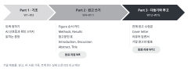

## 강의 개요 {#overview}

대학원생이 자기 연구를 영어 논문으로 쓰는 과정을 익히는 수업이다. AI를 쓰되, AI가 낸 결과는 학생이 직접 확인하고 책임진다. 강의는 한국어로 하고, 원고 실습은 영어로 한다.

대상은 석사 1~2년차부터 박사과정까지다. wet lab과 dry lab 학생 모두 들을 수 있다.

AI를 쓸 때는 [AI 사용 규칙](ai_rules.qmd)을 따른다.

## 강의 목표 {#goals}

1. 논문 각 부분이 하는 일을 알고, 그림 → Methods → Results → Introduction → Discussion → Abstract → Title 순서로 원고를 쓸 수 있다.
2. AI에 맡길 일과 맡기면 안 되는 일을 구분하고, AI가 낸 문장, 참고문헌, 수치를 원문으로 확인할 수 있다.
3. 읽기 어려운 영어 문장(명사 나열, 긴 수식어, 번역투, AI 글에 흔한 표현)을 찾아 고칠 수 있다.
4. Cover letter와 리뷰어 답변을 정해진 구조로 쓸 수 있다.

## 두 트랙 {#tracks}

주차별 수업은 같고, 매주 쓰는 대상만 다르다.

| 항목 | 트랙 A: 내 원고 | 트랙 B: 공개 논문 다시 쓰기 |
|---|---|---|
| 대상 | 자기 데이터와 그림이 있는 학생 | 데이터가 아직 없는 학생 |
| 쓰는 글 | 자기 결과로 쓰는 짧은 원고 (그림 3~4개 분량) | 오픈 액세스 논문 한 편을 골라 그림과 Methods만 보고 나머지를 다시 쓴다 |
| 조건 | 지도교수 동의 | Results, Introduction, Discussion, Abstract는 다 쓸 때까지 읽지 않는다 |
| 확인 방법 | 동료 리뷰, 지도교수 피드백 | 다 쓴 뒤 실제 논문과 비교한다 |
| 제출물 | 원고, AI 사용 기록 | 원고, AI 사용 기록, 실제 논문과의 비교 메모 |

트랙 B 논문은 high impact journal에 실린 것 중 심사 기록(Peer Review File)이 공개된 것으로 고르면 좋다. 그러면 14주차에 그 논문의 실제 리뷰로 답변서를 써 볼 수 있다. 논문은 담당교수 승인을 받는다.

## 주차별 계획 {#schedule}

{fig-alt="세 개의 화살표 모양 칸: Part 1 기초 W1–W3, Part 2 원고 쓰기 W4–W11, Part 3 다듬기와 투고 W12–W15. 각 칸 아래에 그 Part에서 만드는 것과 동료 리뷰 주차가 적혀 있다."}

### Part 1 · 기초

| 주 | 주제 | 과제 |
|---|---|---|
| 1 | [오리엔테이션](chapters/w01_orientation.qmd) | A: 그림 목록 / B: 논문 고르기 |
| 2 | [AI 기본기](chapters/w02_ai_basics.qmd) | AI 답변 하나 검증해 오기 |
| 3 | [읽히는 영어 문장](chapters/w03_readable_sentences.qmd) | AI가 쓴 문단에서 패턴 찾기 |

### Part 2 · 원고 쓰기

| 주 | 주제 | 과제 |
|---|---|---|
| 4 | [Figure 스토리보드](chapters/w04_figure_storyboard.qmd) | Figure 순서 카드 |
| 5 | [Methods와 Figure legend](chapters/w05_methods_legends.qmd) | Methods, legend 초안 |
| 6 | [Results](chapters/w06_results.qmd) | Results 초안 |
| 7 | [문헌 찾기와 인용](chapters/w07_literature.qmd) | 참고문헌 표와 검증 기록 |
| 8 | [중간 점검](chapters/w08_midterm_review.qmd) | 리뷰 반영본 |
| 9 | [Introduction](chapters/w09_introduction.qmd) | Introduction 초안 |
| 10 | [Discussion](chapters/w10_discussion.qmd) | Discussion 초안 |
| 11 | [Abstract와 Title](chapters/w11_abstract_title.qmd) | Abstract, Title 3안 |

### Part 3 · 다듬기와 투고

| 주 | 주제 | 과제 |
|---|---|---|
| 12 | [다듬기](chapters/w12_polishing.qmd) | 전체 원고 수정본 |
| 13 | [투고 준비](chapters/w13_submission.qmd) | Cover letter |
| 14 | [리뷰어 답변](chapters/w14_reviewer_response.qmd) | 답변서 1건 |
| 15 | [기말](chapters/w15_final.qmd) | 원고, AI 사용 기록, (B) 비교 메모 |

## 평가 {#grading}

| 항목 | 비율 |
|---|---|
| 주차 과제 | 30% |
| 기말 원고 | 30% |
| AI 사용 기록 | 15% |
| 동료 리뷰 (8주차, 12주차) | 15% |
| 출석·참여 | 10% |

AI를 썼는지가 아니라 무엇을 맡기고 어떻게 확인했는지를 본다.

과제와 원고는 학교 LMS로 제출한다.
